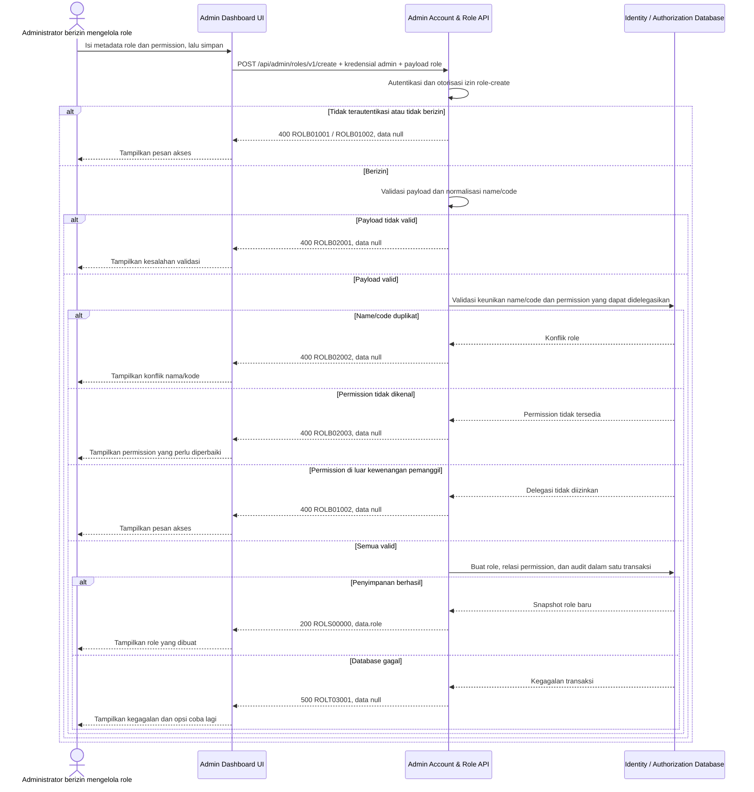

# Admin Dashboard - Create Role Interface Agreement

> **Document Type:** IFA / API Contract  
> **Status:** Draft  
> **Service / Domain:** Admin Dashboard — Account & Role Management  
> **Consumer / Partner:** JokiHub Admin Dashboard (authorized administrator)

## Design

API ini membuat definisi role baru beserta permission awal. Dashboard mengirim metadata role dan daftar permission; API memvalidasi akses admin, format, keunikan nama/kode, serta kewenangan delegasi permission sebelum menyimpan role, relasi permission, dan audit secara atomik. Model RBAC, permission catalog, dan assignment akun-role belum ditetapkan dalam ERD; kontrak dan policy terkait masih perlu dikonfirmasi sebelum implementasi.

## Sequence Diagram



## Performance / SLA Targets

| Success Rate                                     | VUser                                       | CPU / Memory                        | Response Time                                                                             |
| ------------------------------------------------ | ------------------------------------------- | ----------------------------------- | ----------------------------------------------------------------------------------------- |
| TBD; confirm criticality and availability target | TBD; confirm peak concurrent administrators | TBD; set from capacity estimate/NFT | TBD; proposed less-critical web baseline: ideal 200 ms, acceptable 1 s, max tolerable 2 s |

## General Information

| Component          | Value                                                                                                                                                                                 |
| ------------------ | ------------------------------------------------------------------------------------------------------------------------------------------------------------------------------------- |
| Description        | Membuat definisi role dan permission awal untuk Admin Dashboard.                                                                                                                      |
| Resource URL       | `https://{host}/api/admin/roles/v1/create`                                                                                                                                            |
| Transport Protocol | HTTPS, REST                                                                                                                                                                           |
| Request Verb       | POST                                                                                                                                                                                  |
| Content Type       | `application/json`                                                                                                                                                                    |
| Interaction Type   | Synchronous                                                                                                                                                                           |
| Security Policy    | Admin authentication dan izin role-create. Identity provider, permission name, dan permission delegation policy TBD. Terapkan least privilege, rate limiting, serta audit aktor/aksi. |

### Path / Endpoint

| Section        | Value                           |
| -------------- | ------------------------------- |
| Host / Domain  | `{host}` (environment-specific) |
| Service Name   | Admin Account & Role            |
| Version        | `v1`                            |
| Resource       | `/admin/roles/v1/create`        |
| Final Endpoint | `/api/admin/roles/v1/create`    |

### API Versioning

- **Decision:** New Endpoint
- **Previous Endpoint:** Tidak ada API create role yang teridentifikasi pada solutioning sprint ini.
- **Final Endpoint:** `POST /api/admin/roles/v1/create`
- **Backward Compatibility:** Belum ada consumer API create role yang teridentifikasi. Penambahan field response opsional bersifat kompatibel; perubahan kontrak yang mematahkan consumer memerlukan major version baru.
- **Reason:** Admin Dashboard memerlukan operasi untuk membuat definisi role baru.

## Business Rules

1. Hanya administrator terautentikasi dengan izin role-create yang dapat membuat role. Pemetaan role/permission dan identity provider TBD.
2. `id`, `createdAt`, dan `updatedAt` dibuat oleh server; klien tidak boleh menetapkan nilai tersebut.
3. `name` setelah trim dan perbandingan case-insensitive harus unik di antara role yang belum dihapus.
4. `code` dinormalisasi uppercase dan harus unik di antara role yang belum dihapus.
5. Role baru berstatus `ACTIVE` jika `status` tidak dikirim. Status awal lain hanya boleh dipakai jika policy mengizinkan; enum status final TBD.
6. `permissions` merupakan daftar permission ID awal. Semua ID harus terdaftar, unik, dan dapat didelegasikan oleh pemanggil. Daftar kosong diizinkan untuk role tanpa akses.
7. Klien tidak dapat membuat role system/built-in atau mengatur atribut protected. Registrasi dan policy role protected TBD.
8. Request identik yang dikirim ulang dapat membuat duplikat hanya jika business key tidak unik; keunikan `name`/`code` mencegah duplikasi semantik. Dukungan `Idempotency-Key` belum ditetapkan.
9. Pembuatan metadata, relasi permission, dan audit harus atomik. Jika satu langkah gagal, tidak ada role parsial yang tersimpan.
10. ID dibuat server menggunakan strategi yang disepakati dan tidak dapat diprediksi; format/strategi ID TBD.
11. `createdAt` dan `updatedAt` diisi server dalam UTC. Audit mencatat aktor, waktu, dan aksi; audit storage/retention TBD.
12. Perubahan katalog permission atau cache otorisasi mengikuti desain identity system. Cache invalidation tidak diperlukan untuk role baru kecuali role langsung dapat di-assign; mekanisme assignment TBD.

## Request Headers

| Header          | E/N/T | Type   | M/O/C | Max Length | Description                                                               | Example                 |
| --------------- | ----- | ------ | ----- | ---------: | ------------------------------------------------------------------------- | ----------------------- |
| `Authorization` | N     | String | M     |       4096 | Kredensial administrator; skema autentikasi bergantung identity provider. | `Bearer {access-token}` |
| `Content-Type`  | N     | String | M     |        100 | Tipe media request.                                                       | `application/json`      |
| `Accept`        | N     | String | O     |        100 | Tipe media response yang diinginkan; default JSON.                        | `application/json`      |
| `X-Request-Id`  | N     | String | O     |        100 | ID korelasi untuk audit/support.                                          | `req-6ef271`            |

## Request Parameters

None.

## Request Query Parameters

None.

## Request Body

| Attribute     | E/N/T | Type            | M/O/C | Max Length | Description                                                      | Example                         |
| ------------- | ----- | --------------- | ----- | ---------: | ---------------------------------------------------------------- | ------------------------------- |
| `name`        | N     | String          | M     |        100 | Nama tampilan role; trim sebelum disimpan.                       | `Senior Support Agent`          |
| `code`        | N     | String          | M     |         50 | Kode role unik uppercase; format usulan `^[A-Z][A-Z0-9_]*$`.     | `SENIOR_SUPPORT_AGENT`          |
| `description` | N     | String/null     | O     |        500 | Deskripsi role; `null` atau string kosong disimpan sebagai null. | `Menangani eskalasi pelanggan.` |
| `status`      | N     | String          | O     |         20 | Status awal; default `ACTIVE`. Enum final TBD.                   | `ACTIVE`                        |
| `permissions` | N     | Array of String | O     |  100 items | Permission IDs awal; default array kosong.                       | `[`admin.orders.read`]`         |

### Example Request Body

```json
{
  "name": "Senior Support Agent",
  "code": "SENIOR_SUPPORT_AGENT",
  "description": "Menangani eskalasi pelanggan.",
  "status": "ACTIVE",
  "permissions": ["admin.orders.read", "admin.complaints.read"]
}
```

### Request Validation

1. `Authorization` harus mengidentifikasi administrator terautentikasi dengan izin role-create. Kembalikan `ROLB01001` bila belum terautentikasi dan `ROLB01002` bila izin tidak tersedia.
2. Body harus JSON object. Field wajib `name` dan `code`; body tidak valid atau field wajib hilang mengembalikan `ROLB02001`.
3. `name` harus string non-empty setelah trim dan maksimal 100 karakter.
4. `code` harus string non-empty, maksimal 50 karakter, dinormalisasi uppercase, dan mengikuti `^[A-Z][A-Z0-9_]*$`.
5. `description`, bila dikirim, harus string atau `null` dan maksimal 500 karakter.
6. `status`, bila dikirim, harus salah satu nilai yang disepakati. Usulan saat ini `ACTIVE` atau `INACTIVE`; nilai lainnya mengembalikan `ROLB02001`.
7. `permissions`, bila dikirim, harus array maksimal 100 ID string unik. Array kosong valid. ID tidak dikenal mengembalikan `ROLB02003`; ID yang pemanggil tidak berwenang delegasikan mengembalikan `ROLB01002`.
8. Field tak dikenal atau immutable seperti `id`, `createdAt`, `updatedAt`, dan atribut protected ditolak dengan `ROLB02001`.
9. Nama/kode duplikat setelah normalisasi mengembalikan `ROLB02002`. Validasi unique constraint harus tetap ditegakkan saat commit untuk menangani request bersamaan.
10. Validasi seluruh payload dan permission sebelum commit. Error bisnis mengembalikan HTTP 400 dan `data: null`; kegagalan database mengembalikan HTTP 500 tanpa detail internal.
11. Retry setelah timeout dapat menerima konflik duplikat bila request pertama sebenarnya berhasil. Klien perlu membaca daftar role sebelum mencoba ulang; idempotency key dapat ditambahkan setelah kebijakan disepakati.

## Response Body

Semua response menggunakan `status` dan `data`. Sukses mengembalikan snapshot role baru; error mengembalikan `data: null`.

| Attribute               | E/N/T | Type               | M/O/C | Max Length | Description                                            | Example                         |
| ----------------------- | ----- | ------------------ | ----- | ---------: | ------------------------------------------------------ | ------------------------------- |
| `status`                | N     | Object             | M     |          — | Object status response.                                | `{}`                            |
| `status.code`           | N     | String             | M     |         20 | Service status code.                                   | `ROLS00000`                     |
| `status.message`        | N     | String             | O     |        200 | Pesan hasil untuk consumer.                            | `Role created`                  |
| `data`                  | N     | Object/null        | M     |          — | Payload hasil; `null` ketika error.                    | `{}`                            |
| `data.role`             | N     | Object             | C     |          — | Snapshot role yang baru dibuat.                        | `{}`                            |
| `data.role.id`          | N     | String             | C     |         64 | ID immutable yang dibuat server.                       | `role_01JXYZ`                   |
| `data.role.name`        | N     | String             | C     |        100 | Nama tampilan role tersimpan.                          | `Senior Support Agent`          |
| `data.role.code`        | N     | String             | C     |         50 | Kode role tersimpan.                                   | `SENIOR_SUPPORT_AGENT`          |
| `data.role.description` | N     | String/null        | O     |        500 | Deskripsi role tersimpan.                              | `Menangani eskalasi pelanggan.` |
| `data.role.status`      | N     | String             | C     |         20 | Status role tersimpan.                                 | `ACTIVE`                        |
| `data.role.permissions` | N     | Array of String    | C     |  100 items | Permission IDs tersimpan dan dapat dilihat pemanggil.  | `[`admin.orders.read`]`         |
| `data.role.createdAt`   | N     | String (date-time) | C     |         35 | Waktu pembuatan ISO 8601 UTC.                          | `2026-10-12T09:45:00Z`          |
| `data.role.updatedAt`   | N     | String (date-time) | C     |         35 | Waktu awal update ISO 8601 UTC; sama dengan createdAt. | `2026-10-12T09:45:00Z`          |

### Success Example

```json
{
  "status": {
    "code": "ROLS00000",
    "message": "Role created"
  },
  "data": {
    "role": {
      "id": "role_01JXYZ",
      "name": "Senior Support Agent",
      "code": "SENIOR_SUPPORT_AGENT",
      "description": "Menangani eskalasi pelanggan.",
      "status": "ACTIVE",
      "permissions": ["admin.orders.read", "admin.complaints.read"],
      "createdAt": "2026-10-12T09:45:00Z",
      "updatedAt": "2026-10-12T09:45:00Z"
    }
  }
}
```

### Business Error Example

```json
{
  "status": {
    "code": "ROLB02002",
    "message": "Role name or code already exists"
  },
  "data": null
}
```

### Technical Error Example

```json
{
  "status": {
    "code": "ROLT03001",
    "message": "Role service is temporarily unavailable"
  },
  "data": null
}
```

## HTTP Status Codes

| HTTP Status | Usage                                                                                                                                                                                                                        |
| ----------- | ---------------------------------------------------------------------------------------------------------------------------------------------------------------------------------------------------------------------------- |
| `200`       | Role berhasil dibuat dan snapshot role dikembalikan. Konfirmasi apakah standar API memilih `201 Created` untuk operasi create.                                                                                               |
| `400`       | Payload tidak valid, akses admin ditolak, konflik nama/kode, atau permission tidak dikenal/tidak dapat didelegasikan sesuai baseline response project. Konfirmasi apakah API standard mengharuskan `401`, `403`, atau `409`. |
| `500`       | Kegagalan service atau database identity/authorization yang tidak terduga.                                                                                                                                                   |

## Service Status Codes

Format: `[Service Prefix][Status Type][Category][Specific Error Code]`

| Code        | Type      | Category        | Meaning                                                                     |
| ----------- | --------- | --------------- | --------------------------------------------------------------------------- |
| `ROLS00000` | Success   | General         | Role berhasil dibuat.                                                       |
| `ROLB01001` | Business  | Authentication  | Administrator belum terautentikasi.                                         |
| `ROLB01002` | Business  | Authentication  | Administrator tidak memiliki izin create/delegasi permission.               |
| `ROLB02001` | Business  | User validation | Body/field wajib, format, panjang, atau state request tidak valid.          |
| `ROLB02002` | Business  | User validation | Nama atau kode role sudah digunakan role lain.                              |
| `ROLB02003` | Business  | User validation | Satu atau lebih permission tidak dikenal/tidak tersedia.                    |
| `ROLT03001` | Technical | Database        | Role, relasi permission, atau audit gagal disimpan/database tidak tersedia. |

## API Exposure Classification

| Classification                 | Rationale                                                                                                                                                                 |
| ------------------------------ | ------------------------------------------------------------------------------------------------------------------------------------------------------------------------- |
| Enterprise Intranet (proposed) | Endpoint administrasi yang dapat membuat hak akses. Pastikan boundary internal; jika internet-accessible, klasifikasikan sebagai Public dan terapkan proteksi API publik. |

## Testing & Documentation Scope

| Scope      | Required | Rationale / Handoff                                                                                                                                                                                                                                  |
| ---------- | -------- | ---------------------------------------------------------------------------------------------------------------------------------------------------------------------------------------------------------------------------------------------------- |
| NFT        | Yes      | API admin write baru. Uji create sukses, validasi, konflik unik termasuk request bersamaan, permission tidak dikenal/tidak dapat didelegasikan, atomicity, dan beban admin puncak. VUser, CPU/memory, dan target TPS TBD mengikuti forecast traffic. |
| VA/Pentest | Yes      | API membuat kontrol akses. Uji authentication/authorization, privilege escalation, permission delegation, mass assignment, injection, replay/idempotency, dan audit attribution.                                                                     |

## Assumptions

- Endpoint `/api/admin/roles/v1/create`, HTTP `POST`, field request/response, envelope, prefix `ROL`, serta kode status mengikuti pola solutioning admin; API owner perlu menyetujui.
- `name`, `code`, `status`, dan `permissions` adalah usulan field kontrak; model role dan RBAC belum terkonfirmasi dalam ERD.
- `permissions` berisi ID katalog permission dan default kosong; model katalog, ID format, visibility, serta delegation policy perlu disepakati.
- Role baru default `ACTIVE`; status final dan apakah role boleh dibuat tanpa permission harus dikonfirmasi oleh product/security owner.
- Identity provider, ID generation, audit storage/retention, idempotency policy, SLA, dan HTTP status mapping masih TBD.
- Cakupan hanya membuat definisi role; assignment akun, CRUD permission catalog, dan aktivasi workflow approval berada di luar API ini.

## References

- `./get-list-roles.md` — field role dan usulan daftar role.
- `./get-detail-role.md` — kontrak membaca detail role dan permission visibility.
- `./update-role.md` — format metadata, permission, dan error code role.
- `./delete-role.md` — protected-role dan assignment checks yang diusulkan.
- `docs/sprint_1/solutioning/TEMPLATE.md` — template kontrak API sprint.
- `src/features/AdminAccountsRoles/` — UI Admin Dashboard akun & role; tidak menyediakan backend contract.
