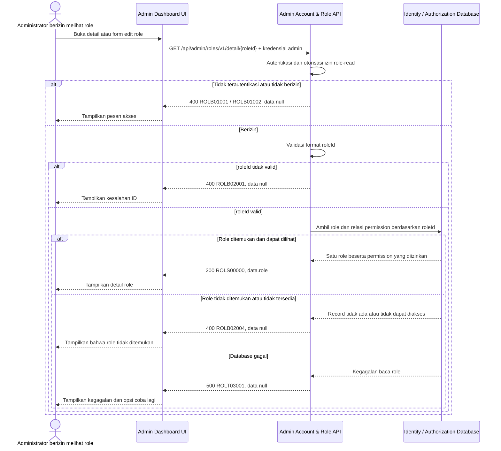

# Admin Dashboard - Get Detail Role Interface Agreement

> **Document Type:** IFA / API Contract  
> **Status:** Draft  
> **Service / Domain:** Admin Dashboard — Account & Role Management  
> **Consumer / Partner:** JokiHub Admin Dashboard (authorized administrator)

## Design

API ini mengambil satu role berdasarkan `roleId` untuk ditampilkan pada halaman detail atau form edit Admin Dashboard. Response mengikuti usulan field pada [Get List Roles](./get-list-roles.md), dengan metadata role dan permission yang boleh dilihat oleh administrator pemanggil. Model akun, role, permission, serta relasinya belum didefinisikan pada ERD atau solutioning sprint ini; field status dan aturan visibilitas harus diselaraskan dengan model RBAC yang disetujui.

## Sequence Diagram



## Performance / SLA Targets

| Success Rate                                     | VUser                                       | CPU / Memory                        | Response Time                                                                             |
| ------------------------------------------------ | ------------------------------------------- | ----------------------------------- | ----------------------------------------------------------------------------------------- |
| TBD; confirm criticality and availability target | TBD; confirm peak concurrent administrators | TBD; set from capacity estimate/NFT | TBD; proposed less-critical web baseline: ideal 200 ms, acceptable 1 s, max tolerable 2 s |

## General Information

| Component          | Value                                                                                                                                           |
| ------------------ | ----------------------------------------------------------------------------------------------------------------------------------------------- |
| Description        | Mengambil satu role beserta metadata dan permission yang dapat dilihat pemanggil.                                                               |
| Resource URL       | `https://{host}/api/admin/roles/v1/detail/{roleId}`                                                                                             |
| Transport Protocol | HTTPS, REST                                                                                                                                     |
| Request Verb       | GET                                                                                                                                             |
| Content Type       | Tidak ada request body                                                                                                                          |
| Interaction Type   | Synchronous                                                                                                                                     |
| Security Policy    | Admin authentication dan izin role-read. Identity provider serta nama permission TBD. Batasi visibility permission sesuai kewenangan pemanggil. |

### Path / Endpoint

| Section        | Value                                 |
| -------------- | ------------------------------------- |
| Host / Domain  | `{host}` (environment-specific)       |
| Service Name   | Admin Account & Role                  |
| Version        | `v1`                                  |
| Resource       | `/admin/roles/v1/detail/{roleId}`     |
| Final Endpoint | `/api/admin/roles/v1/detail/{roleId}` |

### API Versioning

- **Decision:** New Endpoint
- **Previous Endpoint:** Tidak ada API get detail role yang teridentifikasi pada solutioning sprint ini.
- **Final Endpoint:** `GET /api/admin/roles/v1/detail/{roleId}`
- **Backward Compatibility:** Belum ada consumer API detail role yang teridentifikasi. Penambahan field response opsional bersifat kompatibel; perubahan kontrak yang mematahkan consumer memerlukan major version baru.
- **Reason:** Admin Dashboard memerlukan pembacaan satu role untuk halaman detail dan pengisian form edit.

## Business Rules

1. Hanya administrator terautentikasi dengan izin role-read yang dapat mengakses endpoint. Pemetaan role/permission dan identity provider TBD.
2. `roleId` mengidentifikasi satu definisi role dan tidak dapat diubah.
3. Response memuat `id`, `name`, `code`, `description`, `status`, `permissions`, `createdAt`, dan `updatedAt` sesuai usulan kontrak daftar role.
4. Permission yang dikembalikan dibatasi pada permission yang berhak dilihat pemanggil. Permission sensitif tidak boleh bocor melalui response; aturan delegasi dan redaksi TBD.
5. Jika role tidak ditemukan, tidak aktif/tidak tersedia, atau tidak boleh diungkap kepada pemanggil, API mengembalikan `ROLB02004` tanpa membedakan keadaan yang dapat menyebabkan enumerasi data.
6. API hanya membaca data. Perubahan role dan permission dilakukan melalui endpoint update terpisah.
7. Role system/built-in dapat memiliki atribut atau aturan tambahan; apakah detailnya dapat diakses dan field apa yang ditampilkan TBD.
8. Cache detail, bila digunakan, harus diinvalidate ketika role atau permission berubah. Strategi cache belum ditentukan.

## Request Headers

| Header          | E/N/T | Type   | M/O/C | Max Length | Description                                                               | Example                 |
| --------------- | ----- | ------ | ----- | ---------: | ------------------------------------------------------------------------- | ----------------------- |
| `Authorization` | N     | String | M     |       4096 | Kredensial administrator; skema autentikasi bergantung identity provider. | `Bearer {access-token}` |
| `Accept`        | N     | String | O     |        100 | Tipe media response yang diinginkan; default JSON.                        | `application/json`      |
| `X-Request-Id`  | N     | String | O     |        100 | ID korelasi untuk audit/support.                                          | `req-3a71e9`            |

## Request Parameters

| Parameter | E/N/T | Type   | M/O/C | Max Length | Description                         | Example       |
| --------- | ----- | ------ | ----- | ---------: | ----------------------------------- | ------------- |
| `roleId`  | N     | String | M     |         64 | ID immutable role yang akan dibaca. | `role_01JXYZ` |

## Request Query Parameters

None.

## Request Body

Tidak ada request body.

### Request Validation

1. `Authorization` harus mengidentifikasi administrator terautentikasi dengan izin role-read. Kembalikan `ROLB01001` bila belum terautentikasi dan `ROLB01002` bila izin tidak tersedia.
2. `roleId` wajib tersedia, tidak kosong, dan maksimal 64 karakter. Format ID mengikuti strategi pembuatan ID yang TBD; nilai tidak valid mengembalikan `ROLB02001`.
3. Role harus ditemukan dan dapat diakses oleh administrator pemanggil. Jika tidak ditemukan atau tidak tersedia, kembalikan `ROLB02004`.
4. Permission pada response hanya boleh memuat permission yang diizinkan untuk dilihat pemanggil. Bila pemanggil tidak boleh melihat detail role, tolak request tanpa mengembalikan data parsial yang membocorkan permission.
5. Request body tidak digunakan. Kegagalan baca database mengembalikan HTTP 500 tanpa detail internal.

## Response Body

Semua response menggunakan `status` dan `data`. Sukses mengembalikan satu role; error mengembalikan `data: null`.

| Attribute               | E/N/T | Type               | M/O/C | Max Length | Description                                        | Example                           |
| ----------------------- | ----- | ------------------ | ----- | ---------: | -------------------------------------------------- | --------------------------------- |
| `status`                | N     | Object             | M     |          — | Object status response.                            | `{}`                              |
| `status.code`           | N     | String             | M     |         20 | Service status code.                               | `ROLS00000`                       |
| `status.message`        | N     | String             | O     |        200 | Pesan hasil untuk consumer.                        | `Role detail retrieved`           |
| `data`                  | N     | Object/null        | M     |          — | Payload hasil; `null` ketika error.                | `{}`                              |
| `data.role`             | N     | Object             | C     |          — | Snapshot role.                                     | `{}`                              |
| `data.role.id`          | N     | String             | C     |         64 | ID role immutable.                                 | `role_01JXYZ`                     |
| `data.role.name`        | N     | String             | C     |        100 | Nama tampilan role.                                | `Support Agent`                   |
| `data.role.code`        | N     | String             | C     |         50 | Kode role unik.                                    | `SUPPORT_AGENT`                   |
| `data.role.description` | N     | String/null        | O     |        500 | Deskripsi role.                                    | `Menangani pertanyaan pelanggan.` |
| `data.role.status`      | N     | String             | C     |         20 | Status role; nama status menunggu keputusan model. | `ACTIVE`                          |
| `data.role.permissions` | N     | Array of String    | C     |  100 items | ID permission yang dapat dilihat pemanggil.        | `["admin.orders.read"]`           |
| `data.role.createdAt`   | N     | String (date-time) | C     |         35 | Waktu pembuatan ISO 8601 UTC.                      | `2026-10-11T09:45:00Z`            |
| `data.role.updatedAt`   | N     | String (date-time) | C     |         35 | Waktu perubahan terakhir ISO 8601 UTC.             | `2026-10-11T10:00:00Z`            |

### Success Example

```json
{
  "status": {
    "code": "ROLS00000",
    "message": "Role detail retrieved"
  },
  "data": {
    "role": {
      "id": "role_01JXYZ",
      "name": "Support Agent",
      "code": "SUPPORT_AGENT",
      "description": "Menangani pertanyaan pelanggan.",
      "status": "ACTIVE",
      "permissions": ["admin.orders.read", "admin.complaints.read"],
      "createdAt": "2026-10-11T09:45:00Z",
      "updatedAt": "2026-10-11T10:00:00Z"
    }
  }
}
```

### Business Error Example

```json
{
  "status": {
    "code": "ROLB02004",
    "message": "Role not found"
  },
  "data": null
}
```

### Technical Error Example

```json
{
  "status": {
    "code": "ROLT03001",
    "message": "Role service is temporarily unavailable"
  },
  "data": null
}
```

## HTTP Status Codes

| HTTP Status | Usage                                                                                                                                                                                       |
| ----------- | ------------------------------------------------------------------------------------------------------------------------------------------------------------------------------------------- |
| `200`       | Detail role berhasil ditemukan dan dikembalikan.                                                                                                                                            |
| `400`       | `roleId` tidak valid, akses admin ditolak, atau role tidak ditemukan/tidak tersedia sesuai baseline response project. Konfirmasi apakah API standard mengharuskan `401`, `403`, atau `404`. |
| `500`       | Kegagalan service atau database identity/authorization yang tidak terduga.                                                                                                                  |

## Service Status Codes

Format: `[Service Prefix][Status Type][Category][Specific Error Code]`

| Code        | Type      | Category        | Meaning                                                                                      |
| ----------- | --------- | --------------- | -------------------------------------------------------------------------------------------- |
| `ROLS00000` | Success   | General         | Detail role berhasil dikembalikan.                                                           |
| `ROLB01001` | Business  | Authentication  | Administrator belum terautentikasi.                                                          |
| `ROLB01002` | Business  | Authentication  | Administrator tidak memiliki izin role-read atau tidak berwenang melihat permission terkait. |
| `ROLB02001` | Business  | User validation | `roleId` tidak tersedia atau format/panjangnya tidak valid.                                  |
| `ROLB02004` | Business  | User validation | Role tidak ditemukan atau tidak tersedia bagi pemanggil.                                     |
| `ROLT03001` | Technical | Database        | Role gagal dibaca atau database tidak tersedia.                                              |

## API Exposure Classification

| Classification                 | Rationale                                                                                                                                                                                                       |
| ------------------------------ | --------------------------------------------------------------------------------------------------------------------------------------------------------------------------------------------------------------- |
| Enterprise Intranet (proposed) | Endpoint administrasi untuk Admin Dashboard. Pastikan hanya dapat dijangkau melalui boundary internal yang disetujui; jika internet-accessible, klasifikasikan sebagai Public dan terapkan proteksi API publik. |

## Testing & Documentation Scope

| Scope      | Required | Rationale / Handoff                                                                                                                                                                                                   |
| ---------- | -------- | --------------------------------------------------------------------------------------------------------------------------------------------------------------------------------------------------------------------- |
| NFT        | Yes      | API admin baru. Uji role ditemukan, ID invalid/tidak ditemukan, visibility permission, role dengan daftar permission besar, dan kegagalan database. VUser, CPU/memory, dan target TPS TBD mengikuti forecast traffic. |
| VA/Pentest | Yes      | Endpoint mengekspos metadata otorisasi. Uji authentication/authorization, IDOR pada `roleId`, enumerasi role, kebocoran permission sensitif, dan parameter tampering.                                                 |

## Assumptions

- Endpoint `/api/admin/roles/v1/detail/{roleId}`, nama field, response envelope, prefix `ROL`, dan kode status mengikuti usulan [Get List Roles](./get-list-roles.md); perlu persetujuan API owner.
- Route action-based `/detail/{roleId}` dipilih agar konsisten dengan pola solutioning admin project. Konfirmasi jika API standard memilih resource REST `GET /api/admin/roles/v1/{roleId}`.
- Model role, field `status`, permission IDs, serta relasi akun-role belum disepakati atau dimodelkan pada ERD. Kontrak ini bersifat usulan sampai model RBAC disetujui.
- Permission visibility, role system/built-in, format ID, identity provider, permission name, strategi cache, SLA, audit policy, serta pemetaan HTTP untuk authentication/authorization/not-found masih TBD.
- Cakupan hanya membaca detail role; create, list, update, delete, dan assignment role ke akun berada di endpoint terpisah.

## References

- `./get-list-roles.md` — field role, status code, dan aturan visibilitas permission yang diusulkan.
- `docs/sprint_1/solutioning/TEMPLATE.md` — template kontrak API sprint.
- `src/features/AdminAccountsRoles/` — UI Admin Dashboard akun & role; tidak menyediakan backend contract.
