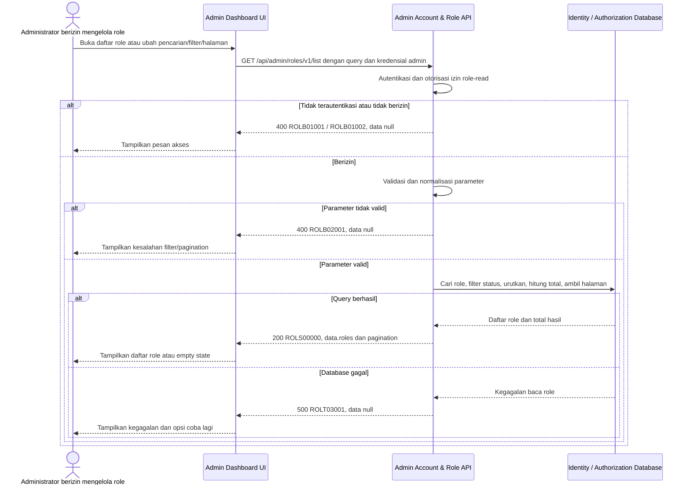

# Admin Dashboard - Get List Roles Interface Agreement

> **Document Type:** IFA / API Contract  
> **Status:** Draft  
> **Service / Domain:** Admin Dashboard — Account & Role Management  
> **Consumer / Partner:** JokiHub Admin Dashboard (authorized administrator)

## Design

API ini mengambil daftar role yang tersedia untuk dikelola melalui Admin Dashboard. Daftar mendukung pencarian, filter status, dan pagination sebagai usulan untuk kebutuhan tabel role. Model akun, role, permission, dan relasinya belum didefinisikan pada ERD atau solutioning sprint ini; field status dan permission dalam kontrak ini perlu diselaraskan dengan model tersebut sebelum implementasi.

## Sequence Diagram



## Performance / SLA Targets

| Success Rate                                     | VUser                                       | CPU / Memory                        | Response Time                                                                             |
| ------------------------------------------------ | ------------------------------------------- | ----------------------------------- | ----------------------------------------------------------------------------------------- |
| TBD; confirm criticality and availability target | TBD; confirm peak concurrent administrators | TBD; set from capacity estimate/NFT | TBD; proposed less-critical web baseline: ideal 200 ms, acceptable 1 s, max tolerable 2 s |

## General Information

| Component          | Value                                                                                                                                                                                  |
| ------------------ | -------------------------------------------------------------------------------------------------------------------------------------------------------------------------------------- |
| Description        | Mengambil daftar role untuk kebutuhan Admin Dashboard.                                                                                                                                 |
| Resource URL       | `https://{host}/api/admin/roles/v1/list`                                                                                                                                               |
| Transport Protocol | HTTPS, REST                                                                                                                                                                            |
| Request Verb       | GET                                                                                                                                                                                    |
| Content Type       | Tidak ada request body                                                                                                                                                                 |
| Interaction Type   | Synchronous                                                                                                                                                                            |
| Security Policy    | Admin authentication dan izin role-read. Identity provider, permission name, serta aturan visibility untuk role sensitif TBD. Terapkan rate limiting dan audit akses sesuai kebijakan. |

### Path / Endpoint

| Section        | Value                           |
| -------------- | ------------------------------- |
| Host / Domain  | `{host}` (environment-specific) |
| Service Name   | Admin Account & Role            |
| Version        | `v1`                            |
| Resource       | `/admin/roles/v1/list`          |
| Final Endpoint | `/api/admin/roles/v1/list`      |

### API Versioning

- **Decision:** New Endpoint
- **Previous Endpoint:** Tidak ada API get list role yang teridentifikasi pada solutioning sprint ini.
- **Final Endpoint:** `GET /api/admin/roles/v1/list`
- **Backward Compatibility:** Belum ada consumer API daftar role yang teridentifikasi. Penambahan field response opsional bersifat kompatibel; perubahan kontrak yang mematahkan consumer memerlukan major version baru.
- **Reason:** Admin Dashboard memerlukan daftar role yang dapat dicari dan ditinjau.

## Business Rules

1. Hanya administrator terautentikasi dengan izin role-read yang dapat mengakses endpoint. Pemetaan role/permission dan identity provider TBD.
2. API mengembalikan role yang masih tersedia untuk administrasi. Apakah role nonaktif atau role system/built-in harus ditampilkan dan bagaimana penandaannya perlu ditetapkan dalam model role.
3. Pencarian mencocokkan `name` atau `code` secara case-insensitive setelah trim. Pencarian permission tidak termasuk dalam kontrak ini.
4. Filter `status` hanya menerima nilai yang disepakati oleh model role. Nilai awal yang diusulkan `ACTIVE` dan `INACTIVE`; status tersebut belum dikonfirmasi oleh ERD.
5. Hasil diurutkan secara deterministik berdasarkan `name` ascending, lalu `id` ascending sebagai tie-breaker.
6. Pagination menggunakan `page` berbasis 1 dan `pageSize`. Default dan batas maksimum diusulkan pada validasi request dan perlu dikonfirmasi.
7. `totalItems` mencakup semua hasil yang memenuhi filter sebelum pagination; `totalPages` bernilai `0` bila tidak ada hasil.
8. Response memuat permission IDs untuk tiap role agar daftar bisa menampilkan jumlah permission atau dipakai sebagai pilihan; deskripsi permission tidak dikembalikan. Bila daftar role besar, evaluasi endpoint detail/summary terpisah.
9. Permission sensitif hanya ditampilkan kepada administrator yang memiliki izin melihatnya. Mekanisme permission-level redaction/delegation TBD; API tidak boleh membocorkan hak akses yang tidak boleh dilihat pemanggil.
10. Endpoint hanya membaca data dan tidak mengubah role atau assignment akun.

## Request Headers

| Header          | E/N/T | Type   | M/O/C | Max Length | Description                                                               | Example                 |
| --------------- | ----- | ------ | ----- | ---------: | ------------------------------------------------------------------------- | ----------------------- |
| `Authorization` | N     | String | M     |       4096 | Kredensial administrator; skema autentikasi bergantung identity provider. | `Bearer {access-token}` |
| `Accept`        | N     | String | O     |        100 | Tipe media response yang diinginkan; default JSON.                        | `application/json`      |
| `X-Request-Id`  | N     | String | O     |        100 | ID korelasi untuk audit/support.                                          | `req-890bc2`            |

## Request Parameters

None.

## Request Query Parameters

| Parameter  | E/N/T | Type    | M/O/C | Max Length | Description                                                                   | Example   |
| ---------- | ----- | ------- | ----- | ---------: | ----------------------------------------------------------------------------- | --------- |
| `search`   | N     | String  | O     |        100 | Cari pada `name` dan `code`; trim sebelum pencarian.                          | `support` |
| `status`   | N     | String  | O     |         20 | Filter status role. Nilai usulan: `ACTIVE` atau `INACTIVE`; status model TBD. | `ACTIVE`  |
| `page`     | N     | Integer | O     |  10 digits | Nomor halaman berbasis 1; default `1`.                                        | `1`       |
| `pageSize` | N     | Integer | O     |  10 digits | Jumlah item per halaman; default `20`, maksimum usulan `100`.                 | `20`      |

## Request Body

Tidak ada request body.

### Request Validation

1. `Authorization` harus mengidentifikasi administrator terautentikasi dengan izin role-read. Kembalikan `ROLB01001` bila belum terautentikasi dan `ROLB01002` bila izin tidak tersedia.
2. `search`, bila dikirim, harus berupa string maksimal 100 karakter setelah trim.
3. `status`, bila dikirim, harus cocok dengan nilai status yang disetujui. Usulan saat ini `ACTIVE` atau `INACTIVE`; nilai lain mengembalikan `ROLB02001`.
4. `page` harus integer lebih besar atau sama dengan 1. Default `1`.
5. `pageSize` harus integer antara 1 dan 100. Default `20`.
6. Parameter query yang tidak dikenal ditolak dengan `ROLB02001` agar kesalahan consumer tidak diabaikan diam-diam.
7. Hasil kosong adalah respons sukses dengan `roles: []`, `totalItems: 0`, dan `totalPages: 0`.
8. Kegagalan baca database mengembalikan HTTP 500 tanpa detail internal.

## Response Body

Semua response menggunakan `status` dan `data`. Sukses mengembalikan halaman role; error mengembalikan `data: null`.

| Attribute                    | E/N/T | Type               | M/O/C |       Max Length | Description                                                        | Example                           |
| ---------------------------- | ----- | ------------------ | ----- | ---------------: | ------------------------------------------------------------------ | --------------------------------- |
| `status`                     | N     | Object             | M     |                — | Object status response.                                            | `{}`                              |
| `status.code`                | N     | String             | M     |               20 | Service status code.                                               | `ROLS00000`                       |
| `status.message`             | N     | String             | O     |              200 | Pesan hasil untuk consumer.                                        | `Role list retrieved`             |
| `data`                       | N     | Object/null        | M     |                — | Payload hasil; `null` ketika error.                                | `{}`                              |
| `data.roles`                 | N     | Array of Object    | M     | `pageSize` items | Role pada halaman yang diminta; array kosong bila tidak ada hasil. | `[]`                              |
| `data.roles[].id`            | N     | String             | M     |               64 | ID role immutable.                                                 | `role_01JXYZ`                     |
| `data.roles[].name`          | N     | String             | M     |              100 | Nama tampilan role.                                                | `Support Agent`                   |
| `data.roles[].code`          | N     | String             | M     |               50 | Kode role unik.                                                    | `SUPPORT_AGENT`                   |
| `data.roles[].description`   | N     | String/null        | O     |              500 | Deskripsi role.                                                    | `Menangani pertanyaan pelanggan.` |
| `data.roles[].status`        | N     | String             | C     |               20 | Status role; nama status menunggu keputusan model.                 | `ACTIVE`                          |
| `data.roles[].permissions`   | N     | Array of String    | M     |        100 items | ID permission yang dapat dilihat pemanggil.                        | `["admin.orders.read"]`           |
| `data.roles[].createdAt`     | N     | String (date-time) | M     |               35 | Waktu pembuatan ISO 8601 UTC.                                      | `2026-10-11T09:45:00Z`            |
| `data.roles[].updatedAt`     | N     | String (date-time) | M     |               35 | Waktu perubahan terakhir ISO 8601 UTC.                             | `2026-10-11T09:45:00Z`            |
| `data.pagination`            | N     | Object             | M     |                — | Metadata pagination.                                               | `{}`                              |
| `data.pagination.page`       | N     | Integer            | M     |        10 digits | Halaman yang dikembalikan.                                         | `1`                               |
| `data.pagination.pageSize`   | N     | Integer            | M     |        10 digits | Ukuran halaman efektif.                                            | `20`                              |
| `data.pagination.totalItems` | N     | Integer            | M     |        10 digits | Jumlah seluruh hasil setelah filter.                               | `1`                               |
| `data.pagination.totalPages` | N     | Integer            | M     |        10 digits | Jumlah halaman; `0` bila tidak ada hasil.                          | `1`                               |

### Success Example

```json
{
  "status": {
    "code": "ROLS00000",
    "message": "Role list retrieved"
  },
  "data": {
    "roles": [
      {
        "id": "role_01JXYZ",
        "name": "Support Agent",
        "code": "SUPPORT_AGENT",
        "description": "Menangani pertanyaan pelanggan.",
        "status": "ACTIVE",
        "permissions": ["admin.orders.read", "admin.complaints.read"],
        "createdAt": "2026-10-11T09:45:00Z",
        "updatedAt": "2026-10-11T09:45:00Z"
      }
    ],
    "pagination": {
      "page": 1,
      "pageSize": 20,
      "totalItems": 1,
      "totalPages": 1
    }
  }
}
```

### Business Error Example

```json
{
  "status": {
    "code": "ROLB02001",
    "message": "Invalid role-list query parameters"
  },
  "data": null
}
```

### Technical Error Example

```json
{
  "status": {
    "code": "ROLT03001",
    "message": "Role service is temporarily unavailable"
  },
  "data": null
}
```

## HTTP Status Codes

| HTTP Status | Usage                                                                                                                                         |
| ----------- | --------------------------------------------------------------------------------------------------------------------------------------------- |
| `200`       | Daftar berhasil diambil, termasuk ketika hasil kosong.                                                                                        |
| `400`       | Query tidak valid atau akses administrator ditolak sesuai baseline response project. Konfirmasi apakah API standard mengharuskan `401`/`403`. |
| `500`       | Kegagalan service atau database identity/authorization yang tidak terduga.                                                                    |

## Service Status Codes

Format: `[Service Prefix][Status Type][Category][Specific Error Code]`

| Code        | Type      | Category        | Meaning                                                   |
| ----------- | --------- | --------------- | --------------------------------------------------------- |
| `ROLS00000` | Success   | General         | Daftar role berhasil dikembalikan.                        |
| `ROLB01001` | Business  | Authentication  | Administrator belum terautentikasi.                       |
| `ROLB01002` | Business  | Authentication  | Administrator tidak memiliki izin role-read.              |
| `ROLB02001` | Business  | User validation | Parameter pencarian, status, atau pagination tidak valid. |
| `ROLT03001` | Technical | Database        | Daftar role gagal dibaca atau database tidak tersedia.    |

## API Exposure Classification

| Classification                 | Rationale                                                                                                                                                                                                       |
| ------------------------------ | --------------------------------------------------------------------------------------------------------------------------------------------------------------------------------------------------------------- |
| Enterprise Intranet (proposed) | Endpoint administrasi untuk Admin Dashboard. Pastikan hanya dapat dijangkau melalui boundary internal yang disetujui; jika internet-accessible, klasifikasikan sebagai Public dan terapkan proteksi API publik. |

## Testing & Documentation Scope

| Scope      | Required | Rationale / Handoff                                                                                                                                                                                 |
| ---------- | -------- | --------------------------------------------------------------------------------------------------------------------------------------------------------------------------------------------------- |
| NFT        | Yes      | API admin baru. Uji pencarian, filter status, pagination, empty result, permission visibility, serta beban daftar puncak. VUser, CPU/memory, dan target TPS TBD mengikuti forecast traffic dan SLA. |
| VA/Pentest | Yes      | Data otorisasi admin. Uji authentication/authorization, permission disclosure, privilege boundaries, parameter tampering, dan akses lintas tenant/organisasi bila konsep tersebut berlaku.          |

## Assumptions

- Endpoint `/api/admin/roles/v1/list`, query parameters, response envelope, prefix `ROL`, dan kode status adalah usulan mengikuti pola API admin project; perlu persetujuan API owner.
- Field `status`, permission IDs, dan timestamps mengikuti usulan create-role contract, tetapi belum ada role ERD atau model yang dikonfirmasi. Hapus/ubah field agar cocok dengan model yang disetujui sebelum implementasi.
- Nilai status `ACTIVE`/`INACTIVE`, ukuran halaman default `20`, maksimum `100`, search behavior, sort order, serta penyertaan role system/built-in masih TBD.
- Permission filtering/redaction harus mengikuti prinsip least privilege. Definisi permission sensitif dan apakah semua permission IDs boleh dilihat administrator pemanggil belum diputuskan.
- Identity provider, nama permission role-read, schema identity/authorization, audit policy, SLA, dan HTTP status mapping masih TBD.
- Cakupan hanya daftar role; detail, create, update, delete, dan assignment role ke akun berada di API terpisah.

## References

- `docs/sprint_1/solutioning/TEMPLATE.md` — template kontrak API sprint.
- `docs/sprint_1/solutioning/dashboard/accounts-roles/create-role.md` — model request role yang diusulkan, belum tersedia pada workspace saat dokumen ini dibuat.
- `src/features/AdminAccountsRoles/` — UI Admin Dashboard akun & role; tidak menyediakan backend contract.
- `docs/sprint_1/solutioning/dashboard/games/get-list-games.md` — pola daftar admin, filter, pagination, dan response envelope.
