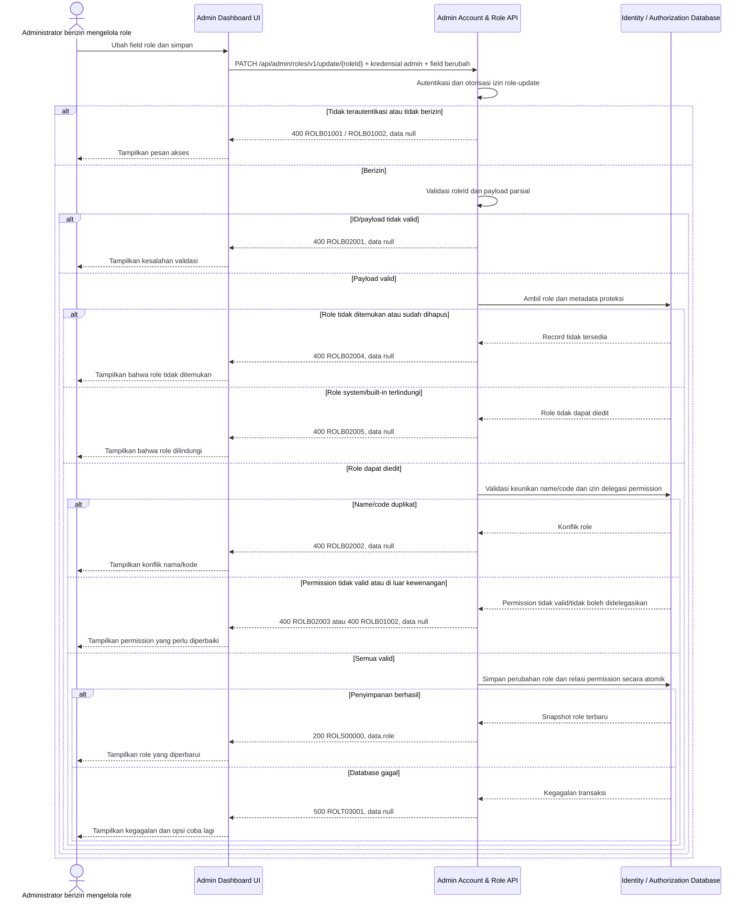

# Admin Dashboard - Update Role Interface Agreement

> **Document Type:** IFA / API Contract  
> **Status:** Draft  
> **Service / Domain:** Admin Dashboard — Account & Role Management  
> **Consumer / Partner:** JokiHub Admin Dashboard (authorized administrator)

## Design

API ini memperbarui metadata dan permission pada satu role berdasarkan `roleId`. Dashboard mengirim field yang berubah; API memvalidasi izin pemanggil, keberadaan dan status role, keunikan nama/kode, serta hak delegasi permission sebelum menyimpan perubahan. Model RBAC, assignment akun-role, dan policy permission belum didefinisikan dalam ERD; perlindungan role system dan dampak perubahan permission pada sesi/otorisasi aktif harus disepakati sebelum implementasi.

## Sequence Diagram



## Performance / SLA Targets

| Success Rate                                     | VUser                                       | CPU / Memory                        | Response Time                                                                             |
| ------------------------------------------------ | ------------------------------------------- | ----------------------------------- | ----------------------------------------------------------------------------------------- |
| TBD; confirm criticality and availability target | TBD; confirm peak concurrent administrators | TBD; set from capacity estimate/NFT | TBD; proposed less-critical web baseline: ideal 200 ms, acceptable 1 s, max tolerable 2 s |

## General Information

| Component          | Value                                                                                                                                                                                                        |
| ------------------ | ------------------------------------------------------------------------------------------------------------------------------------------------------------------------------------------------------------ |
| Description        | Memperbarui metadata dan/atau permission pada satu role Admin Dashboard.                                                                                                                                     |
| Resource URL       | `https://{host}/api/admin/roles/v1/update/{roleId}`                                                                                                                                                          |
| Transport Protocol | HTTPS, REST                                                                                                                                                                                                  |
| Request Verb       | PATCH                                                                                                                                                                                                        |
| Content Type       | `application/json`                                                                                                                                                                                           |
| Interaction Type   | Synchronous                                                                                                                                                                                                  |
| Security Policy    | Admin authentication dan izin role-update. Identity provider, permission name, protected-role policy, dan permission delegation policy TBD. Terapkan least privilege, rate limiting, serta audit aktor/aksi. |

### Path / Endpoint

| Section        | Value                                 |
| -------------- | ------------------------------------- |
| Host / Domain  | `{host}` (environment-specific)       |
| Service Name   | Admin Account & Role                  |
| Version        | `v1`                                  |
| Resource       | `/admin/roles/v1/update/{roleId}`     |
| Final Endpoint | `/api/admin/roles/v1/update/{roleId}` |

### API Versioning

- **Decision:** New Endpoint
- **Previous Endpoint:** Tidak ada API update role yang teridentifikasi pada solutioning sprint ini.
- **Final Endpoint:** `PATCH /api/admin/roles/v1/update/{roleId}`
- **Backward Compatibility:** Belum ada consumer API update role yang teridentifikasi. Penambahan field response opsional bersifat kompatibel; perubahan kontrak yang mematahkan consumer memerlukan major version baru.
- **Reason:** Admin Dashboard memerlukan operasi update parsial untuk definisi role.

## Business Rules

1. Hanya administrator terautentikasi dengan izin role-update yang dapat mengubah role. Pemetaan role/permission dan identity provider TBD.
2. `roleId` mengidentifikasi role yang dituju dan tidak dapat diubah.
3. Request bersifat parsial: field yang tidak dikirim mempertahankan nilai tersimpan. Field yang dikirim sebagai `null` hanya boleh mengosongkan `description`; `name`, `code`, `status`, dan `permissions` tidak menerima `null`.
4. Minimal satu field mutable wajib dikirim. Field immutable seperti `id`, `createdAt`, dan `updatedAt` tidak boleh dikirim.
5. `name` yang dinormalisasi trim dan case-insensitive harus unik selain terhadap role yang sedang diperbarui. `code` uppercase harus unik selain terhadap role yang sama.
6. Jika `permissions` dikirim, seluruh daftar diganti secara atomik. Semua ID harus terdaftar, unik, dan dapat didelegasikan oleh pemanggil. Permission yang tidak dikirim tetap tidak berubah.
7. Role system/built-in atau role protected tidak dapat diperbarui melalui API ini, kecuali perubahan field tertentu secara eksplisit diizinkan oleh policy; policy tersebut TBD.
8. Perubahan status ke `INACTIVE` harus ditolak bila role masih dipakai akun aktif, kecuali ada alur migrasi/reassignment yang telah disetujui. Model assignment belum tersedia; aturan ini merupakan dependency implementasi.
9. Perubahan permission atau status harus memicu invalidasi cache/otorisasi atau mekanisme refresh hak akses sesuai desain identity system. Strategi propagasi dan batas waktu konsistensi TBD.
10. Seluruh perubahan metadata, relasi permission, dan audit harus atomik. Jika satu validasi gagal, tidak ada perubahan parsial.
11. Perubahan sukses memperbarui `updatedAt` dalam UTC dan mencatat aktor serta waktu pada audit. Audit storage/retention TBD.
12. Optimistic locking untuk update bersamaan belum ditetapkan. API owner perlu memilih ETag/`If-Match` atau version field sebelum implementasi agar perubahan admin tidak saling menimpa.

## Request Headers

| Header          | E/N/T | Type   | M/O/C | Max Length | Description                                                               | Example                 |
| --------------- | ----- | ------ | ----- | ---------: | ------------------------------------------------------------------------- | ----------------------- |
| `Authorization` | N     | String | M     |       4096 | Kredensial administrator; skema autentikasi bergantung identity provider. | `Bearer {access-token}` |
| `Content-Type`  | N     | String | M     |        100 | Tipe media request.                                                       | `application/json`      |
| `Accept`        | N     | String | O     |        100 | Tipe media response yang diinginkan; default JSON.                        | `application/json`      |
| `X-Request-Id`  | N     | String | O     |        100 | ID korelasi untuk audit/support.                                          | `req-21d6b8`            |

## Request Parameters

| Parameter | E/N/T | Type   | M/O/C | Max Length | Description                             | Example       |
| --------- | ----- | ------ | ----- | ---------: | --------------------------------------- | ------------- |
| `roleId`  | N     | String | M     |         64 | ID immutable role yang akan diperbarui. | `role_01JXYZ` |

## Request Query Parameters

None.

## Request Body

| Attribute     | E/N/T | Type            | M/O/C | Max Length | Description                                                            | Example                         |
| ------------- | ----- | --------------- | ----- | ---------: | ---------------------------------------------------------------------- | ------------------------------- |
| `name`        | N     | String          | O     |        100 | Nama tampilan role; trim sebelum disimpan.                             | `Senior Support Agent`          |
| `code`        | N     | String          | O     |         50 | Kode role unik uppercase; format usulan `^[A-Z][A-Z0-9_]*$`.           | `SENIOR_SUPPORT_AGENT`          |
| `description` | N     | String/null     | O     |        500 | Deskripsi role; `null` menghapus deskripsi.                            | `Menangani eskalasi pelanggan.` |
| `status`      | N     | String          | O     |         20 | Status role. Usulan `ACTIVE` atau `INACTIVE`; status model TBD.        | `ACTIVE`                        |
| `permissions` | N     | Array of String | O     |  100 items | Daftar permission IDs pengganti; bila dikirim minimal satu permission. | `["admin.orders.read"]`         |

### Example Request Body

```json
{
  "name": "Senior Support Agent",
  "description": "Menangani eskalasi pelanggan.",
  "permissions": ["admin.orders.read", "admin.complaints.read", "admin.complaints.update"]
}
```

### Request Validation

1. `Authorization` harus mengidentifikasi administrator terautentikasi dengan izin role-update. Kembalikan `ROLB01001` bila belum terautentikasi dan `ROLB01002` bila izin tidak tersedia.
2. `roleId` wajib, tidak kosong, dan maksimal 64 karakter. Format ID mengikuti strategi pembuatan ID yang TBD; nilai tidak valid mengembalikan `ROLB02001`.
3. Body harus object dan memuat minimal satu dari `name`, `code`, `description`, `status`, atau `permissions`. Body kosong mengembalikan `ROLB02001`.
4. `name`, bila dikirim, harus string non-empty setelah trim dan maksimal 100 karakter.
5. `code`, bila dikirim, harus string non-empty, maksimal 50 karakter, dinormalisasi uppercase, dan mengikuti `^[A-Z][A-Z0-9_]*$`.
6. `description`, bila dikirim, harus string atau `null` dan maksimal 500 karakter.
7. `status`, bila dikirim, harus salah satu nilai yang disepakati. Usulan saat ini `ACTIVE` atau `INACTIVE`; nilai lainnya mengembalikan `ROLB02001`.
8. `permissions`, bila dikirim, harus array berisi 1 sampai 100 ID string unik. ID tidak dikenal mengembalikan `ROLB02003`; ID yang pemanggil tidak berwenang delegasikan mengembalikan `ROLB01002`.
9. Field tak dikenal atau immutable seperti `id`, `createdAt`, `updatedAt`, dan atribut protected ditolak dengan `ROLB02001`.
10. Jika `roleId` tidak ditemukan atau sudah dihapus, kembalikan `ROLB02004`. Role protected/system yang tidak dapat diubah mengembalikan `ROLB02005`.
11. Nama/kode duplikat mengembalikan `ROLB02002`. Kombinasi status/assignment yang tidak valid mengembalikan `ROLB02006`.
12. Validasi seluruh payload sebelum commit. Error bisnis mengembalikan HTTP 400 dan `data: null`; kegagalan database mengembalikan HTTP 500 tanpa detail internal.

## Response Body

Semua response menggunakan `status` dan `data`. Sukses mengembalikan snapshot role terbaru; error mengembalikan `data: null`.

| Attribute               | E/N/T | Type               | M/O/C | Max Length | Description                                           | Example                         |
| ----------------------- | ----- | ------------------ | ----- | ---------: | ----------------------------------------------------- | ------------------------------- |
| `status`                | N     | Object             | M     |          — | Object status response.                               | `{}`                            |
| `status.code`           | N     | String             | M     |         20 | Service status code.                                  | `ROLS00000`                     |
| `status.message`        | N     | String             | O     |        200 | Pesan hasil untuk consumer.                           | `Role updated`                  |
| `data`                  | N     | Object/null        | M     |          — | Payload hasil; `null` ketika error.                   | `{}`                            |
| `data.role`             | N     | Object             | C     |          — | Snapshot role setelah perubahan.                      | `{}`                            |
| `data.role.id`          | N     | String             | C     |         64 | ID role immutable.                                    | `role_01JXYZ`                   |
| `data.role.name`        | N     | String             | C     |        100 | Nama tampilan role tersimpan.                         | `Senior Support Agent`          |
| `data.role.code`        | N     | String             | C     |         50 | Kode role tersimpan.                                  | `SENIOR_SUPPORT_AGENT`          |
| `data.role.description` | N     | String/null        | O     |        500 | Deskripsi role tersimpan.                             | `Menangani eskalasi pelanggan.` |
| `data.role.status`      | N     | String             | C     |         20 | Status role tersimpan.                                | `ACTIVE`                        |
| `data.role.permissions` | N     | Array of String    | C     |  100 items | Permission IDs tersimpan dan dapat dilihat pemanggil. | `["admin.orders.read"]`         |
| `data.role.createdAt`   | N     | String (date-time) | C     |         35 | Waktu pembuatan ISO 8601 UTC; tidak berubah.          | `2026-10-11T09:45:00Z`          |
| `data.role.updatedAt`   | N     | String (date-time) | C     |         35 | Waktu update terbaru ISO 8601 UTC.                    | `2026-10-11T10:15:00Z`          |

### Success Example

```json
{
  "status": {
    "code": "ROLS00000",
    "message": "Role updated"
  },
  "data": {
    "role": {
      "id": "role_01JXYZ",
      "name": "Senior Support Agent",
      "code": "SENIOR_SUPPORT_AGENT",
      "description": "Menangani eskalasi pelanggan.",
      "status": "ACTIVE",
      "permissions": ["admin.orders.read", "admin.complaints.read", "admin.complaints.update"],
      "createdAt": "2026-10-11T09:45:00Z",
      "updatedAt": "2026-10-11T10:15:00Z"
    }
  }
}
```

### Business Error Example

```json
{
  "status": {
    "code": "ROLB02002",
    "message": "Role name or code already exists"
  },
  "data": null
}
```

### Technical Error Example

```json
{
  "status": {
    "code": "ROLT03001",
    "message": "Role service is temporarily unavailable"
  },
  "data": null
}
```

## HTTP Status Codes

| HTTP Status | Usage                                                                                                                                                                                                                                                                  |
| ----------- | ---------------------------------------------------------------------------------------------------------------------------------------------------------------------------------------------------------------------------------------------------------------------- |
| `200`       | Role berhasil diperbarui dan snapshot terbaru dikembalikan.                                                                                                                                                                                                            |
| `400`       | Payload tidak valid, akses admin ditolak, role tidak ditemukan/protected, konflik nama/kode, permission tidak valid, atau status tidak dapat diterapkan sesuai baseline response project. Konfirmasi apakah API standard mengharuskan `401`, `403`, `404`, atau `409`. |
| `500`       | Kegagalan service atau database identity/authorization yang tidak terduga.                                                                                                                                                                                             |

## Service Status Codes

Format: `[Service Prefix][Status Type][Category][Specific Error Code]`

| Code        | Type      | Category        | Meaning                                                                                  |
| ----------- | --------- | --------------- | ---------------------------------------------------------------------------------------- |
| `ROLS00000` | Success   | General         | Role berhasil diperbarui.                                                                |
| `ROLB01001` | Business  | Authentication  | Administrator belum terautentikasi.                                                      |
| `ROLB01002` | Business  | Authentication  | Administrator tidak memiliki izin update atau tidak berwenang mendelegasikan permission. |
| `ROLB02001` | Business  | User validation | ID/body/field wajib, format, panjang, atau state request tidak valid.                    |
| `ROLB02002` | Business  | User validation | Nama atau kode role sudah digunakan role lain.                                           |
| `ROLB02003` | Business  | User validation | Satu atau lebih permission tidak dikenal/tidak tersedia.                                 |
| `ROLB02004` | Business  | User validation | Role tidak ditemukan atau sudah dihapus.                                                 |
| `ROLB02005` | Business  | User validation | Role system/built-in dilindungi dan tidak dapat diperbarui.                              |
| `ROLB02006` | Business  | User validation | Perubahan status ditolak karena role masih memiliki assignment aktif.                    |
| `ROLT03001` | Technical | Database        | Role, relasi permission, atau audit gagal disimpan/database tidak tersedia.              |

## API Exposure Classification

| Classification                 | Rationale                                                                                                                                                            |
| ------------------------------ | -------------------------------------------------------------------------------------------------------------------------------------------------------------------- |
| Enterprise Intranet (proposed) | Endpoint administrasi yang mengubah hak akses. Pastikan boundary internal; jika internet-accessible, klasifikasikan sebagai Public dan terapkan proteksi API publik. |

## Testing & Documentation Scope

| Scope      | Required | Rationale / Handoff                                                                                                                                                                                                              |
| ---------- | -------- | -------------------------------------------------------------------------------------------------------------------------------------------------------------------------------------------------------------------------------- |
| NFT        | Yes      | API admin write baru. Uji update parsial, konflik nama/kode, perubahan permission/status, role protected, assignment aktif, atomicity, dan beban admin puncak. VUser, CPU/memory, dan target TPS TBD mengikuti forecast traffic. |
| VA/Pentest | Yes      | API mengubah kontrol akses. Uji authentication/authorization, permission delegation, privilege escalation, mass assignment, IDOR, injection, concurrent update, cache invalidation, dan audit attribution.                       |

## Assumptions

- Endpoint `/api/admin/roles/v1/update/{roleId}`, HTTP `PATCH`, field request/response, envelope, prefix `ROL`, dan status code adalah usulan mengikuti kontrak get-list/detail role; perlu persetujuan API owner.
- `status`, field `permissions`, serta protected-role behavior belum didukung ERD/model role terkonfirmasi. Selaraskan kontrak dengan model RBAC yang disetujui sebelum implementasi.
- Field `permissions` mengganti seluruh permission role saat dikirim; perilaku merge/incremental update tidak didukung oleh kontrak ini.
- Penolakan perubahan role aktif yang masih memiliki assignment, policy role system, cache invalidation, delegated-permission rules, dan optimistic locking bergantung keputusan IAM/security owner.
- Identity provider, ID generation, permission catalog, audit storage/retention, SLA, dan HTTP status mapping masih TBD.
- Cakupan hanya memperbarui definisi role; assignment akun, create/list/detail/delete, dan CRUD permission catalog berada di luar API ini.

## References

- `./get-list-roles.md` — field role, status, permission IDs, dan envelope yang diusulkan.
- `./get-detail-role.md` — kontrak membaca detail role dan permission visibility.
- `./delete-role.md` — protected-role dan assignment checks yang diusulkan.
- `docs/sprint_1/solutioning/TEMPLATE.md` — template kontrak API sprint.
- `src/features/AdminAccountsRoles/` — UI Admin Dashboard akun & role; tidak menyediakan backend contract.
