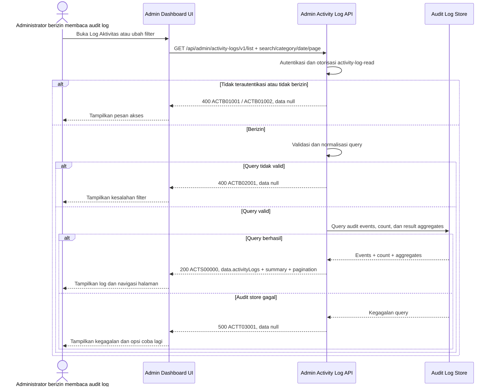

# Admin Dashboard - Get List Activity Logs Interface Agreement

> **Document Type:** IFA / API Contract  
> **Status:** Draft  
> **Service / Domain:** Admin Dashboard — Audit & Activity Logs  
> **Consumer / Partner:** JokiHub Admin Dashboard (authorized administrator)

## Design

API ini mengambil riwayat aksi administrator di dashboard untuk kebutuhan audit dan monitoring. Daftar mendukung search, filter kategori, filter tanggal, pagination, dan ringkasan hasil. Log harus ditulis oleh server saat aksi dilakukan dan bersifat append-only; UI tidak dapat membuat, mengubah, atau menghapus event audit melalui endpoint ini. Belum ada ERD activity log generik, sehingga schema dan integrasi audit lintas domain adalah usulan yang perlu disepakati.

## Sequence Diagram



## Performance / SLA Targets

| Success Rate                                     | VUser                                       | CPU / Memory                        | Response Time                                             |
| ------------------------------------------------ | ------------------------------------------- | ----------------------------------- | --------------------------------------------------------- |
| TBD; confirm audit availability/retention target | TBD; confirm peak concurrent administrators | TBD; set from capacity estimate/NFT | TBD; include search/filter/count on expected audit volume |

## General Information

| Component          | Value                                                                                                                                                      |
| ------------------ | ---------------------------------------------------------------------------------------------------------------------------------------------------------- |
| Description        | Mengambil daftar aktivitas admin dengan search, filter kategori/tanggal, pagination, dan ringkasan hasil.                                                  |
| Resource URL       | `https://{host}/api/admin/activity-logs/v1/list`                                                                                                           |
| Transport Protocol | HTTPS, REST                                                                                                                                                |
| Request Verb       | GET                                                                                                                                                        |
| Content Type       | Tidak ada request body; response `application/json`                                                                                                        |
| Interaction Type   | Synchronous                                                                                                                                                |
| Security Policy    | Admin authentication dan izin `activity-log-read`. Audit log bersifat sensitif; terapkan least privilege, masking, akses tercatat, dan retensi terkontrol. |

### Path / Endpoint

| Section        | Value                              |
| -------------- | ---------------------------------- |
| Host / Domain  | `{host}` (environment-specific)    |
| Service Name   | Admin Audit & Activity Log         |
| Version        | `v1`                               |
| Resource       | `/admin/activity-logs/v1/list`     |
| Final Endpoint | `/api/admin/activity-logs/v1/list` |

### API Versioning

- **Decision:** New Endpoint
- **Previous Endpoint:** Tidak ada API activity log yang teridentifikasi; halaman saat ini menggunakan mock data.
- **Final Endpoint:** `GET /api/admin/activity-logs/v1/list`
- **Backward Compatibility:** Belum ada consumer API activity log yang teridentifikasi. Filter opsional baru kompatibel; perubahan field wajib atau semantik perlu koordinasi consumer.
- **Reason:** Admin Dashboard membutuhkan daftar audit event yang tersimpan server-side.

## Business Rules

1. Hanya administrator terautentikasi dengan izin `activity-log-read` dapat membaca log. Permission name adalah usulan dan perlu selaras dengan RBAC.
2. Event dicatat server-side oleh domain/service yang melakukan aksi. Aksi gagal yang sudah melewati autentikasi dan validasi keamanan juga dicatat; request tidak valid yang ditolak gateway dapat masuk ke security log terpisah.
3. Activity log bersifat append-only bagi consumer aplikasi. Koreksi/retensi dilakukan melalui mekanisme operasional terproteksi dan tetap diaudit.
4. Setiap event mencatat actor ID serta snapshot nama/email jika tersedia, action code/label, target type dan target reference, kategori, hasil, waktu UTC, dan metadata request yang aman.
5. Kategori API memakai nilai stabil: `ORDER`, `PRODUCT`, `USER`, `CONTENT`, `SETTINGS`. UI memetakan ke label Indonesia `Pesanan`, `Produk`, `Pengguna`, `Konten`, `Pengaturan`.
6. Hasil API memakai `SUCCESS` atau `FAILED`; UI memetakan ke `Berhasil` atau `Gagal`.
7. Search berjalan pada admin name/email, action, target reference, dan IP bila diizinkan. Search tidak boleh mengakses atau mencocokkan secret/token.
8. Rentang tanggal diterapkan ke `occurredAt` dengan tanggal lokal platform yang dikonversi ke interval UTC. `fromDate` dan `toDate` inklusif pada level tanggal; batas maksimum rentang TBD.
9. Hasil diurutkan terbaru dahulu menurut `occurredAt DESC`, dengan tie-breaker `activityLogId DESC` untuk pagination deterministik.
10. Pagination berbasis halaman 1. Default `page=1`, `pageSize=20`, maksimum `100` (usulan).
11. Ringkasan total/result counts memakai filter yang sama dan menghitung semua hasil, bukan hanya halaman saat ini.
12. IP address dan email admin merupakan data sensitif. Nilai ditampilkan hanya kepada pemegang izin; masking/retention harus ditetapkan oleh security/privacy owner.
13. Jangan simpan password, token, OTP, credential, raw payment data, atau request/response body penuh. Simpan perubahan field secara allowlist/redacted diff bila diperlukan untuk audit.
14. Kegagalan audit write pada aksi sensitif harus mengikuti kebijakan fail-open/fail-closed per domain; kebijakan tersebut perlu ditetapkan sebelum integrasi. Endpoint list tidak mengubah event.

## Request Headers

| Header          | E/N/T | Type   | M/O/C | Max Length | Description                                                               | Example                 |
| --------------- | ----- | ------ | ----- | ---------: | ------------------------------------------------------------------------- | ----------------------- |
| `Authorization` | N     | String | M     |       4096 | Kredensial administrator; skema autentikasi bergantung identity provider. | `Bearer {access-token}` |
| `Accept`        | N     | String | O     |        100 | Tipe media response yang diinginkan; default JSON.                        | `application/json`      |
| `X-Request-Id`  | N     | String | O     |        100 | ID korelasi untuk audit/support.                                          | `req-a812cc`            |

## Request Parameters

None.

## Request Query Parameters

| Parameter  | E/N/T | Type    | M/O/C | Max Length | Description                                                             | Example      |
| ---------- | ----- | ------- | ----- | ---------: | ----------------------------------------------------------------------- | ------------ |
| `search`   | N     | String  | O     |        100 | Cari admin name/email, action, target reference, atau IP sesuai policy. | `Fatih`      |
| `category` | N     | String  | O     |         30 | Filter: `ORDER`, `PRODUCT`, `USER`, `CONTENT`, `SETTINGS`.              | `ORDER`      |
| `result`   | N     | String  | O     |         20 | Filter hasil: `SUCCESS` atau `FAILED`.                                  | `SUCCESS`    |
| `fromDate` | N     | String  | O     |         10 | Tanggal awal inklusif format `YYYY-MM-DD`, zona waktu platform.         | `2026-10-01` |
| `toDate`   | N     | String  | O     |         10 | Tanggal akhir inklusif format `YYYY-MM-DD`, zona waktu platform.        | `2026-10-12` |
| `page`     | N     | Integer | O     |  10 digits | Halaman berbasis 1; default `1`.                                        | `1`          |
| `pageSize` | N     | Integer | O     |  10 digits | Jumlah log per halaman; default `20`, maksimum usulan `100`.            | `20`         |

## Request Body

Tidak ada request body.

### Request Validation

1. `Authorization` harus mengidentifikasi administrator terautentikasi dengan izin `activity-log-read`. Kembalikan `ACTB01001` bila belum terautentikasi dan `ACTB01002` bila izin tidak tersedia.
2. `search`, bila dikirim, harus string maksimal 100 karakter setelah trim. Gunakan parameterisasi query dan jangan mencari secret atau payload sensitif.
3. `category` harus salah satu enum yang didukung; label UI bahasa Indonesia dan `Semua Kategori` tidak diterima sebagai nilai filter.
4. `result`, bila dikirim, harus `SUCCESS` atau `FAILED`.
5. `fromDate` dan `toDate`, bila dikirim, harus tanggal kalender valid format `YYYY-MM-DD`. Bila keduanya ada, `fromDate` tidak boleh setelah `toDate`; batas rentang maksimum TBD.
6. `page` harus integer >= 1; default `1`.
7. `pageSize` harus integer 1–100; default `20`.
8. Query parameter tak dikenal atau parameter berulang yang tidak didukung ditolak dengan `ACTB02001`.
9. Jika tidak ada hasil, kembalikan HTTP 200 dengan `activityLogs: []`, ringkasan nol, dan `totalItems: 0`, `totalPages: 0`.
10. Count, summary, dan row query harus memakai filter yang sama. Kegagalan audit store mengembalikan HTTP 500 tanpa detail internal.

## Response Body

Semua response menggunakan envelope `status` dan `data`. Sukses mengembalikan halaman activity log, summary atas semua hasil filter, dan pagination; error mengembalikan `data: null`.

| Attribute                              | E/N/T | Type               | M/O/C |       Max Length | Description                                                              | Example                   |
| -------------------------------------- | ----- | ------------------ | ----- | ---------------: | ------------------------------------------------------------------------ | ------------------------- |
| `status`                               | N     | Object             | M     |                — | Object status response.                                                  | `{}`                      |
| `status.code`                          | N     | String             | M     |               20 | Service status code.                                                     | `ACTS00000`               |
| `status.message`                       | N     | String             | O     |              200 | Pesan hasil untuk consumer.                                              | `Activity logs retrieved` |
| `data`                                 | N     | Object/null        | M     |                — | Payload hasil; `null` ketika error.                                      | `{}`                      |
| `data.activityLogs`                    | N     | Array of Object    | M     | `pageSize` items | Halaman activity log; array kosong bila tidak ada hasil.                 | `[]`                      |
| `data.activityLogs[].id`               | N     | String             | M     |               64 | ID immutable event.                                                      | `act_01JXYZ`              |
| `data.activityLogs[].actor`            | N     | Object/null        | O     |                — | Admin pelaku; null bila account dihapus/anonymized.                      | `{}`                      |
| `data.activityLogs[].actor.id`         | N     | String             | O     |               64 | ID admin saat aksi.                                                      | `admin_01JXYZ`            |
| `data.activityLogs[].actor.name`       | N     | String/null        | O     |              150 | Snapshot nama admin.                                                     | `Fatih Muhamad Ridho`     |
| `data.activityLogs[].actor.email`      | N     | String/null        | O     |              254 | Snapshot email; visibility/masking sesuai policy.                        | `fatih@example.com`       |
| `data.activityLogs[].action`           | N     | String             | M     |              100 | Kode aksi stabil.                                                        | `ORDER_STATUS_UPDATED`    |
| `data.activityLogs[].actionLabel`      | N     | String             | M     |              200 | Label aksi untuk tampilan admin.                                         | `Mengubah status pesanan` |
| `data.activityLogs[].target`           | N     | Object             | M     |                — | Referensi target aksi.                                                   | `{}`                      |
| `data.activityLogs[].target.type`      | N     | String             | M     |               50 | Tipe resource target.                                                    | `ORDER`                   |
| `data.activityLogs[].target.id`        | N     | String/null        | O     |               64 | ID internal target, bila tersedia.                                       | `ord_01JXYZ`              |
| `data.activityLogs[].target.reference` | N     | String/null        | O     |              150 | Nomor/reference yang bisa dibaca admin.                                  | `JH-2026-001248`          |
| `data.activityLogs[].category`         | N     | String             | M     |               30 | Enum kategori stabil: `ORDER`, `PRODUCT`, `USER`, `CONTENT`, `SETTINGS`. | `ORDER`                   |
| `data.activityLogs[].occurredAt`       | N     | String (date-time) | M     |               35 | Waktu event ISO 8601 UTC.                                                | `2026-10-11T09:18:00Z`    |
| `data.activityLogs[].ipAddress`        | N     | String/null        | O     |               45 | IP client yang tervalidasi; akses sesuai policy.                         | `192.0.2.28`              |
| `data.activityLogs[].result`           | N     | String             | M     |               20 | `SUCCESS` atau `FAILED`.                                                 | `SUCCESS`                 |
| `data.summary`                         | N     | Object             | M     |                — | Ringkasan seluruh hasil setelah filter.                                  | `{}`                      |
| `data.summary.totalItems`              | N     | Integer            | M     |        10 digits | Total aktivitas yang cocok dengan filter.                                | `1`                       |
| `data.summary.successCount`            | N     | Integer            | M     |        10 digits | Jumlah event sukses pada seluruh hasil terfilter.                        | `1`                       |
| `data.summary.failedCount`             | N     | Integer            | M     |        10 digits | Jumlah event gagal pada seluruh hasil terfilter.                         | `0`                       |
| `data.pagination`                      | N     | Object             | M     |                — | Metadata pagination.                                                     | `{}`                      |
| `data.pagination.page`                 | N     | Integer            | M     |        10 digits | Halaman yang dikembalikan.                                               | `1`                       |
| `data.pagination.pageSize`             | N     | Integer            | M     |        10 digits | Ukuran halaman efektif.                                                  | `20`                      |
| `data.pagination.totalItems`           | N     | Integer            | M     |        10 digits | Total activity log setelah filter.                                       | `1`                       |
| `data.pagination.totalPages`           | N     | Integer            | M     |        10 digits | Total halaman; `0` bila kosong.                                          | `1`                       |

### Success Example

```json
{
  "status": {
    "code": "ACTS00000",
    "message": "Activity logs retrieved"
  },
  "data": {
    "activityLogs": [
      {
        "id": "act_01JXYZ",
        "actor": {
          "id": "admin_01JXYZ",
          "name": "Nadia Prameswari",
          "email": "nadia@example.com"
        },
        "action": "ORDER_STATUS_UPDATED",
        "actionLabel": "Mengubah status pesanan",
        "target": {
          "type": "ORDER",
          "id": "ord_01JXYZ",
          "reference": "JH-2026-001248"
        },
        "category": "ORDER",
        "occurredAt": "2026-10-11T09:18:00Z",
        "ipAddress": "192.0.2.28",
        "result": "SUCCESS"
      }
    ],
    "summary": {
      "totalItems": 1,
      "successCount": 1,
      "failedCount": 0
    },
    "pagination": {
      "page": 1,
      "pageSize": 20,
      "totalItems": 1,
      "totalPages": 1
    }
  }
}
```

### Business Error Example

```json
{
  "status": {
    "code": "ACTB02001",
    "message": "Invalid activity-log query parameters"
  },
  "data": null
}
```

### Technical Error Example

```json
{
  "status": {
    "code": "ACTT03001",
    "message": "Activity log service is temporarily unavailable"
  },
  "data": null
}
```

## HTTP Status Codes

| HTTP Status | Usage                                                                                                                                |
| ----------- | ------------------------------------------------------------------------------------------------------------------------------------ |
| `200`       | Daftar berhasil dikembalikan, termasuk ketika hasil kosong.                                                                          |
| `400`       | Query tidak valid atau akses admin ditolak sesuai baseline response project. Konfirmasi apakah standar API mengharuskan `401`/`403`. |
| `500`       | Kegagalan service atau audit store yang tidak terduga.                                                                               |

## Service Status Codes

Format: `[Service Prefix][Status Type][Category][Specific Error Code]`

| Code        | Type      | Category        | Meaning                                                    |
| ----------- | --------- | --------------- | ---------------------------------------------------------- |
| `ACTS00000` | Success   | General         | Daftar activity log berhasil dikembalikan.                 |
| `ACTB01001` | Business  | Authentication  | Administrator belum terautentikasi.                        |
| `ACTB01002` | Business  | Authentication  | Administrator tidak memiliki izin activity-log-read.       |
| `ACTB02001` | Business  | User validation | Parameter search/filter/date/pagination tidak valid.       |
| `ACTT03001` | Technical | Database        | Activity log gagal dibaca atau audit store tidak tersedia. |

## API Exposure Classification

| Classification                 | Rationale                                                                                                                                                                                  |
| ------------------------------ | ------------------------------------------------------------------------------------------------------------------------------------------------------------------------------------------ |
| Enterprise Intranet (proposed) | Endpoint menampilkan jejak tindakan admin, IP, dan account metadata. Jika internet-accessible, klasifikasikan sebagai Public dan terapkan proteksi API serta privacy controls yang sesuai. |

## Testing & Documentation Scope

| Scope      | Required | Rationale / Handoff                                                                                                                                                      |
| ---------- | -------- | ------------------------------------------------------------------------------------------------------------------------------------------------------------------------ |
| NFT        | Yes      | Uji search, kategori, tanggal, hasil kosong, pagination, ringkasan konsisten, dan beban audit volume besar. VUser, CPU/memory, retensi, serta target TPS TBD.            |
| VA/Pentest | Yes      | Uji authentication/authorization, privilege boundaries, enumeration, injection, PII/IP exposure, filter bypass, audit tampering, dan secret-redaction pada event source. |

## Assumptions

- Endpoint `/api/admin/activity-logs/v1/list`, field query/response, envelope, prefix `ACT`, serta status code adalah usulan; API/security owner perlu menyetujui.
- Kategori API `ORDER`, `PRODUCT`, `USER`, `CONTENT`, `SETTINGS` dipetakan ke kategori UI Indonesia; kategori lain seperti `AUTH`, `ROLE`, `TRANSACTION`, atau `SYSTEM` mungkin diperlukan dan harus ditetapkan oleh audit taxonomy owner.
- Belum ada ERD activity log generik. Diperlukan schema/event store bersama atau audit service, termasuk actor snapshots, correlation ID, target fields, result/error classification, retention, dan indexing.
- Mock UI menyediakan nama/email admin, action, target, category, occurredAt, IP, dan result. Form detail/diff perubahan belum tersedia pada UI saat ini.
- Aturan pencatatan aksi gagal, IP source/proxy trust, timezone platform, masking, audit write fail-open/fail-closed, retensi, permission, SLA, dan HTTP status mapping masih TBD.
- Endpoint hanya membaca log; ekspor, purge/retention management, perubahan data, dan log aktivitas member/customer berada di luar scope.

## References

- `src/features/AdminActivityLogs/views/interfaces/admin-activity-log.interface.ts` — kategori dan field activity log pada UI.
- `src/features/AdminActivityLogs/views/pages/AdminActivityLogs.page.tsx` — mock activity dan client-side search/category/date filters.
- `src/features/AdminActivityLogs/views/templates/AdminActivityLogs.template.tsx` — tabel, ringkasan, dan filter yang ditampilkan.
- `docs/sprint_1/solutioning/dashboard/settings/general-settings.md` — kontrak admin dashboard dan pola pengaturan.
- `docs/sprint_1/solutioning/TEMPLATE.md` — template kontrak API sprint.
