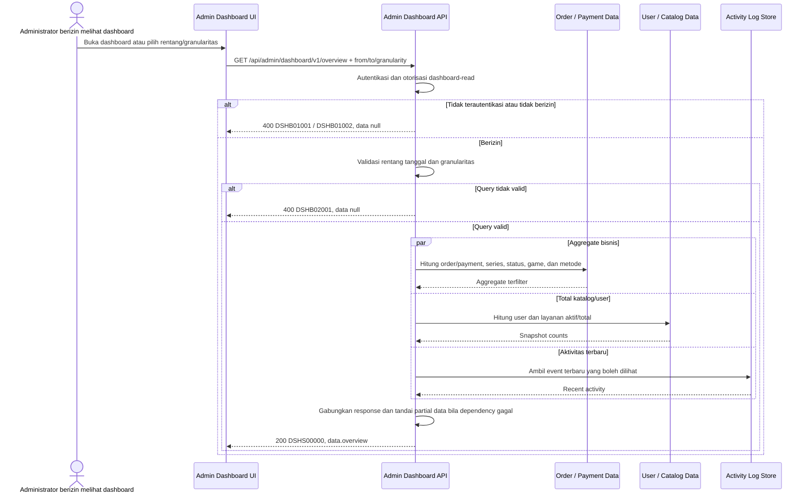

# Admin Dashboard - Get Dashboard Overview Interface Agreement

> **Document Type:** IFA / API Contract  
> **Status:** Draft  
> **Service / Domain:** Admin Dashboard — Business Overview  
> **Consumer / Partner:** JokiHub Admin Dashboard (authorized administrator)

## Design

API ini menyediakan snapshot agregat untuk halaman utama Admin Dashboard: KPI pesanan, pendapatan, total user dan layanan; grafik pendapatan/pesanan; distribusi status order; game populer dan pendapatan per game; breakdown metode pembayaran; pesanan terbaru; serta aktivitas terbaru. Request menerima rentang waktu dan granularitas grafik. Setiap metrik harus memiliki definisi waktu, status yang dihitung, currency, dan sumber data yang konsisten. Kontrak ini mengusulkan response gabungan agar UI dapat memuat dashboard dalam satu request; data contoh UI bukan angka bisnis terverifikasi.

## Sequence Diagram



## Performance / SLA Targets

| Success Rate                               | VUser                                       | CPU / Memory                        | Response Time                                                      |
| ------------------------------------------ | ------------------------------------------- | ----------------------------------- | ------------------------------------------------------------------ |
| TBD; confirm dashboard availability target | TBD; confirm peak concurrent administrators | TBD; set from capacity estimate/NFT | TBD; aggregate query target and data freshness target to be agreed |

## General Information

| Component          | Value                                                                                                                    |
| ------------------ | ------------------------------------------------------------------------------------------------------------------------ |
| Description        | Mengambil agregat KPI, grafik, breakdown bisnis, pesanan terbaru, dan aktivitas terbaru untuk dashboard admin.           |
| Resource URL       | `https://{host}/api/admin/dashboard/v1/overview`                                                                         |
| Transport Protocol | HTTPS, REST                                                                                                              |
| Request Verb       | GET                                                                                                                      |
| Content Type       | Tidak ada request body; response `application/json`                                                                      |
| Interaction Type   | Synchronous; cache/materialized aggregate dapat digunakan sesuai freshness target                                        |
| Security Policy    | Admin authentication dan izin `dashboard-read`. PII pada recent orders/activity mengikuti permission dan masking policy. |

### Path / Endpoint

| Section        | Value                              |
| -------------- | ---------------------------------- |
| Host / Domain  | `{host}` (environment-specific)    |
| Service Name   | Admin Dashboard                    |
| Version        | `v1`                               |
| Resource       | `/admin/dashboard/v1/overview`     |
| Final Endpoint | `/api/admin/dashboard/v1/overview` |

### API Versioning

- **Decision:** New Endpoint
- **Previous Endpoint:** Tidak ada API dashboard overview yang teridentifikasi; halaman saat ini memakai mock data client-side.
- **Final Endpoint:** `GET /api/admin/dashboard/v1/overview`
- **Backward Compatibility:** Belum ada consumer overview API yang teridentifikasi. Section/field response opsional dapat ditambahkan; perubahan definisi metric memerlukan koordinasi consumer dan dokumentasi.
- **Reason:** UI membutuhkan satu sumber server-side untuk ringkasan dan visualisasi dashboard.

## Business Rules

1. Hanya administrator terautentikasi dengan izin `dashboard-read` dapat mengakses overview. Nama permission usulan dan perlu diselaraskan dengan RBAC.
2. Semua metric periodik menggunakan rentang `from` inklusif dan `to` eksklusif dalam UTC. UI dapat mengirim tanggal kalender lokal; konversi timezone harus eksplisit dan konsisten.
3. KPI cards mengembalikan total periode terpilih dan nilai pembanding periode sebelumnya dengan durasi yang sama. Persentase perubahan tidak dihitung bila baseline nol; kembalikan `changePercent: null` beserta indikator `NO_BASELINE`.
4. Definisi `totalOrders` adalah jumlah order unik yang dibuat pada periode, bukan jumlah line item/payment attempt. Status order yang termasuk dibatalkan atau test data perlu disepakati.
5. Definisi `totalRevenue` belum final. Usulan: jumlah amount transaksi payment berstatus `SUCCESS` yang settled dalam periode, dikurangi refund berstatus `SUCCESS` yang settled dalam periode; payout tidak dihitung. Product/finance owner harus menyetujui basis gross/net dan waktu pengakuan.
6. `totalUsers` perlu didefinisikan sebagai semua akun member atau akun yang bergabung dalam rentang. Usulan field menyediakan `totalUsers` cumulative dan `newUsers` dalam periode; akun admin tidak dihitung.
7. `totalServices` menghitung service catalog yang aktif pada snapshot saat request. Apakah yang dihitung hanya aktif atau semua status harus disetujui; response menyediakan `activeServices` dan `totalServices` untuk menghindari ambiguitas.
8. Grafik memiliki `metric` `REVENUE` atau `ORDERS` dan granularitas `DAILY`, `WEEKLY`, atau `MONTHLY`. Bucket kosong dikembalikan bernilai nol agar chart kontinu.
9. Distribusi status order menggunakan enum storage order dan satu order dihitung satu kali. UI memetakan label Indonesia; status payment bukan pengganti status order.
10. Game populer dihitung dari jumlah order unik per game dalam periode dan diurutkan descending; batas default lima item usulan.
11. Pendapatan per game mengikuti definisi revenue pada rule 5 dan harus mencegah duplikasi amount saat join order item/payment.
12. Breakdown payment method menghitung transaksi payment settled/successful sesuai scope yang dipilih; refund handling dan failed/pending counts perlu ditetapkan. Amount dan count disediakan terpisah.
13. `recentOrders` diurutkan `createdAt DESC`, satu record per order, maksimum 10 item (usulan). Field customer contact tidak disertakan; user identifier/nama mengikuti policy PII.
14. `recentActivities` membaca activity/audit log yang sama dengan solutioning log activity, diurutkan terbaru, maksimum 10 item (usulan). Jika audit service belum tersedia, section dapat kosong dengan `dataStatus: UNAVAILABLE`.
15. API dapat memakai snapshot/cache untuk performa, tetapi mengembalikan `generatedAt` dan `dataAsOf` agar freshness terlihat. Target freshness TBD.
16. Kegagalan dependency wajib mengikuti aturan availability: response dapat gagal seluruhnya atau mengembalikan section parsial dengan `dataStatus`; jangan mengisi angka palsu/nol untuk dependency yang gagal.
17. Amount selalu menyertakan currency. Aggregation lintas currency tidak diizinkan tanpa konversi rate dan kebijakan akuntansi yang disetujui.

## Request Headers

| Header          | E/N/T | Type   | M/O/C | Max Length | Description                                                               | Example                 |
| --------------- | ----- | ------ | ----- | ---------: | ------------------------------------------------------------------------- | ----------------------- |
| `Authorization` | N     | String | M     |       4096 | Kredensial administrator; skema autentikasi bergantung identity provider. | `Bearer {access-token}` |
| `Accept`        | N     | String | O     |        100 | Tipe media response yang diinginkan; default JSON.                        | `application/json`      |
| `X-Request-Id`  | N     | String | O     |        100 | ID korelasi untuk tracing dependency.                                     | `req-54be21`            |

## Request Parameters

None.

## Request Query Parameters

| Parameter     | E/N/T | Type    | M/O/C | Max Length | Description                                                               | Example                |
| ------------- | ----- | ------- | ----- | ---------: | ------------------------------------------------------------------------- | ---------------------- |
| `from`        | N     | String  | O     |         35 | Awal rentang ISO 8601 UTC inklusif; default mengikuti preset dashboard.   | `2026-10-01T00:00:00Z` |
| `to`          | N     | String  | O     |         35 | Akhir rentang ISO 8601 UTC eksklusif; default mengikuti preset dashboard. | `2026-10-08T00:00:00Z` |
| `granularity` | N     | String  | O     |         20 | Bucket chart: `DAILY`, `WEEKLY`, atau `MONTHLY`; default `DAILY`.         | `DAILY`                |
| `metric`      | N     | String  | O     |         20 | Metric chart: `REVENUE` atau `ORDERS`; default `REVENUE`.                 | `REVENUE`              |
| `topGames`    | N     | Integer | O     |   3 digits | Banyak game pada breakdown populer; default `5`, maksimum usulan `20`.    | `5`                    |
| `recentLimit` | N     | Integer | O     |   3 digits | Batas item recent orders/activity; default `5`, maksimum usulan `10`.     | `5`                    |

## Request Body

Tidak ada request body.

### Request Validation

1. `Authorization` harus mengidentifikasi administrator terautentikasi dengan izin `dashboard-read`. Kembalikan `DSHB01001` bila belum terautentikasi dan `DSHB01002` bila izin tidak tersedia.
2. `from` dan `to` harus ISO 8601 date-time dengan timezone. Jika salah satu tidak dikirim, gunakan default range yang eksplisit dan dikembalikan di response. `from` harus lebih awal dari `to`.
3. Rentang maksimum bergantung granularity dan kapasitas; nilai di luar batas mengembalikan `DSHB02001`. Batas final TBD.
4. `granularity` hanya `DAILY`, `WEEKLY`, atau `MONTHLY`; `metric` hanya `REVENUE` atau `ORDERS`.
5. `topGames` harus integer 1–20; default `5`.
6. `recentLimit` harus integer 1–10; default `5`.
7. Parameter query tak dikenal/berulang yang tidak didukung ditolak dengan `DSHB02001`.
8. Bila dependency section gagal, jangan mengembalikan nilai default yang seolah-olah data valid; isi section status dan `dataAsOf` sesuai ketersediaan.

## Response Body

Semua response menggunakan envelope `status` dan `data`. Response berisi range efektif, freshness, KPI/comparison, chart, breakdown, recent orders, dan recent activity.

| Attribute                              | E/N/T | Type               | M/O/C |         Max Length | Description                                                           | Example                        |
| -------------------------------------- | ----- | ------------------ | ----- | -----------------: | --------------------------------------------------------------------- | ------------------------------ |
| `status`                               | N     | Object             | M     |                  — | Object status response.                                               | `{}`                           |
| `status.code`                          | N     | String             | M     |                 20 | Service status code.                                                  | `DSHS00000`                    |
| `status.message`                       | N     | String             | O     |                200 | Pesan hasil untuk consumer.                                           | `Dashboard overview retrieved` |
| `data`                                 | N     | Object/null        | M     |                  — | Payload hasil; null ketika request gagal seluruhnya.                  | `{}`                           |
| `data.range.from`                      | N     | String (date-time) | M     |                 35 | Awal range efektif UTC inklusif.                                      | `2026-10-01T00:00:00Z`         |
| `data.range.to`                        | N     | String (date-time) | M     |                 35 | Akhir range efektif UTC eksklusif.                                    | `2026-10-08T00:00:00Z`         |
| `data.range.previousFrom`              | N     | String (date-time) | M     |                 35 | Awal comparison range sebelumnya.                                     | `2026-09-24T00:00:00Z`         |
| `data.range.previousTo`                | N     | String (date-time) | M     |                 35 | Akhir comparison range sebelumnya.                                    | `2026-10-01T00:00:00Z`         |
| `data.generatedAt`                     | N     | String (date-time) | M     |                 35 | Waktu response dihitung/dibuat UTC.                                   | `2026-10-12T09:45:00Z`         |
| `data.dataAsOf`                        | N     | String (date-time) | O     |                 35 | Waktu data paling akhir yang tercermin; dapat per-section bila perlu. | `2026-10-12T09:44:00Z`         |
| `data.sections`                        | N     | Object             | M     |                  — | Status tiap dependency section: `AVAILABLE`/`UNAVAILABLE`.            | `{}`                           |
| `data.kpis`                            | N     | Object             | M     |                  — | KPI cards dashboard.                                                  | `{}`                           |
| `data.kpis.totalOrders`                | N     | Object             | M     |                  — | Order count periode dan perubahan terhadap periode sebelumnya.        | `{}`                           |
| `data.kpis.totalOrders.value`          | N     | Integer            | C     |          10 digits | Jumlah order unik dalam periode.                                      | `1248`                         |
| `data.kpis.totalOrders.previousValue`  | N     | Integer            | C     |          10 digits | Jumlah order pada comparison range.                                   | `1114`                         |
| `data.kpis.totalOrders.changePercent`  | N     | Decimal/null       | O     |                7,2 | Persentase perubahan; null jika baseline nol.                         | `12.03`                        |
| `data.kpis.totalRevenue`               | N     | Object             | M     |                  — | Revenue periode dan perubahan; definisi mengikuti approved policy.    | `{}`                           |
| `data.kpis.totalRevenue.value`         | N     | Decimal            | C     |               18,2 | Revenue dalam currency yang sama.                                     | `45230000.00`                  |
| `data.kpis.totalRevenue.previousValue` | N     | Decimal            | C     |               18,2 | Revenue comparison range.                                             | `38300000.00`                  |
| `data.kpis.totalRevenue.currency`      | N     | String             | C     |                  3 | Currency ISO 4217.                                                    | `IDR`                          |
| `data.kpis.totalRevenue.changePercent` | N     | Decimal/null       | O     |                7,2 | Persentase perubahan; null jika baseline nol.                         | `18.09`                        |
| `data.kpis.totalUsers`                 | N     | Integer            | M     |          10 digits | Akun member cumulative pada snapshot.                                 | `3420`                         |
| `data.kpis.newUsers`                   | N     | Integer            | M     |          10 digits | Member baru pada periode.                                             | `128`                          |
| `data.kpis.totalServices`              | N     | Integer            | M     |          10 digits | Total layanan catalog pada snapshot.                                  | `128`                          |
| `data.kpis.activeServices`             | N     | Integer            | M     |          10 digits | Layanan aktif pada snapshot.                                          | `96`                           |
| `data.chart.metric`                    | N     | String             | M     |                 20 | Metric yang diminta: `REVENUE` atau `ORDERS`.                         | `REVENUE`                      |
| `data.chart.granularity`               | N     | String             | M     |                 20 | Granularity bucket.                                                   | `DAILY`                        |
| `data.chart.currency`                  | N     | String/null        | O     |                  3 | Currency untuk chart revenue; null untuk orders.                      | `IDR`                          |
| `data.chart.points`                    | N     | Array of Object    | M     |      range buckets | Series point dengan `bucketStart` dan `value`.                        | `[]`                           |
| `data.orderStatusBreakdown`            | N     | Array of Object    | M     |       status count | Jumlah order per status pada range.                                   | `[]`                           |
| `data.popularGames`                    | N     | Array of Object    | M     |    `topGames` rows | Jumlah order per game pada range.                                     | `[]`                           |
| `data.revenueByGame`                   | N     | Array of Object    | M     |    `topGames` rows | Revenue per game, currency sama dengan KPI.                           | `[]`                           |
| `data.paymentMethods`                  | N     | Array of Object    | M     |       method count | Count dan nominal payment per method.                                 | `[]`                           |
| `data.recentOrders`                    | N     | Array of Object    | M     | `recentLimit` rows | Pesanan terbaru, tanpa data kontak customer.                          | `[]`                           |
| `data.recentActivities`                | N     | Array of Object    | M     | `recentLimit` rows | Aktivitas audit terbaru yang aman ditampilkan.                        | `[]`                           |

### Nested Item Fields

| Object / Attribute                   | E/N/T | Type               | M/O/C | Max Length | Description                                     | Example                    |
| ------------------------------------ | ----- | ------------------ | ----- | ---------: | ----------------------------------------------- | -------------------------- |
| `chart.points[].bucketStart`         | N     | String (date-time) | M     |         35 | Awal bucket UTC.                                | `2026-10-01T00:00:00Z`     |
| `chart.points[].value`               | N     | Decimal/integer    | M     |       18,2 | Nilai revenue atau order count.                 | `6450000.00`               |
| `orderStatusBreakdown[].status`      | N     | String             | M     |         30 | Enum status order storage.                      | `COMPLETED`                |
| `orderStatusBreakdown[].count`       | N     | Integer            | M     |  10 digits | Jumlah order unik.                              | `892`                      |
| `popularGames[].gameId`              | N     | String             | M     |         64 | ID game catalog.                                | `game_01JXYZ`              |
| `popularGames[].gameName`            | N     | String             | M     |        100 | Nama game.                                      | `Mobile Legends`           |
| `popularGames[].orderCount`          | N     | Integer            | M     |  10 digits | Jumlah order unik.                              | `428`                      |
| `revenueByGame[].gameId`             | N     | String             | M     |         64 | ID game catalog.                                | `game_01JXYZ`              |
| `revenueByGame[].gameName`           | N     | String             | M     |        100 | Nama game.                                      | `Mobile Legends`           |
| `revenueByGame[].amount`             | N     | Decimal            | M     |       18,2 | Revenue sesuai approved basis dan currency.     | `18420000.00`              |
| `revenueByGame[].currency`           | N     | String             | M     |          3 | Currency ISO 4217.                              | `IDR`                      |
| `paymentMethods[].method`            | N     | String             | M     |         30 | Payment method enum.                            | `QRIS`                     |
| `paymentMethods[].transactionCount`  | N     | Integer            | M     |  10 digits | Count transaksi yang memenuhi policy.           | `96`                       |
| `paymentMethods[].amount`            | N     | Decimal            | M     |       18,2 | Amount transaksi sesuai revenue/payment policy. | `3960000.00`               |
| `paymentMethods[].currency`          | N     | String             | M     |          3 | Currency ISO 4217.                              | `IDR`                      |
| `recentOrders[].orderId`             | N     | String             | M     |         64 | ID order.                                       | `ord_01JXYZ`               |
| `recentOrders[].orderNumber`         | N     | String             | M     |         32 | Nomor order.                                    | `JH-2026-001248`           |
| `recentOrders[].createdAt`           | N     | String (date-time) | M     |         35 | Waktu order dibuat UTC.                         | `2026-10-11T09:42:00Z`     |
| `recentOrders[].customerName`        | N     | String             | O     |        150 | Nama customer sesuai permission/privacy policy. | `Budi Santoso`             |
| `recentOrders[].gameName`            | N     | String             | M     |        100 | Game snapshot order.                            | `Mobile Legends`           |
| `recentOrders[].serviceName`         | N     | String             | M     |        150 | Service snapshot order.                         | `Top Up 86 Diamonds`       |
| `recentOrders[].amount`              | N     | Decimal            | M     |       18,2 | Total order snapshot.                           | `25000.00`                 |
| `recentOrders[].currency`            | N     | String             | M     |          3 | Currency ISO 4217.                              | `IDR`                      |
| `recentOrders[].status`              | N     | String             | M     |         30 | Status order storage.                           | `PENDING_VALIDATION`       |
| `recentActivities[].id`              | N     | String             | M     |         64 | ID audit event.                                 | `act_01JXYZ`               |
| `recentActivities[].actionLabel`     | N     | String             | M     |        200 | Label aktivitas.                                | `Layanan baru ditambahkan` |
| `recentActivities[].targetReference` | N     | String/null        | O     |        150 | Target yang dapat dibaca admin.                 | `Top Up Diamond 500`       |
| `recentActivities[].occurredAt`      | N     | String (date-time) | M     |         35 | Waktu event UTC.                                | `2026-10-11T09:18:00Z`     |
| `recentActivities[].result`          | N     | String             | M     |         20 | `SUCCESS` atau `FAILED`.                        | `SUCCESS`                  |
| `sections.<sectionName>`             | N     | String             | M     |         20 | Status section: `AVAILABLE` atau `UNAVAILABLE`. | `AVAILABLE`                |

### Success Example

```json
{
  "status": {
    "code": "DSHS00000",
    "message": "Dashboard overview retrieved"
  },
  "data": {
    "range": {
      "from": "2026-10-01T00:00:00Z",
      "to": "2026-10-08T00:00:00Z",
      "previousFrom": "2026-09-24T00:00:00Z",
      "previousTo": "2026-10-01T00:00:00Z"
    },
    "generatedAt": "2026-10-12T09:45:00Z",
    "dataAsOf": "2026-10-12T09:44:00Z",
    "sections": {
      "kpis": "AVAILABLE",
      "chart": "AVAILABLE",
      "orderStatusBreakdown": "AVAILABLE",
      "popularGames": "AVAILABLE",
      "revenueByGame": "AVAILABLE",
      "paymentMethods": "AVAILABLE",
      "recentOrders": "AVAILABLE",
      "recentActivities": "AVAILABLE"
    },
    "kpis": {
      "totalOrders": { "value": 1248, "previousValue": 1114, "changePercent": 12.03 },
      "totalRevenue": {
        "value": 45230000.0,
        "previousValue": 38300000.0,
        "currency": "IDR",
        "changePercent": 18.09
      },
      "totalUsers": 3420,
      "newUsers": 128,
      "totalServices": 128,
      "activeServices": 96
    },
    "chart": {
      "metric": "REVENUE",
      "granularity": "DAILY",
      "currency": "IDR",
      "points": [
        { "bucketStart": "2026-10-01T00:00:00Z", "value": 6450000.0 },
        { "bucketStart": "2026-10-02T00:00:00Z", "value": 5820000.0 }
      ]
    },
    "orderStatusBreakdown": [
      { "status": "COMPLETED", "count": 892 },
      { "status": "PROCESSING", "count": 184 },
      { "status": "PENDING_VALIDATION", "count": 96 },
      { "status": "CANCELLED", "count": 48 }
    ],
    "popularGames": [{ "gameId": "game_01JXYZ", "gameName": "Mobile Legends", "orderCount": 428 }],
    "revenueByGame": [
      { "gameId": "game_01JXYZ", "gameName": "Mobile Legends", "amount": 18420000.0, "currency": "IDR" }
    ],
    "paymentMethods": [{ "method": "QRIS", "transactionCount": 96, "amount": 3960000.0, "currency": "IDR" }],
    "recentOrders": [
      {
        "orderId": "ord_01JXYZ",
        "orderNumber": "JH-2026-001248",
        "createdAt": "2026-10-11T09:42:00Z",
        "customerName": "Budi Santoso",
        "gameName": "Mobile Legends",
        "serviceName": "Top Up 86 Diamonds",
        "amount": 25000.0,
        "currency": "IDR",
        "status": "PENDING_VALIDATION"
      }
    ],
    "recentActivities": [
      {
        "id": "act_01JXYZ",
        "actionLabel": "Layanan baru ditambahkan",
        "targetReference": "Top Up Diamond 500",
        "occurredAt": "2026-10-11T09:18:00Z",
        "result": "SUCCESS"
      }
    ]
  }
}
```

### Business Error Example

```json
{
  "status": {
    "code": "DSHB02001",
    "message": "Invalid dashboard query parameters"
  },
  "data": null
}
```

### Technical Error Example

```json
{
  "status": {
    "code": "DSHT03001",
    "message": "Dashboard data is temporarily unavailable"
  },
  "data": null
}
```

## HTTP Status Codes

| HTTP Status | Usage                                                                                                                                                          |
| ----------- | -------------------------------------------------------------------------------------------------------------------------------------------------------------- |
| `200`       | Overview berhasil dikembalikan; section individual dapat berstatus unavailable jika partial response disepakati.                                               |
| `400`       | Parameter rentang/granularitas tidak valid atau akses admin ditolak sesuai baseline response project. Konfirmasi apakah API standard mengharuskan `401`/`403`. |
| `500`       | Kegagalan service/dependency yang menghalangi response overview sesuai availability policy.                                                                    |

## Service Status Codes

Format: `[Service Prefix][Status Type][Category][Specific Error Code]`

| Code        | Type      | Category        | Meaning                                                           |
| ----------- | --------- | --------------- | ----------------------------------------------------------------- |
| `DSHS00000` | Success   | General         | Dashboard overview berhasil dikembalikan.                         |
| `DSHB01001` | Business  | Authentication  | Administrator belum terautentikasi.                               |
| `DSHB01002` | Business  | Authentication  | Administrator tidak memiliki izin dashboard-read.                 |
| `DSHB02001` | Business  | User validation | Query range/granularity/limit tidak valid.                        |
| `DSHT03001` | Technical | Database        | Data dashboard gagal dibaca atau dependency utama tidak tersedia. |

## API Exposure Classification

| Classification                 | Rationale                                                                                                                                                                             |
| ------------------------------ | ------------------------------------------------------------------------------------------------------------------------------------------------------------------------------------- |
| Enterprise Intranet (proposed) | Endpoint menggabungkan ringkasan bisnis, revenue, user, order, dan aktivitas admin. Jika internet-accessible, klasifikasikan sebagai Public dan lindungi sesuai kebijakan API publik. |

## Testing & Documentation Scope

| Scope      | Required | Rationale / Handoff                                                                                                                                                                     |
| ---------- | -------- | --------------------------------------------------------------------------------------------------------------------------------------------------------------------------------------- |
| NFT        | Yes      | Uji kombinasi aggregate, rentang/granularitas, concurrent admin, cache freshness, query plan, dan partial dependency failure. VUser, CPU/memory, serta response/freshness target TBD.   |
| VA/Pentest | Yes      | Uji authentication/authorization, privilege boundaries, PII exposure recent orders/activity, query abuse, injection, aggregate leakage, dan cache key isolation antar permission/range. |

## Assumptions

- Endpoint `/api/admin/dashboard/v1/overview`, field response, query parameters, envelope, prefix `DSH`, dan status code adalah usulan mengikuti pola dashboard; API owner perlu menyetujui.
- Source data mengikuti [Order ERD](../../erd/order-erd.md), [Transaction ERD](../../erd/transaction-erd.md), catalog ERDs, user ERD, dan activity-log solutioning; dashboard tidak menjadi source of truth.
- UI saat ini seluruhnya memakai mock data. KPI, chart, popular games, payment methods, recent orders/activity di response merupakan kontrak usulan, bukan angka atau business definition terverifikasi.
- Revenue basis (gross/net/refund, settledAt vs createdAt), total/new user definition, service count status, bucket timezone, comparison period, payment method enum, cache/freshness, and partial response policy perlu keputusan product/finance/data owners.
- Identity provider, permission name, activity audit schema/source, currency policy, retention, SLA, and HTTP status mapping masih TBD.
- Export laporan, drill-down detail, CRUD, payout, dan konfigurasi chart tersimpan tidak termasuk scope.

## References

- `src/features/AdminDashboard/views/pages/AdminDashboard.page.tsx` — metric cards, chart, breakdown, recent orders, dan recent activities mock.
- `docs/sprint_1/solutioning/dashboard/orders/get-list-orders.md` — order status, snapshot, dan field pesanan.
- `docs/sprint_1/solutioning/erd/order-erd.md` — order/payment source of truth.
- `docs/sprint_1/solutioning/erd/transaction-erd.md` — financial transaction dan settlement status.
- `docs/sprint_1/solutioning/erd/game-catalog-erd.md` — game catalog reference.
- `docs/sprint_1/solutioning/erd/service-erd.md` — service catalog reference.
- `docs/sprint_1/solutioning/dashboard/activity-logs/get-list-activity-logs.md` — recent activity source and taxonomy proposal.
- `docs/sprint_1/solutioning/TEMPLATE.md` — template kontrak API sprint.
