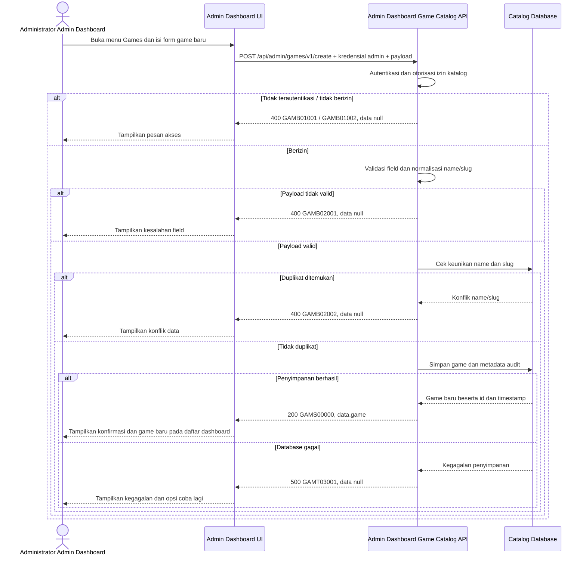

# Admin Dashboard - Create Game Interface Agreement

> **Document Type:** IFA / API Contract  
> **Status:** Draft  
> **Service / Domain:** Admin Dashboard — Game Catalog Management  
> **Consumer / Partner:** JokiHub Admin Dashboard (authorized administrator)

## Design

Tujuan fitur ini adalah memberi administrator kemampuan menambahkan game ke katalog melalui Admin Dashboard. Administrator mengisi form game baru, lalu dashboard menyimpan data melalui Game Catalog API dan menampilkan hasilnya. Belum ada layar Games management atau kebutuhan Games yang terisi dalam BRD, sehingga field katalog di bawah masih berupa usulan. Referensi field kartu storefront: `src/features/HomeV2/views/interfaces/homeV2.interface.ts`.

## Sequence Diagram



## Performance / SLA Targets

| Success Rate                                     | VUser                                       | CPU / Memory                        | Response Time                                                                             |
| ------------------------------------------------ | ------------------------------------------- | ----------------------------------- | ----------------------------------------------------------------------------------------- |
| TBD; confirm criticality and availability target | TBD; confirm peak concurrent administrators | TBD; set from capacity estimate/NFT | TBD; proposed less-critical web baseline: ideal 200 ms, acceptable 1 s, max tolerable 2 s |

## General Information

| Component          | Value                                                                                                                                           |
| ------------------ | ----------------------------------------------------------------------------------------------------------------------------------------------- |
| Description        | Membuat record game baru pada katalog JokiHub.                                                                                                  |
| Resource URL       | `https://{host}/api/admin/games/v1/create`                                                                                                      |
| Transport Protocol | HTTPS, REST                                                                                                                                     |
| Request Verb       | POST                                                                                                                                            |
| Content Type       | `application/json`                                                                                                                              |
| Interaction Type   | Synchronous                                                                                                                                     |
| Security Policy    | Admin authentication and game-catalog create permission. Identity provider and permission name TBD. Apply rate limiting and audit actor/action. |

### Path / Endpoint

| Section        | Value                           |
| -------------- | ------------------------------- |
| Host / Domain  | `{host}` (environment-specific) |
| Service Name   | Game Catalog                    |
| Version        | `v1`                            |
| Resource       | `/admin/games/v1/create`        |
| Final Endpoint | `/api/admin/games/v1/create`    |

### API Versioning

- **Decision:** New Endpoint
- **Previous Endpoint:** Not applicable; no game creation API identified.
- **Final Endpoint:** `POST /api/admin/games/v1/create`
- **Backward Compatibility:** No existing consumer identified. Additive optional response fields remain compatible; breaking request/response changes require a new major version.
- **Reason:** Introduce protected creation of catalog game records.

## Business Rules

1. Only an authenticated administrator with game-catalog create permission may create a game. Role and permission mapping are TBD.
2. `id`, `createdAt`, and `updatedAt` are generated by the service and are not accepted in the request.
3. `name` and `slug` are required. Name is trimmed; slug must be lowercase and URL-safe.
4. Normalized `name` and `slug` must be unique. Duplicate name or slug is rejected; existing data is not overwritten.
5. `isActive` determines whether the game can be offered in the storefront. Proposed default is `false`; product owner must confirm.
6. `isPopular` determines eligibility for the popular-game list. Proposed default is `false`; inactive games cannot be created with `isPopular=true`.
7. `sortOrder` is non-negative; lower values precede higher values. Proposed default is `0`.
8. `serviceSummary` and `artworkKey` are optional presentation metadata inferred from existing game cards. An artwork key must reference an approved asset; asset catalog integration is TBD.
9. Successful creation is auditable with administrator identity and timestamp. Audit storage/retention are TBD.

## Request Headers

| Header          | E/N/T | Type   | M/O/C | Max Length | Description                                                           | Example                 |
| --------------- | ----- | ------ | ----- | ---------: | --------------------------------------------------------------------- | ----------------------- |
| `Authorization` | N     | String | M     |       4096 | Admin credential; authentication scheme depends on identity provider. | `Bearer {access-token}` |
| `Content-Type`  | N     | String | M     |        100 | Request media type.                                                   | `application/json`      |
| `Accept`        | N     | String | O     |        100 | Desired response media type; defaults to JSON.                        | `application/json`      |
| `X-Request-Id`  | N     | String | O     |        100 | Correlation identifier for audit/support.                             | `req-8f41d2`            |

## Request Parameters

None.

## Request Query Parameters

None.

## Request Body

| Attribute        | E/N/T | Type    | M/O/C | Max Length | Description                                                                    | Example              |
| ---------------- | ----- | ------- | ----- | ---------: | ------------------------------------------------------------------------------ | -------------------- |
| `name`           | N     | String  | M     |        100 | Display name; trimmed, non-empty.                                              | `Mobile Legends`     |
| `slug`           | N     | String  | M     |        100 | Unique route identifier; lowercase alphanumeric segments separated by hyphens. | `mobile-legends`     |
| `serviceSummary` | N     | String  | O     |        160 | Short summary shown on game card.                                              | `Joki Rank / Top Up` |
| `artworkKey`     | N     | String  | O     |        160 | Approved asset catalog key; not an arbitrary executable URL.                   | `mobile-legends`     |
| `isActive`       | N     | Boolean | O     |          - | Storefront availability flag. Proposed default `false`; requires confirmation. | `true`               |
| `isPopular`      | N     | Boolean | O     |          - | Popular-list eligibility. Proposed default `false`; requires confirmation.     | `true`               |
| `sortOrder`      | N     | Integer | O     |  10 digits | Non-negative ordering value. Proposed default `0`.                             | `2`                  |

### Example Request Body

```json
{
  "name": "Mobile Legends",
  "slug": "mobile-legends",
  "serviceSummary": "Joki Rank / Top Up",
  "artworkKey": "mobile-legends",
  "isActive": true,
  "isPopular": true,
  "sortOrder": 2
}
```

### Request Validation

1. `Authorization` must identify an authenticated administrator with game-catalog create permission. Return `GAMB01001` when unauthenticated and `GAMB01002` when permission is missing.
2. `name` and `slug` are mandatory, non-empty after trimming, and must fit their maximum lengths.
3. `slug` must match `^[a-z0-9]+(?:-[a-z0-9]+)*$`.
4. Normalized `name` or `slug` matching an existing game returns `GAMB02002`.
5. `serviceSummary` and `artworkKey`, when present, must fit maximum lengths. `artworkKey` must resolve to an approved asset; exact validation dependency is TBD.
6. `isActive` and `isPopular`, when present, must be booleans. `isActive=false` with `isPopular=true` returns `GAMB02003`.
7. `sortOrder`, when present, must be a non-negative integer.
8. Unknown request fields, including `id`, `createdAt`, and `updatedAt`, are rejected with `GAMB02001`.
9. Validation failures return HTTP 400 and `data: null`. Database failures return HTTP 500 and do not expose internal details.

## Response Body

Every response uses `status` and `data`. Successful creation returns the persisted catalog record. Errors return `data: null`.

| Attribute                  | E/N/T | Type               | M/O/C | Max Length | Description                                                       | Example                |
| -------------------------- | ----- | ------------------ | ----- | ---------: | ----------------------------------------------------------------- | ---------------------- |
| `status`                   | N     | Object             | M     |          - | Response status object.                                           | `{}`                   |
| `status.code`              | N     | String             | M     |         20 | Service status code.                                              | `GAMS00000`            |
| `status.message`           | N     | String             | O     |        200 | Human-readable result.                                            | `Game created`         |
| `data`                     | N     | Object/null        | M     |          - | Created game data; null on error.                                 | `{}`                   |
| `data.game`                | N     | Object             | C     |          - | Persisted game record.                                            | `{}`                   |
| `data.game.id`             | N     | String             | C     |         64 | Immutable generated identifier.                                   | `gm_01JXYZ`            |
| `data.game.name`           | N     | String             | C     |        100 | Normalized display name.                                          | `Mobile Legends`       |
| `data.game.slug`           | N     | String             | C     |        100 | Unique URL identifier.                                            | `mobile-legends`       |
| `data.game.serviceSummary` | N     | String/null        | O     |        160 | Storefront summary.                                               | `Joki Rank / Top Up`   |
| `data.game.artworkKey`     | N     | String/null        | O     |        160 | Approved asset key.                                               | `mobile-legends`       |
| `data.game.isActive`       | N     | Boolean            | M     |          - | Storefront availability.                                          | `true`                 |
| `data.game.isPopular`      | N     | Boolean            | M     |          - | Popular-list eligibility.                                         | `true`                 |
| `data.game.sortOrder`      | N     | Integer            | M     |  10 digits | Display ordering value.                                           | `2`                    |
| `data.game.createdAt`      | N     | String (date-time) | M     |         35 | Creation time in ISO 8601 UTC.                                    | `2026-10-11T08:30:00Z` |
| `data.game.updatedAt`      | N     | String (date-time) | M     |         35 | Last update time in ISO 8601 UTC; equals `createdAt` on creation. | `2026-10-11T08:30:00Z` |

### Success Example

```json
{
  "status": {
    "code": "GAMS00000",
    "message": "Game created"
  },
  "data": {
    "game": {
      "id": "gm_01JXYZ",
      "name": "Mobile Legends",
      "slug": "mobile-legends",
      "serviceSummary": "Joki Rank / Top Up",
      "artworkKey": "mobile-legends",
      "isActive": true,
      "isPopular": true,
      "sortOrder": 2,
      "createdAt": "2026-10-11T08:30:00Z",
      "updatedAt": "2026-10-11T08:30:00Z"
    }
  }
}
```

### Business Error Example

```json
{
  "status": {
    "code": "GAMB02002",
    "message": "Game name or slug already exists"
  },
  "data": null
}
```

### Technical Error Example

```json
{
  "status": {
    "code": "GAMT03001",
    "message": "Game catalog is temporarily unavailable"
  },
  "data": null
}
```

## HTTP Status Codes

| HTTP Status | Usage                                                                                                                                                                         |
| ----------- | ----------------------------------------------------------------------------------------------------------------------------------------------------------------------------- |
| `200`       | Game created successfully, following project IFA baseline. Confirm whether create should use `201` in the API standard.                                                       |
| `400`       | Invalid request, missing/invalid admin access, insufficient permission, or duplicate game according to current project response baseline. Confirm auth-specific HTTP mapping. |
| `500`       | Unexpected service or catalog database failure.                                                                                                                               |

## Service Status Codes

Format: `[Service Prefix][Status Type][Category][Specific Error Code]`

| Code        | Type      | Category        | Meaning                                                        |
| ----------- | --------- | --------------- | -------------------------------------------------------------- |
| `GAMS00000` | Success   | General         | Game created.                                                  |
| `GAMB01001` | Business  | Authentication  | Administrator is not authenticated.                            |
| `GAMB01002` | Business  | Authentication  | Administrator lacks create permission.                         |
| `GAMB02001` | Business  | User validation | Required field, format, length, or state validation failed.    |
| `GAMB02002` | Business  | User validation | Game name or slug already exists.                              |
| `GAMB02003` | Business  | User validation | Popular flag conflicts with inactive state.                    |
| `GAMT03001` | Technical | Database        | Catalog record could not be stored or database is unavailable. |

## API Exposure Classification

| Classification                 | Rationale                                                                                                                              |
| ------------------------------ | -------------------------------------------------------------------------------------------------------------------------------------- |
| Enterprise Intranet (proposed) | Administrative write operation. Confirm network boundary; if internet-accessible, classify as Public and apply public API protections. |

## Testing & Documentation Scope

| Scope      | Required | Rationale / Handoff                                                                                                                                                          |
| ---------- | -------- | ---------------------------------------------------------------------------------------------------------------------------------------------------------------------------- |
| NFT        | Yes      | New admin write API. Test valid creation, peak concurrent admin load, duplicate checks, and persistence. VUser, CPU/memory, and target TPS are TBD pending traffic forecast. |
| VA/Pentest | Yes      | Admin write API. Verify authentication and authorization, privilege boundaries, payload validation, injection resistance, and audit attribution.                             |

## Assumptions

- Endpoint, response envelope, `GAM` service prefix/codes, field names, and defaults are proposals pending API owner approval.
- Scope covers creating a game catalog record only; listing, detail, update, delete, game services, pricing, and order management are excluded.
- Current UI model has `name`, `service`, `art`, and `mark`; `serviceSummary` and `artworkKey` are proposed API mappings for `service` and `art`. `mark` is excluded from this catalog contract because it has no confirmed product need.
- `id` generation strategy, database technology, identity provider, permission name, audit storage, asset registry, and API exposure boundary are TBD.
- `isActive=false`, `isPopular=false`, and `sortOrder=0` are proposed defaults. Confirm before implementation.

## References

- `docs/sprint_1/solutioning/get-popular-games.md` — storefront consumer contract.
- `src/features/HomeV2/views/interfaces/homeV2.interface.ts` — current UI game fields.
- `src/features/HomeV2/views/molecules/GameCard.molecule.tsx` — game card consumption and order link.
