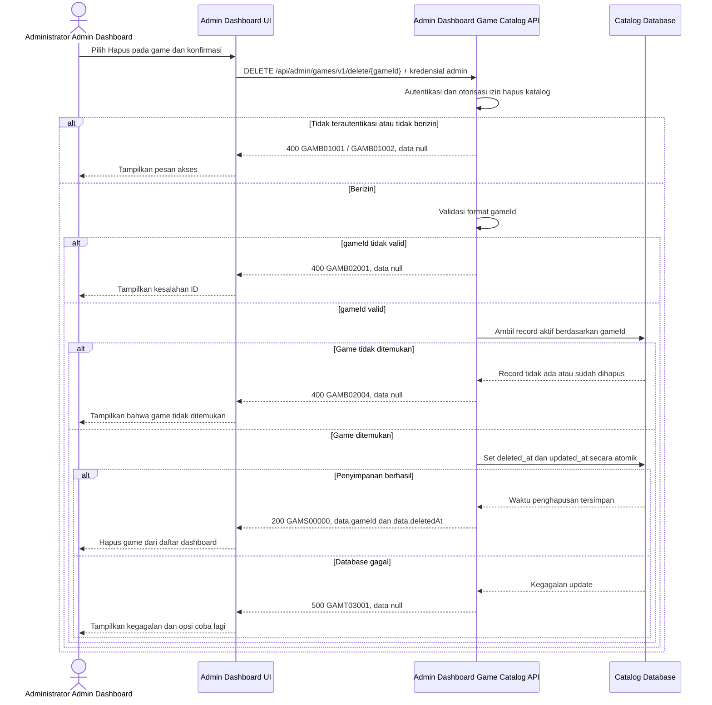

# Admin Dashboard - Delete Game Interface Agreement

> **Document Type:** IFA / API Contract  
> **Status:** Draft  
> **Service / Domain:** Admin Dashboard — Game Catalog Management  
> **Consumer / Partner:** JokiHub Admin Dashboard (authorized administrator)

## Design

API ini menghapus game dari katalog yang dikelola Admin Dashboard. Strategi yang diusulkan adalah soft delete menggunakan `deleted_at` agar referensi layanan dan riwayat pesanan tetap aman. ERD saat ini belum memiliki kolom tersebut atau relasi layanan/pesanan; persetujuan strategi dan pembaruan [Game ERD](../../erd/game-erd.md) menjadi prasyarat implementasi. Tidak ada hard delete atau cascade pada kontrak ini.

## Sequence Diagram



## Performance / SLA Targets

| Success Rate                                     | VUser                                       | CPU / Memory                        | Response Time                                                                             |
| ------------------------------------------------ | ------------------------------------------- | ----------------------------------- | ----------------------------------------------------------------------------------------- |
| TBD; confirm criticality and availability target | TBD; confirm peak concurrent administrators | TBD; set from capacity estimate/NFT | TBD; proposed less-critical web baseline: ideal 200 ms, acceptable 1 s, max tolerable 2 s |

## General Information

| Component          | Value                                                                                                                                  |
| ------------------ | -------------------------------------------------------------------------------------------------------------------------------------- |
| Description        | Menandai satu record game katalog sebagai terhapus tanpa menghapus riwayat atau record terkait.                                        |
| Resource URL       | `https://{host}/api/admin/games/v1/delete/{gameId}`                                                                                    |
| Transport Protocol | HTTPS, REST                                                                                                                            |
| Request Verb       | DELETE                                                                                                                                 |
| Content Type       | Tidak ada request body                                                                                                                 |
| Interaction Type   | Synchronous                                                                                                                            |
| Security Policy    | Admin authentication dan izin game-catalog delete. Identity provider serta nama izin TBD. Terapkan rate limiting dan audit aktor/aksi. |

### Path / Endpoint

| Section        | Value                                 |
| -------------- | ------------------------------------- |
| Host / Domain  | `{host}` (environment-specific)       |
| Service Name   | Game Catalog                          |
| Version        | `v1`                                  |
| Resource       | `/admin/games/v1/delete/{gameId}`     |
| Final Endpoint | `/api/admin/games/v1/delete/{gameId}` |

### API Versioning

- **Decision:** New Endpoint
- **Previous Endpoint:** Tidak ada API delete game yang teridentifikasi.
- **Final Endpoint:** `DELETE /api/admin/games/v1/delete/{gameId}`
- **Backward Compatibility:** Tidak ada consumer delete game yang teridentifikasi. Penambahan field response bersifat kompatibel; perubahan kontrak yang mematahkan consumer memerlukan major version baru.
- **Reason:** Admin Dashboard memerlukan operasi penghapusan terkontrol untuk satu game katalog.

## Business Rules

1. Hanya administrator terautentikasi dengan izin game-catalog delete yang dapat menghapus game. Pemetaan role dan izin TBD.
2. Penghapusan menggunakan soft delete: service mengisi `deleted_at` dengan timestamp UTC dan memperbarui `updated_at`. Kolom `deleted_at` belum tersedia di ERD saat ini dan harus disetujui sebelum implementasi.
3. Game terhapus tidak muncul pada daftar game admin secara default atau daftar game populer publik. Kontrak get-list dan popular-games perlu mengecualikan record dengan `deleted_at` terisi.
4. Operasi tidak menghapus fisik record, layanan, transaksi, atau pesanan terkait. Tidak ada cascade delete.
5. Game yang tidak ditemukan atau sudah dihapus mengembalikan `GAMB02004`. Pengulangan request tidak mengubah data atau menghasilkan audit penghapusan baru.
6. `gameId` dan identitas penghapus dicatat untuk audit. Mekanisme serta retensi audit TBD.
7. Update `deleted_at` dan `updated_at` dilakukan atomik. Jika database gagal, status game tetap seperti semula.
8. Penghapusan tidak dapat dibatalkan melalui API ini. Mekanisme restore, jika dibutuhkan, harus didefinisikan sebagai API terpisah.
9. Kebijakan penghapusan ketika game memiliki layanan/riwayat aktif belum dapat divalidasi karena relasi tersebut belum tercakup pada ERD. Tidak ada hard-delete sampai kebijakan referensial disepakati.

## Request Headers

| Header          | E/N/T | Type   | M/O/C | Max Length | Description                                                               | Example                 |
| --------------- | ----- | ------ | ----- | ---------: | ------------------------------------------------------------------------- | ----------------------- |
| `Authorization` | N     | String | M     |       4096 | Kredensial administrator; skema autentikasi bergantung identity provider. | `Bearer {access-token}` |
| `Accept`        | N     | String | O     |        100 | Tipe media response yang diinginkan; default JSON.                        | `application/json`      |
| `X-Request-Id`  | N     | String | O     |        100 | ID korelasi untuk audit/support.                                          | `req-3c10af`            |

## Request Parameters

| Parameter | E/N/T | Type   | M/O/C | Max Length | Description                                  | Example     |
| --------- | ----- | ------ | ----- | ---------: | -------------------------------------------- | ----------- |
| `gameId`  | N     | String | M     |         64 | ID immutable game katalog yang akan dihapus. | `gm_01JXYZ` |

## Request Body

Tidak ada request body.

### Request Validation

1. `Authorization` harus mengidentifikasi administrator terautentikasi dengan izin game-catalog delete. Kembalikan `GAMB01001` bila belum terautentikasi dan `GAMB01002` bila izin tidak tersedia.
2. `gameId` wajib tersedia, tidak kosong, dan panjang maksimal 64 karakter. Format ID mengikuti strategi pembuatan ID yang TBD; nilai format tidak valid mengembalikan `GAMB02001`.
3. Game harus ditemukan dan belum memiliki `deleted_at`. Bila tidak ditemukan atau sudah terhapus, kembalikan `GAMB02004`.
4. Request body tidak diterima. Jika body dikirim, abaikan hanya bila standar API mengizinkan; keputusan validasi body kosong perlu dikonfirmasi.
5. Perubahan `deleted_at` dan `updated_at` harus tersimpan atomik. Kegagalan database mengembalikan HTTP 500 tanpa detail internal.

## Response Body

Semua response menggunakan `status` dan `data`. Penghapusan sukses mengembalikan ID game dan waktu soft delete; error mengembalikan `data: null`.

| Attribute        | E/N/T | Type               | M/O/C | Max Length | Description                             | Example                |
| ---------------- | ----- | ------------------ | ----- | ---------: | --------------------------------------- | ---------------------- |
| `status`         | N     | Object             | M     |          — | Object status response.                 | `{}`                   |
| `status.code`    | N     | String             | M     |         20 | Service status code.                    | `GAMS00000`            |
| `status.message` | N     | String             | O     |        200 | Pesan hasil untuk consumer.             | `Game deleted`         |
| `data`           | N     | Object/null        | M     |          — | Hasil penghapusan; `null` ketika error. | `{}`                   |
| `data.gameId`    | N     | String             | C     |         64 | ID game yang ditandai terhapus.         | `gm_01JXYZ`            |
| `data.deletedAt` | N     | String (date-time) | C     |         35 | Waktu soft delete ISO 8601 UTC.         | `2026-10-11T09:30:00Z` |

### Success Example

```json
{
  "status": {
    "code": "GAMS00000",
    "message": "Game deleted"
  },
  "data": {
    "gameId": "gm_01JXYZ",
    "deletedAt": "2026-10-11T09:30:00Z"
  }
}
```

### Business Error Example

```json
{
  "status": {
    "code": "GAMB02004",
    "message": "Game not found"
  },
  "data": null
}
```

### Technical Error Example

```json
{
  "status": {
    "code": "GAMT03001",
    "message": "Game catalog is temporarily unavailable"
  },
  "data": null
}
```

## HTTP Status Codes

| HTTP Status | Usage                                                                                                                                                                                     |
| ----------- | ----------------------------------------------------------------------------------------------------------------------------------------------------------------------------------------- |
| `200`       | Game berhasil ditandai terhapus dan metadata penghapusan dikembalikan.                                                                                                                    |
| `400`       | ID tidak valid, akses admin tidak lolos, atau game tidak ditemukan/sudah terhapus sesuai baseline response project. Konfirmasi apakah API standard mengharuskan `401`, `403`, atau `404`. |
| `500`       | Kegagalan service atau database katalog yang tidak terduga.                                                                                                                               |

## Service Status Codes

Format: `[Service Prefix][Status Type][Category][Specific Error Code]`

| Code        | Type      | Category        | Meaning                                                       |
| ----------- | --------- | --------------- | ------------------------------------------------------------- |
| `GAMS00000` | Success   | General         | Game berhasil ditandai terhapus.                              |
| `GAMB01001` | Business  | Authentication  | Administrator belum terautentikasi.                           |
| `GAMB01002` | Business  | Authentication  | Administrator tidak memiliki izin hapus katalog game.         |
| `GAMB02001` | Business  | User validation | `gameId` tidak tersedia atau format/panjangnya tidak valid.   |
| `GAMB02004` | Business  | User validation | Game tidak ditemukan atau sudah dihapus.                      |
| `GAMT03001` | Technical | Database        | Record katalog gagal diperbarui atau database tidak tersedia. |

## API Exposure Classification

| Classification                 | Rationale                                                                                                                                                                    |
| ------------------------------ | ---------------------------------------------------------------------------------------------------------------------------------------------------------------------------- |
| Enterprise Intranet (proposed) | Operasi tulis khusus Admin Dashboard. Pastikan boundary jaringan; jika endpoint dapat diakses dari internet, klasifikasikan sebagai Public dan terapkan proteksi API publik. |

## Testing & Documentation Scope

| Scope      | Required | Rationale / Handoff                                                                                                                                                                                                    |
| ---------- | -------- | ---------------------------------------------------------------------------------------------------------------------------------------------------------------------------------------------------------------------- |
| NFT        | Yes      | API admin write baru. Cakup penghapusan sukses, ID invalid, game tidak ditemukan/sudah terhapus, kegagalan database, dan konkurensi admin. VUser, CPU/memory, serta target TPS TBD mengikuti forecast traffic dan SLA. |
| VA/Pentest | Yes      | API admin write. Uji autentikasi/otorisasi, IDOR pada `gameId`, privilege escalation, validasi input, replay request, dan audit attribution.                                                                           |

## Assumptions

- Soft delete melalui nullable `deleted_at` menjadi usulan karena relasi layanan/pesanan dan retention policy belum didefinisikan. API ini belum siap diimplementasikan sampai keputusan tersebut disetujui dan ERD diperbarui.
- Path `/api/admin/games/v1/delete/{gameId}`, HTTP `DELETE`, response envelope, prefix `GAM`, dan kode status mengikuti pola kontrak create/list/update dan perlu persetujuan API owner.
- Daftar admin dan endpoint popular games akan memfilter `deleted_at IS NULL`; kontrak terkait perlu diperbarui agar konsisten sebelum soft delete dirilis.
- Format `gameId`, identity provider, nama permission, audit storage/retention, API exposure boundary, SLA, dan pemetaan HTTP untuk authentication/authorization/not-found masih TBD.
- Tidak tersedia kebutuhan hard delete, restore, atau penghapusan layanan/pesanan terkait.

## References

- `./create-game.md` — field katalog dan pola izin admin.
- `./get-list-games.md` — daftar game admin; perlu mengecualikan soft-deleted games.
- `./update-game.md` — pola endpoint update dan status code Game Catalog.
- `../../erd/game-erd.md` — skema saat ini belum mendefinisikan soft delete atau relasi layanan/pesanan.
- `docs/sprint_1/solutioning/public/games/get-popular-games.md` — consumer storefront yang perlu mengecualikan soft-deleted games.
