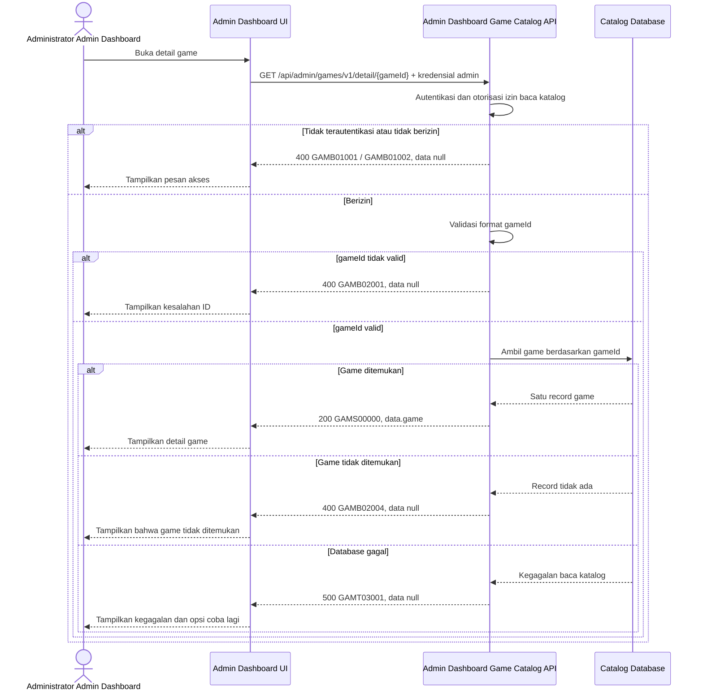

# Admin Dashboard - Get Detail Game Interface Agreement

> **Document Type:** IFA / API Contract  
> **Status:** Draft  
> **Service / Domain:** Admin Dashboard — Game Catalog Management  
> **Consumer / Partner:** JokiHub Admin Dashboard (authorized administrator)

## Design

API ini mengambil satu record game berdasarkan `gameId` untuk ditampilkan pada halaman detail atau form edit Admin Dashboard. Data mengikuti field katalog dari [Create Game](./create-game.md) dan skema usulan [Game ERD](../../erd/game-erd.md). API hanya membaca; perubahan game dilakukan melalui [Update Game](./update-game.md).

## Sequence Diagram



## Performance / SLA Targets

| Success Rate                                     | VUser                                       | CPU / Memory                        | Response Time                                                                             |
| ------------------------------------------------ | ------------------------------------------- | ----------------------------------- | ----------------------------------------------------------------------------------------- |
| TBD; confirm criticality and availability target | TBD; confirm peak concurrent administrators | TBD; set from capacity estimate/NFT | TBD; proposed less-critical web baseline: ideal 200 ms, acceptable 1 s, max tolerable 2 s |

## General Information

| Component          | Value                                                                                                                                                  |
| ------------------ | ------------------------------------------------------------------------------------------------------------------------------------------------------ |
| Description        | Mengambil detail satu record game katalog berdasarkan ID.                                                                                              |
| Resource URL       | `https://{host}/api/admin/games/v1/detail/{gameId}`                                                                                                    |
| Transport Protocol | HTTPS, REST                                                                                                                                            |
| Request Verb       | GET                                                                                                                                                    |
| Content Type       | Tidak ada request body                                                                                                                                 |
| Interaction Type   | Synchronous                                                                                                                                            |
| Security Policy    | Admin authentication dan izin game-catalog read. Identity provider serta nama permission TBD. Terapkan rate limiting dan audit akses sesuai kebijakan. |

### Path / Endpoint

| Section        | Value                                 |
| -------------- | ------------------------------------- |
| Host / Domain  | `{host}` (environment-specific)       |
| Service Name   | Game Catalog                          |
| Version        | `v1`                                  |
| Resource       | `/admin/games/v1/detail/{gameId}`     |
| Final Endpoint | `/api/admin/games/v1/detail/{gameId}` |

### API Versioning

- **Decision:** New Endpoint
- **Previous Endpoint:** Tidak ada API detail game admin yang teridentifikasi.
- **Final Endpoint:** `GET /api/admin/games/v1/detail/{gameId}`
- **Backward Compatibility:** Belum ada consumer detail game yang teridentifikasi. Penambahan field response bersifat kompatibel; perubahan kontrak yang mematahkan consumer memerlukan major version baru.
- **Reason:** Admin Dashboard memerlukan pembacaan satu game untuk halaman detail dan pengisian form edit.

## Business Rules

1. Hanya administrator terautentikasi dengan izin game-catalog read yang dapat mengakses endpoint. Pemetaan role dan izin TBD.
2. `gameId` mengidentifikasi satu record katalog dan tidak dapat diubah.
3. API mengembalikan seluruh field katalog yang didefinisikan dalam kontrak: `id`, `name`, `slug`, `serviceSummary`, `artworkKey`, `isActive`, `isPopular`, `sortOrder`, `createdAt`, dan `updatedAt`.
4. Nilai opsional yang belum diisi dikembalikan sebagai `null`, bukan dihilangkan, agar consumer dapat membedakan nilai kosong secara konsisten.
5. Jika record tidak ditemukan, API mengembalikan `GAMB02004`. Pemetaan HTTP 404 perlu diselaraskan dengan API standard; baseline kontrak project saat ini menggunakan HTTP 400 untuk error bisnis.
6. Endpoint tidak mengubah data game. Perubahan dilakukan melalui endpoint update terpisah.
7. Cache detail, bila digunakan, harus dihentikan atau diinvalidate setelah update game agar Admin Dashboard tidak menerima data lama. Strategi cache belum ditentukan.
8. Filter soft-delete belum menjadi bagian ERD saat ini. Jika soft delete disetujui, record terhapus tidak dikembalikan endpoint ini kecuali kontrak admin secara eksplisit mendukung detail arsip.

## Request Headers

| Header          | E/N/T | Type   | M/O/C | Max Length | Description                                                               | Example                 |
| --------------- | ----- | ------ | ----- | ---------: | ------------------------------------------------------------------------- | ----------------------- |
| `Authorization` | N     | String | M     |       4096 | Kredensial administrator; skema autentikasi bergantung identity provider. | `Bearer {access-token}` |
| `Accept`        | N     | String | O     |        100 | Tipe media response yang diinginkan; default JSON.                        | `application/json`      |
| `X-Request-Id`  | N     | String | O     |        100 | ID korelasi untuk audit/support.                                          | `req-5d8c31`            |

## Request Parameters

| Parameter | E/N/T | Type   | M/O/C | Max Length | Description                                 | Example     |
| --------- | ----- | ------ | ----- | ---------: | ------------------------------------------- | ----------- |
| `gameId`  | N     | String | M     |         64 | ID immutable game katalog yang akan dibaca. | `gm_01JXYZ` |

## Request Query Parameters

None.

## Request Body

Tidak ada request body.

### Request Validation

1. `Authorization` harus mengidentifikasi administrator terautentikasi dengan izin game-catalog read. Kembalikan `GAMB01001` bila belum terautentikasi dan `GAMB01002` bila izin tidak tersedia.
2. `gameId` wajib tersedia, tidak kosong, dan maksimal 64 karakter. Format ID mengikuti strategi pembuatan ID yang TBD; nilai yang tidak valid mengembalikan `GAMB02001`.
3. Jika `gameId` valid tetapi tidak memiliki record katalog, kembalikan `GAMB02004`.
4. Request body tidak digunakan. Parameter tambahan yang tidak didukung tidak boleh mengubah pemilihan record.
5. Kegagalan baca database mengembalikan HTTP 500 dan tidak mengungkap detail internal.

## Response Body

Semua response menggunakan `status` dan `data`. Sukses mengembalikan satu game; error mengembalikan `data: null`.

| Attribute                  | E/N/T | Type               | M/O/C | Max Length | Description                                                  | Example                 |
| -------------------------- | ----- | ------------------ | ----- | ---------: | ------------------------------------------------------------ | ----------------------- |
| `status`                   | N     | Object             | M     |          — | Object status response.                                      | `{}`                    |
| `status.code`              | N     | String             | M     |         20 | Service status code.                                         | `GAMS00000`             |
| `status.message`           | N     | String             | O     |        200 | Pesan hasil untuk consumer.                                  | `Game detail retrieved` |
| `data`                     | N     | Object/null        | M     |          — | Payload hasil; `null` ketika error.                          | `{}`                    |
| `data.game`                | N     | Object             | C     |          — | Record detail game katalog.                                  | `{}`                    |
| `data.game.id`             | N     | String             | C     |         64 | ID immutable katalog.                                        | `gm_01JXYZ`             |
| `data.game.name`           | N     | String             | C     |        100 | Nama tampilan.                                               | `Mobile Legends`        |
| `data.game.slug`           | N     | String             | C     |        100 | Slug unik untuk route.                                       | `mobile-legends`        |
| `data.game.serviceSummary` | N     | String/null        | O     |        160 | Ringkasan layanan pada kartu game.                           | `Joki Rank / Top Up`    |
| `data.game.artworkKey`     | N     | String/null        | O     |        160 | Key asset artwork yang disetujui.                            | `mobile-legends`        |
| `data.game.isActive`       | N     | Boolean            | C     |          — | Status ketersediaan storefront.                              | `true`                  |
| `data.game.isPopular`      | N     | Boolean            | C     |          — | Kelayakan game pada daftar populer.                          | `true`                  |
| `data.game.sortOrder`      | N     | Integer            | C     |  10 digits | Urutan tampilan; nilai lebih kecil ditampilkan lebih dahulu. | `2`                     |
| `data.game.createdAt`      | N     | String (date-time) | C     |         35 | Waktu pembuatan ISO 8601 UTC.                                | `2026-10-11T08:30:00Z`  |
| `data.game.updatedAt`      | N     | String (date-time) | C     |         35 | Waktu perubahan terakhir ISO 8601 UTC.                       | `2026-10-11T09:15:00Z`  |

### Success Example

```json
{
  "status": {
    "code": "GAMS00000",
    "message": "Game detail retrieved"
  },
  "data": {
    "game": {
      "id": "gm_01JXYZ",
      "name": "Mobile Legends",
      "slug": "mobile-legends",
      "serviceSummary": "Joki Rank / Top Up",
      "artworkKey": "mobile-legends",
      "isActive": true,
      "isPopular": true,
      "sortOrder": 2,
      "createdAt": "2026-10-11T08:30:00Z",
      "updatedAt": "2026-10-11T09:15:00Z"
    }
  }
}
```

### Business Error Example

```json
{
  "status": {
    "code": "GAMB02004",
    "message": "Game not found"
  },
  "data": null
}
```

### Technical Error Example

```json
{
  "status": {
    "code": "GAMT03001",
    "message": "Game catalog is temporarily unavailable"
  },
  "data": null
}
```

## HTTP Status Codes

| HTTP Status | Usage                                                                                                                                                                      |
| ----------- | -------------------------------------------------------------------------------------------------------------------------------------------------------------------------- |
| `200`       | Game detail berhasil ditemukan dan dikembalikan.                                                                                                                           |
| `400`       | ID tidak valid, akses admin tidak lolos, atau game tidak ditemukan sesuai baseline response project. Konfirmasi apakah API standard mengharuskan `401`, `403`, atau `404`. |
| `500`       | Kegagalan service atau database katalog yang tidak terduga.                                                                                                                |

## Service Status Codes

Format: `[Service Prefix][Status Type][Category][Specific Error Code]`

| Code        | Type      | Category        | Meaning                                                     |
| ----------- | --------- | --------------- | ----------------------------------------------------------- |
| `GAMS00000` | Success   | General         | Detail game berhasil dikembalikan.                          |
| `GAMB01001` | Business  | Authentication  | Administrator belum terautentikasi.                         |
| `GAMB01002` | Business  | Authentication  | Administrator tidak memiliki izin baca katalog game.        |
| `GAMB02001` | Business  | User validation | `gameId` tidak tersedia atau format/panjangnya tidak valid. |
| `GAMB02004` | Business  | User validation | Game dengan `gameId` tersebut tidak ditemukan.              |
| `GAMT03001` | Technical | Database        | Record katalog gagal dibaca atau database tidak tersedia.   |

## API Exposure Classification

| Classification                 | Rationale                                                                                                                                                                    |
| ------------------------------ | ---------------------------------------------------------------------------------------------------------------------------------------------------------------------------- |
| Enterprise Intranet (proposed) | Endpoint baca khusus Admin Dashboard. Pastikan boundary jaringan; jika endpoint dapat diakses dari internet, klasifikasikan sebagai Public dan terapkan proteksi API publik. |

## Testing & Documentation Scope

| Scope      | Required | Rationale / Handoff                                                                                                                                                                              |
| ---------- | -------- | ------------------------------------------------------------------------------------------------------------------------------------------------------------------------------------------------ |
| NFT        | Yes      | API admin baru. Uji detail ditemukan, ID invalid/tidak ditemukan, volume akses halaman edit, dan kegagalan database. VUser, CPU/memory, serta target TPS TBD mengikuti forecast traffic dan SLA. |
| VA/Pentest | Yes      | Endpoint admin. Uji authentication/authorization, IDOR pada `gameId`, akses role tidak berwenang, parameter tampering, dan kebocoran data internal.                                              |

## Assumptions

- Endpoint `/api/admin/games/v1/detail/{gameId}`, field response, envelope, prefix `GAM`, dan kode status mengikuti pola API admin game yang sudah didokumentasikan dan memerlukan persetujuan API owner.
- Route segmen `/detail/{gameId}` dipilih agar konsisten dengan action-based endpoint project (`/list`, `/create`, `/update/{gameId}`, `/delete/{gameId}`). Konfirmasi bila API standard memakai resource REST `GET /api/admin/games/v1/{gameId}`.
- Response detail memakai field yang sama dengan item pada [Get List Games](./get-list-games.md) dan record pada [Game ERD](../../erd/game-erd.md).
- Format `gameId`, identity provider, permission name, strategi cache, API exposure boundary, SLA, serta pemetaan HTTP untuk authentication/authorization/not-found masih TBD.
- Soft delete belum ditetapkan pada ERD. Jika disetujui, perilaku detail untuk game terhapus harus diselaraskan dengan kontrak delete dan list.

## References

- `./create-game.md` — definisi field game katalog.
- `./get-list-games.md` — kontrak daftar game dan pola response.
- `./update-game.md` — operasi update game.
- `./delete-game.md` — usulan soft delete dan perilaku record terhapus.
- `../../erd/game-erd.md` — skema game katalog saat ini.
