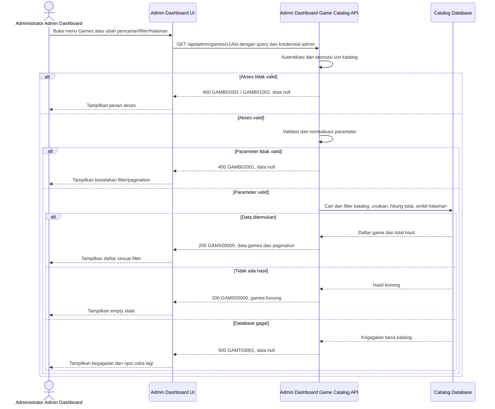

# Admin Dashboard - Get List Games Interface Agreement

> **Document Type:** IFA / API Contract  
> **Status:** Draft  
> **Service / Domain:** Admin Dashboard — Game Catalog Management  
> **Consumer / Partner:** JokiHub Admin Dashboard (authorized administrator)

## Design

Tujuan fitur ini adalah memberi administrator akses melihat dan mengelola daftar game katalog dari Admin Dashboard. Daftar mendukung pencarian, filter status, dan pagination agar administrator dapat menemukan data yang perlu dikelola. Belum ada layar Games management atau kebutuhan Games yang terisi dalam BRD; perilaku tabel dan field mengikuti usulan pada [Create Game](./create-game.md).

## Sequence Diagram



## Performance / SLA Targets

| Success Rate                                     | VUser                                       | CPU / Memory                              | Response Time                                                                             |
| ------------------------------------------------ | ------------------------------------------- | ----------------------------------------- | ----------------------------------------------------------------------------------------- |
| TBD; confirm criticality and availability target | TBD; confirm peak concurrent administrators | TBD; determine from capacity estimate/NFT | TBD; proposed less-critical web baseline: ideal 200 ms, acceptable 1 s, max tolerable 2 s |

## General Information

| Component          | Value                                                                                                                                                            |
| ------------------ | ---------------------------------------------------------------------------------------------------------------------------------------------------------------- |
| Description        | Mengambil daftar game katalog untuk ditampilkan dan dikelola administrator melalui Admin Dashboard.                                                              |
| Resource URL       | `https://{host}/api/admin/games/v1/list`                                                                                                                         |
| Transport Protocol | HTTPS, REST                                                                                                                                                      |
| Request Verb       | GET                                                                                                                                                              |
| Content Type       | `application/json` response; GET request has no body.                                                                                                            |
| Interaction Type   | Synchronous                                                                                                                                                      |
| Security Policy    | Admin authentication and game-catalog read permission. Identity provider and permission name TBD. Apply rate limiting and audit access where required by policy. |

### Path / Endpoint

| Section        | Value                           |
| -------------- | ------------------------------- |
| Host / Domain  | `{host}` (environment-specific) |
| Service Name   | Game Catalog                    |
| Version        | `v1`                            |
| Resource       | `/admin/games/v1/list`          |
| Final Endpoint | `/api/admin/games/v1/list`      |

### API Versioning

- **Decision:** New Endpoint
- **Previous Endpoint:** Not applicable; no admin game-list API identified.
- **Final Endpoint:** `GET /api/admin/games/v1/list`
- **Backward Compatibility:** No existing consumer identified. Additive optional response fields remain compatible; breaking request/response changes require a new major version.
- **Reason:** Admin Dashboard needs a protected, searchable catalog list separate from the public popular-games feed.

## Business Rules

1. Only an authenticated administrator with game-catalog read permission may access this list. Role and permission mapping are TBD.
2. The list includes active and inactive game records so administrators can manage catalog availability.
3. `q`, when supplied, matches `name` or `slug` case-insensitively after trimming.
4. `isActive` and `isPopular`, when supplied, filter by exact boolean value. Omitted filters do not restrict results.
5. Results use deterministic ordering: `sortOrder` ascending, then `name` ascending, then `id` ascending. Confirm ordering with product owner.
6. Pagination uses zero-based `offset` and `limit`. Default `limit` is 20; allowed range is 1–100. Default `offset` is 0.
7. `total` represents records matching search and filters before pagination.
8. No matching records is a successful result with an empty `games` array, not an error.
9. Response contains only catalog fields needed for admin list management; it must not expose internal audit data, credentials, or unrelated customer/order data.
10. Current game fields and proposed admin fields follow [Create Game](./create-game.md); final persisted schema remains subject to approval.

## Request Headers

| Header          | E/N/T | Type   | M/O/C | Max Length | Description                                                           | Example                 |
| --------------- | ----- | ------ | ----- | ---------: | --------------------------------------------------------------------- | ----------------------- |
| `Authorization` | N     | String | M     |       4096 | Admin credential; authentication scheme depends on identity provider. | `Bearer {access-token}` |
| `Accept`        | N     | String | O     |        100 | Desired response media type; defaults to JSON.                        | `application/json`      |
| `X-Request-Id`  | N     | String | O     |        100 | Correlation identifier for support/monitoring.                        | `req-8f41d2`            |

## Request Parameters

None.

## Request Query Parameters

| Parameter   | E/N/T | Type    | M/O/C | Max Length | Description                                                                           | Example  |
| ----------- | ----- | ------- | ----- | ---------: | ------------------------------------------------------------------------------------- | -------- |
| `q`         | N     | String  | O     |        100 | Case-insensitive search on game name or slug. Leading/trailing whitespace is trimmed. | `mobile` |
| `isActive`  | N     | Boolean | O     |          5 | Filter by active state; accepted values `true` or `false`.                            | `true`   |
| `isPopular` | N     | Boolean | O     |          5 | Filter by popular state; accepted values `true` or `false`.                           | `false`  |
| `limit`     | N     | Integer | O     |   3 digits | Page size; default 20; range 1–100.                                                   | `20`     |
| `offset`    | N     | Integer | O     |   9 digits | Zero-based number of matching records to skip; default 0; minimum 0.                  | `0`      |

## Request Body

None. GET request has no body.

### Request Validation

1. `Authorization` must identify an authenticated administrator with game-catalog read permission. Return `GAMB01001` when unauthenticated and `GAMB01002` when permission is missing.
2. `q`, when present, must be a string no longer than 100 characters. Trim surrounding whitespace; an empty normalized value behaves as omitted.
3. `isActive` and `isPopular`, when present, must be literal `true` or `false`; other values return `GAMB02001`.
4. `limit`, when present, must be an integer from 1 through 100; otherwise return `GAMB02001`.
5. `offset`, when present, must be a non-negative integer; otherwise return `GAMB02001`.
6. Unknown query parameters are ignored for forward compatibility; confirm this behavior with API owner.
7. Validation errors return HTTP 400 and `data: null`; catalog read failures return HTTP 500 and `data: null` without internal details.

## Response Body

Every response uses `status` and `data`. Successful responses contain `games` and pagination metadata. Empty matches return an empty array with `total: 0`. Errors return `data: null`.

| Attribute                     | E/N/T | Type               | M/O/C | Max Length | Description                               | Example                |
| ----------------------------- | ----- | ------------------ | ----- | ---------: | ----------------------------------------- | ---------------------- |
| `status`                      | N     | Object             | M     |          - | Response status object.                   | `{}`                   |
| `status.code`                 | N     | String             | M     |         20 | Service status code.                      | `GAMS00000`            |
| `status.message`              | N     | String             | O     |        200 | Human-readable result.                    | `Games retrieved`      |
| `data`                        | N     | Object/null        | M     |          - | Result payload; null on errors.           | `{}`                   |
| `data.games`                  | N     | Array              | M     |          - | Current page of matching games.           | `[]`                   |
| `data.games[].id`             | N     | String             | M     |         64 | Stable catalog identifier.                | `gm_01JXYZ`            |
| `data.games[].name`           | N     | String             | M     |        100 | Display name.                             | `Mobile Legends`       |
| `data.games[].slug`           | N     | String             | M     |        100 | URL-safe route identifier.                | `mobile-legends`       |
| `data.games[].serviceSummary` | N     | String/null        | O     |        160 | Storefront service summary.               | `Joki Rank / Top Up`   |
| `data.games[].artworkKey`     | N     | String/null        | O     |        160 | Approved asset key.                       | `mobile-legends`       |
| `data.games[].isActive`       | N     | Boolean            | M     |          - | Storefront availability.                  | `true`                 |
| `data.games[].isPopular`      | N     | Boolean            | M     |          - | Popular-list eligibility.                 | `true`                 |
| `data.games[].sortOrder`      | N     | Integer            | M     |  10 digits | Display order.                            | `2`                    |
| `data.games[].createdAt`      | N     | String (date-time) | M     |         35 | Creation time in ISO 8601 UTC.            | `2026-10-11T08:30:00Z` |
| `data.games[].updatedAt`      | N     | String (date-time) | M     |         35 | Last update time in ISO 8601 UTC.         | `2026-10-11T08:30:00Z` |
| `data.pagination.limit`       | N     | Integer            | M     |   3 digits | Applied page size.                        | `20`                   |
| `data.pagination.offset`      | N     | Integer            | M     |   9 digits | Applied offset.                           | `0`                    |
| `data.pagination.total`       | N     | Integer            | M     |  10 digits | Total matching records before pagination. | `2`                    |

### Success Example

```json
{
  "status": {
    "code": "GAMS00000",
    "message": "Games retrieved"
  },
  "data": {
    "games": [
      {
        "id": "gm_01JXYZ",
        "name": "Mobile Legends",
        "slug": "mobile-legends",
        "serviceSummary": "Joki Rank / Top Up",
        "artworkKey": "mobile-legends",
        "isActive": true,
        "isPopular": true,
        "sortOrder": 2,
        "createdAt": "2026-10-11T08:30:00Z",
        "updatedAt": "2026-10-11T08:30:00Z"
      }
    ],
    "pagination": {
      "limit": 20,
      "offset": 0,
      "total": 1
    }
  }
}
```

### Business Error Example

```json
{
  "status": {
    "code": "GAMB02001",
    "message": "Invalid list parameter"
  },
  "data": null
}
```

### Technical Error Example

```json
{
  "status": {
    "code": "GAMT03001",
    "message": "Game catalog is temporarily unavailable"
  },
  "data": null
}
```

## HTTP Status Codes

| HTTP Status | Usage                                                                                                                                              |
| ----------- | -------------------------------------------------------------------------------------------------------------------------------------------------- |
| `200`       | Query valid; returns matching games or an empty list.                                                                                              |
| `400`       | Invalid query, missing admin authentication, or insufficient permission per current project response baseline; confirm auth-specific HTTP mapping. |
| `500`       | Unexpected API or catalog database failure.                                                                                                        |

## Service Status Codes

Format: `[Service Prefix][Status Type][Category][Specific Error Code]`

| Code        | Type      | Category        | Meaning                                               |
| ----------- | --------- | --------------- | ----------------------------------------------------- |
| `GAMS00000` | Success   | General         | Game list retrieved, including empty result.          |
| `GAMB01001` | Business  | Authentication  | Administrator is not authenticated.                   |
| `GAMB01002` | Business  | Authentication  | Administrator lacks game-catalog read permission.     |
| `GAMB02001` | Business  | User validation | Query parameter is invalid.                           |
| `GAMT03001` | Technical | Database        | Catalog could not be read or database is unavailable. |

## API Exposure Classification

| Classification                 | Rationale                                                                                                                                           |
| ------------------------------ | --------------------------------------------------------------------------------------------------------------------------------------------------- |
| Enterprise Intranet (proposed) | Admin-only read operation for the dashboard. Confirm network boundary; if internet-accessible, classify as Public and apply public API protections. |

## Testing & Documentation Scope

| Scope      | Required | Rationale / Handoff                                                                                                                                                      |
| ---------- | -------- | ------------------------------------------------------------------------------------------------------------------------------------------------------------------------ |
| NFT        | Yes      | New admin list API. Test common and maximum page sizes, filters, search, and peak concurrent admin load. VUser, CPU/memory, and target TPS TBD pending traffic forecast. |
| VA/Pentest | Yes      | Admin API. Verify authentication/authorization, privilege boundaries, query validation, injection resistance, and that customer/order/audit-private data is not exposed. |

## Assumptions

- Endpoint `/api/admin/games/v1/list`, query names, response envelope, service codes, and page defaults are proposed to align with [Create Game](./create-game.md), pending API owner approval.
- `serviceSummary`/`artworkKey` map to the current UI model’s `service`/`art`; final catalog persistence schema is TBD.
- Search covers only `name` and `slug`; sort and exact-match rules need product confirmation.
- Admin identity provider, role/permission names, rate limits, cache policy, and service SLA are TBD.

## References

- `./create-game.md` — proposed game catalog fields and admin access assumptions.
- `docs/sprint_1/solutioning/public/games/get-popular-games.md` — public popular-games consumer contract.
- `src/features/AdminDashboard/views/pages/AdminDashboard.page.tsx` — existing Admin Dashboard entry point; Games list UI is not yet implemented.
