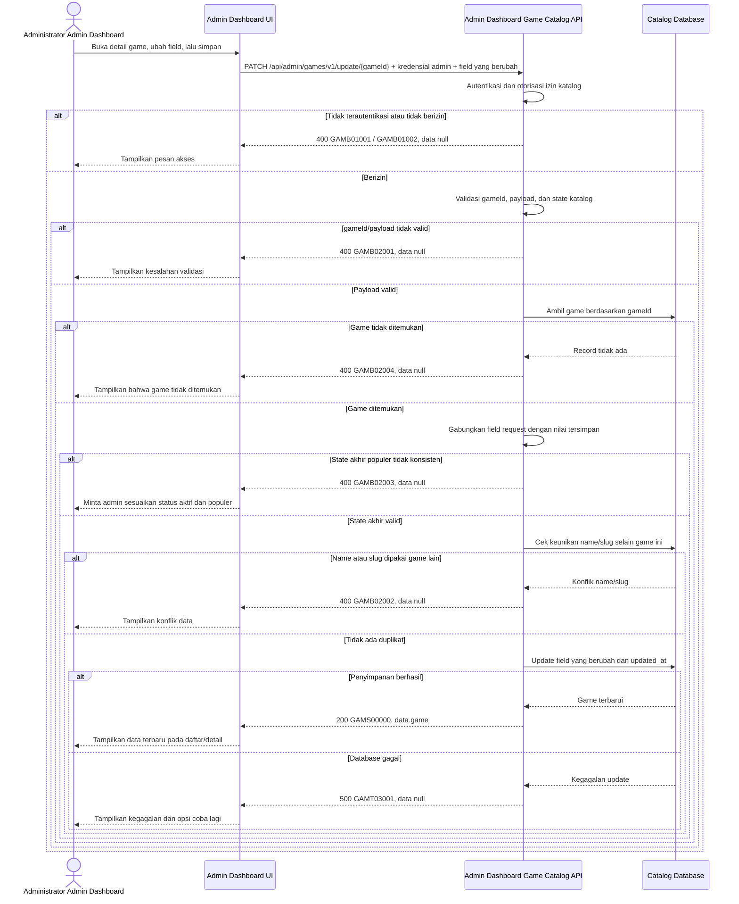

# Admin Dashboard - Update Game Interface Agreement

> **Document Type:** IFA / API Contract  
> **Status:** Draft  
> **Service / Domain:** Admin Dashboard — Game Catalog Management  
> **Consumer / Partner:** JokiHub Admin Dashboard (authorized administrator)

## Design

API ini memperbarui record game yang sudah ada di katalog melalui Admin Dashboard. Dashboard mengirim hanya field yang berubah; API memvalidasi hak akses, keberadaan game, keunikan `name`/`slug`, dan konsistensi status aktif-populer sebelum menyimpan perubahan. Field katalog mengikuti [Create Game](./create-game.md) dan skema usulan pada [Game ERD](../../erd/game-erd.md). Belum ada kebutuhan Games yang terisi dalam BRD, sehingga kontrak ini merupakan usulan.

## Sequence Diagram



## Performance / SLA Targets

| Success Rate                                     | VUser                                       | CPU / Memory                        | Response Time                                                                             |
| ------------------------------------------------ | ------------------------------------------- | ----------------------------------- | ----------------------------------------------------------------------------------------- |
| TBD; confirm criticality and availability target | TBD; confirm peak concurrent administrators | TBD; set from capacity estimate/NFT | TBD; proposed less-critical web baseline: ideal 200 ms, acceptable 1 s, max tolerable 2 s |

## General Information

| Component          | Value                                                                                                                                  |
| ------------------ | -------------------------------------------------------------------------------------------------------------------------------------- |
| Description        | Memperbarui satu record game katalog berdasarkan `gameId`.                                                                             |
| Resource URL       | `https://{host}/api/admin/games/v1/update/{gameId}`                                                                                    |
| Transport Protocol | HTTPS, REST                                                                                                                            |
| Request Verb       | PATCH                                                                                                                                  |
| Content Type       | `application/json`                                                                                                                     |
| Interaction Type   | Synchronous                                                                                                                            |
| Security Policy    | Admin authentication dan izin game-catalog update. Identity provider serta nama izin TBD. Terapkan rate limiting dan audit aktor/aksi. |

### Path / Endpoint

| Section        | Value                                 |
| -------------- | ------------------------------------- |
| Host / Domain  | `{host}` (environment-specific)       |
| Service Name   | Game Catalog                          |
| Version        | `v1`                                  |
| Resource       | `/admin/games/v1/update/{gameId}`     |
| Final Endpoint | `/api/admin/games/v1/update/{gameId}` |

### API Versioning

- **Decision:** New Endpoint
- **Previous Endpoint:** Tidak ada API update game yang teridentifikasi.
- **Final Endpoint:** `PATCH /api/admin/games/v1/update/{gameId}`
- **Backward Compatibility:** Belum ada consumer update game yang teridentifikasi. Penambahan field response bersifat kompatibel; perubahan kontrak yang mematahkan consumer memerlukan major version baru.
- **Reason:** Admin Dashboard memerlukan operasi update parsial terhadap record katalog yang ditargetkan.

## Business Rules

1. Hanya administrator terautentikasi dengan izin game-catalog update yang dapat memperbarui game. Pemetaan role dan izin TBD.
2. `gameId` mengidentifikasi satu record katalog. `id` tidak dapat diubah melalui request.
3. Request bersifat parsial: field yang tidak dikirim mempertahankan nilai tersimpan; `serviceSummary` dan `artworkKey` yang dikirim sebagai `null` menghapus nilai opsional tersebut.
4. Minimal satu field mutable harus dikirim. `createdAt` dan `updatedAt` bukan field mutable yang diterima dari consumer.
5. `name` setelah trim dan normalisasi harus unik dibandingkan game lain. `slug` harus unik dibandingkan game lain. Record yang sedang diperbarui dikecualikan dari pemeriksaan duplikasi.
6. `isPopular=true` hanya berlaku bila hasil akhir `isActive=true`. Bila game populer dinonaktifkan, consumer harus sekaligus mengirim `isPopular=false`; API menolak state akhir yang tidak konsisten.
7. `sortOrder` tidak boleh negatif. Nilai lebih kecil tampil lebih dahulu.
8. `artworkKey` harus menunjuk asset yang disetujui. Integrasi registry asset TBD.
9. `updatedAt` dibuat oleh service dalam UTC pada setiap update sukses. `createdAt` tidak berubah.
10. Perubahan sukses dicatat dengan identitas administrator dan waktu. Penyimpanan serta retensi audit TBD.
11. API mengembalikan snapshot game hasil update. Bila satu validasi gagal, tidak ada field yang disimpan; operasi bersifat atomik.
12. Kebijakan optimistic locking untuk dua admin yang mengubah game bersamaan belum ditetapkan; putuskan penggunaan ETag/`If-Match` atau versi record sebelum implementasi.

## Request Headers

| Header          | E/N/T | Type   | M/O/C | Max Length | Description                                                               | Example                 |
| --------------- | ----- | ------ | ----- | ---------: | ------------------------------------------------------------------------- | ----------------------- |
| `Authorization` | N     | String | M     |       4096 | Kredensial administrator; skema autentikasi bergantung identity provider. | `Bearer {access-token}` |
| `Content-Type`  | N     | String | M     |        100 | Tipe media request.                                                       | `application/json`      |
| `Accept`        | N     | String | O     |        100 | Tipe media response yang diinginkan; default JSON.                        | `application/json`      |
| `X-Request-Id`  | N     | String | O     |        100 | ID korelasi untuk audit/support.                                          | `req-91b7c4`            |

## Request Parameters

| Parameter | E/N/T | Type   | M/O/C | Max Length | Description                             | Example     |
| --------- | ----- | ------ | ----- | ---------: | --------------------------------------- | ----------- |
| `gameId`  | N     | String | M     |         64 | ID immutable game yang akan diperbarui. | `gm_01JXYZ` |

## Request Body

| Attribute        | E/N/T | Type        | M/O/C | Max Length | Description                                                     | Example                     |
| ---------------- | ----- | ----------- | ----- | ---------: | --------------------------------------------------------------- | --------------------------- |
| `name`           | N     | String      | O     |        100 | Nama tampilan baru; trim sebelum disimpan.                      | `Mobile Legends: Bang Bang` |
| `slug`           | N     | String      | O     |        100 | Slug unik baru, huruf kecil dan segmen dipisahkan tanda hubung. | `mobile-legends-bang-bang`  |
| `serviceSummary` | N     | String/null | O     |        160 | Ringkasan storefront; kirim `null` untuk menghapus.             | `Joki Rank dan Top Up`      |
| `artworkKey`     | N     | String/null | O     |        160 | Key asset yang disetujui; kirim `null` untuk menghapus.         | `mobile-legends-bang-bang`  |
| `isActive`       | N     | Boolean     | O     |          — | Status ketersediaan storefront.                                 | `true`                      |
| `isPopular`      | N     | Boolean     | O     |          — | Kelayakan masuk daftar populer.                                 | `false`                     |
| `sortOrder`      | N     | Integer     | O     |  10 digits | Urutan tampilan non-negatif.                                    | `3`                         |

### Example Request Body

```json
{
  "name": "Mobile Legends: Bang Bang",
  "slug": "mobile-legends-bang-bang",
  "serviceSummary": "Joki Rank dan Top Up",
  "artworkKey": "mobile-legends-bang-bang",
  "isActive": true,
  "isPopular": false,
  "sortOrder": 3
}
```

### Request Validation

1. `Authorization` harus mengidentifikasi administrator terautentikasi yang memiliki izin game-catalog update. Kembalikan `GAMB01001` bila belum terautentikasi dan `GAMB01002` bila izin tidak tersedia.
2. `gameId` wajib ada, tidak kosong, maksimal 64 karakter, dan mengikuti format ID yang diterbitkan service. Format ID final TBD.
3. Body wajib berupa JSON object dan memuat minimal satu field mutable. Field tidak dikenal, termasuk `id`, `createdAt`, dan `updatedAt`, ditolak dengan `GAMB02001`.
4. `name`, bila dikirim, harus string tidak kosong setelah trim dan maksimal 100 karakter.
5. `slug`, bila dikirim, harus cocok dengan `^[a-z0-9]+(?:-[a-z0-9]+)*$` dan maksimal 100 karakter.
6. `serviceSummary` dan `artworkKey`, bila dikirim bukan `null`, harus string dan memenuhi batas panjang masing-masing. `artworkKey` harus cocok dengan asset yang disetujui; dependency validasi TBD.
7. `isActive` dan `isPopular`, bila dikirim, harus boolean. API validasi kombinasi request dengan nilai tersimpan dan menolak hasil akhir `isActive=false` serta `isPopular=true` dengan `GAMB02003`.
8. `sortOrder`, bila dikirim, harus integer non-negatif.
9. Nilai `name`/`slug` yang sudah dinormalisasi tidak boleh digunakan game lain. Konflik mengembalikan `GAMB02002`; nilai milik `gameId` yang sama bukan konflik.
10. Jika `gameId` valid tetapi record tidak ditemukan, kembalikan `GAMB02004`.
11. Validasi gagal tidak boleh menyimpan sebagian perubahan. Error bisnis mengembalikan HTTP 400 dan `data: null`; kegagalan database mengembalikan HTTP 500 tanpa detail internal.

## Response Body

Semua response menggunakan `status` dan `data`. Update sukses mengembalikan record katalog terbaru; error mengembalikan `data: null`.

| Attribute                  | E/N/T | Type               | M/O/C | Max Length | Description                                              | Example                     |
| -------------------------- | ----- | ------------------ | ----- | ---------: | -------------------------------------------------------- | --------------------------- |
| `status`                   | N     | Object             | M     |          — | Object status response.                                  | `{}`                        |
| `status.code`              | N     | String             | M     |         20 | Service status code.                                     | `GAMS00000`                 |
| `status.message`           | N     | String             | O     |        200 | Pesan hasil untuk consumer.                              | `Game updated`              |
| `data`                     | N     | Object/null        | M     |          — | Payload hasil; `null` ketika error.                      | `{}`                        |
| `data.game`                | N     | Object             | C     |          — | Snapshot record game setelah update.                     | `{}`                        |
| `data.game.id`             | N     | String             | C     |         64 | ID immutable katalog.                                    | `gm_01JXYZ`                 |
| `data.game.name`           | N     | String             | C     |        100 | Nama tampilan tersimpan.                                 | `Mobile Legends: Bang Bang` |
| `data.game.slug`           | N     | String             | C     |        100 | Slug unik tersimpan.                                     | `mobile-legends-bang-bang`  |
| `data.game.serviceSummary` | N     | String/null        | O     |        160 | Ringkasan layanan storefront.                            | `Joki Rank dan Top Up`      |
| `data.game.artworkKey`     | N     | String/null        | O     |        160 | Key asset tersimpan.                                     | `mobile-legends-bang-bang`  |
| `data.game.isActive`       | N     | Boolean            | M     |          — | Status ketersediaan storefront.                          | `true`                      |
| `data.game.isPopular`      | N     | Boolean            | M     |          — | Kelayakan daftar populer.                                | `false`                     |
| `data.game.sortOrder`      | N     | Integer            | M     |  10 digits | Urutan tampilan.                                         | `3`                         |
| `data.game.createdAt`      | N     | String (date-time) | M     |         35 | Waktu pembuatan ISO 8601 UTC; tidak berubah saat update. | `2026-10-11T08:30:00Z`      |
| `data.game.updatedAt`      | N     | String (date-time) | M     |         35 | Waktu update terbaru ISO 8601 UTC.                       | `2026-10-11T09:15:00Z`      |

### Success Example

```json
{
  "status": {
    "code": "GAMS00000",
    "message": "Game updated"
  },
  "data": {
    "game": {
      "id": "gm_01JXYZ",
      "name": "Mobile Legends: Bang Bang",
      "slug": "mobile-legends-bang-bang",
      "serviceSummary": "Joki Rank dan Top Up",
      "artworkKey": "mobile-legends-bang-bang",
      "isActive": true,
      "isPopular": false,
      "sortOrder": 3,
      "createdAt": "2026-10-11T08:30:00Z",
      "updatedAt": "2026-10-11T09:15:00Z"
    }
  }
}
```

### Business Error Example

```json
{
  "status": {
    "code": "GAMB02002",
    "message": "Game name or slug already exists"
  },
  "data": null
}
```

### Technical Error Example

```json
{
  "status": {
    "code": "GAMT03001",
    "message": "Game catalog is temporarily unavailable"
  },
  "data": null
}
```

## HTTP Status Codes

| HTTP Status | Usage                                                                                                                                                                                                                                 |
| ----------- | ------------------------------------------------------------------------------------------------------------------------------------------------------------------------------------------------------------------------------------- |
| `200`       | Game berhasil diperbarui dan snapshot terkini dikembalikan.                                                                                                                                                                           |
| `400`       | Request tidak valid, autentikasi/otorisasi tidak lolos, game tidak ditemukan, konflik unik, atau state bisnis tidak konsisten sesuai baseline response project. Konfirmasi apakah API standard mengharuskan `401`, `403`, atau `404`. |
| `500`       | Kegagalan service atau database katalog yang tidak terduga.                                                                                                                                                                           |

## Service Status Codes

Format: `[Service Prefix][Status Type][Category][Specific Error Code]`

| Code        | Type      | Category        | Meaning                                                           |
| ----------- | --------- | --------------- | ----------------------------------------------------------------- |
| `GAMS00000` | Success   | General         | Game berhasil diperbarui.                                         |
| `GAMB01001` | Business  | Authentication  | Administrator belum terautentikasi.                               |
| `GAMB01002` | Business  | Authentication  | Administrator tidak memiliki izin update katalog game.            |
| `GAMB02001` | Business  | User validation | ID, body, field, format, panjang, atau state request tidak valid. |
| `GAMB02002` | Business  | User validation | `name` atau `slug` sudah digunakan game lain.                     |
| `GAMB02003` | Business  | User validation | State populer tidak konsisten dengan state aktif.                 |
| `GAMB02004` | Business  | User validation | Game dengan `gameId` tersebut tidak ditemukan.                    |
| `GAMT03001` | Technical | Database        | Record katalog gagal diperbarui atau database tidak tersedia.     |

## API Exposure Classification

| Classification                 | Rationale                                                                                                                                                                    |
| ------------------------------ | ---------------------------------------------------------------------------------------------------------------------------------------------------------------------------- |
| Enterprise Intranet (proposed) | Operasi tulis khusus Admin Dashboard. Pastikan boundary jaringan; jika endpoint dapat diakses dari internet, klasifikasikan sebagai Public dan terapkan proteksi API publik. |

## Testing & Documentation Scope

| Scope      | Required | Rationale / Handoff                                                                                                                                                                                                     |
| ---------- | -------- | ----------------------------------------------------------------------------------------------------------------------------------------------------------------------------------------------------------------------- |
| NFT        | Yes      | API admin write baru. Uji update parsial, konflik unik, perubahan state aktif-populer, record tidak ditemukan, persistensi, dan beban admin puncak. VUser, CPU/memory, serta target TPS TBD mengikuti forecast traffic. |
| VA/Pentest | Yes      | API admin write. Uji autentikasi/otorisasi, batas privilege, IDOR pada `gameId`, payload validation, injection, mass assignment, dan audit attribution.                                                                 |

## Assumptions

- Path `/api/admin/games/v1/update/{gameId}`, HTTP `PATCH`, nama field, response envelope, dan kode status mengikuti usulan kontrak create/list dan perlu persetujuan API owner.
- Field katalog mengikuti [Create Game](./create-game.md); response mengikuti struktur item pada [Get List Games](./get-list-games.md).
- `serviceSummary` dan `artworkKey` adalah mapping dari field storefront `service` dan `art`. `mark` tidak disertakan karena belum ada kebutuhan produk yang dikonfirmasi.
- Format `gameId`, identity provider, nama permission, registry asset, audit storage/retention, kebijakan concurrency, rate limit, SLA, dan exposure boundary masih TBD.
- API memakai HTTP 400 untuk semua error bisnis sesuai baseline kontrak saat ini. Penggunaan HTTP 401/403/404 perlu diselaraskan dengan API standard.

## References

- `./create-game.md` — field katalog, izin admin, dan aturan create.
- `./get-list-games.md` — response item dan daftar game admin.
- `../../erd/game-erd.md` — model data game katalog.
- `docs/sprint_1/solutioning/public/games/get-popular-games.md` — consumer storefront daftar game populer.
