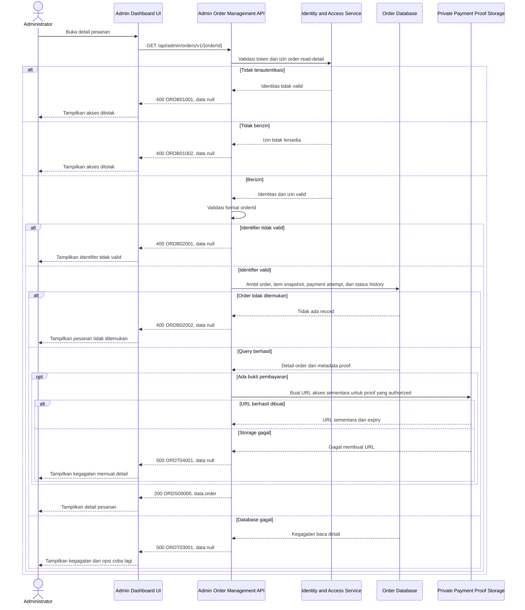

# Admin Dashboard - Get Order Detail Interface Agreement

> **Document Type:** IFA / API Contract  
> **Status:** Draft  
> **Service / Domain:** Admin Dashboard — Order Management  
> **Consumer / Partner:** JokiHub Admin Dashboard (authorized administrator)

## Design

API ini mengambil detail satu pesanan berdasarkan `orderId` internal. `orderNumber` publik disertakan dalam response untuk tampilan. Detail mencakup snapshot pelanggan, item dan instruksi fulfillment, ringkasan pembayaran, bukti pembayaran yang dapat ditinjau secara aman, serta riwayat perubahan status. Model sumber adalah `customer_order`, `order_item`, `order_payment`, `payment_proof`, `order_status_history`, dan `payment_status_history` pada [Order ERD](../../erd/order-erd.md). Admin Orders saat ini hanya menampilkan dialog detail berbasis mock data; field detail penuh dalam kontrak ini merupakan rancangan untuk menggantikan mock.

## Sequence Diagram



## Performance / SLA Targets

| Success Rate                                        | VUser                                   | CPU / Memory                             | Response Time                                                                            |
| --------------------------------------------------- | --------------------------------------- | ---------------------------------------- | ---------------------------------------------------------------------------------------- |
| TBD; konfirmasi criticality dan target availability | TBD; konfirmasi concurrent admin puncak | TBD; tetapkan dari capacity estimate/NFT | TBD; usulan baseline transactional: ideal 100 ms, acceptable 500 ms, max tolerable 1–2 s |

## General Information

| Component          | Value                                                                                                                             |
| ------------------ | --------------------------------------------------------------------------------------------------------------------------------- |
| Description        | Mengambil detail pesanan, item, pembayaran, dan audit status untuk Admin Dashboard.                                               |
| Resource URL       | `https://{host}/api/admin/orders/v1/{orderId}`                                                                                    |
| Transport Protocol | HTTPS, REST                                                                                                                       |
| Request Verb       | GET                                                                                                                               |
| Content Type       | Tidak ada request body                                                                                                            |
| Interaction Type   | Synchronous                                                                                                                       |
| Security Policy    | Admin authentication dan izin `order-read-detail`; proof hanya melalui akses storage privat sementara. Nama permission final TBD. |

### Path / Endpoint

| Section        | Value                                |
| -------------- | ------------------------------------ |
| Host / Domain  | `{host}` (environment-specific)      |
| Service Name   | Order Management                     |
| Version        | `v1`                                 |
| Resource       | `/admin/orders/v1/{orderId}`         |
| Final Endpoint | `GET /api/admin/orders/v1/{orderId}` |

### API Versioning

- **Decision:** New Endpoint
- **Previous Endpoint:** Tidak ada API detail pesanan admin yang teridentifikasi pada solutioning sprint ini.
- **Final Endpoint:** `GET /api/admin/orders/v1/{orderId}`
- **Backward Compatibility:** Belum ada consumer API ini yang teridentifikasi. Penambahan field response opsional bersifat kompatibel; perubahan kontrak yang mematahkan consumer memerlukan major version baru.
- **Reason:** Admin memerlukan satu sumber detail untuk memeriksa instruksi fulfillment dan memvalidasi pembayaran manual.

## Business Rules

1. Hanya administrator terautentikasi dengan izin `order-read-detail` yang dapat membaca detail. Permission dapat dipetakan ke `order-read` bila RBAC tidak membedakan akses list dan detail; keputusan final mengikuti role matrix.
2. `orderId` adalah ID internal immutable dari `customer_order.order_id`; endpoint tidak menerima nomor order sebagai pengganti kecuali kontrak secara eksplisit menetapkan lookup alternatif. Nomor order tetap disertakan pada response untuk tampilan.
3. Satu order mengembalikan seluruh `order_item` snapshot terkait. Jangan membaca ulang harga atau nama produk dari katalog aktif untuk mengganti snapshot transaksi.
4. Data pelanggan berasal dari snapshot saat checkout. `customerWhatsapp` hanya tampil kepada admin berizin dan tidak boleh dicatat sebagai PII mentah dalam application logs.
5. `gameAccount`, `gameServer`, dan `customerNotes` merupakan data fulfillment sensitif. Batasi akses sesuai role, redaksi pada log dan tracing, dan jangan pernah menyimpan atau mengembalikan password game maupun OTP.
6. `orderStatus` dan `paymentStatus` adalah lifecycle terpisah. Riwayat masing-masing diambil dari tabel history terkait; urutkan kronologis naik berdasarkan timestamp lalu ID history untuk tie-break yang deterministik.
7. `payments` memuat seluruh payment attempt untuk order, termasuk rejected/failed bila tersimpan. Setiap payment merujuk bukti miliknya sendiri; bukti dari attempt lain tidak boleh tercampur.
8. `object_key` tidak pernah dikirim ke browser. Untuk proof yang ada, API mengembalikan metadata dan URL akses sementara yang berumur pendek, terbatas pada satu objek dan hanya dibuat setelah authorization. TTL, metode delivery, dan batas unduhan perlu dikonfirmasi.
9. Bukti pembayaran dapat belum ada, termasuk ketika order belum mengirim proof. Dalam kondisi itu `proofs` berupa array kosong; tidak adanya proof bukan kegagalan detail.
10. Order yang tidak ditemukan mengembalikan error bisnis yang sama tanpa membedakan apakah ID pernah ada atau telah dihapus, untuk mengurangi enumerasi. Historical order tidak dihapus secara fisik sesuai ERD.
11. Endpoint bersifat read-only: tidak mengubah status order/payment, tidak memicu notifikasi, dan tidak melakukan validasi pembayaran.
12. Refund dan komplain tidak dirinci oleh endpoint ini; keduanya memiliki modul dan kontrak sendiri yang mereferensikan order.

## Request Headers

| Header          | E/N/T | Type   | M/O/C | Max Length | Description                                                  | Example                 |
| --------------- | ----- | ------ | ----- | ---------: | ------------------------------------------------------------ | ----------------------- |
| `Authorization` | N     | String | M     |       4096 | Kredensial administrator; skema mengikuti identity provider. | `Bearer {access-token}` |
| `Accept`        | N     | String | O     |        100 | Tipe media response yang diinginkan; default JSON.           | `application/json`      |
| `X-Request-Id`  | N     | String | O     |        100 | ID korelasi untuk audit/support; jangan memuat PII.          | `req-a17c2e`            |

## Request Parameters

| Parameter | E/N/T | Type          | M/O/C | Max Length | Description                       | Example      |
| --------- | ----- | ------------- | ----- | ---------: | --------------------------------- | ------------ |
| `orderId` | N     | String (path) | M     |         64 | ID internal immutable dari order. | `ord_01JXYZ` |

## Request Body

Tidak ada request body.

### Request Validation

1. `Authorization` harus mengidentifikasi administrator terautentikasi dengan izin detail. Kembalikan `ORDB01001` bila token tidak valid dan `ORDB01002` bila akses tidak tersedia.
2. `orderId` wajib, tidak kosong, maksimal 64 karakter, dan mengikuti format ID yang ditetapkan implementasi. Tolak path identifier invalid dengan `ORDB02001`.
3. Tolak parameter query yang tidak dikenal; endpoint tidak membutuhkan query parameter pada versi ini.
4. Otorisasi harus dijalankan sebelum mengambil atau membuat URL bukti pembayaran.
5. Jika ID valid tetapi record tidak ditemukan, kembalikan `ORDB02002` tanpa membocorkan status keberadaan historis atau detail internal.
6. Kegagalan database menghasilkan HTTP 500 `ORDT03001`; kegagalan mengakses metadata/buat URL proof menghasilkan HTTP 500 `ORDT04001`. Jangan mengembalikan object key atau informasi storage internal.

## Response Body

Semua response menggunakan envelope `status` dan `data`. Error mengembalikan `data: null`.

| Attribute                                      | E/N/T | Type                    | M/O/C |            Max Length | Description                                                                       | Example                                              |
| ---------------------------------------------- | ----- | ----------------------- | ----- | --------------------: | --------------------------------------------------------------------------------- | ---------------------------------------------------- |
| `status`                                       | N     | Object                  | M     |                     — | Object status response.                                                           | `{}`                                                 |
| `status.code`                                  | N     | String                  | M     |                    20 | Service status code.                                                              | `ORDS00000`                                          |
| `status.message`                               | N     | String                  | O     |                   200 | Pesan hasil untuk consumer.                                                       | `Order detail retrieved`                             |
| `data`                                         | N     | Object/null             | M     |                     — | Payload detail; `null` ketika error.                                              | `{}`                                                 |
| `data.order`                                   | N     | Object                  | M     |                     — | Detail satu order.                                                                | `{}`                                                 |
| `data.order.id`                                | N     | String                  | M     |                    64 | ID internal order.                                                                | `ord_01JXYZ`                                         |
| `data.order.orderNumber`                       | N     | String                  | M     |                    32 | Nomor order customer/admin.                                                       | `JH-2026-001248`                                     |
| `data.order.customer.name`                     | N     | String                  | M     |                   150 | Snapshot nama customer.                                                           | `Budi Santoso`                                       |
| `data.order.customer.whatsapp`                 | N     | String                  | M     |                    32 | Snapshot nomor WhatsApp checkout; response dibatasi ke admin berizin.             | `+6281234567890`                                     |
| `data.order.orderStatus`                       | N     | String                  | M     |                    30 | Status fulfillment/order.                                                         | `PENDING_VALIDATION`                                 |
| `data.order.paymentStatus`                     | N     | String                  | M     |                    30 | Status pembayaran terpisah dari status order.                                     | `PENDING_REVIEW`                                     |
| `data.order.amount.subtotal`                   | N     | Decimal                 | M     |                  18,2 | Snapshot subtotal order.                                                          | `25000.00`                                           |
| `data.order.amount.discount`                   | N     | Decimal                 | M     |                  18,2 | Snapshot diskon.                                                                  | `0.00`                                               |
| `data.order.amount.total`                      | N     | Decimal                 | M     |                  18,2 | Total snapshot yang ditagihkan.                                                   | `25000.00`                                           |
| `data.order.amount.currency`                   | N     | String                  | M     |                     3 | Kode mata uang ISO 4217.                                                          | `IDR`                                                |
| `data.order.expiresAt`                         | N     | String (date-time)/null | O     |                    35 | Waktu kedaluwarsa jika ditetapkan.                                                | `2026-10-11T10:00:00Z`                               |
| `data.order.createdAt`                         | N     | String (date-time)      | M     |                    35 | Waktu order dibuat dalam ISO 8601 UTC.                                            | `2026-10-11T09:42:00Z`                               |
| `data.order.updatedAt`                         | N     | String (date-time)      | M     |                    35 | Waktu order terakhir diperbarui.                                                  | `2026-10-11T09:45:00Z`                               |
| `data.order.items`                             | N     | Array of Object         | M     |    Sesuai jumlah item | Snapshot semua item dalam order.                                                  | `[]`                                                 |
| `data.order.items[].id`                        | N     | String                  | M     |                    64 | ID internal item.                                                                 | `itm_01JXYZ`                                         |
| `data.order.items[].game.name`                 | N     | String                  | M     |                   100 | Snapshot nama game.                                                               | `Roblox`                                             |
| `data.order.items[].service.name`              | N     | String                  | M     |                   150 | Snapshot nama layanan.                                                            | `Joki Rank Bronze → Silver`                          |
| `data.order.items[].categoryName`              | N     | String/null             | O     |                   100 | Snapshot kategori layanan.                                                        | `Joki Rank`                                          |
| `data.order.items[].gameAccount`               | N     | String                  | M     |                   150 | Username/user ID game untuk fulfillment; bukan password.                          | `Player12345`                                        |
| `data.order.items[].gameServer`                | N     | String/null             | O     |                   100 | Server/region yang diberikan customer.                                            | `Global`                                             |
| `data.order.items[].customerNotes`             | N     | String/null             | O     |                   TBD | Catatan fulfillment customer; panjang dan retensi perlu ditentukan.               | `Main setelah pukul 19.00`                           |
| `data.order.items[].quantity`                  | N     | Integer                 | M     |                     — | Kuantitas yang dipesan.                                                           | `1`                                                  |
| `data.order.items[].unitPrice`                 | N     | Decimal/null            | O     |                  18,2 | Harga satuan snapshot bila layanan berharga tetap.                                | `25000.00`                                           |
| `data.order.items[].lineTotal`                 | N     | Decimal/null            | O     |                  18,2 | Total baris snapshot bila dihitung saat checkout.                                 | `25000.00`                                           |
| `data.order.items[].estimate`                  | N     | String/null             | O     |                   TBD | Snapshot estimasi penyelesaian bila tersedia.                                     | `1–2 hari`                                           |
| `data.order.payments`                          | N     | Array of Object         | M     | Sesuai jumlah attempt | Semua payment attempt order.                                                      | `[]`                                                 |
| `data.order.payments[].id`                     | N     | String                  | M     |                    64 | ID payment attempt.                                                               | `pay_01JXYZ`                                         |
| `data.order.payments[].method`                 | N     | String                  | M     |                    30 | Metode pada attempt.                                                              | `QRIS`                                               |
| `data.order.payments[].status`                 | N     | String                  | M     |                    30 | Status attempt/payment.                                                           | `PENDING_REVIEW`                                     |
| `data.order.payments[].amount`                 | N     | Decimal                 | M     |                  18,2 | Nominal pada payment attempt.                                                     | `25000.00`                                           |
| `data.order.payments[].submittedAt`            | N     | String (date-time)/null | O     |                    35 | Waktu proof/payment dikirim.                                                      | `2026-10-11T09:45:00Z`                               |
| `data.order.payments[].reviewedAt`             | N     | String (date-time)/null | O     |                    35 | Waktu review manual bila sudah ditinjau.                                          | `null`                                               |
| `data.order.payments[].reviewedBy`             | N     | String/null             | O     |                    64 | ID admin reviewer; nama tampilan dapat dipetakan dari user service.               | `usr_admin_01`                                       |
| `data.order.payments[].proofs`                 | N     | Array of Object         | M     |   Sesuai jumlah proof | Bukti yang terkait khusus dengan payment attempt ini.                             | `[]`                                                 |
| `data.order.payments[].proofs[].id`            | N     | String                  | M     |                    64 | ID metadata bukti, bukan object key.                                              | `prf_01JXYZ`                                         |
| `data.order.payments[].proofs[].fileName`      | N     | String                  | M     |                   255 | Nama tampilan file yang sudah disanitasi.                                         | `bukti-qris.png`                                     |
| `data.order.payments[].proofs[].mimeType`      | N     | String                  | M     |                   100 | MIME type hasil validasi upload.                                                  | `image/png`                                          |
| `data.order.payments[].proofs[].fileSizeBytes` | N     | Integer                 | M     |                     — | Ukuran file.                                                                      | `245120`                                             |
| `data.order.payments[].proofs[].uploadedAt`    | N     | String (date-time)      | M     |                    35 | Waktu upload proof.                                                               | `2026-10-11T09:45:00Z`                               |
| `data.order.payments[].proofs[].accessUrl`     | N     | String                  | C     |                   TBD | URL privat sementara hanya jika proof tersedia dan requester authorized. TTL TBD. | `https://{private-storage}/temporary/{signed-token}` |
| `data.order.statusHistory`                     | N     | Array of Object         | M     |   Sesuai jumlah event | Riwayat perubahan order, kronologis naik.                                         | `[]`                                                 |
| `data.order.statusHistory[].oldStatus`         | N     | String/null             | O     |                    30 | Status sebelum transisi; null pada event awal.                                    | `PENDING_PAYMENT`                                    |
| `data.order.statusHistory[].newStatus`         | N     | String                  | M     |                    30 | Status sesudah transisi.                                                          | `PENDING_VALIDATION`                                 |
| `data.order.statusHistory[].changedBy`         | N     | String/null             | O     |                    64 | ID actor; null untuk system actor.                                                | `usr_admin_01`                                       |
| `data.order.statusHistory[].reason`            | N     | String/null             | O     |                   TBD | Alasan perubahan status bila dicatat.                                             | `Bukti pembayaran diterima`                          |
| `data.order.statusHistory[].changedAt`         | N     | String (date-time)      | M     |                    35 | Waktu transisi dalam ISO 8601 UTC.                                                | `2026-10-11T09:45:00Z`                               |
| `data.order.paymentStatusHistory`              | N     | Array of Object         | M     |   Sesuai jumlah event | Riwayat perubahan status payment, kronologis naik.                                | `[]`                                                 |
| `data.order.paymentStatusHistory[].oldStatus`  | N     | String/null             | O     |                    30 | Status payment sebelumnya.                                                        | `UNPAID`                                             |
| `data.order.paymentStatusHistory[].newStatus`  | N     | String                  | M     |                    30 | Status payment setelah transisi.                                                  | `PENDING_REVIEW`                                     |
| `data.order.paymentStatusHistory[].changedBy`  | N     | String/null             | O     |                    64 | ID actor; null untuk system actor.                                                | `usr_admin_01`                                       |
| `data.order.paymentStatusHistory[].reason`     | N     | String/null             | O     |                   TBD | Alasan perubahan status payment.                                                  | `Bukti pembayaran dikirim`                           |
| `data.order.paymentStatusHistory[].changedAt`  | N     | String (date-time)      | M     |                    35 | Waktu transisi dalam ISO 8601 UTC.                                                | `2026-10-11T09:45:00Z`                               |

### Success Example

```json
{
  "status": {
    "code": "ORDS00000",
    "message": "Order detail retrieved"
  },
  "data": {
    "order": {
      "id": "ord_01JXYZ",
      "orderNumber": "JH-2026-001248",
      "customer": {
        "name": "Budi Santoso",
        "whatsapp": "+6281234567890"
      },
      "orderStatus": "PENDING_VALIDATION",
      "paymentStatus": "PENDING_REVIEW",
      "amount": {
        "subtotal": 25000.0,
        "discount": 0.0,
        "total": 25000.0,
        "currency": "IDR"
      },
      "expiresAt": "2026-10-11T10:00:00Z",
      "createdAt": "2026-10-11T09:42:00Z",
      "updatedAt": "2026-10-11T09:45:00Z",
      "items": [
        {
          "id": "itm_01JXYZ",
          "game": { "name": "Roblox" },
          "service": { "name": "Joki Rank Bronze → Silver" },
          "categoryName": "Joki Rank",
          "gameAccount": "Player12345",
          "gameServer": "Global",
          "customerNotes": null,
          "quantity": 1,
          "unitPrice": 25000.0,
          "lineTotal": 25000.0,
          "estimate": "1–2 hari"
        }
      ],
      "payments": [
        {
          "id": "pay_01JXYZ",
          "method": "QRIS",
          "status": "PENDING_REVIEW",
          "amount": 25000.0,
          "submittedAt": "2026-10-11T09:45:00Z",
          "reviewedAt": null,
          "reviewedBy": null,
          "proofs": [
            {
              "id": "prf_01JXYZ",
              "fileName": "bukti-qris.png",
              "mimeType": "image/png",
              "fileSizeBytes": 245120,
              "uploadedAt": "2026-10-11T09:45:00Z",
              "accessUrl": "https://{private-storage}/temporary/{signed-token}"
            }
          ]
        }
      ],
      "statusHistory": [
        {
          "oldStatus": "PENDING_PAYMENT",
          "newStatus": "PENDING_VALIDATION",
          "changedBy": null,
          "reason": "Bukti pembayaran dikirim",
          "changedAt": "2026-10-11T09:45:00Z"
        }
      ],
      "paymentStatusHistory": [
        {
          "oldStatus": "UNPAID",
          "newStatus": "PENDING_REVIEW",
          "changedBy": null,
          "reason": "Bukti pembayaran dikirim",
          "changedAt": "2026-10-11T09:45:00Z"
        }
      ]
    }
  }
}
```

### Business Error Example

```json
{
  "status": {
    "code": "ORDB02002",
    "message": "Order not found"
  },
  "data": null
}
```

### Technical Error Example

```json
{
  "status": {
    "code": "ORDT03001",
    "message": "Order service is temporarily unavailable"
  },
  "data": null
}
```

## HTTP Status Codes

| HTTP Status | Usage                                                                                                                                                                     |
| ----------- | ------------------------------------------------------------------------------------------------------------------------------------------------------------------------- |
| `200`       | Detail pesanan berhasil diambil.                                                                                                                                          |
| `400`       | Identifier tidak valid, akses admin ditolak sesuai baseline response project, atau pesanan tidak ditemukan. Konfirmasi apakah standar API mengharuskan `401`/`403`/`404`. |
| `500`       | Kegagalan database atau payment proof storage yang tidak terduga.                                                                                                         |

## Service Status Codes

Format: `[Service Prefix][Status Type][Category][Specific Error Code]`

| Code        | Type      | Category        | Meaning                                                                   |
| ----------- | --------- | --------------- | ------------------------------------------------------------------------- |
| `ORDS00000` | Success   | General         | Detail pesanan berhasil dikembalikan.                                     |
| `ORDB01001` | Business  | Authentication  | Administrator belum terautentikasi.                                       |
| `ORDB01002` | Business  | Authentication  | Administrator tidak memiliki izin detail pesanan.                         |
| `ORDB02001` | Business  | User validation | Format `orderId` tidak valid atau parameter tidak dikenal.                |
| `ORDB02002` | Business  | User validation | Pesanan tidak ditemukan.                                                  |
| `ORDT03001` | Technical | Database        | Detail pesanan gagal dibaca dari database.                                |
| `ORDT04001` | Technical | Object storage  | Metadata proof tidak dapat diambil atau URL akses sementara gagal dibuat. |

## API Exposure Classification

| Classification                 | Rationale                                                                                                                                                                                      |
| ------------------------------ | ---------------------------------------------------------------------------------------------------------------------------------------------------------------------------------------------- |
| Enterprise Intranet (proposed) | API admin memuat data pelanggan, instruksi game, dan bukti pembayaran. Bila dapat diakses dari internet, klasifikasikan sebagai Public dan terapkan kontrol perimeter serta akses yang sesuai. |

## Testing & Documentation Scope

| Scope      | Required | Rationale / Handoff                                                                                                                                                                                                              |
| ---------- | -------- | -------------------------------------------------------------------------------------------------------------------------------------------------------------------------------------------------------------------------------- |
| NFT        | Yes      | API admin baru untuk operasional order. Uji order dengan banyak item/payment attempt/history, tanpa proof, proof privat, dan detail payload besar. VUser, CPU/memory, serta target TPS TBD mengikuti forecast.                   |
| VA/Pentest | Yes      | Endpoint mengekspos PII, instruksi fulfillment, dan proof transaksi. Uji authentication/authorization, IDOR, enumeration, storage URL scope/expiry, privilege boundaries, excessive data exposure, serta kebocoran PII pada log. |

## Assumptions

- Endpoint `/api/admin/orders/v1/{orderId}`, permission, status codes, dan response field merupakan proposal karena belum ada kontrak backend order yang disetujui.
- `orderId` menggunakan `customer_order.order_id`; konfirmasi bentuk identifier yang dipakai persistence/API. UI saat ini menggunakan order number sebagai `id` demo, sehingga boundary mapping perlu ditetapkan.
- Status order yang diusulkan adalah `PENDING_PAYMENT`, `PENDING_VALIDATION`, `PROCESSING`, `COMPLETED`, `CANCELLED`; status payment terpisah mengikuti ERD.
- URL bukti sementara bergantung pada private object storage dan pola upload yang belum ditentukan. TTL, ukuran maksimum, signed URL atau proxy streaming, serta audit akses harus ditetapkan sebelum implementasi.
- Retensi data, batas notes, permission untuk melihat game account/nomor customer, dan maksimum item/history per detail perlu disetujui.
- Tidak ada update status atau aksi validasi pembayaran pada endpoint baca ini.

## References

- `../../erd/order-erd.md` — order, item snapshot, payment/proof, dan status history.
- `src/features/AdminOrders/views/interfaces/admin-order.interface.ts` — tipe detail order pada UI admin saat ini.
- `src/features/AdminOrders/views/templates/AdminOrders.template.tsx` — field yang ditampilkan di dialog Detail Pesanan.
- `src/features/AdminOrders/views/pages/AdminOrders.page.tsx` — mock order detail dan nilai contoh UI.
- `get-list-orders.md` — kontrak daftar pesanan dan status/payment summary.
