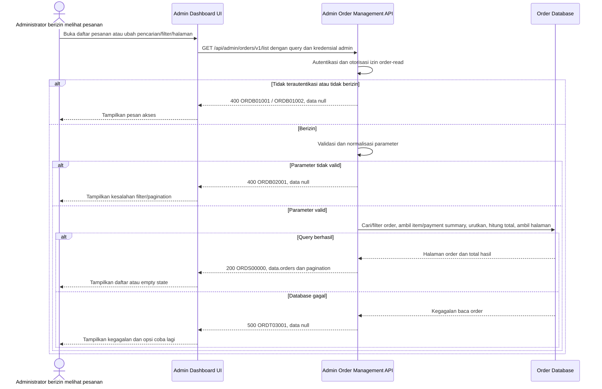

# Admin Dashboard - Get List Orders Interface Agreement

> **Document Type:** IFA / API Contract  
> **Status:** Draft  
> **Service / Domain:** Admin Dashboard — Order Management  
> **Consumer / Partner:** JokiHub Admin Dashboard (authorized administrator)

## Design

API ini mengambil daftar pesanan untuk Admin Dashboard dengan pencarian, filter status pesanan, dan pagination. Data utama berasal dari `customer_order`; item snapshot dan payment attempt digunakan untuk menampilkan game/layanan serta metode/status pembayaran. Respons daftar tidak menyertakan game account ID, server, notes, atau payment proof karena hanya diperlukan pada halaman detail.

## Sequence Diagram



## Performance / SLA Targets

| Success Rate                                     | VUser                                       | CPU / Memory                        | Response Time                                                                                  |
| ------------------------------------------------ | ------------------------------------------- | ----------------------------------- | ---------------------------------------------------------------------------------------------- |
| TBD; confirm criticality and availability target | TBD; confirm peak concurrent administrators | TBD; set from capacity estimate/NFT | TBD; proposed transactional web baseline: ideal 100 ms, acceptable 500 ms, max tolerable 1–2 s |

## General Information

| Component          | Value                                                                                                                               |
| ------------------ | ----------------------------------------------------------------------------------------------------------------------------------- |
| Description        | Mengambil daftar pesanan dan ringkasan pembayaran untuk Admin Dashboard.                                                            |
| Resource URL       | `https://{host}/api/admin/orders/v1/list`                                                                                           |
| Transport Protocol | HTTPS, REST                                                                                                                         |
| Request Verb       | GET                                                                                                                                 |
| Content Type       | Tidak ada request body                                                                                                              |
| Interaction Type   | Synchronous                                                                                                                         |
| Security Policy    | Admin authentication dan izin `order-read`. Identity provider serta nama permission TBD. Terapkan rate limiting dan minimisasi PII. |

### Path / Endpoint

| Section        | Value                           |
| -------------- | ------------------------------- |
| Host / Domain  | `{host}` (environment-specific) |
| Service Name   | Order Management                |
| Version        | `v1`                            |
| Resource       | `/admin/orders/v1/list`         |
| Final Endpoint | `/api/admin/orders/v1/list`     |

### API Versioning

- **Decision:** New Endpoint
- **Previous Endpoint:** Tidak ada API daftar pesanan admin yang teridentifikasi pada solutioning sprint ini.
- **Final Endpoint:** `GET /api/admin/orders/v1/list`
- **Backward Compatibility:** Belum ada consumer API ini yang teridentifikasi. Penambahan field response opsional bersifat kompatibel; perubahan kontrak yang mematahkan consumer memerlukan major version baru.
- **Reason:** Admin Dashboard memerlukan daftar order yang dapat dicari dan difilter untuk operasional.

## Business Rules

1. Hanya administrator terautentikasi dengan izin `order-read` yang dapat mengakses endpoint. Role mapping dan nama permission final TBD.
2. Semua status order yang masih dalam retensi dapat ditampilkan, termasuk `CANCELLED`; data tidak dihapus dari daftar hanya karena status terminal.
3. Filter `status` merujuk pada `customer_order.order_status`, bukan status payment. Nilai storage diusulkan `PENDING_PAYMENT`, `PENDING_VALIDATION`, `PROCESSING`, `COMPLETED`, dan `CANCELLED`; UI labels dipetakan ke label bahasa Indonesia.
4. Pencarian mencocokkan `order_number`, `customer_name`, normalized `customer_whatsapp`, game name snapshot, atau service name snapshot secara case-insensitive. Pencarian nomor WhatsApp memerlukan akses `order-read` dan harus dibatasi/rate-limited.
5. Hasil diurutkan `created_at DESC`, lalu `order_id DESC` untuk urutan deterministik.
6. `totalItems` menghitung semua order setelah pencarian/status filter sebelum pagination; hasil kosong adalah sukses dengan array kosong.
7. Ringkasan daftar mengambil `payment_status` dari status order yang tersinkron dengan payment workflow dan `paymentMethod` dari payment attempt terbaru yang relevan. Aturan pemilihan attempt terbaru dan state authority harus ditetapkan agar tidak menampilkan status stale.
8. Untuk MVP yang saat ini memilih satu layanan, `items` berisi satu item. Bila order multi-item diaktifkan, UI harus menampilkan ringkasan semua item atau representasi ringkas yang disepakati; API tidak boleh diam-diam membuang item selain yang pertama.
9. Daftar tidak mengembalikan `gameAccount`, `gameServer`, customer notes, proof storage key, atau raw payment proof. Ambil melalui detail endpoint dengan izin lebih terbatas.
10. `customerWhatsapp` hanya dikembalikan karena UI saat ini menampilkannya; akses/masking per role dan export policy perlu disetujui. Jangan tulis nomor mentah ke application logs.
11. `amount` berasal dari `customer_order.total_amount` dan `currency`; jangan hitung ulang dari harga katalog saat list dibaca.
12. Pagination memakai `page` berbasis 1 dan `pageSize` dengan default/maksimum usulan. Untuk dataset besar, database query harus membatasi result sebelum mengambil item/payment summary.

## Request Headers

| Header          | E/N/T | Type   | M/O/C | Max Length | Description                                                               | Example                 |
| --------------- | ----- | ------ | ----- | ---------: | ------------------------------------------------------------------------- | ----------------------- |
| `Authorization` | N     | String | M     |       4096 | Kredensial administrator; skema autentikasi bergantung identity provider. | `Bearer {access-token}` |
| `Accept`        | N     | String | O     |        100 | Tipe media response yang diinginkan; default JSON.                        | `application/json`      |
| `X-Request-Id`  | N     | String | O     |        100 | ID korelasi untuk audit/support.                                          | `req-5a90c7`            |

## Request Parameters

None.

## Request Query Parameters

| Parameter  | E/N/T | Type    | M/O/C | Max Length | Description                                                                                                   | Example              |
| ---------- | ----- | ------- | ----- | ---------: | ------------------------------------------------------------------------------------------------------------- | -------------------- |
| `search`   | N     | String  | O     |        100 | Cari nomor order, customer name/WhatsApp, game snapshot, atau service snapshot.                               | `JH-2026-001248`     |
| `status`   | N     | String  | O     |         30 | Filter status order storage: `PENDING_PAYMENT`, `PENDING_VALIDATION`, `PROCESSING`, `COMPLETED`, `CANCELLED`. | `PENDING_VALIDATION` |
| `page`     | N     | Integer | O     |  10 digits | Halaman berbasis 1; default `1`.                                                                              | `1`                  |
| `pageSize` | N     | Integer | O     |  10 digits | Jumlah order per halaman; default `20`, maksimum usulan `100`.                                                | `20`                 |

## Request Body

Tidak ada request body.

### Request Validation

1. `Authorization` harus mengidentifikasi administrator terautentikasi dengan izin `order-read`. Kembalikan `ORDB01001` bila belum terautentikasi dan `ORDB01002` bila izin tidak tersedia.
2. `search`, bila dikirim, harus string maksimal 100 karakter setelah trim. Gunakan parameterisasi query; wildcard behavior dan escaping mengikuti database search policy.
3. `status`, bila dikirim, harus salah satu nilai status storage yang didukung. Label UI bahasa Indonesia tidak dikirim sebagai nilai kontrak; nilai tidak dikenal mengembalikan `ORDB02001`.
4. `page` harus integer >= 1; default `1`.
5. `pageSize` harus integer 1–100; default `20`.
6. Parameter query yang tidak dikenal ditolak dengan `ORDB02001`.
7. Jika tidak ada hasil, kembalikan HTTP 200 dengan `orders: []`, `totalItems: 0`, dan `totalPages: 0`.
8. Query database harus mengecualikan duplicate order akibat join dengan items/payments; satu order muncul sekali.
9. Kegagalan database mengembalikan HTTP 500 dan tidak membocorkan detail internal.

## Response Body

Semua response menggunakan envelope `status` dan `data`. Sukses mengembalikan halaman order; error mengembalikan `data: null`.

| Attribute                           | E/N/T | Type               | M/O/C |           Max Length | Description                                                                    | Example                |
| ----------------------------------- | ----- | ------------------ | ----- | -------------------: | ------------------------------------------------------------------------------ | ---------------------- |
| `status`                            | N     | Object             | M     |                    — | Object status response.                                                        | `{}`                   |
| `status.code`                       | N     | String             | M     |                   20 | Service status code.                                                           | `ORDS00000`            |
| `status.message`                    | N     | String             | O     |                  200 | Pesan hasil untuk consumer.                                                    | `Order list retrieved` |
| `data`                              | N     | Object/null        | M     |                    — | Payload hasil; `null` ketika error.                                            | `{}`                   |
| `data.orders`                       | N     | Array of Object    | M     |     `pageSize` items | Halaman order; array kosong bila hasil kosong.                                 | `[]`                   |
| `data.orders[].id`                  | N     | String             | M     |                   64 | ID internal order.                                                             | `ord_01JXYZ`           |
| `data.orders[].orderNumber`         | N     | String             | M     |                   32 | Nomor order yang tampil kepada admin/customer.                                 | `JH-2026-001248`       |
| `data.orders[].customerName`        | N     | String             | M     |                  150 | Snapshot nama customer.                                                        | `Budi Santoso`         |
| `data.orders[].customerWhatsapp`    | N     | String             | M     |                   32 | Snapshot kontak checkout; masking mengikuti access policy.                     | `+6281234567890`       |
| `data.orders[].items`               | N     | Array of Object    | M     | 100 items (proposed) | Snapshot item order. Satu item pada flow UI saat ini.                          | `[]`                   |
| `data.orders[].items[].gameName`    | N     | String             | M     |                  100 | Nama game saat order dibuat.                                                   | `Mobile Legends`       |
| `data.orders[].items[].serviceName` | N     | String             | M     |                  150 | Nama layanan saat order dibuat.                                                | `Top Up 86 Diamonds`   |
| `data.orders[].amount`              | N     | Decimal            | M     |                 18,2 | Total amount snapshot order.                                                   | `25000.00`             |
| `data.orders[].currency`            | N     | String             | M     |                    3 | Kode currency ISO 4217.                                                        | `IDR`                  |
| `data.orders[].status`              | N     | String             | M     |                   30 | Status order storage.                                                          | `PENDING_VALIDATION`   |
| `data.orders[].paymentMethod`       | N     | String/null        | O     |                   30 | Method payment attempt terbaru yang relevan; `null` bila belum dipilih/dibuat. | `QRIS`                 |
| `data.orders[].paymentStatus`       | N     | String             | M     |                   30 | Status payment terkini pada order.                                             | `PENDING_REVIEW`       |
| `data.orders[].createdAt`           | N     | String (date-time) | M     |                   35 | Waktu order dibuat ISO 8601 UTC.                                               | `2026-10-11T09:42:00Z` |
| `data.pagination`                   | N     | Object             | M     |                    — | Metadata pagination.                                                           | `{}`                   |
| `data.pagination.page`              | N     | Integer            | M     |            10 digits | Halaman yang dikembalikan.                                                     | `1`                    |
| `data.pagination.pageSize`          | N     | Integer            | M     |            10 digits | Ukuran halaman efektif.                                                        | `20`                   |
| `data.pagination.totalItems`        | N     | Integer            | M     |            10 digits | Jumlah order setelah filter.                                                   | `1`                    |
| `data.pagination.totalPages`        | N     | Integer            | M     |            10 digits | Jumlah halaman; `0` bila kosong.                                               | `1`                    |

### Success Example

```json
{
  "status": {
    "code": "ORDS00000",
    "message": "Order list retrieved"
  },
  "data": {
    "orders": [
      {
        "id": "ord_01JXYZ",
        "orderNumber": "JH-2026-001248",
        "customerName": "Budi Santoso",
        "customerWhatsapp": "+6281234567890",
        "items": [
          {
            "gameName": "Mobile Legends",
            "serviceName": "Top Up 86 Diamonds"
          }
        ],
        "amount": 25000.0,
        "currency": "IDR",
        "status": "PENDING_VALIDATION",
        "paymentMethod": "QRIS",
        "paymentStatus": "PENDING_REVIEW",
        "createdAt": "2026-10-11T09:42:00Z"
      }
    ],
    "pagination": {
      "page": 1,
      "pageSize": 20,
      "totalItems": 1,
      "totalPages": 1
    }
  }
}
```

### Business Error Example

```json
{
  "status": {
    "code": "ORDB02001",
    "message": "Invalid order-list query parameters"
  },
  "data": null
}
```

### Technical Error Example

```json
{
  "status": {
    "code": "ORDT03001",
    "message": "Order service is temporarily unavailable"
  },
  "data": null
}
```

## HTTP Status Codes

| HTTP Status | Usage                                                                                                                                         |
| ----------- | --------------------------------------------------------------------------------------------------------------------------------------------- |
| `200`       | Daftar berhasil diambil, termasuk ketika hasil kosong.                                                                                        |
| `400`       | Query tidak valid atau akses administrator ditolak sesuai baseline response project. Konfirmasi apakah API standard mengharuskan `401`/`403`. |
| `500`       | Kegagalan service atau database order yang tidak terduga.                                                                                     |

## Service Status Codes

Format: `[Service Prefix][Status Type][Category][Specific Error Code]`

| Code        | Type      | Category        | Meaning                                                 |
| ----------- | --------- | --------------- | ------------------------------------------------------- |
| `ORDS00000` | Success   | General         | Daftar order berhasil dikembalikan.                     |
| `ORDB01001` | Business  | Authentication  | Administrator belum terautentikasi.                     |
| `ORDB01002` | Business  | Authentication  | Administrator tidak memiliki izin order-read.           |
| `ORDB02001` | Business  | User validation | Parameter search/status/pagination tidak valid.         |
| `ORDT03001` | Technical | Database        | Daftar order gagal dibaca atau database tidak tersedia. |

## API Exposure Classification

| Classification                 | Rationale                                                                                                                                                                                        |
| ------------------------------ | ------------------------------------------------------------------------------------------------------------------------------------------------------------------------------------------------ |
| Enterprise Intranet (proposed) | Endpoint admin yang menampilkan data pesanan dan kontak customer. Jika endpoint dapat diakses dari internet, klasifikasikan sebagai Public dan terapkan proteksi serta PII controls yang sesuai. |

## Testing & Documentation Scope

| Scope      | Required | Rationale / Handoff                                                                                                                                                                              |
| ---------- | -------- | ------------------------------------------------------------------------------------------------------------------------------------------------------------------------------------------------ |
| NFT        | Yes      | API admin baru pada alur operasional order. Uji filter, search, pagination, hasil kosong, join tanpa duplikasi, dan beban list puncak. VUser, CPU/memory, dan target TPS TBD mengikuti forecast. |
| VA/Pentest | Yes      | Endpoint mengekspos order/PII. Uji authentication/authorization, privilege boundaries, enumeration, injection, WhatsApp disclosure, excessive data exposure, dan filtering bypass.               |

## Assumptions

- Endpoint `/api/admin/orders/v1/list`, status codes, response envelope, and field mapping are proposed because no Order API solutioning exists yet.
- `order_status` dan `payment_status` disimpan terpisah sesuai [Order ERD](../../erd/order-erd.md). Status UI dipetakan: `Menunggu Pembayaran` → `PENDING_PAYMENT`, `Menunggu Validasi` → `PENDING_VALIDATION`, `Diproses` → `PROCESSING`, `Selesai` → `COMPLETED`, `Dibatalkan` → `CANCELLED`.
- Payment status mapping mengikuti Order ERD: `UNPAID`, `PENDING_REVIEW`, `PAID`, `REJECTED`, `FAILED`; UI label `Gagal` memerlukan pemetaan reason agar rejected dan technical failure tidak tercampur.
- Current UI assumes one game/service per order. API response supports array `items`; confirm MVP rule or update Admin Orders UI for multi-item orders.
- Search semantics, WhatsApp visibility/masking, page defaults, maximum page size, current payment attempt selection, currency, SLA, identity provider, permission name, and HTTP auth mapping remain TBD.
- Refunds and complaints remain separate modules referencing `orderId`; payout and transaction ledger are not part of this list API.

## References

- `../../erd/order-erd.md` — order, item snapshot, payment, and status history model.
- `../../erd/service-erd.md` — service catalog source for order snapshots.
- `src/features/AdminOrders/views/interfaces/admin-order.interface.ts` — Admin Orders table field/status types.
- `src/features/AdminOrders/views/templates/AdminOrders.template.tsx` — Admin Orders table, filter, and detail display.
- `src/features/AdminOrders/views/pages/AdminOrders.page.tsx` — current mock order records and field values.
- `docs/sprint_1/solutioning/dashboard/games/get-list-games.md` — list API pagination and response pattern.
