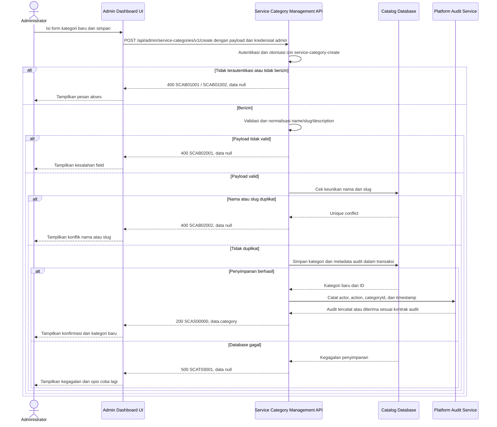

# Admin Dashboard - Create Service Category Interface Agreement

> **Document Type:** IFA / API Contract  
> **Status:** Draft  
> **Service / Domain:** Admin Dashboard — Service Category Management  
> **Consumer / Partner:** JokiHub Admin Dashboard (authorized administrator)

## Design

API ini membuat kategori layanan baru dari form Admin Service Categories. Admin mengirim nama, slug, deskripsi opsional, dan status aktif; service menghasilkan `categoryId` dan timestamp. Field dan constraints mengikuti [Service Category ERD](../../erd/service-category-erd.md) dan form UI. Kategori baru tidak otomatis membuat atau mengubah layanan.

## Sequence Diagram



## Performance / SLA Targets

| Success Rate                                        | VUser                                   | CPU / Memory                             | Response Time                                                                        |
| --------------------------------------------------- | --------------------------------------- | ---------------------------------------- | ------------------------------------------------------------------------------------ |
| TBD; konfirmasi criticality dan availability target | TBD; konfirmasi concurrent admin puncak | TBD; tetapkan dari capacity estimate/NFT | TBD; usulan baseline web non-kritis: ideal 200 ms, acceptable 1 s, max tolerable 2 s |

## General Information

| Component          | Value                                                                                                                                               |
| ------------------ | --------------------------------------------------------------------------------------------------------------------------------------------------- |
| Description        | Membuat record kategori layanan baru untuk katalog JokiHub.                                                                                         |
| Resource URL       | `https://{host}/api/admin/service-categories/v1/create`                                                                                             |
| Transport Protocol | HTTPS, REST                                                                                                                                         |
| Request Verb       | POST                                                                                                                                                |
| Content Type       | `application/json`                                                                                                                                  |
| Interaction Type   | Synchronous                                                                                                                                         |
| Security Policy    | Admin authentication dan izin `service-category-create`. Identity provider dan permission final TBD. Terapkan rate limiting dan audit actor/action. |

### Path / Endpoint

| Section        | Value                                          |
| -------------- | ---------------------------------------------- |
| Host / Domain  | `{host}` (environment-specific)                |
| Service Name   | Service Category Management                    |
| Version        | `v1`                                           |
| Resource       | `/admin/service-categories/v1/create`          |
| Final Endpoint | `POST /api/admin/service-categories/v1/create` |

### API Versioning

- **Decision:** New Endpoint
- **Previous Endpoint:** Tidak ada API create kategori admin yang teridentifikasi pada solutioning sprint ini.
- **Final Endpoint:** `POST /api/admin/service-categories/v1/create`
- **Backward Compatibility:** Belum ada consumer API ini yang teridentifikasi. Penambahan field request opsional bersifat kompatibel; perubahan kontrak yang mematahkan consumer memerlukan major version baru.
- **Reason:** Admin Dashboard memerlukan operasi untuk menambah kelompok layanan ke katalog.

## Business Rules

1. Hanya administrator terautentikasi dengan izin `service-category-create` yang dapat membuat kategori. Role mapping final TBD.
2. `categoryId`, `createdAt`, dan `updatedAt` dibuat oleh service; client tidak boleh mengirim nilai tersebut.
3. `name` dan `slug` wajib. Nama disimpan setelah trim; slug disimpan lowercase setelah trim dan harus sesuai format URL-safe.
4. Nama kategori yang dinormalisasi harus unik case-insensitive dan slug harus unik di antara kategori non-deleted sesuai unique index usulan ERD. Constraint database menjadi kontrol akhir untuk race condition.
5. Kategori duplikat tidak menimpa atau menggabungkan record yang sudah ada. Kembalikan konflik validasi yang sama untuk duplicate name atau slug agar tidak mengekspos record lain.
6. `description` opsional; nilai kosong setelah trim dinormalisasi menjadi `null`. Batas 500 karakter mengikuti proposal ERD.
7. `isActive` menentukan apakah kategori tersedia untuk assignment/publikasi katalog. Default `true` mengikuti proposal ERD bila field tidak dikirim; konfirmasi default sebelum implementasi.
8. Kategori dibuat dengan `serviceCount=0`. Pembuatan kategori tidak membuat layanan dan tidak mengubah layanan yang sudah ada.
9. `createdAt` dan `updatedAt` diset ke waktu server UTC yang sama pada pembuatan.
10. Keberhasilan pembuatan dicatat pada audit platform dengan actor, action, category ID, dan waktu. Audit tidak boleh menggagalkan/menyebabkan duplikasi create setelah record tersimpan; mekanisme outbox atau transaksi audit mengikuti platform standard dan TBD.
11. Endpoint tidak menerima `deletedAt`; kategori baru selalu non-deleted.
12. Retry setelah timeout dapat membuat duplikat jika client mengulang request. Idempotency key belum didefinisikan; tentukan kebutuhan sebelum implementasi atau gunakan unique constraint untuk mencegah duplikasi nama/slug.

## Request Headers

| Header          | E/N/T | Type   | M/O/C | Max Length | Description                                                  | Example                 |
| --------------- | ----- | ------ | ----- | ---------: | ------------------------------------------------------------ | ----------------------- |
| `Authorization` | N     | String | M     |       4096 | Kredensial administrator; skema mengikuti identity provider. | `Bearer {access-token}` |
| `Content-Type`  | N     | String | M     |        100 | Format payload.                                              | `application/json`      |
| `Accept`        | N     | String | O     |        100 | Tipe media response yang diinginkan; default JSON.           | `application/json`      |
| `X-Request-Id`  | N     | String | O     |        100 | ID korelasi untuk audit/support; jangan memuat PII.          | `req-3c2f10`            |

## Request Parameters

Tidak ada path/query parameter.

## Request Body

| Attribute     | E/N/T | Type        | M/O/C | Max Length | Description                                                     | Example                        |
| ------------- | ----- | ----------- | ----- | ---------: | --------------------------------------------------------------- | ------------------------------ |
| `name`        | N     | String      | M     |        100 | Nama tampilan kategori.                                         | `Top Up`                       |
| `slug`        | N     | String      | M     |        100 | Identifier URL-safe, lowercase dan dipisahkan tanda hubung.     | `top-up`                       |
| `description` | N     | String/null | O     |        500 | Deskripsi kategori; whitespace-only dinormalisasi menjadi null. | `Layanan pengisian saldo game` |
| `isActive`    | N     | Boolean     | O     |          — | Status aktif; default usulan `true`.                            | `true`                         |

### Example Request Body

```json
{
  "name": "Top Up",
  "slug": "top-up",
  "description": "Layanan pengisian saldo game",
  "isActive": true
}
```

### Request Validation

1. `Authorization` harus mengidentifikasi administrator terautentikasi dengan izin `service-category-create`. Kembalikan `SCAB01001` bila belum terautentikasi dan `SCAB01002` bila izin tidak tersedia.
2. Body wajib berupa JSON object valid. Tolak field yang tidak dikenal, termasuk `id`, `categoryId`, `createdAt`, `updatedAt`, `deletedAt`, dan `serviceCount`, dengan `SCAB02001`.
3. `name` wajib berupa string; trim sebelum validasi dan simpan. Nilai setelah trim tidak boleh kosong dan panjangnya maksimal 100 karakter.
4. `slug` wajib berupa string; trim dan ubah ke lowercase sebelum validasi. Nilai harus cocok dengan `^[a-z0-9]+(?:-[a-z0-9]+)*$` dan panjang maksimal 100 karakter. UI dapat mengisi slug dari nama, tetapi API tetap menerima slug eksplisit.
5. `description`, bila dikirim, harus string atau `null`; trim sebelum simpan, maksimal 500 karakter. Nilai kosong/whitespace menjadi `null`.
6. `isActive`, bila dikirim, harus boolean JSON. Jika tidak dikirim, gunakan default `true` yang masih menunggu persetujuan product/API owner.
7. Nama ternormalisasi atau slug yang sudah dipakai kategori non-deleted menghasilkan `SCAB02002`. Pemeriksaan aplikasi harus didukung unique constraint transaksional/database.
8. Jika kategori dengan slug sama pernah soft-deleted, aturan penggunaan ulang slug belum diputuskan; perlakukan sebagai konflik sampai aturan reuse disetujui.
9. Kegagalan database saat penyimpanan menghasilkan HTTP 500 `SCAT03001`; jangan mengembalikan detail query atau constraint internal.

## Response Body

Semua response menggunakan envelope `status` dan `data`. Error mengembalikan `data: null`.

| Attribute                    | E/N/T | Type               | M/O/C | Max Length | Description                                        | Example                        |
| ---------------------------- | ----- | ------------------ | ----- | ---------: | -------------------------------------------------- | ------------------------------ |
| `status`                     | N     | Object             | M     |          — | Object status response.                            | `{}`                           |
| `status.code`                | N     | String             | M     |         20 | Service status code.                               | `SCAS00000`                    |
| `status.message`             | N     | String             | O     |        200 | Pesan hasil untuk consumer.                        | `Service category created`     |
| `data`                       | N     | Object/null        | M     |          — | Payload hasil; `null` ketika error.                | `{}`                           |
| `data.category`              | N     | Object             | M     |          — | Kategori yang berhasil dibuat.                     | `{}`                           |
| `data.category.id`           | N     | String             | M     |         64 | ID immutable yang dibuat service.                  | `cat_01JXYZ`                   |
| `data.category.name`         | N     | String             | M     |        100 | Nama kategori setelah trim.                        | `Top Up`                       |
| `data.category.slug`         | N     | String             | M     |        100 | Slug kategori normalized.                          | `top-up`                       |
| `data.category.description`  | N     | String/null        | O     |        500 | Deskripsi kategori.                                | `Layanan pengisian saldo game` |
| `data.category.isActive`     | N     | Boolean            | M     |          — | Status aktif tersimpan.                            | `true`                         |
| `data.category.serviceCount` | N     | Integer            | M     |  10 digits | Jumlah layanan saat dibuat; selalu `0`.            | `0`                            |
| `data.category.createdAt`    | N     | String (date-time) | M     |         35 | Waktu pembuatan UTC.                               | `2026-10-11T09:00:00Z`         |
| `data.category.updatedAt`    | N     | String (date-time) | M     |         35 | Waktu update; sama dengan `createdAt` saat create. | `2026-10-11T09:00:00Z`         |

### Success Example

```json
{
  "status": {
    "code": "SCAS00000",
    "message": "Service category created"
  },
  "data": {
    "category": {
      "id": "cat_01JXYZ",
      "name": "Top Up",
      "slug": "top-up",
      "description": "Layanan pengisian saldo game",
      "isActive": true,
      "serviceCount": 0,
      "createdAt": "2026-10-11T09:00:00Z",
      "updatedAt": "2026-10-11T09:00:00Z"
    }
  }
}
```

### Business Error Example

```json
{
  "status": {
    "code": "SCAB02002",
    "message": "Service category name or slug already exists"
  },
  "data": null
}
```

### Technical Error Example

```json
{
  "status": {
    "code": "SCAT03001",
    "message": "Service category data is temporarily unavailable"
  },
  "data": null
}
```

## HTTP Status Codes

| HTTP Status | Usage                                                                                                                                      |
| ----------- | ------------------------------------------------------------------------------------------------------------------------------------------ |
| `200`       | Kategori berhasil dibuat sesuai baseline IFA project; konfirmasi apakah standar API menetapkan `201`.                                      |
| `400`       | Payload tidak valid, akses admin ditolak sesuai baseline response project, atau nama/slug duplikat. Konfirmasi auth-specific HTTP mapping. |
| `500`       | Kegagalan service atau database yang tidak terduga.                                                                                        |

## Service Status Codes

Format: `[Service Prefix][Status Type][Category][Specific Error Code]`

| Code        | Type      | Category        | Meaning                                                      |
| ----------- | --------- | --------------- | ------------------------------------------------------------ |
| `SCAS00000` | Success   | General         | Kategori layanan berhasil dibuat.                            |
| `SCAB01001` | Business  | Authentication  | Administrator belum terautentikasi.                          |
| `SCAB01002` | Business  | Authentication  | Administrator tidak memiliki izin create kategori.           |
| `SCAB02001` | Business  | User validation | Field wajib, format, panjang, atau tipe payload tidak valid. |
| `SCAB02002` | Business  | User validation | Nama atau slug kategori sudah digunakan.                     |
| `SCAT03001` | Technical | Database        | Kategori gagal disimpan atau database tidak tersedia.        |

## API Exposure Classification

| Classification                 | Rationale                                                                                                                                     |
| ------------------------------ | --------------------------------------------------------------------------------------------------------------------------------------------- |
| Enterprise Intranet (proposed) | Operasi tulis admin untuk katalog. Jika endpoint dapat diakses dari internet, klasifikasikan sebagai Public dan terapkan proteksi API publik. |

## Testing & Documentation Scope

| Scope      | Required | Rationale / Handoff                                                                                                                                                                                         |
| ---------- | -------- | ----------------------------------------------------------------------------------------------------------------------------------------------------------------------------------------------------------- |
| NFT        | Yes      | API create admin baru. Uji payload valid, batas panjang, duplikasi, request bersamaan dengan slug sama, persistence, dan retry setelah timeout. VUser, CPU/memory, serta target TPS TBD mengikuti forecast. |
| VA/Pentest | Yes      | Verifikasi authentication/authorization, privilege boundaries, mass assignment, input validation, injection, audit attribution, dan tidak ada overwrite record duplikat.                                    |

## Assumptions

- Endpoint, response envelope, service prefix/codes, dan permission adalah usulan karena backend category API belum didefinisikan.
- Nama unik case-insensitive setelah trim, slug unik, batas field, dan default `isActive=true` mengikuti proposal ERD; owner perlu menyetujui sebelum implementasi.
- Slug reuse setelah soft delete belum ditetapkan. Kontrak menganggap slug tetap konflik sampai keputusan final.
- Audit menggunakan platform audit service; transaksi/outbox dan perilaku saat audit service gagal mengikuti standar platform yang belum tersedia.
- Idempotency key belum menjadi bagian kontrak. Jika client retry harus menjamin exactly-once semantics, tambahkan mekanisme idempotency pada API standard.
- HTTP `201` vs `200`, identity provider, role mapping, rate limit, database engine, dan SLA TBD.

## References

- `../../erd/service-category-erd.md` — atribut kategori, unique constraints, default, serta audit proposal.
- `src/features/AdminServiceCategories/views/interfaces/admin-service-category.interface.ts` — field model kategori pada UI.
- `src/features/AdminServiceCategories/views/templates/AdminServiceCategories.template.tsx` — field form, slug generation, dan active toggle.
- `./get-list-service-categories.md` — kontrak daftar kategori dan response summary.
- `./get-detail-service-category.md` — kontrak pembacaan kategori detail.
