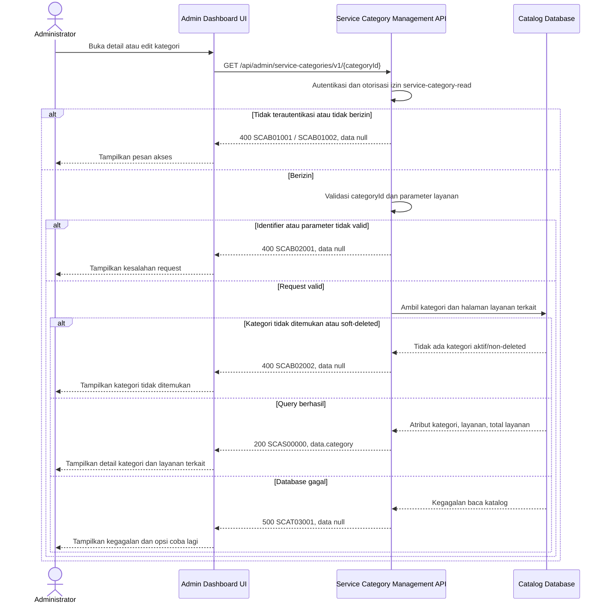

# Admin Dashboard - Get Service Category Detail Interface Agreement

> **Document Type:** IFA / API Contract  
> **Status:** Draft  
> **Service / Domain:** Admin Dashboard — Service Category Management  
> **Consumer / Partner:** JokiHub Admin Dashboard (authorized administrator)

## Design

API mengambil satu kategori layanan berdasarkan `categoryId` untuk kebutuhan detail/edit Admin Dashboard. Response mencakup atribut kategori dan daftar layanan yang terhubung secara paginasi, termasuk status layanan dan game terkait bila tersedia. Sumber kategori dan relasi adalah [Service Category ERD](../../erd/service-category-erd.md); kebutuhan field UI mengikuti interface Admin Service Categories dan Admin Services. UI saat ini memakai modal edit berisi atribut kategori dan belum memuat detail layanan dari backend.

## Sequence Diagram



## Performance / SLA Targets

| Success Rate                                        | VUser                                   | CPU / Memory                             | Response Time                                                                        |
| --------------------------------------------------- | --------------------------------------- | ---------------------------------------- | ------------------------------------------------------------------------------------ |
| TBD; konfirmasi criticality dan availability target | TBD; konfirmasi concurrent admin puncak | TBD; tetapkan dari capacity estimate/NFT | TBD; usulan baseline web non-kritis: ideal 200 ms, acceptable 1 s, max tolerable 2 s |

## General Information

| Component          | Value                                                                                                                                                       |
| ------------------ | ----------------------------------------------------------------------------------------------------------------------------------------------------------- |
| Description        | Mengambil atribut satu kategori layanan dan daftar layanan terkait untuk Admin Dashboard.                                                                   |
| Resource URL       | `https://{host}/api/admin/service-categories/v1/{categoryId}`                                                                                               |
| Transport Protocol | HTTPS, REST                                                                                                                                                 |
| Request Verb       | GET                                                                                                                                                         |
| Content Type       | `application/json` response; GET tidak memiliki request body.                                                                                               |
| Interaction Type   | Synchronous                                                                                                                                                 |
| Security Policy    | Admin authentication dan izin `service-category-read`. Identity provider dan permission final TBD. Terapkan rate limiting dan audit akses sesuai kebijakan. |

### Path / Endpoint

| Section        | Value                                               |
| -------------- | --------------------------------------------------- |
| Host / Domain  | `{host}` (environment-specific)                     |
| Service Name   | Service Category Management                         |
| Version        | `v1`                                                |
| Resource       | `/admin/service-categories/v1/{categoryId}`         |
| Final Endpoint | `GET /api/admin/service-categories/v1/{categoryId}` |

### API Versioning

- **Decision:** New Endpoint
- **Previous Endpoint:** Tidak ada API detail kategori admin yang teridentifikasi pada solutioning sprint ini.
- **Final Endpoint:** `GET /api/admin/service-categories/v1/{categoryId}`
- **Backward Compatibility:** Belum ada consumer API ini yang teridentifikasi. Penambahan field response opsional bersifat kompatibel; perubahan kontrak yang mematahkan consumer memerlukan major version baru.
- **Reason:** Admin membutuhkan satu resource kategori untuk melihat/edit atribut serta memeriksa layanan yang masih terhubung sebelum perubahan atau penghapusan.

## Business Rules

1. Hanya administrator terautentikasi dengan izin `service-category-read` yang dapat membaca detail. Izin ini dapat dipisahkan dari write permission; role mapping final TBD.
2. `categoryId` adalah identifier immutable pada `service_category.category_id`, bukan nama atau slug kategori.
3. Kategori aktif dan nonaktif dapat dibaca oleh admin. Kategori soft-deleted (`deleted_at IS NOT NULL`) tidak dikembalikan pada endpoint ini; kebijakan pemulihan kategori terhapus memerlukan endpoint/permission terpisah.
4. Field kategori berasal dari record `service_category`: `name`, `slug`, `description`, `is_active`, `created_at`, dan `updated_at`. `deleted_at` serta field internal lain tidak diekspos.
5. `serviceCount` adalah jumlah total layanan terkait sesuai kebijakan hitung yang sama dengan list endpoint. Usulan awal menghitung layanan non-deleted, baik aktif maupun nonaktif; definisi soft delete/status layanan harus dikonfirmasi.
6. `services` hanya mengembalikan satu halaman layanan terkait untuk mencegah response tidak terbatas. Default `serviceLimit=20`, maksimum `100`; urutan `name ASC`, lalu `service_id ASC` untuk hasil deterministik.
7. Setiap service summary mencakup ID, nama, game, status aktif, dan updated timestamp bila sumber service ERD menyediakan field tersebut. Field yang belum tersedia pada service ERD bersifat TBD sebelum implementasi.
8. Kategori tanpa layanan terkait tetap sukses dengan `services: []`, `serviceCount: 0`, dan pagination `total: 0`.
9. Relasi satu kategori ke banyak layanan mengikuti model UI saat ini; response tidak mengubah assignment atau status layanan.
10. Endpoint bersifat read-only. Tidak memutasi kategori/layanan dan tidak menulis audit perubahan.
11. Untuk menghindari ID enumeration, kategori yang tidak ditemukan dan kategori soft-deleted mengembalikan kode bisnis yang sama.
12. Query layanan harus membatasi `category_id` sesuai kategori yang sudah lolos authorization dan pengecekan non-deleted; jangan menerima category ID dari query sebagai pengganti path ID.

## Request Headers

| Header          | E/N/T | Type   | M/O/C | Max Length | Description                                                  | Example                 |
| --------------- | ----- | ------ | ----- | ---------: | ------------------------------------------------------------ | ----------------------- |
| `Authorization` | N     | String | M     |       4096 | Kredensial administrator; skema mengikuti identity provider. | `Bearer {access-token}` |
| `Accept`        | N     | String | O     |        100 | Tipe media response yang diinginkan; default JSON.           | `application/json`      |
| `X-Request-Id`  | N     | String | O     |        100 | ID korelasi untuk audit/support; jangan memuat PII.          | `req-e4f09b`            |

## Request Parameters

| Parameter    | E/N/T | Type          | M/O/C | Max Length | Description                    | Example      |
| ------------ | ----- | ------------- | ----- | ---------: | ------------------------------ | ------------ |
| `categoryId` | N     | String (path) | M     |         64 | ID immutable kategori layanan. | `cat_01JXYZ` |

## Request Query Parameters

| Parameter       | E/N/T | Type    | M/O/C | Max Length | Description                                                      | Example |
| --------------- | ----- | ------- | ----- | ---------: | ---------------------------------------------------------------- | ------- |
| `serviceLimit`  | N     | Integer | O     |   3 digits | Jumlah layanan per halaman; default `20`, maksimum usulan `100`. | `20`    |
| `serviceOffset` | N     | Integer | O     |   9 digits | Jumlah layanan yang dilewati; default `0`.                       | `0`     |

## Request Body

Tidak ada request body.

### Request Validation

1. `Authorization` harus mengidentifikasi administrator terautentikasi dengan izin `service-category-read`. Kembalikan `SCAB01001` bila belum terautentikasi dan `SCAB01002` bila tidak berizin.
2. `categoryId` wajib, tidak kosong, maksimal 64 karakter, dan mengikuti format ID yang ditetapkan implementasi. Format invalid menghasilkan `SCAB02001`.
3. `serviceLimit` harus integer dari 1 sampai 100; default `20`.
4. `serviceOffset` harus integer >= 0 dan tidak melebihi batas integer yang disepakati implementasi; default `0`.
5. Parameter query yang tidak dikenal ditolak dengan `SCAB02001`.
6. Identifier valid yang tidak ditemukan atau menunjuk kategori soft-deleted menghasilkan `SCAB02002`.
7. Kategori valid tanpa layanan terkait adalah sukses, bukan error.
8. Kegagalan database mengembalikan HTTP 500 tanpa detail internal.

## Response Body

Semua response menggunakan envelope `status` dan `data`. Error mengembalikan `data: null`.

| Attribute                                 | E/N/T | Type                    | M/O/C |           Max Length | Description                                                           | Example                             |
| ----------------------------------------- | ----- | ----------------------- | ----- | -------------------: | --------------------------------------------------------------------- | ----------------------------------- |
| `status`                                  | N     | Object                  | M     |                    — | Object status response.                                               | `{}`                                |
| `status.code`                             | N     | String                  | M     |                   20 | Service status code.                                                  | `SCAS00000`                         |
| `status.message`                          | N     | String                  | O     |                  200 | Pesan hasil untuk consumer.                                           | `Service category detail retrieved` |
| `data`                                    | N     | Object/null             | M     |                    — | Payload hasil; `null` ketika error.                                   | `{}`                                |
| `data.category`                           | N     | Object                  | M     |                    — | Detail kategori.                                                      | `{}`                                |
| `data.category.id`                        | N     | String                  | M     |                   64 | ID internal kategori.                                                 | `cat_01JXYZ`                        |
| `data.category.name`                      | N     | String                  | M     |                  100 | Nama kategori.                                                        | `Top Up`                            |
| `data.category.slug`                      | N     | String                  | M     |                  100 | Slug kategori.                                                        | `top-up`                            |
| `data.category.description`               | N     | String/null             | O     |                  500 | Deskripsi kategori.                                                   | `Layanan pengisian saldo game`      |
| `data.category.isActive`                  | N     | Boolean                 | M     |                    — | Status aktif kategori.                                                | `true`                              |
| `data.category.createdAt`                 | N     | String (date-time)      | M     |                   35 | Waktu pembuatan UTC.                                                  | `2026-10-10T07:00:00Z`              |
| `data.category.updatedAt`                 | N     | String (date-time)      | M     |                   35 | Waktu terakhir diperbarui UTC.                                        | `2026-10-11T08:30:00Z`              |
| `data.category.serviceCount`              | N     | Integer                 | M     |            10 digits | Total layanan terkait menurut kebijakan hitung.                       | `8`                                 |
| `data.category.services`                  | N     | Array of Object         | M     | `serviceLimit` items | Halaman ringkasan layanan terkait.                                    | `[]`                                |
| `data.category.services[].id`             | N     | String                  | M     |                   64 | ID layanan.                                                           | `svc_01JXYZ`                        |
| `data.category.services[].name`           | N     | String                  | M     |                  150 | Nama layanan.                                                         | `Top Up 86 Diamonds`                |
| `data.category.services[].gameName`       | N     | String/null             | O     |                  100 | Nama game terkait bila tersedia melalui relasi service-game.          | `Mobile Legends`                    |
| `data.category.services[].isActive`       | N     | Boolean                 | M     |                    — | Status aktif layanan.                                                 | `true`                              |
| `data.category.services[].updatedAt`      | N     | String (date-time)/null | O     |                   35 | Waktu update layanan jika tersedia di service schema.                 | `2026-10-11T08:00:00Z`              |
| `data.category.servicesPagination.limit`  | N     | Integer                 | M     |             3 digits | Batas layanan efektif.                                                | `20`                                |
| `data.category.servicesPagination.offset` | N     | Integer                 | M     |             9 digits | Offset layanan efektif.                                               | `0`                                 |
| `data.category.servicesPagination.total`  | N     | Integer                 | M     |            10 digits | Total layanan terkait sebelum pagination; sama dengan `serviceCount`. | `8`                                 |

### Success Example

```json
{
  "status": {
    "code": "SCAS00000",
    "message": "Service category detail retrieved"
  },
  "data": {
    "category": {
      "id": "cat_01JXYZ",
      "name": "Top Up",
      "slug": "top-up",
      "description": "Layanan pengisian saldo game",
      "isActive": true,
      "createdAt": "2026-10-10T07:00:00Z",
      "updatedAt": "2026-10-11T08:30:00Z",
      "serviceCount": 1,
      "services": [
        {
          "id": "svc_01JXYZ",
          "name": "Top Up 86 Diamonds",
          "gameName": "Mobile Legends",
          "isActive": true,
          "updatedAt": "2026-10-11T08:00:00Z"
        }
      ],
      "servicesPagination": {
        "limit": 20,
        "offset": 0,
        "total": 1
      }
    }
  }
}
```

### Business Error Example

```json
{
  "status": {
    "code": "SCAB02002",
    "message": "Service category not found"
  },
  "data": null
}
```

### Technical Error Example

```json
{
  "status": {
    "code": "SCAT03001",
    "message": "Service category data is temporarily unavailable"
  },
  "data": null
}
```

## HTTP Status Codes

| HTTP Status | Usage                                                                                                                                                                              |
| ----------- | ---------------------------------------------------------------------------------------------------------------------------------------------------------------------------------- |
| `200`       | Detail kategori berhasil diambil, termasuk kategori tanpa layanan terkait.                                                                                                         |
| `400`       | Identifier/parameter tidak valid, akses admin ditolak sesuai baseline response project, atau kategori tidak ditemukan. Konfirmasi apakah auth/not-found memakai `401`/`403`/`404`. |
| `500`       | Kegagalan service/database kategori yang tidak terduga.                                                                                                                            |

## Service Status Codes

Format: `[Service Prefix][Status Type][Category][Specific Error Code]`

| Code        | Type      | Category        | Meaning                                                   |
| ----------- | --------- | --------------- | --------------------------------------------------------- |
| `SCAS00000` | Success   | General         | Detail kategori berhasil dikembalikan.                    |
| `SCAB01001` | Business  | Authentication  | Administrator belum terautentikasi.                       |
| `SCAB01002` | Business  | Authentication  | Administrator tidak memiliki izin membaca kategori.       |
| `SCAB02001` | Business  | User validation | `categoryId` atau parameter layanan tidak valid.          |
| `SCAB02002` | Business  | User validation | Kategori tidak ditemukan atau soft-deleted.               |
| `SCAT03001` | Technical | Database        | Kategori atau layanan terkait gagal dibaca dari database. |

## API Exposure Classification

| Classification                 | Rationale                                                                                                                                           |
| ------------------------------ | --------------------------------------------------------------------------------------------------------------------------------------------------- |
| Enterprise Intranet (proposed) | Endpoint admin untuk metadata katalog. Jika dapat diakses dari internet, klasifikasikan sebagai Public dan terapkan kontrol API publik yang sesuai. |

## Testing & Documentation Scope

| Scope      | Required | Rationale / Handoff                                                                                                                                                                                                 |
| ---------- | -------- | ------------------------------------------------------------------------------------------------------------------------------------------------------------------------------------------------------------------- |
| NFT        | Yes      | API detail admin baru. Uji kategori dengan nol, satu, dan banyak layanan; pagination layanan; status kategori aktif/nonaktif; dan kategori soft-deleted. VUser, CPU/memory, serta target TPS TBD menunggu forecast. |
| VA/Pentest | Yes      | Verifikasi authentication/authorization, IDOR terhadap `categoryId`, enumeration, query validation, dan pembatasan data layanan pada kategori yang diminta.                                                         |

## Assumptions

- Endpoint dan kontrak response merupakan usulan karena backend category API belum didefinisikan.
- Service ERD menjadi sumber definitif nama field relasi, game mapping, status, timestamp, dan soft-delete layanan. Field ringkasan layanan yang belum terkonfirmasi bersifat TBD.
- `serviceCount` dan daftar layanan menggunakan definisi yang sama: seluruh layanan non-deleted, termasuk inactive, sesuai usulan list kategori.
- Kategori soft-deleted tidak dapat dilihat melalui API ini; recovery membutuhkan operasi terpisah.
- Pagination layanan memakai `serviceLimit`/`serviceOffset` agar tidak mengembalikan daftar tak terbatas. Default/maksimum merupakan proposal.
- Permission, auth mapping HTTP, rate limit, SLA, dan kebijakan audit akses perlu dikonfirmasi.

## References

- `../../erd/service-category-erd.md` — atribut kategori dan relasi category-to-services.
- `../../erd/service-erd.md` — atribut layanan dan relasi ke game.
- `./get-list-service-categories.md` — aturan daftar dan definisi awal `serviceCount`.
- `src/features/AdminServiceCategories/views/interfaces/admin-service-category.interface.ts` — field tampilan kategori.
- `src/features/AdminServices/views/interfaces/admin-service.interface.ts` — field tampilan layanan.
