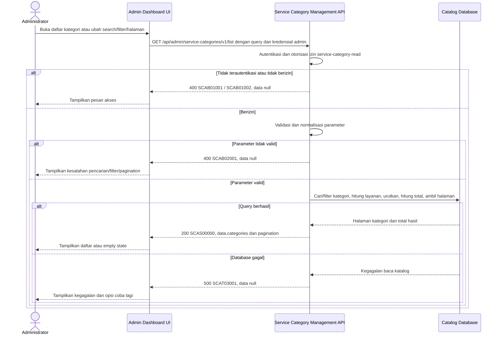

# Admin Dashboard - Get List Service Categories Interface Agreement

> **Document Type:** IFA / API Contract  
> **Status:** Draft  
> **Service / Domain:** Admin Dashboard — Service Category Management  
> **Consumer / Partner:** JokiHub Admin Dashboard (authorized administrator)

## Design

API mengambil daftar kategori layanan untuk pengelolaan Admin Dashboard. Daftar mencakup kategori aktif dan nonaktif, pencarian nama/slug, filter status, pagination, serta jumlah layanan turunan. Field dan relasi bersumber dari [Service Category ERD](../../erd/service-category-erd.md) dan tampilan Admin Service Categories. Belum ada implementasi backend; endpoint dan parameter di bawah merupakan kontrak usulan.

## Sequence Diagram



## Performance / SLA Targets

| Success Rate                                        | VUser                                   | CPU / Memory                             | Response Time                                                                        |
| --------------------------------------------------- | --------------------------------------- | ---------------------------------------- | ------------------------------------------------------------------------------------ |
| TBD; konfirmasi criticality dan availability target | TBD; konfirmasi concurrent admin puncak | TBD; tetapkan dari capacity estimate/NFT | TBD; usulan baseline web non-kritis: ideal 200 ms, acceptable 1 s, max tolerable 2 s |

## General Information

| Component          | Value                                                                                                                                                       |
| ------------------ | ----------------------------------------------------------------------------------------------------------------------------------------------------------- |
| Description        | Mengambil daftar kategori layanan beserta jumlah layanan untuk Admin Dashboard.                                                                             |
| Resource URL       | `https://{host}/api/admin/service-categories/v1/list`                                                                                                       |
| Transport Protocol | HTTPS, REST                                                                                                                                                 |
| Request Verb       | GET                                                                                                                                                         |
| Content Type       | `application/json` response; GET tidak memiliki request body.                                                                                               |
| Interaction Type   | Synchronous                                                                                                                                                 |
| Security Policy    | Admin authentication dan izin `service-category-read`. Identity provider dan permission final TBD. Terapkan rate limiting dan audit akses sesuai kebijakan. |

### Path / Endpoint

| Section        | Value                                       |
| -------------- | ------------------------------------------- |
| Host / Domain  | `{host}` (environment-specific)             |
| Service Name   | Service Category Management                 |
| Version        | `v1`                                        |
| Resource       | `/admin/service-categories/v1/list`         |
| Final Endpoint | `GET /api/admin/service-categories/v1/list` |

### API Versioning

- **Decision:** New Endpoint
- **Previous Endpoint:** Tidak ada API daftar kategori admin yang teridentifikasi pada solutioning sprint ini.
- **Final Endpoint:** `GET /api/admin/service-categories/v1/list`
- **Backward Compatibility:** Belum ada consumer API ini yang teridentifikasi. Penambahan field response opsional bersifat kompatibel; perubahan kontrak yang mematahkan consumer memerlukan major version baru.
- **Reason:** Admin Dashboard memerlukan daftar kategori yang dapat dicari dan difilter untuk pengelolaan katalog layanan.

## Business Rules

1. Hanya administrator terautentikasi dengan izin `service-category-read` yang dapat mengakses endpoint. Mapping permission ke role final TBD.
2. Daftar admin mencakup kategori aktif dan nonaktif. Kategori soft-deleted (`deleted_at IS NOT NULL`) tidak ditampilkan; hard-delete policy mengikuti keputusan ERD.
3. Parameter `q`, bila diberikan, mencocokkan `name` atau `slug` setelah trim secara case-insensitive. Deskripsi tidak dicari pada versi ini.
4. Parameter `isActive`, bila diberikan, memfilter nilai boolean tepat. Bila tidak diberikan, kedua status aktif/nonaktif disertakan.
5. `serviceCount` merupakan jumlah turunan dari `game_service` yang terhubung. ERD belum menetapkan apakah kategori inactive atau soft-deleted dihitung; usulan awal menghitung seluruh layanan non-deleted tanpa memandang status aktif. Konfirmasi sebelum implementasi.
6. Hasil diurutkan `name ASC`, lalu `category_id ASC` agar urutan deterministik. Kebutuhan custom sort order belum ada pada ERD/UI.
7. `total` menghitung kategori setelah filter sebelum pagination. Hasil kosong adalah sukses dengan `categories: []` dan `total: 0`.
8. `updatedAt` menggunakan timestamp UTC dari `service_category.updated_at`; format response ISO 8601.
9. Response memuat data yang diperlukan tabel admin saja: `id`, `name`, `slug`, `description`, `serviceCount`, `isActive`, dan `updatedAt`. Field internal audit/soft-delete tidak diekspos.
10. API bersifat read-only; tidak membuat perubahan kategori atau layanan.
11. Pagination diterapkan di database sebelum serialisasi response. Perhitungan jumlah layanan harus menghindari duplikasi kategori maupun hasil total akibat join.

## Request Headers

| Header          | E/N/T | Type   | M/O/C | Max Length | Description                                                  | Example                 |
| --------------- | ----- | ------ | ----- | ---------: | ------------------------------------------------------------ | ----------------------- |
| `Authorization` | N     | String | M     |       4096 | Kredensial administrator; skema mengikuti identity provider. | `Bearer {access-token}` |
| `Accept`        | N     | String | O     |        100 | Tipe media response yang diinginkan; default JSON.           | `application/json`      |
| `X-Request-Id`  | N     | String | O     |        100 | ID korelasi untuk audit/support; jangan memuat PII.          | `req-c71a2d`            |

## Request Parameters

Tidak ada path parameter.

## Request Query Parameters

| Parameter  | E/N/T | Type    | M/O/C | Max Length | Description                                                             | Example  |
| ---------- | ----- | ------- | ----- | ---------: | ----------------------------------------------------------------------- | -------- |
| `q`        | N     | String  | O     |        100 | Pencarian nama atau slug kategori.                                      | `top-up` |
| `isActive` | N     | Boolean | O     |          5 | Filter status aktif: `true` atau `false`.                               | `true`   |
| `limit`    | N     | Integer | O     |   3 digits | Jumlah maksimum hasil per halaman; default `20`, maksimum usulan `100`. | `20`     |
| `offset`   | N     | Integer | O     |   9 digits | Jumlah hasil yang dilewati; default `0`.                                | `0`      |

## Request Body

Tidak ada request body.

### Request Validation

1. `Authorization` harus mengidentifikasi administrator terautentikasi dengan izin `service-category-read`. Kembalikan `SCAB01001` bila belum terautentikasi dan `SCAB01002` bila tidak berizin.
2. `q`, bila dikirim, harus berupa string maksimal 100 karakter setelah trim. Query harus diparameterisasi; wildcard dan escape mengikuti kebijakan pencarian database.
3. `isActive`, bila dikirim, harus tepat `true` atau `false`; nilai lain menghasilkan `SCAB02001`.
4. `limit` harus integer dari 1 sampai 100; default `20`.
5. `offset` harus integer >= 0 dan tidak melebihi batas integer yang disepakati implementasi; default `0`.
6. Parameter query yang tidak dikenal ditolak dengan `SCAB02001`.
7. Query hanya mengikutsertakan kategori yang belum soft-delete dan tidak boleh menghasilkan kategori duplikat akibat join ke layanan.
8. Jika tidak ada hasil, kembalikan HTTP 200 dengan `categories: []` dan `total: 0`.
9. Kegagalan database mengembalikan HTTP 500 tanpa detail internal.

## Response Body

Semua response menggunakan envelope `status` dan `data`. Error mengembalikan `data: null`.

| Attribute                        | E/N/T | Type               | M/O/C |    Max Length | Description                                                 | Example                        |
| -------------------------------- | ----- | ------------------ | ----- | ------------: | ----------------------------------------------------------- | ------------------------------ |
| `status`                         | N     | Object             | M     |             — | Object status response.                                     | `{}`                           |
| `status.code`                    | N     | String             | M     |            20 | Service status code.                                        | `SCAS00000`                    |
| `status.message`                 | N     | String             | O     |           200 | Pesan hasil untuk consumer.                                 | `Service categories retrieved` |
| `data`                           | N     | Object/null        | M     |             — | Payload hasil; `null` ketika error.                         | `{}`                           |
| `data.categories`                | N     | Array of Object    | M     | `limit` items | Halaman kategori; kosong bila tidak ada hasil.              | `[]`                           |
| `data.categories[].id`           | N     | String             | M     |            64 | ID kategori internal (`category_id`).                       | `cat_01JXYZ`                   |
| `data.categories[].name`         | N     | String             | M     |           100 | Nama kategori.                                              | `Top Up`                       |
| `data.categories[].slug`         | N     | String             | M     |           100 | Slug URL-safe kategori.                                     | `top-up`                       |
| `data.categories[].description`  | N     | String/null        | O     |           500 | Deskripsi kategori.                                         | `Layanan pengisian saldo game` |
| `data.categories[].serviceCount` | N     | Integer            | M     |     10 digits | Jumlah layanan terkait sesuai aturan hitung yang disetujui. | `8`                            |
| `data.categories[].isActive`     | N     | Boolean            | M     |             — | Status aktif kategori.                                      | `true`                         |
| `data.categories[].updatedAt`    | N     | String (date-time) | M     |            35 | Waktu terakhir diperbarui dalam ISO 8601 UTC.               | `2026-10-11T08:30:00Z`         |
| `data.pagination.limit`          | N     | Integer            | M     |      3 digits | Batas hasil efektif.                                        | `20`                           |
| `data.pagination.offset`         | N     | Integer            | M     |      9 digits | Offset efektif.                                             | `0`                            |
| `data.pagination.total`          | N     | Integer            | M     |     10 digits | Total kategori yang cocok sebelum pagination.               | `1`                            |

### Success Example

```json
{
  "status": {
    "code": "SCAS00000",
    "message": "Service categories retrieved"
  },
  "data": {
    "categories": [
      {
        "id": "cat_01JXYZ",
        "name": "Top Up",
        "slug": "top-up",
        "description": "Layanan pengisian saldo game",
        "serviceCount": 8,
        "isActive": true,
        "updatedAt": "2026-10-11T08:30:00Z"
      }
    ],
    "pagination": {
      "limit": 20,
      "offset": 0,
      "total": 1
    }
  }
}
```

### Business Error Example

```json
{
  "status": {
    "code": "SCAB02001",
    "message": "Invalid service-category list parameters"
  },
  "data": null
}
```

### Technical Error Example

```json
{
  "status": {
    "code": "SCAT03001",
    "message": "Service category data is temporarily unavailable"
  },
  "data": null
}
```

## HTTP Status Codes

| HTTP Status | Usage                                                                                                                                     |
| ----------- | ----------------------------------------------------------------------------------------------------------------------------------------- |
| `200`       | Query valid; mengembalikan kategori yang cocok atau array kosong.                                                                         |
| `400`       | Query tidak valid atau akses admin ditolak sesuai baseline response project. Konfirmasi apakah autentikasi/otorisasi memakai `401`/`403`. |
| `500`       | Kegagalan service/database kategori yang tidak terduga.                                                                                   |

## Service Status Codes

Format: `[Service Prefix][Status Type][Category][Specific Error Code]`

| Code        | Type      | Category        | Meaning                                                       |
| ----------- | --------- | --------------- | ------------------------------------------------------------- |
| `SCAS00000` | Success   | General         | Daftar kategori berhasil dikembalikan, termasuk hasil kosong. |
| `SCAB01001` | Business  | Authentication  | Administrator belum terautentikasi.                           |
| `SCAB01002` | Business  | Authentication  | Administrator tidak memiliki izin membaca kategori layanan.   |
| `SCAB02001` | Business  | User validation | Parameter pencarian/filter/pagination tidak valid.            |
| `SCAT03001` | Technical | Database        | Kategori gagal dibaca atau database tidak tersedia.           |

## API Exposure Classification

| Classification                 | Rationale                                                                                                                                              |
| ------------------------------ | ------------------------------------------------------------------------------------------------------------------------------------------------------ |
| Enterprise Intranet (proposed) | Endpoint admin untuk pengelolaan katalog. Jika dapat diakses dari internet, klasifikasikan sebagai Public dan terapkan kontrol API publik yang sesuai. |

## Testing & Documentation Scope

| Scope      | Required | Rationale / Handoff                                                                                                                                                                                           |
| ---------- | -------- | ------------------------------------------------------------------------------------------------------------------------------------------------------------------------------------------------------------- |
| NFT        | Yes      | API daftar admin baru. Uji search, filter aktif/nonaktif, limit minimum/maksimum, offset, hasil kosong, dan hitung `serviceCount` tanpa duplikasi. VUser, CPU/memory, serta target TPS TBD menunggu forecast. |
| VA/Pentest | Yes      | Verifikasi authentication/authorization, privilege boundaries, injection, query validation, serta tidak adanya field internal yang tidak diperlukan.                                                          |

## Assumptions

- Endpoint, parameter, pagination, response envelope, service codes, dan permission adalah usulan karena kontrak backend kategori belum ditemukan.
- `serviceCount` menghitung layanan non-deleted; perlakuan layanan nonaktif dan layanan soft-deleted harus dikonfirmasi.
- Nama, slug, description, status aktif, dan jumlah layanan mengikuti ERD/UI. Nilai panjang dan unique constraints mengikuti proposal ERD.
- `deleted_at` tersedia di ERD, tetapi kebijakan penghapusan kategori belum disetujui; API mengecualikan soft-deleted rows sebagai asumsi.
- Sort `name ASC`, ID tie-break, default `limit=20`, dan maksimum `100` adalah proposal.
- Identity provider, role mapping, rate limit, SLA, database engine, dan auth HTTP mapping TBD.

## References

- `../../erd/service-category-erd.md` — field kategori, relasi layanan, indeks, dan aturan soft delete.
- `src/features/AdminServiceCategories/views/interfaces/admin-service-category.interface.ts` — field tabel kategori dan filter status.
- `src/features/AdminServiceCategories/views/templates/AdminServiceCategories.template.tsx` — pencarian nama/slug, filter aktif, dan tampilan jumlah layanan.
- `../../erd/service-erd.md` — sumber relasi layanan yang dihitung pada `serviceCount`.
