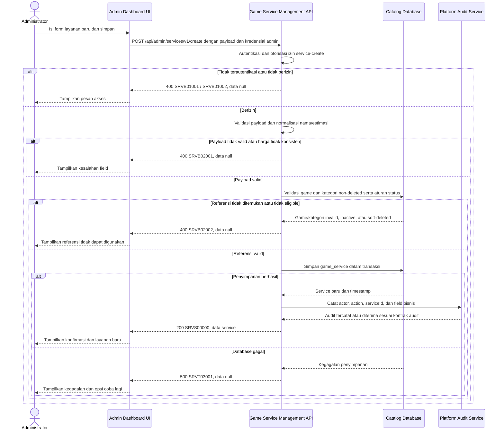

# Admin Dashboard - Create Service Interface Agreement

> **Document Type:** IFA / API Contract  
> **Status:** Draft  
> **Service / Domain:** Admin Dashboard — Game Service Management  
> **Consumer / Partner:** JokiHub Admin Dashboard (authorized administrator)

## Design

API membuat layanan game baru dari form Admin Services. Admin menentukan game, kategori, nama layanan, harga tetap atau custom, estimasi penyelesaian, dan status aktif. API memvalidasi referensi game/kategori serta konsistensi harga, menghasilkan ID dan timestamp, lalu mencatat perubahan pada audit platform. Model mengacu pada [Service ERD](../../erd/service-erd.md), [Game ERD](../../erd/game-erd.md), dan [Service Category ERD](../../erd/service-category-erd.md); field mengikuti form Admin Services.

## Sequence Diagram



## Performance / SLA Targets

| Success Rate                                        | VUser                                   | CPU / Memory                             | Response Time                                                                        |
| --------------------------------------------------- | --------------------------------------- | ---------------------------------------- | ------------------------------------------------------------------------------------ |
| TBD; konfirmasi criticality dan availability target | TBD; konfirmasi concurrent admin puncak | TBD; tetapkan dari capacity estimate/NFT | TBD; usulan baseline web non-kritis: ideal 200 ms, acceptable 1 s, max tolerable 2 s |

## General Information

| Component          | Value                                                                                                                                      |
| ------------------ | ------------------------------------------------------------------------------------------------------------------------------------------ |
| Description        | Membuat record layanan game baru beserta relasi game dan kategori.                                                                         |
| Resource URL       | `https://{host}/api/admin/services/v1/create`                                                                                              |
| Transport Protocol | HTTPS, REST                                                                                                                                |
| Request Verb       | POST                                                                                                                                       |
| Content Type       | `application/json`                                                                                                                         |
| Interaction Type   | Synchronous                                                                                                                                |
| Security Policy    | Admin authentication dan izin `service-create`. Identity provider dan permission final TBD. Terapkan rate limiting dan audit actor/action. |

### Path / Endpoint

| Section        | Value                                |
| -------------- | ------------------------------------ |
| Host / Domain  | `{host}` (environment-specific)      |
| Service Name   | Game Service Management              |
| Version        | `v1`                                 |
| Resource       | `/admin/services/v1/create`          |
| Final Endpoint | `POST /api/admin/services/v1/create` |

### API Versioning

- **Decision:** New Endpoint
- **Previous Endpoint:** Tidak ada API create layanan admin yang teridentifikasi pada solutioning sprint ini.
- **Final Endpoint:** `POST /api/admin/services/v1/create`
- **Backward Compatibility:** Belum ada consumer API ini yang teridentifikasi. Penambahan field request opsional bersifat kompatibel; perubahan kontrak yang mematahkan consumer memerlukan major version baru.
- **Reason:** Admin Dashboard memerlukan operasi untuk menambahkan penawaran layanan pada game dan kategori yang tersedia.

## Business Rules

1. Hanya administrator terautentikasi dengan izin `service-create` yang dapat membuat layanan. Role mapping dan permission final TBD.
2. `serviceId`, `createdAt`, dan `updatedAt` dibuat oleh service; client tidak boleh menetapkan nilai tersebut.
3. `gameId` dan `categoryId` wajib merujuk record yang ada dan belum soft-deleted.
4. Layanan aktif hanya dapat dibuat untuk game aktif dan kategori aktif, mengikuti data rules ERD. Layanan nonaktif boleh ditautkan ke parent nonaktif bila product menyetujui; kebijakan tersebut TBD. Default usulan adalah menolak parent inactive untuk semua create sampai aturan final ditetapkan.
5. `name` wajib, di-trim, tidak kosong, maksimal 150 karakter. Uniqueness scope belum ditetapkan ERD; duplicate name tidak ditolak berdasarkan asumsi sampai product/API owner menetapkan apakah unik per game atau global.
6. Harga fixed menggunakan `isCustomPrice=false` dan `priceAmount` berupa decimal >= 0. Harga quote/custom menggunakan `isCustomPrice=true` dan `priceAmount=null`. Kombinasi lain ditolak.
7. Mata uang mengikuti konfigurasi platform. UI saat ini menampilkan IDR; currency tidak dikirim dalam request karena model ERD belum memiliki kolom currency dan mengasumsikan satu mata uang platform. Konfirmasi sebelum implementasi.
8. `estimateText` wajib berupa teks tampilan, maksimal 100 karakter. Nilai bukan SLA dan tidak boleh dipakai sebagai jaminan sistem.
9. `isActive` menentukan ketersediaan layanan baru di storefront; default usulan `true` mengikuti ERD. Konfirmasi default sebelum implementasi.
10. Pembuatan tidak mengubah game, kategori, atau layanan lain; tidak membuat order atau perubahan fulfillment.
11. Keberhasilan dicatat pada platform audit dengan actor, action, ID layanan, nilai bisnis, dan waktu. Audit storage/retention mengikuti standar platform.
12. Service name uniqueness dan idempotency belum memiliki keputusan. Gunakan transaksi dan unique constraint hanya setelah scope uniqueness disetujui; retry semantics perlu disepakati sebelum implementasi.
13. Penghapusan atau perubahan parent di masa depan tidak boleh menghapus order historis; order harus mengambil snapshot sesuai Order ERD.

## Request Headers

| Header          | E/N/T | Type   | M/O/C | Max Length | Description                                                  | Example                 |
| --------------- | ----- | ------ | ----- | ---------: | ------------------------------------------------------------ | ----------------------- |
| `Authorization` | N     | String | M     |       4096 | Kredensial administrator; skema mengikuti identity provider. | `Bearer {access-token}` |
| `Content-Type`  | N     | String | M     |        100 | Format payload.                                              | `application/json`      |
| `Accept`        | N     | String | O     |        100 | Tipe media response yang diinginkan; default JSON.           | `application/json`      |
| `X-Request-Id`  | N     | String | O     |        100 | ID korelasi untuk audit/support; jangan memuat PII.          | `req-81d204`            |

## Request Parameters

Tidak ada path/query parameter.

## Request Body

| Attribute       | E/N/T | Type         | M/O/C | Max Length | Description                                                   | Example              |
| --------------- | ----- | ------------ | ----- | ---------: | ------------------------------------------------------------- | -------------------- |
| `gameId`        | N     | String       | M     |         64 | ID game pada `game_catalog`.                                  | `gm_01JXYZ`          |
| `categoryId`    | N     | String       | M     |         64 | ID kategori pada `service_category`.                          | `cat_01JXYZ`         |
| `name`          | N     | String       | M     |        150 | Nama display layanan.                                         | `Top Up 86 Diamonds` |
| `priceAmount`   | N     | Decimal/null | C     |       18,2 | Harga fixed >= 0; wajib null untuk custom price.              | `25000.00`           |
| `isCustomPrice` | N     | Boolean      | M     |          — | `true` untuk layanan quote/custom; `false` untuk harga fixed. | `false`              |
| `estimateText`  | N     | String       | M     |        100 | Estimasi display penyelesaian.                                | `Instan`             |
| `isActive`      | N     | Boolean      | O     |          — | Status layanan; default usulan `true`.                        | `true`               |

### Example Request Body

```json
{
  "gameId": "gm_01JXYZ",
  "categoryId": "cat_01JXYZ",
  "name": "Top Up 86 Diamonds",
  "priceAmount": 25000.0,
  "isCustomPrice": false,
  "estimateText": "Instan",
  "isActive": true
}
```

### Request Validation

1. `Authorization` harus mengidentifikasi administrator terautentikasi dengan izin `service-create`. Kembalikan `SRVB01001` bila belum terautentikasi dan `SRVB01002` bila izin tidak tersedia.
2. Body harus JSON object valid. Tolak field yang tidak dikenal, termasuk `serviceId`, `id`, `createdAt`, `updatedAt`, dan `deletedAt`, dengan `SRVB02001`.
3. `gameId` dan `categoryId` wajib berupa string non-kosong maksimal 64 karakter dengan format ID yang ditetapkan implementasi.
4. `name` wajib string; trim sebelum simpan, tidak boleh kosong setelah trim, dan maksimal 150 karakter.
5. `priceAmount` dan `isCustomPrice` harus konsisten: jika `isCustomPrice=true`, `priceAmount` wajib hadir sebagai `null`; jika `isCustomPrice=false`, `priceAmount` wajib hadir sebagai angka decimal >= 0 dengan presisi maksimal `18,2`.
6. Jangan menerima string numerik untuk `priceAmount`. Tolak NaN, Infinity, nilai negatif, serta nilai yang memiliki presisi/scale di luar batas.
7. `estimateText` wajib string non-kosong setelah trim dan maksimal 100 karakter.
8. `isActive`, bila dikirim, harus boolean JSON; selain itu gunakan default usulan `true`.
9. `gameId` harus ada dan belum soft-deleted. Bila layanan akan aktif, game harus aktif. Referensi invalid atau tidak eligible mengembalikan `SRVB02002`.
10. `categoryId` harus ada, belum soft-deleted, dan aktif untuk layanan aktif. Referensi invalid atau tidak eligible mengembalikan `SRVB02002`.
11. Validasi referensi parent dan insert harus konsisten terhadap concurrent deactivation/deletion; enforce FK dan lakukan transaksi atau recheck sebelum commit.
12. Kegagalan database saat penyimpanan mengembalikan HTTP 500 `SRVT03001` tanpa detail internal.

## Response Body

Semua response menggunakan envelope `status` dan `data`. Error mengembalikan `data: null`.

| Attribute                    | E/N/T | Type               | M/O/C | Max Length | Description                                                | Example                |
| ---------------------------- | ----- | ------------------ | ----- | ---------: | ---------------------------------------------------------- | ---------------------- |
| `status`                     | N     | Object             | M     |          — | Object status response.                                    | `{}`                   |
| `status.code`                | N     | String             | M     |         20 | Service status code.                                       | `SRVS00000`            |
| `status.message`             | N     | String             | O     |        200 | Pesan hasil untuk consumer.                                | `Service created`      |
| `data`                       | N     | Object/null        | M     |          — | Payload hasil; `null` ketika error.                        | `{}`                   |
| `data.service`               | N     | Object             | M     |          — | Layanan baru.                                              | `{}`                   |
| `data.service.id`            | N     | String             | M     |         64 | ID immutable yang dibuat service.                          | `svc_01JXYZ`           |
| `data.service.gameId`        | N     | String             | M     |         64 | ID game terkait.                                           | `gm_01JXYZ`            |
| `data.service.gameName`      | N     | String             | M     |        100 | Nama game untuk admin UI, diproyeksikan dari katalog.      | `Mobile Legends`       |
| `data.service.categoryId`    | N     | String             | M     |         64 | ID kategori terkait.                                       | `cat_01JXYZ`           |
| `data.service.categoryName`  | N     | String             | M     |        100 | Nama kategori untuk admin UI, diproyeksikan dari kategori. | `Top Up`               |
| `data.service.name`          | N     | String             | M     |        150 | Nama layanan tersimpan.                                    | `Top Up 86 Diamonds`   |
| `data.service.priceAmount`   | N     | Decimal/null       | C     |       18,2 | Harga fixed atau null untuk custom price.                  | `25000.00`             |
| `data.service.isCustomPrice` | N     | Boolean            | M     |          — | Penanda harga custom.                                      | `false`                |
| `data.service.estimateText`  | N     | String             | M     |        100 | Estimasi display layanan.                                  | `Instan`               |
| `data.service.isActive`      | N     | Boolean            | M     |          — | Status layanan.                                            | `true`                 |
| `data.service.createdAt`     | N     | String (date-time) | M     |         35 | Waktu pembuatan UTC.                                       | `2026-10-11T10:00:00Z` |
| `data.service.updatedAt`     | N     | String (date-time) | M     |         35 | Waktu update; sama dengan `createdAt` saat create.         | `2026-10-11T10:00:00Z` |

### Success Example

```json
{
  "status": {
    "code": "SRVS00000",
    "message": "Service created"
  },
  "data": {
    "service": {
      "id": "svc_01JXYZ",
      "gameId": "gm_01JXYZ",
      "gameName": "Mobile Legends",
      "categoryId": "cat_01JXYZ",
      "categoryName": "Top Up",
      "name": "Top Up 86 Diamonds",
      "priceAmount": 25000.0,
      "isCustomPrice": false,
      "estimateText": "Instan",
      "isActive": true,
      "createdAt": "2026-10-11T10:00:00Z",
      "updatedAt": "2026-10-11T10:00:00Z"
    }
  }
}
```

### Business Error Example

```json
{
  "status": {
    "code": "SRVB02001",
    "message": "Invalid service payload"
  },
  "data": null
}
```

### Technical Error Example

```json
{
  "status": {
    "code": "SRVT03001",
    "message": "Service catalog is temporarily unavailable"
  },
  "data": null
}
```

## HTTP Status Codes

| HTTP Status | Usage                                                                                                                           |
| ----------- | ------------------------------------------------------------------------------------------------------------------------------- |
| `200`       | Layanan berhasil dibuat sesuai baseline IFA project; konfirmasi apakah API standard menetapkan `201`.                           |
| `400`       | Payload/reference tidak valid atau akses admin ditolak sesuai baseline response project. Konfirmasi auth-specific HTTP mapping. |
| `500`       | Kegagalan service atau database yang tidak terduga.                                                                             |

## Service Status Codes

Format: `[Service Prefix][Status Type][Category][Specific Error Code]`

| Code        | Type      | Category        | Meaning                                                                               |
| ----------- | --------- | --------------- | ------------------------------------------------------------------------------------- |
| `SRVS00000` | Success   | General         | Layanan berhasil dibuat.                                                              |
| `SRVB01001` | Business  | Authentication  | Administrator belum terautentikasi.                                                   |
| `SRVB01002` | Business  | Authentication  | Administrator tidak memiliki izin create layanan.                                     |
| `SRVB02001` | Business  | User validation | Payload, field, atau kombinasi harga tidak valid.                                     |
| `SRVB02002` | Business  | User validation | Game/kategori tidak ditemukan, soft-deleted, atau tidak eligible untuk layanan aktif. |
| `SRVT03001` | Technical | Database        | Layanan gagal disimpan atau database tidak tersedia.                                  |

## API Exposure Classification

| Classification                 | Rationale                                                                                                                               |
| ------------------------------ | --------------------------------------------------------------------------------------------------------------------------------------- |
| Enterprise Intranet (proposed) | Operasi tulis katalog admin. Jika endpoint dapat diakses dari internet, klasifikasikan sebagai Public dan terapkan proteksi API publik. |

## Testing & Documentation Scope

| Scope      | Required | Rationale / Handoff                                                                                                                                                                                             |
| ---------- | -------- | --------------------------------------------------------------------------------------------------------------------------------------------------------------------------------------------------------------- |
| NFT        | Yes      | API create admin baru. Uji fixed/custom price, batas nilai/presisi, referensi aktif/nonaktif/deleted, request bersamaan, persistence, dan peak admin load. VUser, CPU/memory, target TPS TBD menunggu forecast. |
| VA/Pentest | Yes      | Verifikasi authentication/authorization, mass assignment, IDOR pada referensi game/kategori, input validation, injection, audit attribution, dan tidak ada update silang ke entitas katalog.                    |

## Assumptions

- Endpoint, response envelope, permission, dan service prefix `SRV` adalah proposal karena belum ada solutioning API layanan.
- `isCustomPrice` ditambahkan eksplisit sebagai flag walau UI saat ini memakai `price === null`; ini mengikuti proposal ERD. Persisted schema/field migration perlu disetujui.
- Status aktif default `true`, eligibility parent inactive, serta currency platform tunggal memerlukan keputusan product/API owner.
- Uniqueness nama layanan belum ditetapkan ERD; kontrak tidak menambah aturan uniqueness tanpa persetujuan.
- Audit menggunakan platform audit mechanism; transaksi/outbox dan failure handling TBD.
- Idempotency, currency representation, database engine, identity provider, role mapping, HTTP auth mapping, dan SLA TBD.

## References

- `../../erd/service-erd.md` — atribut layanan, harga, relasi game/kategori, status, dan constraints.
- `../../erd/game-erd.md` — game catalog reference dan lifecycle.
- `../../erd/service-category-erd.md` — category reference dan lifecycle.
- `src/features/AdminServices/views/interfaces/admin-service.interface.ts` — field service pada UI.
- `src/features/AdminServices/views/templates/AdminServices.template.tsx` — form create/edit, harga, estimasi, status, game/category selection.
- `../service-categories/create-service-category.md` — pola create API kategori admin.
