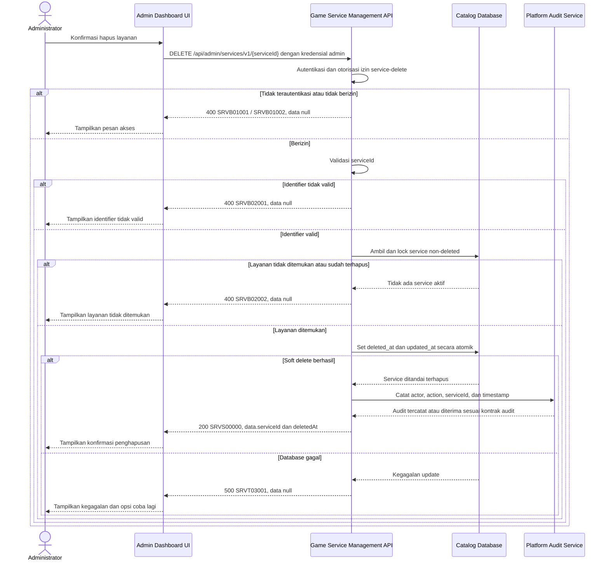

# Admin Dashboard - Delete Service Interface Agreement

> **Document Type:** IFA / API Contract  
> **Status:** Draft  
> **Service / Domain:** Admin Dashboard — Game Service Management  
> **Consumer / Partner:** JokiHub Admin Dashboard (authorized administrator)

## Design

API menghapus layanan dari katalog admin menggunakan soft delete. Record `game_service` tetap tersimpan dengan `deleted_at` agar referensi historis tidak rusak; order yang sudah dibuat mempertahankan snapshot layanan/harganya. Operasi tidak menghapus game, kategori, order, atau data pembayaran. Soft delete mengikuti proposal pada [Service ERD](../../erd/service-erd.md); kebijakan restore dan retensi masih perlu disetujui.

## Sequence Diagram



## Performance / SLA Targets

| Success Rate                                        | VUser                                   | CPU / Memory                             | Response Time                                                                        |
| --------------------------------------------------- | --------------------------------------- | ---------------------------------------- | ------------------------------------------------------------------------------------ |
| TBD; konfirmasi criticality dan availability target | TBD; konfirmasi concurrent admin puncak | TBD; tetapkan dari capacity estimate/NFT | TBD; usulan baseline web non-kritis: ideal 200 ms, acceptable 1 s, max tolerable 2 s |

## General Information

| Component          | Value                                                                                                                                      |
| ------------------ | ------------------------------------------------------------------------------------------------------------------------------------------ |
| Description        | Menandai satu layanan sebagai terhapus dari katalog tanpa menghapus histori order.                                                         |
| Resource URL       | `https://{host}/api/admin/services/v1/{serviceId}`                                                                                         |
| Transport Protocol | HTTPS, REST                                                                                                                                |
| Request Verb       | DELETE                                                                                                                                     |
| Content Type       | `application/json` response; tidak ada request body.                                                                                       |
| Interaction Type   | Synchronous                                                                                                                                |
| Security Policy    | Admin authentication dan izin `service-delete`. Identity provider dan permission final TBD. Terapkan rate limiting dan audit actor/action. |

### Path / Endpoint

| Section        | Value                                       |
| -------------- | ------------------------------------------- |
| Host / Domain  | `{host}` (environment-specific)             |
| Service Name   | Game Service Management                     |
| Version        | `v1`                                        |
| Resource       | `/admin/services/v1/{serviceId}`            |
| Final Endpoint | `DELETE /api/admin/services/v1/{serviceId}` |

### API Versioning

- **Decision:** New Endpoint
- **Previous Endpoint:** Tidak ada API delete layanan admin yang teridentifikasi pada solutioning sprint ini.
- **Final Endpoint:** `DELETE /api/admin/services/v1/{serviceId}`
- **Backward Compatibility:** Belum ada consumer API ini yang teridentifikasi. Perubahan semantik atau error contract yang mematahkan consumer memerlukan major version baru.
- **Reason:** Admin UI menyediakan aksi hapus layanan; endpoint menerapkan penghapusan aman sambil mempertahankan referensi transaksi.

## Business Rules

1. Hanya administrator terautentikasi dengan izin `service-delete` yang dapat menghapus layanan. Role mapping final TBD.
2. `serviceId` mengidentifikasi record secara immutable. Nama layanan atau ID game/kategori tidak dapat digunakan sebagai target penghapusan.
3. Operasi adalah soft delete: set `deleted_at` dan `updated_at` ke waktu server UTC; record fisik dipertahankan.
4. Layanan aktif maupun nonaktif dapat dihapus. Layanan terhapus tidak lagi tersedia untuk pemesanan/storefront dan dikecualikan dari daftar admin standar.
5. Relasi ke game dan kategori tidak dihapus atau diubah. Tidak ada cascade ke game/kategori, order, order item, pembayaran, refund, komplain, maupun audit.
6. Order historis tetap utuh dan menggunakan snapshot nama, harga, mata uang, dan estimasi saat checkout. Delete katalog tidak membatalkan atau mengubah status order yang sudah dibuat.
7. Layanan yang tidak ditemukan atau sudah soft-deleted mengembalikan kode bisnis yang sama untuk menghindari enumerasi status record.
8. Operasi update `deleted_at` harus atomik dan hanya berlaku bila `deleted_at IS NULL`; concurrent delete pertama menang. Retry sesudah sukses menghasilkan not-found/already-deleted tanpa efek samping tambahan.
9. Audit merekam actor, service ID, action, dan waktu. Detail audit storage/retention mengikuti platform audit policy.
10. Hard delete, restore, reassignment, dan pengubahan harga/status layanan bukan bagian endpoint ini.
11. ERD belum menentukan apakah service delete ditolak ketika sedang dipakai oleh proses fulfillment yang berjalan. Jika ada active fulfillment reference, perilaku blokir/allow harus ditentukan bersama modul order sebelum implementasi.

## Request Headers

| Header          | E/N/T | Type   | M/O/C | Max Length | Description                                                  | Example                 |
| --------------- | ----- | ------ | ----- | ---------: | ------------------------------------------------------------ | ----------------------- |
| `Authorization` | N     | String | M     |       4096 | Kredensial administrator; skema mengikuti identity provider. | `Bearer {access-token}` |
| `Accept`        | N     | String | O     |        100 | Tipe media response yang diinginkan; default JSON.           | `application/json`      |
| `X-Request-Id`  | N     | String | O     |        100 | ID korelasi untuk audit/support; jangan memuat PII.          | `req-2b84f1`            |

## Request Parameters

| Parameter   | E/N/T | Type          | M/O/C | Max Length | Description                             | Example      |
| ----------- | ----- | ------------- | ----- | ---------: | --------------------------------------- | ------------ |
| `serviceId` | N     | String (path) | M     |         64 | ID immutable layanan yang akan dihapus. | `svc_01JXYZ` |

## Request Body

Tidak ada request body.

### Request Validation

1. `Authorization` harus mengidentifikasi administrator terautentikasi dengan izin `service-delete`. Kembalikan `SRVB01001` bila belum terautentikasi dan `SRVB01002` bila tidak berizin.
2. `serviceId` wajib, tidak kosong, maksimal 64 karakter, dan mengikuti format ID implementasi. Format invalid menghasilkan `SRVB02001`.
3. Tolak request body dan query parameter yang tidak didefinisikan.
4. Lakukan soft delete hanya bila service ditemukan dan `deleted_at IS NULL`; bila tidak ditemukan atau sudah terhapus, kembalikan `SRVB02002`.
5. Pastikan transaksi tidak menghapus atau mengubah referensi order historis. Terapkan optimistic condition/row lock agar concurrent update tidak mengaktifkan kembali service yang sedang dihapus.
6. Catat audit secara durable sesuai platform policy.
7. Kegagalan database menghasilkan HTTP 500 `SRVT03001` tanpa detail internal.

## Response Body

Semua response menggunakan envelope `status` dan `data`. Error mengembalikan `data: null`.

| Attribute        | E/N/T | Type               | M/O/C | Max Length | Description                           | Example                |
| ---------------- | ----- | ------------------ | ----- | ---------: | ------------------------------------- | ---------------------- |
| `status`         | N     | Object             | M     |          — | Object status response.               | `{}`                   |
| `status.code`    | N     | String             | M     |         20 | Service status code.                  | `SRVS00000`            |
| `status.message` | N     | String             | O     |        200 | Pesan hasil untuk consumer.           | `Service deleted`      |
| `data`           | N     | Object/null        | M     |          — | Payload hasil; `null` ketika error.   | `{}`                   |
| `data.serviceId` | N     | String             | M     |         64 | ID layanan yang ditandai terhapus.    | `svc_01JXYZ`           |
| `data.deletedAt` | N     | String (date-time) | M     |         35 | Waktu soft delete dalam ISO 8601 UTC. | `2026-10-11T10:30:00Z` |

### Success Example

```json
{
  "status": {
    "code": "SRVS00000",
    "message": "Service deleted"
  },
  "data": {
    "serviceId": "svc_01JXYZ",
    "deletedAt": "2026-10-11T10:30:00Z"
  }
}
```

### Business Error Example

```json
{
  "status": {
    "code": "SRVB02002",
    "message": "Service not found"
  },
  "data": null
}
```

### Technical Error Example

```json
{
  "status": {
    "code": "SRVT03001",
    "message": "Service catalog is temporarily unavailable"
  },
  "data": null
}
```

## HTTP Status Codes

| HTTP Status | Usage                                                                                                                                                    |
| ----------- | -------------------------------------------------------------------------------------------------------------------------------------------------------- |
| `200`       | Layanan berhasil ditandai terhapus sesuai baseline response project; konfirmasi apakah API standard memilih `204`.                                       |
| `400`       | Identifier invalid, akses admin ditolak sesuai baseline response project, atau layanan tidak ditemukan/sudah terhapus. Konfirmasi auth-specific mapping. |
| `500`       | Kegagalan service/database yang tidak terduga.                                                                                                           |

## Service Status Codes

Format: `[Service Prefix][Status Type][Category][Specific Error Code]`

| Code        | Type      | Category        | Meaning                                                                     |
| ----------- | --------- | --------------- | --------------------------------------------------------------------------- |
| `SRVS00000` | Success   | General         | Layanan berhasil ditandai terhapus.                                         |
| `SRVB01001` | Business  | Authentication  | Administrator belum terautentikasi.                                         |
| `SRVB01002` | Business  | Authentication  | Administrator tidak memiliki izin delete layanan.                           |
| `SRVB02001` | Business  | User validation | `serviceId` invalid atau request memuat parameter/body yang tidak didukung. |
| `SRVB02002` | Business  | User validation | Layanan tidak ditemukan atau sudah soft-deleted.                            |
| `SRVT03001` | Technical | Database        | Layanan gagal ditandai terhapus atau database tidak tersedia.               |

## API Exposure Classification

| Classification                 | Rationale                                                                                                                                         |
| ------------------------------ | ------------------------------------------------------------------------------------------------------------------------------------------------- |
| Enterprise Intranet (proposed) | Operasi destruktif admin pada katalog. Jika endpoint dapat diakses dari internet, klasifikasikan sebagai Public dan terapkan proteksi API publik. |

## Testing & Documentation Scope

| Scope      | Required | Rationale / Handoff                                                                                                                                                                                                         |
| ---------- | -------- | --------------------------------------------------------------------------------------------------------------------------------------------------------------------------------------------------------------------------- |
| NFT        | Yes      | API delete admin baru. Uji layanan aktif/nonaktif, layanan tidak ditemukan, soft-deleted, retry, query katalog sesudah delete, serta operasi concurrent update/delete. VUser, CPU/memory, target TPS TBD menunggu forecast. |
| VA/Pentest | Yes      | Verifikasi authentication/authorization, IDOR, privilege boundaries, audit attribution, no hard-delete/cascade, dan order snapshot tetap tersedia.                                                                          |

## Assumptions

- Endpoint, permission, response envelope, dan prefix `SRV` mengikuti proposal [Create Service](./create-service.md); belum ada backend service API yang disetujui.
- Soft delete mengikuti kolom `deleted_at` dan rekomendasi Service ERD; kebijakan restore/retensi perlu disetujui.
- Endpoint tetap mengizinkan delete meskipun ada order historis karena FK/history dipertahankan dan order memakai snapshots; proses fulfillment aktif perlu aturan eksplisit.
- HTTP `200` dan response envelope mengikuti project baseline; `204` dapat dipilih oleh standar API final.
- Audit mechanism, identity provider, role mapping, database engine, active fulfillment guard, dan SLA TBD.

## References

- `../../erd/service-erd.md` — `deleted_at`, relasi parent, soft-delete proposal, dan audit rule.
- `../../erd/order-erd.md` — order item service reference, immutable snapshots, dan larangan menghapus histori.
- `./create-service.md` — service ID, field, permission, dan response naming baseline.
- `./update-service.md` — perilaku update dan referensi service.
- `src/features/AdminServices/views/templates/AdminServices.template.tsx` — aksi konfirmasi delete pada Admin Services UI.
