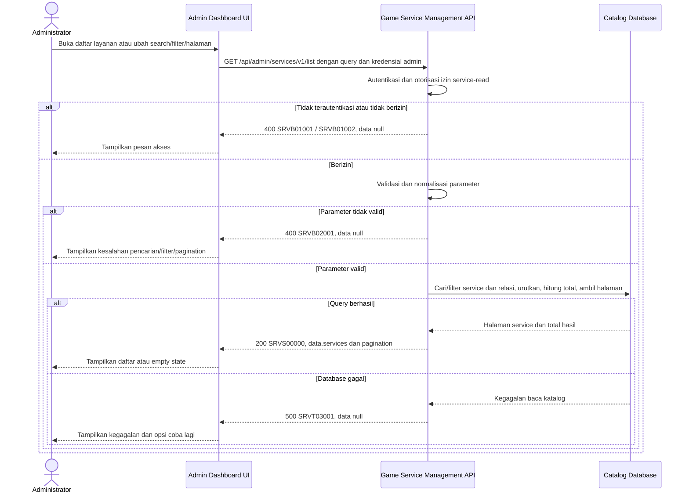

# Admin Dashboard - Get List Services Interface Agreement

> **Document Type:** IFA / API Contract  
> **Status:** Draft  
> **Service / Domain:** Admin Dashboard — Game Service Management  
> **Consumer / Partner:** JokiHub Admin Dashboard (authorized administrator)

## Design

API mengambil daftar layanan game untuk Admin Dashboard. Daftar mendukung pencarian nama layanan/game, filter kategori dan status, serta pagination. Response menyediakan harga fixed/custom, estimasi, relasi game/kategori, dan waktu perubahan sesuai tabel Admin Services. Sumber data `game_service` dan relasinya mengikuti [Service ERD](../../erd/service-erd.md); record soft-deleted dikecualikan.

## Sequence Diagram



## Performance / SLA Targets

| Success Rate                                        | VUser                                   | CPU / Memory                             | Response Time                                                                        |
| --------------------------------------------------- | --------------------------------------- | ---------------------------------------- | ------------------------------------------------------------------------------------ |
| TBD; konfirmasi criticality dan availability target | TBD; konfirmasi concurrent admin puncak | TBD; tetapkan dari capacity estimate/NFT | TBD; usulan baseline web non-kritis: ideal 200 ms, acceptable 1 s, max tolerable 2 s |

## General Information

| Component          | Value                                                                                                                                              |
| ------------------ | -------------------------------------------------------------------------------------------------------------------------------------------------- |
| Description        | Mengambil daftar layanan game beserta relasi game dan kategori untuk Admin Dashboard.                                                              |
| Resource URL       | `https://{host}/api/admin/services/v1/list`                                                                                                        |
| Transport Protocol | HTTPS, REST                                                                                                                                        |
| Request Verb       | GET                                                                                                                                                |
| Content Type       | `application/json` response; GET tidak memiliki request body.                                                                                      |
| Interaction Type   | Synchronous                                                                                                                                        |
| Security Policy    | Admin authentication dan izin `service-read`. Identity provider dan permission final TBD. Terapkan rate limiting dan audit akses sesuai kebijakan. |

### Path / Endpoint

| Section        | Value                             |
| -------------- | --------------------------------- |
| Host / Domain  | `{host}` (environment-specific)   |
| Service Name   | Game Service Management           |
| Version        | `v1`                              |
| Resource       | `/admin/services/v1/list`         |
| Final Endpoint | `GET /api/admin/services/v1/list` |

### API Versioning

- **Decision:** New Endpoint
- **Previous Endpoint:** Tidak ada API daftar layanan admin yang teridentifikasi pada solutioning sprint ini.
- **Final Endpoint:** `GET /api/admin/services/v1/list`
- **Backward Compatibility:** Belum ada consumer API ini yang teridentifikasi. Penambahan field response opsional bersifat kompatibel; perubahan kontrak yang mematahkan consumer memerlukan major version baru.
- **Reason:** Admin Dashboard memerlukan daftar layanan yang dapat dicari dan difilter untuk pengelolaan katalog.

## Business Rules

1. Hanya administrator terautentikasi dengan izin `service-read` yang dapat mengakses daftar. Role mapping dan permission final TBD.
2. Daftar mencakup layanan aktif dan nonaktif agar admin dapat mengelola status; layanan soft-deleted (`deleted_at IS NOT NULL`) tidak ditampilkan.
3. Parameter `q`, bila diberikan, mencocokkan nama layanan dan nama game secara case-insensitive setelah trim. Kategori tidak termasuk search karena UI menyediakan filter kategori terpisah.
4. `categoryId`, bila diberikan, memfilter exact match pada `game_service.category_id`. Kategori inactive tetap dapat digunakan untuk filter daftar historis/admin; kategori soft-deleted masih dapat menjadi relasi service dan tetap ditampilkan sebagai snapshot projection bila parent record tersedia.
5. `isActive`, bila diberikan, memfilter status layanan secara exact. Jika tidak diberikan, status aktif dan nonaktif ditampilkan.
6. Hasil diurutkan `updated_at DESC`, lalu `service_id DESC` untuk urutan deterministik. UI menampilkan latest-updated list; bila product menginginkan nama sort, definisikan terpisah.
7. `total` menghitung layanan setelah search dan filter, sebelum pagination. Hasil kosong adalah sukses dengan `services: []` dan `total: 0`.
8. Harga diambil dari `price_amount` dan `is_custom_price` yang tersimpan. Custom price memiliki `priceAmount=null` dan `isCustomPrice=true`; fixed price memiliki nilai non-negative dan flag false.
9. Nama game dan kategori adalah projection dari relasi katalog terkini untuk tampilan admin. Order historis memakai snapshot tersendiri dan tidak bergantung pada nilai projection list.
10. `updatedAt` dikembalikan ISO 8601 UTC dari `game_service.updated_at`.
11. Endpoint hanya read; tidak mengubah layanan, relasi, harga, status, atau audit records.
12. Pagination diterapkan pada database sebelum serialization; join ke game/category tidak boleh menduplikasi service atau mengubah `total`.
13. Bila parent game/category tidak ditemukan karena inkonsistensi data, jangan buang service tanpa observability; kembalikan ID referensi dan null display name atau raise data-integrity error sesuai kebijakan platform. Perilaku final perlu dikonfirmasi.

## Request Headers

| Header          | E/N/T | Type   | M/O/C | Max Length | Description                                                  | Example                 |
| --------------- | ----- | ------ | ----- | ---------: | ------------------------------------------------------------ | ----------------------- |
| `Authorization` | N     | String | M     |       4096 | Kredensial administrator; skema mengikuti identity provider. | `Bearer {access-token}` |
| `Accept`        | N     | String | O     |        100 | Tipe media response yang diinginkan; default JSON.           | `application/json`      |
| `X-Request-Id`  | N     | String | O     |        100 | ID korelasi untuk audit/support; jangan memuat PII.          | `req-f340b2`            |

## Request Parameters

Tidak ada path parameter.

## Request Query Parameters

| Parameter    | E/N/T | Type    | M/O/C | Max Length | Description                                                      | Example      |
| ------------ | ----- | ------- | ----- | ---------: | ---------------------------------------------------------------- | ------------ |
| `q`          | N     | String  | O     |        100 | Cari nama layanan atau nama game.                                | `diamond`    |
| `categoryId` | N     | String  | O     |         64 | Filter berdasarkan ID kategori.                                  | `cat_01JXYZ` |
| `isActive`   | N     | Boolean | O     |          5 | Filter status layanan `true` atau `false`.                       | `true`       |
| `limit`      | N     | Integer | O     |   3 digits | Jumlah layanan per halaman; default `20`, maksimum usulan `100`. | `20`         |
| `offset`     | N     | Integer | O     |   9 digits | Jumlah hasil yang dilewati; default `0`.                         | `0`          |

## Request Body

Tidak ada request body.

### Request Validation

1. `Authorization` harus mengidentifikasi administrator terautentikasi dengan izin `service-read`. Kembalikan `SRVB01001` bila belum terautentikasi dan `SRVB01002` bila tidak berizin.
2. `q`, bila dikirim, harus string maksimal 100 karakter setelah trim. Gunakan parameterized query dan kebijakan escape wildcard database.
3. `categoryId`, bila dikirim, harus string non-kosong maksimal 64 karakter dan sesuai format ID implementasi.
4. `isActive`, bila dikirim, hanya menerima `true` atau `false`.
5. `limit` harus integer 1–100; default `20`.
6. `offset` harus integer >= 0 dan tidak melebihi batas integer implementasi; default `0`.
7. Tolak query parameter yang tidak dikenal dengan `SRVB02001`.
8. Query mengecualikan service yang soft-deleted dan menghasilkan satu record per `serviceId`.
9. Jika tidak ada hasil, kembalikan HTTP 200 dengan array kosong dan total `0`.
10. Kegagalan database mengembalikan HTTP 500 tanpa detail internal.

## Response Body

Semua response menggunakan envelope `status` dan `data`. Error mengembalikan `data: null`.

| Attribute                       | E/N/T | Type               | M/O/C |    Max Length | Description                                      | Example                |
| ------------------------------- | ----- | ------------------ | ----- | ------------: | ------------------------------------------------ | ---------------------- |
| `status`                        | N     | Object             | M     |             — | Object status response.                          | `{}`                   |
| `status.code`                   | N     | String             | M     |            20 | Service status code.                             | `SRVS00000`            |
| `status.message`                | N     | String             | O     |           200 | Pesan hasil untuk consumer.                      | `Services retrieved`   |
| `data`                          | N     | Object/null        | M     |             — | Payload hasil; `null` ketika error.              | `{}`                   |
| `data.services`                 | N     | Array of Object    | M     | `limit` items | Halaman layanan; array kosong bila hasil kosong. | `[]`                   |
| `data.services[].id`            | N     | String             | M     |            64 | ID internal service.                             | `svc_01JXYZ`           |
| `data.services[].name`          | N     | String             | M     |           150 | Nama layanan.                                    | `Top Up Diamond 100`   |
| `data.services[].gameId`        | N     | String             | M     |            64 | ID game terkait.                                 | `gm_01JXYZ`            |
| `data.services[].gameName`      | N     | String/null        | O     |           100 | Nama game hasil relasi katalog.                  | `Mobile Legends`       |
| `data.services[].categoryId`    | N     | String             | M     |            64 | ID kategori terkait.                             | `cat_01JXYZ`           |
| `data.services[].categoryName`  | N     | String/null        | O     |           100 | Nama kategori hasil relasi katalog.              | `Top Up`               |
| `data.services[].priceAmount`   | N     | Decimal/null       | C     |          18,2 | Harga fixed; null untuk custom price.            | `25000.00`             |
| `data.services[].isCustomPrice` | N     | Boolean            | M     |             — | Penanda custom pricing.                          | `false`                |
| `data.services[].estimateText`  | N     | String             | M     |           100 | Estimasi display penyelesaian.                   | `Instan`               |
| `data.services[].isActive`      | N     | Boolean            | M     |             — | Status publikasi layanan.                        | `true`                 |
| `data.services[].updatedAt`     | N     | String (date-time) | M     |            35 | Waktu perubahan terakhir dalam ISO 8601 UTC.     | `2026-10-11T08:30:00Z` |
| `data.pagination.limit`         | N     | Integer            | M     |      3 digits | Batas hasil efektif.                             | `20`                   |
| `data.pagination.offset`        | N     | Integer            | M     |      9 digits | Offset efektif.                                  | `0`                    |
| `data.pagination.total`         | N     | Integer            | M     |     10 digits | Total service yang cocok sebelum pagination.     | `1`                    |

### Success Example

```json
{
  "status": {
    "code": "SRVS00000",
    "message": "Services retrieved"
  },
  "data": {
    "services": [
      {
        "id": "svc_01JXYZ",
        "name": "Top Up Diamond 100",
        "gameId": "gm_01JXYZ",
        "gameName": "Mobile Legends",
        "categoryId": "cat_01JXYZ",
        "categoryName": "Top Up",
        "priceAmount": 25000.0,
        "isCustomPrice": false,
        "estimateText": "Instan",
        "isActive": true,
        "updatedAt": "2026-10-11T08:30:00Z"
      }
    ],
    "pagination": {
      "limit": 20,
      "offset": 0,
      "total": 1
    }
  }
}
```

### Business Error Example

```json
{
  "status": {
    "code": "SRVB02001",
    "message": "Invalid service-list parameters"
  },
  "data": null
}
```

### Technical Error Example

```json
{
  "status": {
    "code": "SRVT03001",
    "message": "Service catalog is temporarily unavailable"
  },
  "data": null
}
```

## HTTP Status Codes

| HTTP Status | Usage                                                                                                                                             |
| ----------- | ------------------------------------------------------------------------------------------------------------------------------------------------- |
| `200`       | Query valid; mengembalikan layanan yang cocok atau array kosong.                                                                                  |
| `400`       | Parameter tidak valid atau akses admin ditolak sesuai baseline response project. Konfirmasi apakah autentikasi/otorisasi menggunakan `401`/`403`. |
| `500`       | Kegagalan service/database katalog yang tidak terduga.                                                                                            |

## Service Status Codes

Format: `[Service Prefix][Status Type][Category][Specific Error Code]`

| Code        | Type      | Category        | Meaning                                                      |
| ----------- | --------- | --------------- | ------------------------------------------------------------ |
| `SRVS00000` | Success   | General         | Daftar layanan berhasil dikembalikan, termasuk hasil kosong. |
| `SRVB01001` | Business  | Authentication  | Administrator belum terautentikasi.                          |
| `SRVB01002` | Business  | Authentication  | Administrator tidak memiliki izin membaca layanan.           |
| `SRVB02001` | Business  | User validation | Parameter pencarian/filter/pagination tidak valid.           |
| `SRVT03001` | Technical | Database        | Layanan gagal dibaca atau database tidak tersedia.           |

## API Exposure Classification

| Classification                 | Rationale                                                                                                                                  |
| ------------------------------ | ------------------------------------------------------------------------------------------------------------------------------------------ |
| Enterprise Intranet (proposed) | Endpoint admin untuk katalog. Jika dapat diakses dari internet, klasifikasikan sebagai Public dan terapkan kontrol API publik yang sesuai. |

## Testing & Documentation Scope

| Scope      | Required | Rationale / Handoff                                                                                                                                                                                      |
| ---------- | -------- | -------------------------------------------------------------------------------------------------------------------------------------------------------------------------------------------------------- |
| NFT        | Yes      | API list admin baru. Uji search, filter kategori/status, pagination minimum/maksimum, hasil kosong, custom/fixed price, serta join tanpa duplikasi. VUser, CPU/memory, target TPS TBD menunggu forecast. |
| VA/Pentest | Yes      | Verifikasi authentication/authorization, privilege boundaries, injection, parameter validation, IDOR pada category filter, dan pengecualian service soft-deleted.                                        |

## Assumptions

- Endpoint, parameter, pagination, response envelope, service prefix/codes, dan permission adalah proposal karena backend service API belum didefinisikan.
- Pagination menggunakan `limit`/`offset`, selaras dengan pola list game dalam solutioning. `limit=20`, maksimum `100` adalah proposal.
- Search terbatas pada nama layanan dan nama game sesuai UI placeholder/filter saat ini; status dan kategori menjadi filter terpisah.
- Daftar menyertakan aktif/nonaktif dan mengecualikan soft-deleted service. Kategori/game nonaktif tetap terbaca dalam admin list.
- Nama game/category di response berasal dari relasi katalog terkini; penanganan parent record yang hilang perlu diselaraskan dengan data-integrity policy.
- `isCustomPrice` mengikuti proposal ERD, sementara UI model menandai custom dengan `price === null`. Currency diasumsikan konfigurasi platform tunggal; keputusan final TBD.
- Identity provider, role mapping, SLA, rate limit, database engine, sort policy, serta category soft-delete visibility TBD.

## References

- `../../erd/service-erd.md` — field `game_service`, parent relationships, status, price constraints, soft-delete proposal.
- `../../erd/game-erd.md` — game catalog source.
- `../../erd/service-category-erd.md` — category source.
- `./create-service.md` — contract create service dan price model proposal.
- `./update-service.md` — contract update service.
- `./delete-service.md` — soft-delete behavior.
- `src/features/AdminServices/views/interfaces/admin-service.interface.ts` — table/form field model.
- `src/features/AdminServices/views/templates/AdminServices.template.tsx` — search, filters, table, dan service form.
- `src/features/AdminServices/views/pages/AdminServices.page.tsx` — mock data, category filter behavior, dan custom price representation.
- `../games/get-list-games.md` — pagination dan service code convention pembanding.
