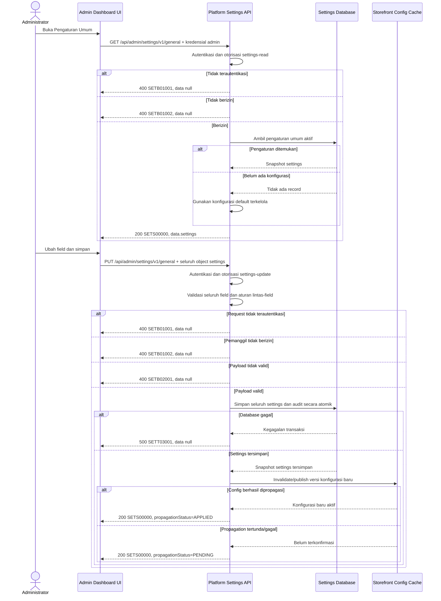

# Admin Dashboard - General Settings Interface Agreement

> **Document Type:** IFA / API Contract  
> **Status:** Draft  
> **Service / Domain:** Admin Dashboard — Platform Settings  
> **Consumer / Partner:** JokiHub Admin Dashboard (authorized administrator)

## Design

Kontrak ini memuat dan menyimpan pengaturan umum platform yang ditampilkan halaman `Pengaturan Umum`: informasi platform, kontak, preferensi regional, mode pemeliharaan, dan pendaftaran pengguna. UI mengambil snapshot melalui `GET`, lalu menyimpan perubahan melalui `PUT` dengan seluruh object settings. Hanya administrator berizin settings-read/settings-update yang dapat mengakses API. Perubahan mode pemeliharaan dan pendaftaran memengaruhi storefront, sehingga pembaruan harus tervalidasi, tercatat, dan segera berlaku sesuai strategi cache/config propagation. Struktur storage, cache, dan audit belum ditetapkan.

## Sequence Diagram



## Performance / SLA Targets

| Success Rate                                     | VUser                                       | CPU / Memory                        | Response Time                                          |
| ------------------------------------------------ | ------------------------------------------- | ----------------------------------- | ------------------------------------------------------ |
| TBD; confirm criticality and availability target | TBD; confirm peak concurrent administrators | TBD; set from capacity estimate/NFT | TBD; include config propagation target and measurement |

## General Information

| Component          | Value                                                                                                                                                        |
| ------------------ | ------------------------------------------------------------------------------------------------------------------------------------------------------------ |
| Description        | Membaca dan memperbarui pengaturan umum platform yang digunakan Admin Dashboard dan storefront.                                                              |
| Resource URL       | `https://{host}/api/admin/settings/v1/general`                                                                                                               |
| Transport Protocol | HTTPS, REST                                                                                                                                                  |
| Request Verb       | `GET` untuk baca; `PUT` untuk mengganti snapshot settings                                                                                                    |
| Content Type       | `application/json` untuk `PUT`; tidak diperlukan untuk `GET`                                                                                                 |
| Interaction Type   | Synchronous; config propagation dapat asynchronous                                                                                                           |
| Security Policy    | Admin authentication dan izin settings-read/settings-update. Terapkan least privilege, validasi server-side, audit perubahan, dan proteksi CSRF sesuai auth. |

### Path / Endpoint

| Section        | Value                            |
| -------------- | -------------------------------- |
| Host / Domain  | `{host}` (environment-specific)  |
| Service Name   | Platform Settings                |
| Version        | `v1`                             |
| Resource       | `/admin/settings/v1/general`     |
| Final Endpoint | `/api/admin/settings/v1/general` |

### API Versioning

- **Decision:** New Endpoint
- **Previous Endpoint:** Tidak ada API pengaturan umum yang teridentifikasi pada solutioning sprint ini; UI saat ini menyimpan state sesi saja.
- **Final Endpoint:** `GET, PUT /api/admin/settings/v1/general`
- **Backward Compatibility:** Belum ada consumer API settings yang teridentifikasi. Field response baru dapat ditambahkan secara opsional; perubahan field wajib/semantik memerlukan koordinasi consumer atau versi mayor.
- **Reason:** Admin Dashboard memerlukan konfigurasi persisten untuk menampilkan dan mengubah pengaturan platform.

## Business Rules

1. Hanya administrator terautentikasi dengan izin `settings-read` dapat membaca pengaturan; perubahan memerlukan `settings-update`. Nama permission adalah usulan dan perlu diselaraskan dengan RBAC.
2. Resource merepresentasikan satu snapshot konfigurasi umum platform. `GET` mengembalikan seluruh field yang dapat dikelola UI.
3. `PUT` mengganti seluruh snapshot mutable. Semua field harus dikirim; field yang tidak ada tidak diam-diam di-reset. Gunakan `PATCH` bila product menginginkan partial update.
4. `siteName` wajib dan tidak boleh kosong setelah trim. String disimpan dalam bentuk teks biasa; escaping dilakukan saat render.
5. `siteDescription` boleh kosong/null sesuai kebijakan panjang; copy ini informasi storefront dan tidak boleh berisi HTML aktif.
6. `contactEmail` harus alamat email valid. `contactWhatsapp` harus nomor telepon dalam format internasional E.164 atau aturan format yang disepakati.
7. `instagramUrl` opsional. Bila berisi nilai, harus URL HTTPS dengan host yang diizinkan; daftar domain dan validasi URL TBD.
8. `maintenanceMode` adalah boolean. Jika aktif, storefront perlu menampilkan maintenance state yang ditetapkan product; akses admin dan endpoint operasional tetap tersedia.
9. `allowRegistration` adalah boolean dan hanya mengontrol pendaftaran akun member. Nilai `false` tidak boleh menonaktifkan pembuatan akun admin atau invitation admin.
10. `defaultCurrency` saat ini hanya mendukung `IDR`, sesuai UI dan storefront. Dukungan multi-currency memerlukan keputusan produk dan perubahan kontrak.
11. `timezone` harus salah satu IANA timezone yang diizinkan UI: `Asia/Jakarta`, `Asia/Makassar`, atau `Asia/Jayapura`. Daftar final dapat diperluas melalui persetujuan.
12. Penyimpanan perubahan, `updatedAt`, `updatedBy`, dan audit harus atomik. Bila validasi atau persistence gagal, konfigurasi sebelumnya tetap aktif.
13. Setelah penyimpanan berhasil, cache/config storefront harus di-invalidate atau dipublikasikan. Target propagasi dan perilaku jika cache gagal TBD; response harus membedakan persisted dari propagated state.
14. Untuk mencegah admin menimpa perubahan admin lain, kontrak perlu memakai optimistic concurrency (`ETag`/`If-Match` atau `version`). Mekanisme final TBD; sampai diputuskan, API owner perlu menetapkan kebijakan last-write-wins atau menolak stale update.
15. Setiap perubahan mencatat aktor, waktu, field yang berubah, dan correlation ID. Jangan menyimpan token/session secret dalam audit.

## Request Headers

| Header          | E/N/T | Type   | M/O/C | Max Length | Description                                                                  | Example                 |
| --------------- | ----- | ------ | ----- | ---------: | ---------------------------------------------------------------------------- | ----------------------- |
| `Authorization` | N     | String | M     |       4096 | Kredensial administrator; skema autentikasi bergantung identity provider.    | `Bearer {access-token}` |
| `Content-Type`  | N     | String | C     |        100 | Wajib untuk `PUT`; tipe media request.                                       | `application/json`      |
| `Accept`        | N     | String | O     |        100 | Tipe media response yang diinginkan; default JSON.                           | `application/json`      |
| `X-Request-Id`  | N     | String | O     |        100 | ID korelasi untuk audit/support.                                             | `req-71c1ab`            |
| `If-Match`      | N     | String | C     |        200 | Version/ETag settings untuk optimistic concurrency bila mekanisme disetujui. | `"settings-v12"`        |

## Request Parameters

None.

## Request Query Parameters

None.

## Request Body

`GET` tidak menerima body. `PUT` mengirim seluruh object berikut.

| Attribute           | E/N/T | Type        | M/O/C | Max Length | Description                                                 | Example                                            |
| ------------------- | ----- | ----------- | ----- | ---------: | ----------------------------------------------------------- | -------------------------------------------------- |
| `siteName`          | N     | String      | M     |        100 | Nama platform, wajib non-empty setelah trim.                | `JokiHub`                                          |
| `siteDescription`   | N     | String/null | M     |        500 | Deskripsi platform; string kosong/null menghapus deskripsi. | `Solusi top up game, joki, dan kebutuhan digital.` |
| `contactEmail`      | N     | String      | M     |        254 | Email bantuan yang ditampilkan kepada pengguna.             | `cs@jokihub.id`                                    |
| `contactWhatsapp`   | N     | String      | M     |         16 | Nomor WhatsApp bantuan; format E.164 yang diusulkan.        | `+6281234567890`                                   |
| `instagramUrl`      | N     | String/null | M     |       2048 | URL Instagram; boleh null/kosong jika tidak tersedia.       | `https://instagram.com/jokihub`                    |
| `maintenanceMode`   | N     | Boolean     | M     |          — | Aktifkan mode pemeliharaan storefront.                      | `false`                                            |
| `allowRegistration` | N     | Boolean     | M     |          — | Izinkan pendaftaran akun member.                            | `true`                                             |
| `defaultCurrency`   | N     | String      | M     |          3 | Mata uang default; saat ini hanya `IDR`.                    | `IDR`                                              |
| `timezone`          | N     | String      | M     |         64 | IANA timezone untuk tampilan/waktu platform.                | `Asia/Jakarta`                                     |

### Example Request Body

```json
{
  "siteName": "JokiHub",
  "siteDescription": "Solusi top up game, joki, dan kebutuhan digital.",
  "contactEmail": "cs@jokihub.id",
  "contactWhatsapp": "+6281234567890",
  "instagramUrl": "https://instagram.com/jokihub",
  "maintenanceMode": false,
  "allowRegistration": true,
  "defaultCurrency": "IDR",
  "timezone": "Asia/Jakarta"
}
```

### Request Validation

1. `GET` memerlukan autentikasi dan izin settings-read. `PUT` memerlukan autentikasi dan izin settings-update; kembalikan `SETB01001` bila belum terautentikasi dan `SETB01002` bila tidak berizin.
2. `PUT` harus berisi JSON object dengan semua field kontrak. Body kosong, field wajib hilang, tipe salah, atau field tak dikenal mengembalikan `SETB02001`.
3. `siteName` harus string, trim, non-empty, dan maksimal 100 karakter.
4. `siteDescription` harus string/null dengan maksimal 500 karakter; karakter markup disimpan sebagai teks biasa dan di-escape saat render.
5. `contactEmail` harus alamat email valid maksimal 254 karakter.
6. `contactWhatsapp` harus nomor valid dalam format internasional yang disepakati; usulan E.164 maksimal 16 karakter termasuk `+`.
7. `instagramUrl` harus null/kosong atau HTTPS URL valid dari host yang diizinkan.
8. `maintenanceMode` dan `allowRegistration` harus boolean JSON, bukan string atau angka.
9. `defaultCurrency` harus `IDR`; nilai lain mengembalikan `SETB02001` sampai multi-currency didukung.
10. `timezone` harus anggota allowlist IANA yang didukung.
11. Bila optimistic concurrency aktif, `If-Match` wajib dan stale version mengembalikan `SETB02002`; jika tidak, tetapkan kebijakan concurrency sebelum rilis.
12. Validasi seluruh object sebelum commit. Bila database gagal, kembalikan HTTP 500 `SETT03001` dan settings lama tetap berlaku.
13. Kegagalan propagation setelah persistence tidak boleh memberi kesan bahwa perubahan belum tersimpan. Kembalikan snapshot tersimpan beserta `propagationStatus: PENDING` dan jalankan retry/alert sesuai operasional.

## Response Body

Semua response memakai envelope `status` dan `data`. `GET` dan `PUT` sukses mengembalikan settings snapshot; response `PUT` menyertakan metadata update dan status propagation.

| Attribute                         | E/N/T | Type               | M/O/C | Max Length | Description                                    | Example                         |
| --------------------------------- | ----- | ------------------ | ----- | ---------: | ---------------------------------------------- | ------------------------------- |
| `status`                          | N     | Object             | M     |          — | Object status response.                        | `{}`                            |
| `status.code`                     | N     | String             | M     |         20 | Service status code.                           | `SETS00000`                     |
| `status.message`                  | N     | String             | O     |        200 | Pesan hasil untuk consumer.                    | `Settings retrieved`            |
| `data`                            | N     | Object/null        | M     |          — | Payload; null saat error.                      | `{}`                            |
| `data.settings`                   | N     | Object             | C     |          — | Snapshot pengaturan umum.                      | `{}`                            |
| `data.settings.siteName`          | N     | String             | C     |        100 | Nama platform tersimpan.                       | `JokiHub`                       |
| `data.settings.siteDescription`   | N     | String/null        | C     |        500 | Deskripsi platform tersimpan.                  | `Solusi top up game...`         |
| `data.settings.contactEmail`      | N     | String             | C     |        254 | Email bantuan.                                 | `cs@jokihub.id`                 |
| `data.settings.contactWhatsapp`   | N     | String             | C     |         16 | Nomor WhatsApp bantuan.                        | `+6281234567890`                |
| `data.settings.instagramUrl`      | N     | String/null        | C     |       2048 | URL Instagram atau null.                       | `https://instagram.com/jokihub` |
| `data.settings.maintenanceMode`   | N     | Boolean            | C     |          — | Status mode pemeliharaan.                      | `false`                         |
| `data.settings.allowRegistration` | N     | Boolean            | C     |          — | Status pendaftaran member.                     | `true`                          |
| `data.settings.defaultCurrency`   | N     | String             | C     |          3 | Mata uang default.                             | `IDR`                           |
| `data.settings.timezone`          | N     | String             | C     |         64 | IANA timezone.                                 | `Asia/Jakarta`                  |
| `data.settings.updatedAt`         | N     | String (date-time) | O     |         35 | Waktu update ISO 8601 UTC.                     | `2026-10-12T09:45:00Z`          |
| `data.settings.updatedBy`         | N     | String             | O     |         64 | ID admin yang terakhir mengubah settings.      | `admin_01JXYZ`                  |
| `data.version`                    | N     | String             | O     |        200 | Version/ETag untuk concurrency control.        | `settings-v12`                  |
| `data.propagationStatus`          | N     | String             | C     |         20 | Status config propagation pada response `PUT`. | `APPLIED`                       |

### Success Example — GET

```json
{
  "status": {
    "code": "SETS00000",
    "message": "Settings retrieved"
  },
  "data": {
    "settings": {
      "siteName": "JokiHub",
      "siteDescription": "Solusi top up game, joki, dan kebutuhan digital.",
      "contactEmail": "cs@jokihub.id",
      "contactWhatsapp": "+6281234567890",
      "instagramUrl": "https://instagram.com/jokihub",
      "maintenanceMode": false,
      "allowRegistration": true,
      "defaultCurrency": "IDR",
      "timezone": "Asia/Jakarta",
      "updatedAt": "2026-10-12T09:45:00Z",
      "updatedBy": "admin_01JXYZ"
    },
    "version": "settings-v12"
  }
}
```

### Success Example — PUT

```json
{
  "status": {
    "code": "SETS00000",
    "message": "Settings updated"
  },
  "data": {
    "settings": {
      "siteName": "JokiHub",
      "siteDescription": "Solusi top up game, joki, dan kebutuhan digital.",
      "contactEmail": "cs@jokihub.id",
      "contactWhatsapp": "+6281234567890",
      "instagramUrl": "https://instagram.com/jokihub",
      "maintenanceMode": false,
      "allowRegistration": true,
      "defaultCurrency": "IDR",
      "timezone": "Asia/Jakarta",
      "updatedAt": "2026-10-12T09:45:00Z",
      "updatedBy": "admin_01JXYZ"
    },
    "version": "settings-v13",
    "propagationStatus": "APPLIED"
  }
}
```

### Business Error Example

```json
{
  "status": {
    "code": "SETB02001",
    "message": "One or more settings fields are invalid"
  },
  "data": null
}
```

### Technical Error Example

```json
{
  "status": {
    "code": "SETT03001",
    "message": "Settings service is temporarily unavailable"
  },
  "data": null
}
```

## HTTP Status Codes

| HTTP Status | Usage                                                                                                                                                                |
| ----------- | -------------------------------------------------------------------------------------------------------------------------------------------------------------------- |
| `200`       | Settings berhasil dibaca atau disimpan. `PUT` dapat mengembalikan `propagationStatus: PENDING` jika persistence sukses tetapi propagation belum terkonfirmasi.       |
| `400`       | Akses admin ditolak, payload tidak valid, atau version stale sesuai baseline response project. Konfirmasi apakah API standard mengharuskan `401`, `403`, atau `412`. |
| `500`       | Kegagalan database atau service yang tidak terduga. Kegagalan propagation pasca-persistensi dilaporkan sebagai pending dan diproses retry, bukan rollback semu.      |

## Service Status Codes

Format: `[Service Prefix][Status Type][Category][Specific Error Code]`

| Code        | Type      | Category        | Meaning                                                                |
| ----------- | --------- | --------------- | ---------------------------------------------------------------------- |
| `SETS00000` | Success   | General         | Settings berhasil dibaca atau diperbarui.                              |
| `SETB01001` | Business  | Authentication  | Administrator belum terautentikasi.                                    |
| `SETB01002` | Business  | Authentication  | Administrator tidak memiliki izin baca/perbarui settings.              |
| `SETB02001` | Business  | User validation | Field settings tidak lengkap, format salah, atau nilai tidak didukung. |
| `SETB02002` | Business  | User validation | Version settings stale; perubahan ditolak untuk mencegah overwrite.    |
| `SETT03001` | Technical | Database        | Settings atau audit gagal disimpan/database tidak tersedia.            |

## API Exposure Classification

| Classification                 | Rationale                                                                                                                                                 |
| ------------------------------ | --------------------------------------------------------------------------------------------------------------------------------------------------------- |
| Enterprise Intranet (proposed) | Endpoint mengubah konfigurasi platform dan perilaku storefront. Jika internet-accessible, klasifikasikan sebagai Public dan terapkan proteksi API publik. |

## Testing & Documentation Scope

| Scope      | Required | Rationale / Handoff                                                                                                                                                                  |
| ---------- | -------- | ------------------------------------------------------------------------------------------------------------------------------------------------------------------------------------ |
| NFT        | Yes      | Uji read/write settings, ukuran beban admin, dan propagation cache saat perubahan maintenance/registration. Target VUser, TPS, dan propagation latency TBD.                          |
| VA/Pentest | Yes      | Uji authentication/authorization, mass assignment, URL validation, stored/reflected XSS pada teks, CSRF sesuai auth, privilege bypass, concurrency overwrite, dan audit attribution. |

## Assumptions

- Field API mengikuti form UI saat ini di `src/features/AdminSettings/`; nilai awal yang tampil di UI adalah mock dan tidak dianggap sebagai konfigurasi produksi terverifikasi.
- `GET` dan `PUT /api/admin/settings/v1/general`, envelope, prefix `SET`, dan status code adalah usulan mengikuti pola solutioning dashboard; API owner perlu menyetujui.
- UI saat ini mensimulasikan penyimpanan untuk sesi dan belum memiliki backend contract. Dokumen ini mengusulkan persistence server-side.
- `defaultCurrency` hanya `IDR`; timezone mengikuti tiga pilihan UI. Perubahan daftar nilai perlu koordinasi consumer.
- Authentication/permission model, settings storage, audit store, config cache/propagation, optimistic concurrency, default bootstrap values, SLA, dan HTTP status mapping masih TBD.
- Cakupan hanya pengaturan umum pada halaman admin; pengaturan pembayaran, pajak, biaya layanan, SEO, banner, dan konfigurasi provider tidak termasuk.

## References

- `src/features/AdminSettings/views/interfaces/admin-settings.interface.ts` — field settings yang digunakan UI.
- `src/features/AdminSettings/views/templates/AdminSettings.template.tsx` — form pengaturan umum dan perilaku UI saat ini.
- `src/features/AdminSettings/views/pages/AdminSettings.page.tsx` — state simulasi; belum menyimpan data ke server.
- `docs/sprint_1/solutioning/TEMPLATE.md` — template kontrak API sprint.
