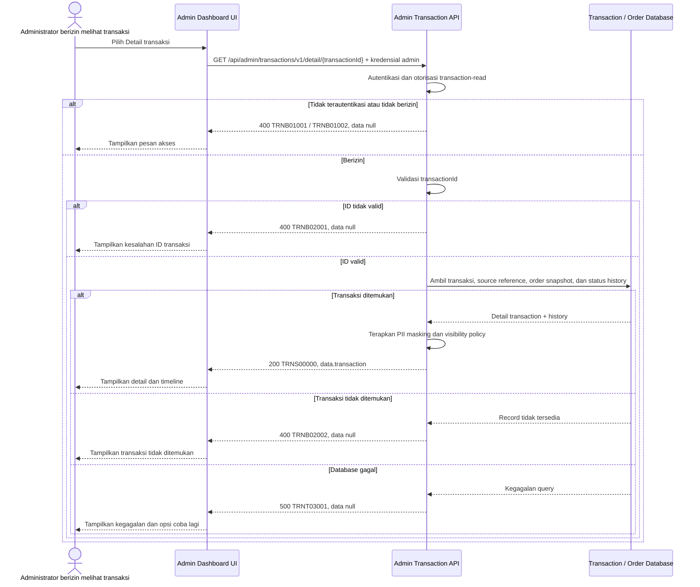

# Admin Dashboard - Get Detail Transaction Interface Agreement

> **Document Type:** IFA / API Contract  
> **Status:** Draft  
> **Service / Domain:** Admin Dashboard — Transaction Reporting  
> **Consumer / Partner:** JokiHub Admin Dashboard (authorized administrator)

## Design

API ini mengambil satu financial transaction berdasarkan `transactionId` atau `transactionNumber`, termasuk detail pembayaran/refund, referensi order, customer fields sesuai policy PII, dan riwayat perubahan status. Financial transaction adalah record reporting untuk pergerakan dana; status order dan refund workflow tetap dimiliki domain sumbernya. Endpoint hanya membaca data dan tidak mengubah transaksi, melakukan refund, atau mengonfirmasi settlement.

## Sequence Diagram



## Performance / SLA Targets

| Success Rate                                     | VUser                                       | CPU / Memory                        | Response Time                                                |
| ------------------------------------------------ | ------------------------------------------- | ----------------------------------- | ------------------------------------------------------------ |
| TBD; confirm criticality and availability target | TBD; confirm peak concurrent administrators | TBD; set from capacity estimate/NFT | TBD; include status-history lookup and expected history size |

## General Information

| Component          | Value                                                                                                                                      |
| ------------------ | ------------------------------------------------------------------------------------------------------------------------------------------ |
| Description        | Mengambil detail satu transaksi pembayaran order atau refund, termasuk ringkasan order dan status history.                                 |
| Resource URL       | `https://{host}/api/admin/transactions/v1/detail/{transactionId}`                                                                          |
| Transport Protocol | HTTPS, REST                                                                                                                                |
| Request Verb       | GET                                                                                                                                        |
| Content Type       | Tidak ada request body; response `application/json`                                                                                        |
| Interaction Type   | Synchronous                                                                                                                                |
| Security Policy    | Admin authentication dan izin `transaction-read`. Terapkan least privilege, audit akses sensitif, dan masking PII berdasarkan role/policy. |

### Path / Endpoint

| Section        | Value                                               |
| -------------- | --------------------------------------------------- |
| Host / Domain  | `{host}` (environment-specific)                     |
| Service Name   | Admin Transaction Reporting                         |
| Version        | `v1`                                                |
| Resource       | `/admin/transactions/v1/detail/{transactionId}`     |
| Final Endpoint | `/api/admin/transactions/v1/detail/{transactionId}` |

### API Versioning

- **Decision:** New Endpoint
- **Previous Endpoint:** Tidak ada API detail transaksi yang teridentifikasi; detail pada UI saat ini berasal dari mock list item.
- **Final Endpoint:** `GET /api/admin/transactions/v1/detail/{transactionId}`
- **Backward Compatibility:** Belum ada consumer API detail transaksi yang teridentifikasi. Field response opsional dapat ditambahkan secara kompatibel; perubahan wajib/semantik perlu koordinasi consumer.
- **Reason:** Admin memerlukan detail authoritative dan status history untuk satu transaksi.

## Business Rules

1. Hanya administrator terautentikasi dengan izin `transaction-read` dapat membaca detail transaksi. Nama permission usulan dan perlu diselaraskan dengan RBAC.
2. Path mengidentifikasi immutable `transaction_id`. Pencarian melalui `transaction_number` dapat disediakan sebagai alternate key, tetapi tidak boleh ambigu.
3. Scope mencakup financial transaction bertipe `ORDER_PAYMENT` atau `REFUND`. Payout/disbursement tidak termasuk.
4. Satu transaksi harus memiliki tepat satu source link yang konsisten dengan `type`: order payment atau refund request. `orderId` pada transaksi harus cocok dengan order pada source.
5. `status` mengikuti lifecycle financial transaction: `PENDING`, `SUCCESS`, `FAILED`, `REVERSED`. Refund request review status dan order status ditampilkan terpisah bila disertakan; keduanya tidak menggantikan status transaction.
6. Status history disajikan kronologis ascending berdasarkan `changedAt`; event awal dapat memiliki `oldStatus: null`. History kosong diperbolehkan jika belum tersedia migrasi/record lama.
7. Customer name/contact dapat berasal dari snapshot transaksi atau order. Contact harus dimasking sesuai permission/PII policy; provider reference hanya ditampilkan kepada role berwenang.
8. Nilai nominal positif dan currency berasal dari ledger transaction. Refund amount dan payment amount tidak boleh digabung atau diinterpretasikan sebagai net total pada response detail.
9. `settledAt` bernilai null bila transaksi belum menyelesaikan pergerakan dana. `createdAt`, `updatedAt`, dan history timestamp diserialisasi sebagai ISO 8601 UTC.
10. Endpoint read-only: tidak memicu provider lookup yang mengubah status, tidak mengirim ulang callback, dan tidak membuat refund/settlement.
11. Query detail dan status history harus konsisten dalam satu snapshot/transaksi baca bila database mendukungnya. Jangan mengembalikan history dari transaksi lain.
12. Kegagalan sumber data order/refund yang diperlukan harus ditangani sesuai source contract; detail ledger tetap dapat dikembalikan hanya bila field source-dependent dinyatakan nullable dan status partial response didefinisikan.

## Request Headers

| Header          | E/N/T | Type   | M/O/C | Max Length | Description                                                               | Example                 |
| --------------- | ----- | ------ | ----- | ---------: | ------------------------------------------------------------------------- | ----------------------- |
| `Authorization` | N     | String | M     |       4096 | Kredensial administrator; skema autentikasi bergantung identity provider. | `Bearer {access-token}` |
| `Accept`        | N     | String | O     |        100 | Tipe media response yang diinginkan; default JSON.                        | `application/json`      |
| `X-Request-Id`  | N     | String | O     |        100 | ID korelasi untuk audit/support.                                          | `req-72d2bf`            |

## Request Parameters

| Parameter       | E/N/T | Type   | M/O/C | Max Length | Description                              | Example      |
| --------------- | ----- | ------ | ----- | ---------: | ---------------------------------------- | ------------ |
| `transactionId` | N     | String | M     |         64 | ID immutable transaksi yang akan dibaca. | `txn_01JXYZ` |

## Request Query Parameters

None.

## Request Body

Tidak ada request body.

### Request Validation

1. `Authorization` harus mengidentifikasi administrator terautentikasi dengan izin `transaction-read`. Kembalikan `TRNB01001` bila belum terautentikasi dan `TRNB01002` bila izin tidak tersedia.
2. `transactionId` wajib, tidak kosong, dan maksimal 64 karakter. Format mengikuti strategi ID yang disepakati; nilai malformed mengembalikan `TRNB02001`.
3. Parameter tambahan/query yang tidak didukung ditolak dengan `TRNB02001`.
4. Jika transaksi tidak ditemukan, kembalikan `TRNB02002` dan `data: null`. Jangan membedakan transaksi yang tidak ada dari transaksi yang tidak boleh diakses jika policy mencegah enumeration.
5. Pastikan source link/type consistency sebelum merangkai detail. Data relasi yang tidak konsisten dicatat sebagai data-integrity incident dan tidak boleh direkayasa dari field lain.
6. Riwayat status hanya diambil dengan foreign key `transactionId` yang sama, lalu diurutkan `changedAt ASC` dengan tie-breaker history ID.
7. PII dan provider reference difilter/masking berdasarkan izin sebelum serialisasi response.
8. Kegagalan database mengembalikan HTTP 500 `TRNT03001` tanpa detail internal.

## Response Body

Semua response menggunakan envelope `status` dan `data`. Sukses mengembalikan satu transaction; error mengembalikan `data: null`.

| Attribute                                    | E/N/T | Type               | M/O/C |            Max Length | Description                                                          | Example                        |
| -------------------------------------------- | ----- | ------------------ | ----- | --------------------: | -------------------------------------------------------------------- | ------------------------------ |
| `status`                                     | N     | Object             | M     |                     — | Object status response.                                              | `{}`                           |
| `status.code`                                | N     | String             | M     |                    20 | Service status code.                                                 | `TRNS00000`                    |
| `status.message`                             | N     | String             | O     |                   200 | Pesan hasil untuk consumer.                                          | `Transaction detail retrieved` |
| `data`                                       | N     | Object/null        | M     |                     — | Payload hasil; `null` ketika error.                                  | `{}`                           |
| `data.transaction`                           | N     | Object             | C     |                     — | Detail financial transaction.                                        | `{}`                           |
| `data.transaction.id`                        | N     | String             | C     |                    64 | ID internal transaksi.                                               | `txn_01JXYZ`                   |
| `data.transaction.transactionNumber`         | N     | String             | C     |                    64 | Nomor transaksi support/reporting.                                   | `TRX-2026-00981`               |
| `data.transaction.orderId`                   | N     | String             | C     |                    64 | ID/nomor order terkait.                                              | `JH-2026-001248`               |
| `data.transaction.sourceId`                  | N     | String             | C     |                    64 | ID order payment atau refund request sesuai type.                    | `pay_01JXYZ`                   |
| `data.transaction.type`                      | N     | String             | C     |                    30 | `ORDER_PAYMENT` atau `REFUND`.                                       | `ORDER_PAYMENT`                |
| `data.transaction.method`                    | N     | String             | C     |                    30 | Metode transaksi sesuai enum storage/provider.                       | `QRIS`                         |
| `data.transaction.amount`                    | N     | Decimal            | C     |                  18,2 | Nilai pergerakan dana positif.                                       | `25000.00`                     |
| `data.transaction.currency`                  | N     | String             | C     |                     3 | Mata uang ISO 4217.                                                  | `IDR`                          |
| `data.transaction.status`                    | N     | String             | C     |                    30 | Status financial transaction.                                        | `SUCCESS`                      |
| `data.transaction.providerReference`         | N     | String/null        | O     |                   128 | Referensi provider bila tersedia dan boleh ditampilkan.              | `QR-928381-AB`                 |
| `data.transaction.customer`                  | N     | Object/null        | O     |                     — | Snapshot customer; dapat null sesuai retensi/anonimisasi.            | `{}`                           |
| `data.transaction.customer.name`             | N     | String/null        | O     |                   150 | Nama customer dari snapshot/order.                                   | `Budi Santoso`                 |
| `data.transaction.customer.contact`          | N     | String/null        | O     |                    32 | Kontak customer yang dimasking sesuai policy.                        | `+62812****890`                |
| `data.transaction.order`                     | N     | Object             | C     |                     — | Ringkasan order terkait, bukan seluruh detail order.                 | `{}`                           |
| `data.transaction.order.orderNumber`         | N     | String             | C     |                    32 | Nomor order untuk navigasi ke order detail.                          | `JH-2026-001248`               |
| `data.transaction.order.status`              | N     | String             | O     |                    30 | Status order terkini dari source order; bukan status transaksi.      | `COMPLETED`                    |
| `data.transaction.order.paymentStatus`       | N     | String             | O     |                    30 | Status payment order dari source order, bila tersedia.               | `PAID`                         |
| `data.transaction.createdAt`                 | N     | String (date-time) | C     |                    35 | Waktu transaksi dibuat ISO 8601 UTC.                                 | `2026-10-11T09:42:00Z`         |
| `data.transaction.updatedAt`                 | N     | String (date-time) | O     |                    35 | Waktu transaksi terakhir diperbarui ISO 8601 UTC.                    | `2026-10-11T09:43:15Z`         |
| `data.transaction.settledAt`                 | N     | String/null        | O     |                    35 | Waktu settlement/refund selesai; null bila belum selesai.            | `2026-10-11T09:43:15Z`         |
| `data.transaction.statusHistory`             | N     | Array of Object    | M     | 1000 items (proposed) | Riwayat status kronologis; kosong bila belum tersedia.               | `[]`                           |
| `data.transaction.statusHistory[].oldStatus` | N     | String/null        | O     |                    30 | Status sebelumnya; null untuk status awal.                           | `PENDING`                      |
| `data.transaction.statusHistory[].newStatus` | N     | String             | M     |                    30 | Status setelah perubahan.                                            | `SUCCESS`                      |
| `data.transaction.statusHistory[].changedBy` | N     | String/null        | O     |                    64 | ID actor admin/system; tampilkan sesuai policy.                      | `admin_01JXYZ`                 |
| `data.transaction.statusHistory[].reason`    | N     | String/null        | O     |                   500 | Alasan transisi jika tersedia; jangan sertakan secret/PII tak perlu. | `Pembayaran terverifikasi`     |
| `data.transaction.statusHistory[].changedAt` | N     | String (date-time) | M     |                    35 | Waktu perubahan ISO 8601 UTC.                                        | `2026-10-11T09:43:15Z`         |

### Success Example

```json
{
  "status": {
    "code": "TRNS00000",
    "message": "Transaction detail retrieved"
  },
  "data": {
    "transaction": {
      "id": "txn_01JXYZ",
      "transactionNumber": "TRX-2026-00981",
      "orderId": "JH-2026-001248",
      "sourceId": "pay_01JXYZ",
      "type": "ORDER_PAYMENT",
      "method": "QRIS",
      "amount": 25000.0,
      "currency": "IDR",
      "status": "SUCCESS",
      "providerReference": "QR-928381-AB",
      "customer": {
        "name": "Budi Santoso",
        "contact": "+62812****890"
      },
      "order": {
        "orderNumber": "JH-2026-001248",
        "status": "COMPLETED",
        "paymentStatus": "PAID"
      },
      "createdAt": "2026-10-11T09:42:00Z",
      "updatedAt": "2026-10-11T09:43:15Z",
      "settledAt": "2026-10-11T09:43:15Z",
      "statusHistory": [
        {
          "oldStatus": null,
          "newStatus": "PENDING",
          "changedBy": "system",
          "reason": null,
          "changedAt": "2026-10-11T09:42:00Z"
        },
        {
          "oldStatus": "PENDING",
          "newStatus": "SUCCESS",
          "changedBy": "admin_01JXYZ",
          "reason": "Pembayaran terverifikasi",
          "changedAt": "2026-10-11T09:43:15Z"
        }
      ]
    }
  }
}
```

### Business Error Example

```json
{
  "status": {
    "code": "TRNB02002",
    "message": "Transaction not found"
  },
  "data": null
}
```

### Technical Error Example

```json
{
  "status": {
    "code": "TRNT03001",
    "message": "Transaction service is temporarily unavailable"
  },
  "data": null
}
```

## HTTP Status Codes

| HTTP Status | Usage                                                                                                                                                           |
| ----------- | --------------------------------------------------------------------------------------------------------------------------------------------------------------- |
| `200`       | Detail transaksi berhasil dikembalikan.                                                                                                                         |
| `400`       | ID tidak valid, akses admin ditolak, atau transaksi tidak ditemukan sesuai baseline response project. Konfirmasi apakah API standard memakai `401`/`403`/`404`. |
| `500`       | Kegagalan service/database transaksi atau dependency detail yang tidak terduga.                                                                                 |

## Service Status Codes

Format: `[Service Prefix][Status Type][Category][Specific Error Code]`

| Code        | Type      | Category        | Meaning                                                                    |
| ----------- | --------- | --------------- | -------------------------------------------------------------------------- |
| `TRNS00000` | Success   | General         | Detail transaksi berhasil dikembalikan.                                    |
| `TRNB01001` | Business  | Authentication  | Administrator belum terautentikasi.                                        |
| `TRNB01002` | Business  | Authentication  | Administrator tidak memiliki izin transaction-read.                        |
| `TRNB02001` | Business  | User validation | Transaction ID tidak tersedia atau formatnya tidak valid.                  |
| `TRNB02002` | Business  | User validation | Transaksi tidak ditemukan/tidak dapat diakses.                             |
| `TRNT03001` | Technical | Database        | Detail transaksi/status history gagal dibaca atau database tidak tersedia. |

## API Exposure Classification

| Classification                 | Rationale                                                                                                                                                                                                      |
| ------------------------------ | -------------------------------------------------------------------------------------------------------------------------------------------------------------------------------------------------------------- |
| Enterprise Intranet (proposed) | Endpoint admin menampilkan data finansial, referensi provider, PII customer, dan status history. Jika internet-accessible, klasifikasikan sebagai Public dan terapkan proteksi serta PII controls yang sesuai. |

## Testing & Documentation Scope

| Scope      | Required | Rationale / Handoff                                                                                                                                                                    |
| ---------- | -------- | -------------------------------------------------------------------------------------------------------------------------------------------------------------------------------------- |
| NFT        | Yes      | Uji detail lookup, status history dengan banyak event, source/order join, transaksi tanpa customer snapshot, dan beban baca detail. Target VUser, CPU/memory, serta response time TBD. |
| VA/Pentest | Yes      | Uji authentication/authorization, IDOR/enumeration, PII masking, provider-reference exposure, status-history isolation, privilege boundaries, dan data-integrity handling.             |

## Assumptions

- Endpoint `/api/admin/transactions/v1/detail/{transactionId}`, envelope, prefix `TRN`, dan status code adalah usulan mengikuti kontrak get-list transaksi; API owner perlu menyetujui.
- Kontrak mengikuti scope [Transaction ERD](../../erd/transaction-erd.md): payment/refund financial movement; payout tidak termasuk.
- `statusHistory` bersumber dari `transaction_status_history`; `changedBy` dan `reason` dapat null sesuai sumber event/policy. Retensi dan batas jumlah history perlu ditetapkan.
- Detail order di sini hanya ringkasan navigasi; detail line items tetap dimiliki API get-detail order.
- Refund source schema dan refund workflow belum memiliki ERD final. Data refund-specific seperti alasan/refund destination perlu kontrak Refund terpisah.
- Customer contact masking, permission name, provider reference visibility, alternate transaction-number lookup, identity provider, SLA, dan HTTP status mapping masih TBD.
- Endpoint hanya read-only; update status, provider reconciliation, refund execution, audit mutation, dan payout berada di luar scope.

## References

- `./get-list-transactions.md` — filter, ledger status, field ringkas, dan transaction list scope.
- `../../erd/transaction-erd.md` — financial transaction dan status history model.
- `../../erd/order-erd.md` — order/payment relationship dan status order.
- `src/features/AdminTransactions/views/interfaces/admin-transaction.interface.ts` — field transaksi UI.
- `src/features/AdminTransactions/views/templates/AdminTransactions.template.tsx` — modal detail yang saat ini ditampilkan.
- `docs/sprint_1/solutioning/dashboard/orders/get-detail-order.md` — konvensi kontrak detail dashboard.
