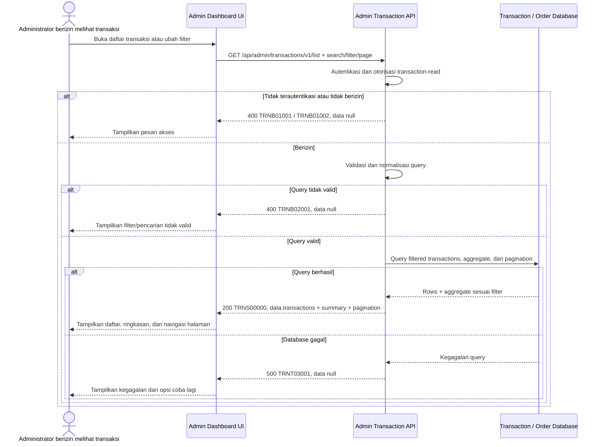

# Admin Dashboard - Get List Transactions Interface Agreement

> **Document Type:** IFA / API Contract  
> **Status:** Draft  
> **Service / Domain:** Admin Dashboard — Transaction Reporting  
> **Consumer / Partner:** JokiHub Admin Dashboard (authorized administrator)

## Design

API ini mengembalikan daftar financial transaction untuk pembayaran order dan refund, sesuai batas [Transaction ERD](../../erd/transaction-erd.md). Dashboard dapat mencari transaksi, memfilter status/metode/jenis/tanggal, melihat ringkasan hasil, dan berpindah halaman. Payout/disbursement tidak termasuk. Data customer yang ditampilkan harus mengikuti policy akses dan retensi PII. Status transaksi diambil dari ledger transaction; status order dan status workflow refund tetap dimiliki domain masing-masing.

## Sequence Diagram



## Performance / SLA Targets

| Success Rate                                     | VUser                                       | CPU / Memory                        | Response Time                                                    |
| ------------------------------------------------ | ------------------------------------------- | ----------------------------------- | ---------------------------------------------------------------- |
| TBD; confirm criticality and availability target | TBD; confirm peak concurrent administrators | TBD; set from capacity estimate/NFT | TBD; include filtered count/aggregation and expected data volume |

## General Information

| Component          | Value                                                                                                                                      |
| ------------------ | ------------------------------------------------------------------------------------------------------------------------------------------ |
| Description        | Mengambil daftar transaksi pembayaran order dan refund dengan filter, search, pagination, dan ringkasan terfilter.                         |
| Resource URL       | `https://{host}/api/admin/transactions/v1/list`                                                                                            |
| Transport Protocol | HTTPS, REST                                                                                                                                |
| Request Verb       | GET                                                                                                                                        |
| Content Type       | Tidak ada request body; response `application/json`                                                                                        |
| Interaction Type   | Synchronous                                                                                                                                |
| Security Policy    | Admin authentication dan izin `transaction-read`. Terapkan least privilege, audit akses sensitif, dan masking PII berdasarkan role/policy. |

### Path / Endpoint

| Section        | Value                             |
| -------------- | --------------------------------- |
| Host / Domain  | `{host}` (environment-specific)   |
| Service Name   | Admin Transaction Reporting       |
| Version        | `v1`                              |
| Resource       | `/admin/transactions/v1/list`     |
| Final Endpoint | `/api/admin/transactions/v1/list` |

### API Versioning

- **Decision:** New Endpoint
- **Previous Endpoint:** Tidak ada API list transaksi yang teridentifikasi pada solutioning sprint ini; halaman UI menggunakan mock data.
- **Final Endpoint:** `GET /api/admin/transactions/v1/list`
- **Backward Compatibility:** Belum ada consumer API list transaksi yang teridentifikasi. Filter opsional baru kompatibel; perubahan field wajib atau semantik memerlukan koordinasi consumer/major version.
- **Reason:** Admin Dashboard memerlukan sumber transaksi server-side untuk pembayaran order dan refund.

## Business Rules

1. Hanya administrator terautentikasi dengan izin `transaction-read` dapat membaca daftar transaksi. Nama permission usulan dan perlu diselaraskan dengan RBAC.
2. Daftar mencakup `ORDER_PAYMENT` dan `REFUND`. Payout/disbursement dan workflow refund yang belum menjadi pergerakan finansial tidak ditampilkan sebagai financial transaction.
3. Status transaksi mengikuti ledger: `PENDING`, `SUCCESS`, `FAILED`, `REVERSED`. Status review refund/order tidak boleh dicampur dengan status financial movement.
4. UI memetakan status storage ke label: `SUCCESS` → `Berhasil`, `PENDING` → `Menunggu`, `FAILED` → `Gagal`, `REVERSED` → `Dikembalikan`.
5. UI memetakan jenis: `ORDER_PAYMENT` → `Pembayaran Pesanan`; `REFUND` → `Refund`. Filter menerima nilai enum storage, bukan label UI.
6. Metode payment mengikuti nilai yang didukung catalog/provider. ERD mengusulkan `QRIS` dan `BCA_TRANSFER`; label UI `BCA Virtual Account` adalah label tampilan dan perlu konfirmasi terhadap metode provider final.
7. Search berjalan pada transaction number, order number/ID, nama customer, kontak yang diizinkan, dan provider reference. Nilai search harus diparameterisasi dan wildcard behavior harus ditetapkan.
8. Rentang tanggal menggunakan UTC ISO 8601 dengan semantik `createdAt >= from` dan `createdAt < to`. Batas inklusif/exklusif ini menghindari overlap antar rentang.
9. Hasil diurutkan terbaru dahulu menurut `createdAt DESC`, dengan tie-breaker `transactionId DESC` untuk pagination deterministik.
10. Pagination berbasis halaman 1. Default `page=1`, `pageSize=20`, maksimum `100` (usulan); nilai final mengikuti volume dan kapasitas.
11. Filter, jumlah hasil, serta ringkasan menggunakan predicate yang sama. Ringkasan `successfulAmount`, `pendingCount`, dan `refundedCount` dihitung atas seluruh hasil setelah filter, bukan hanya halaman saat ini.
12. `totalPages` bernilai `0` bila tidak ada hasil; daftar kosong tetap HTTP 200.
13. Kontak customer adalah PII. Masking atau akses penuh bergantung permission/policy; API tidak boleh membocorkan kontak ke role yang tidak berhak.
14. Satu financial transaction hanya muncul satu kali meskipun query menggabungkan order/source data. Join tidak boleh menggandakan row atau mengubah amount.
15. Data transaksi berasal dari ledger sebagai reporting record; API tidak mengubah status payment, order, atau refund workflow.

## Request Headers

| Header          | E/N/T | Type   | M/O/C | Max Length | Description                                                               | Example                 |
| --------------- | ----- | ------ | ----- | ---------: | ------------------------------------------------------------------------- | ----------------------- |
| `Authorization` | N     | String | M     |       4096 | Kredensial administrator; skema autentikasi bergantung identity provider. | `Bearer {access-token}` |
| `Accept`        | N     | String | O     |        100 | Tipe media response yang diinginkan; default JSON.                        | `application/json`      |
| `X-Request-Id`  | N     | String | O     |        100 | ID korelasi untuk audit/support.                                          | `req-b8132e`            |

## Request Parameters

None.

## Request Query Parameters

| Parameter  | E/N/T | Type    | M/O/C | Max Length | Description                                                                                                | Example                |
| ---------- | ----- | ------- | ----- | ---------: | ---------------------------------------------------------------------------------------------------------- | ---------------------- |
| `search`   | N     | String  | O     |        100 | Cari transaction number/ID, order number/ID, nama customer, kontak sesuai policy, atau provider reference. | `TRX-2026-00981`       |
| `status`   | N     | String  | O     |         30 | Filter status storage: `PENDING`, `SUCCESS`, `FAILED`, `REVERSED`.                                         | `SUCCESS`              |
| `type`     | N     | String  | O     |         30 | Filter jenis: `ORDER_PAYMENT` atau `REFUND`.                                                               | `ORDER_PAYMENT`        |
| `method`   | N     | String  | O     |         30 | Filter metode sesuai enum provider yang disepakati; usulan `QRIS` atau `BCA_TRANSFER`.                     | `QRIS`                 |
| `from`     | N     | String  | O     |         35 | Batas waktu awal ISO 8601 UTC, inklusif, berdasarkan `createdAt`.                                          | `2026-10-01T00:00:00Z` |
| `to`       | N     | String  | O     |         35 | Batas waktu akhir ISO 8601 UTC, eksklusif, berdasarkan `createdAt`.                                        | `2026-10-12T00:00:00Z` |
| `page`     | N     | Integer | O     |  10 digits | Halaman berbasis 1; default `1`.                                                                           | `1`                    |
| `pageSize` | N     | Integer | O     |  10 digits | Jumlah record per halaman; default `20`, maksimum usulan `100`.                                            | `20`                   |

## Request Body

Tidak ada request body.

### Request Validation

1. `Authorization` harus mengidentifikasi administrator terautentikasi dengan izin `transaction-read`. Kembalikan `TRNB01001` bila belum terautentikasi dan `TRNB01002` bila izin tidak tersedia.
2. `search`, bila dikirim, harus string maksimal 100 karakter setelah trim. Parameterisasi query wajib; escaping dan wildcard behavior mengikuti search policy.
3. `status`, `type`, dan `method`, bila dikirim, harus cocok dengan enum storage/provider yang didukung. Label Bahasa Indonesia tidak diterima sebagai nilai API; nilai tak dikenal mengembalikan `TRNB02001`.
4. `from` dan `to`, bila dikirim, harus ISO 8601 date-time dengan timezone. Jika keduanya dikirim, `from` harus lebih awal dari `to`; rentang maksimum dan timezone selain UTC perlu ditetapkan.
5. `page` harus integer >= 1; default `1`.
6. `pageSize` harus integer 1–100; default `20`.
7. Query parameter tak dikenal atau parameter berulang yang tidak didukung ditolak dengan `TRNB02001`.
8. Jika tidak ada hasil, kembalikan HTTP 200 dengan `transactions: []`, summary bernilai nol, dan `totalItems: 0`, `totalPages: 0`.
9. Query harus memakai predicate yang sama untuk rows, total count, dan summary serta mencegah duplikasi akibat join ke order/source.
10. Kegagalan database mengembalikan HTTP 500 dan tidak membocorkan detail internal.

## Response Body

Semua response menggunakan envelope `status` dan `data`. Sukses mengembalikan halaman transaksi, ringkasan atas semua hasil terfilter, dan pagination; error mengembalikan `data: null`.

| Attribute                               | E/N/T | Type               | M/O/C |       Max Length | Description                                                            | Example                      |
| --------------------------------------- | ----- | ------------------ | ----- | ---------------: | ---------------------------------------------------------------------- | ---------------------------- |
| `status`                                | N     | Object             | M     |                — | Object status response.                                                | `{}`                         |
| `status.code`                           | N     | String             | M     |               20 | Service status code.                                                   | `TRNS00000`                  |
| `status.message`                        | N     | String             | O     |              200 | Pesan hasil untuk consumer.                                            | `Transaction list retrieved` |
| `data`                                  | N     | Object/null        | M     |                — | Payload hasil; `null` ketika error.                                    | `{}`                         |
| `data.transactions`                     | N     | Array of Object    | M     | `pageSize` items | Halaman transaksi; array kosong bila tidak ada hasil.                  | `[]`                         |
| `data.transactions[].id`                | N     | String             | M     |               64 | ID internal transaksi.                                                 | `txn_01JXYZ`                 |
| `data.transactions[].transactionNumber` | N     | String             | M     |               64 | Nomor transaksi untuk admin/support.                                   | `TRX-2026-00981`             |
| `data.transactions[].orderId`           | N     | String             | M     |               64 | ID/nomor order terkait sesuai kontrak order.                           | `JH-2026-001248`             |
| `data.transactions[].customerName`      | N     | String/null        | O     |              150 | Snapshot nama customer atau nilai dari order; nullable sesuai retensi. | `Budi Santoso`               |
| `data.transactions[].customerContact`   | N     | String/null        | O     |               32 | Kontak customer, dimasking sesuai policy.                              | `+62812****890`              |
| `data.transactions[].type`              | N     | String             | M     |               30 | `ORDER_PAYMENT` atau `REFUND`.                                         | `ORDER_PAYMENT`              |
| `data.transactions[].method`            | N     | String             | M     |               30 | Metode sesuai enum provider/storage.                                   | `QRIS`                       |
| `data.transactions[].amount`            | N     | Decimal            | M     |             18,2 | Nilai transaksi positif dalam unit currency.                           | `25000.00`                   |
| `data.transactions[].currency`          | N     | String             | M     |                3 | Kode mata uang ISO 4217.                                               | `IDR`                        |
| `data.transactions[].status`            | N     | String             | M     |               30 | Status ledger: `PENDING`, `SUCCESS`, `FAILED`, `REVERSED`.             | `SUCCESS`                    |
| `data.transactions[].providerReference` | N     | String/null        | O     |              128 | Referensi eksternal bila tersedia dan boleh ditampilkan.               | `QR-928381-AB`               |
| `data.transactions[].createdAt`         | N     | String (date-time) | M     |               35 | Waktu record dibuat dalam ISO 8601 UTC.                                | `2026-10-11T09:42:00Z`       |
| `data.transactions[].settledAt`         | N     | String/null        | O     |               35 | Waktu dana diterima/refund selesai; null bila belum settle.            | `2026-10-11T09:43:15Z`       |
| `data.summary`                          | N     | Object             | M     |                — | Aggregate setelah filter, atas seluruh hasil bukan halaman saja.       | `{}`                         |
| `data.summary.totalItems`               | N     | Integer            | M     |        10 digits | Jumlah record terfilter.                                               | `1`                          |
| `data.summary.successfulAmount`         | N     | Decimal            | M     |             18,2 | Jumlah nominal transaksi status `SUCCESS` terfilter.                   | `25000.00`                   |
| `data.summary.pendingCount`             | N     | Integer            | M     |        10 digits | Jumlah transaksi `PENDING` terfilter.                                  | `0`                          |
| `data.summary.refundedCount`            | N     | Integer            | M     |        10 digits | Jumlah transaksi bertipe `REFUND` yang berhasil (`SUCCESS`).           | `0`                          |
| `data.pagination`                       | N     | Object             | M     |                — | Metadata pagination.                                                   | `{}`                         |
| `data.pagination.page`                  | N     | Integer            | M     |        10 digits | Halaman yang dikembalikan.                                             | `1`                          |
| `data.pagination.pageSize`              | N     | Integer            | M     |        10 digits | Ukuran halaman efektif.                                                | `20`                         |
| `data.pagination.totalItems`            | N     | Integer            | M     |        10 digits | Total transaksi setelah filter.                                        | `1`                          |
| `data.pagination.totalPages`            | N     | Integer            | M     |        10 digits | Total halaman; `0` bila kosong.                                        | `1`                          |

### Success Example

```json
{
  "status": {
    "code": "TRNS00000",
    "message": "Transaction list retrieved"
  },
  "data": {
    "transactions": [
      {
        "id": "txn_01JXYZ",
        "transactionNumber": "TRX-2026-00981",
        "orderId": "JH-2026-001248",
        "customerName": "Budi Santoso",
        "customerContact": "+62812****890",
        "type": "ORDER_PAYMENT",
        "method": "QRIS",
        "amount": 25000.0,
        "currency": "IDR",
        "status": "SUCCESS",
        "providerReference": "QR-928381-AB",
        "createdAt": "2026-10-11T09:42:00Z",
        "settledAt": "2026-10-11T09:43:15Z"
      }
    ],
    "summary": {
      "totalItems": 1,
      "successfulAmount": 25000.0,
      "pendingCount": 0,
      "refundedCount": 0
    },
    "pagination": {
      "page": 1,
      "pageSize": 20,
      "totalItems": 1,
      "totalPages": 1
    }
  }
}
```

### Business Error Example

```json
{
  "status": {
    "code": "TRNB02001",
    "message": "Invalid transaction-list query parameters"
  },
  "data": null
}
```

### Technical Error Example

```json
{
  "status": {
    "code": "TRNT03001",
    "message": "Transaction service is temporarily unavailable"
  },
  "data": null
}
```

## HTTP Status Codes

| HTTP Status | Usage                                                                                                                                |
| ----------- | ------------------------------------------------------------------------------------------------------------------------------------ |
| `200`       | Daftar dan summary berhasil dikembalikan, termasuk ketika hasil kosong.                                                              |
| `400`       | Query tidak valid atau akses admin ditolak sesuai baseline response project. Konfirmasi apakah standar API mengharuskan `401`/`403`. |
| `500`       | Kegagalan service atau database transaksi/order yang tidak terduga.                                                                  |

## Service Status Codes

Format: `[Service Prefix][Status Type][Category][Specific Error Code]`

| Code        | Type      | Category        | Meaning                                                               |
| ----------- | --------- | --------------- | --------------------------------------------------------------------- |
| `TRNS00000` | Success   | General         | Daftar transaksi berhasil dikembalikan.                               |
| `TRNB01001` | Business  | Authentication  | Administrator belum terautentikasi.                                   |
| `TRNB01002` | Business  | Authentication  | Administrator tidak memiliki izin transaction-read.                   |
| `TRNB02001` | Business  | User validation | Parameter search/filter/date/pagination tidak valid.                  |
| `TRNT03001` | Technical | Database        | Daftar transaksi atau aggregate gagal dibaca/database tidak tersedia. |

## API Exposure Classification

| Classification                 | Rationale                                                                                                                                                                                                 |
| ------------------------------ | --------------------------------------------------------------------------------------------------------------------------------------------------------------------------------------------------------- |
| Enterprise Intranet (proposed) | Endpoint admin menampilkan data finansial, referensi provider, dan PII customer. Jika internet-accessible, klasifikasikan sebagai Public dan terapkan proteksi API publik serta PII controls yang sesuai. |

## Testing & Documentation Scope

| Scope      | Required | Rationale / Handoff                                                                                                                                                                                |
| ---------- | -------- | -------------------------------------------------------------------------------------------------------------------------------------------------------------------------------------------------- |
| NFT        | Yes      | Uji filter, search, date range, pagination, summary konsisten pada seluruh hasil, hasil kosong, unique rows, dan beban list/aggregate. VUser, CPU/memory, serta target TPS TBD mengikuti forecast. |
| VA/Pentest | Yes      | Uji authentication/authorization, privilege boundaries, enumeration, injection, PII masking, provider-reference exposure, filter bypass, excessive data exposure, dan pagination manipulation.     |

## Assumptions

- Endpoint `/api/admin/transactions/v1/list`, query fields, response envelope, prefix `TRN`, dan kode status adalah usulan; API owner perlu menyetujui.
- Kontrak mengikuti scope [Transaction ERD](../../erd/transaction-erd.md): pembayaran order dan refund yang menjadi financial movement; payout tidak termasuk.
- UI mock mendefinisikan label status/type/method. Mapping status mengikuti Transaction ERD; `BCA Virtual Account` perlu dikonfirmasi sebagai enum provider `BCA_TRANSFER` atau nilai lain.
- Customer name/contact berasal dari order snapshot/join atau transaction snapshot sesuai retention policy. Masking/visibility dan search terhadap kontak harus mengikuti privilege/PII policy.
- Currency, method enum, refund amount semantics, search policy, date-range limit, page limits, permission name, SLA, transaction-number generation, dan HTTP auth mapping masih TBD.
- Endpoint hanya membaca reporting transactions; perubahan status, refund decisions, manual reconciliation, export, dan payout berada di luar scope.

## References

- `../../erd/transaction-erd.md` — financial transaction fields, source relationships, status, and indexes.
- `../../erd/order-erd.md` — order/payment relationship and customer snapshots.
- `src/features/AdminTransactions/views/interfaces/admin-transaction.interface.ts` — transaction table fields and UI labels.
- `src/features/AdminTransactions/views/pages/AdminTransactions.page.tsx` — mock transactions and client-side search/status/method filters.
- `src/features/AdminTransactions/views/templates/AdminTransactions.template.tsx` — table, metrics, and detail fields currently displayed.
- `docs/sprint_1/solutioning/dashboard/orders/get-list-orders.md` — admin list endpoint conventions and pagination response.
