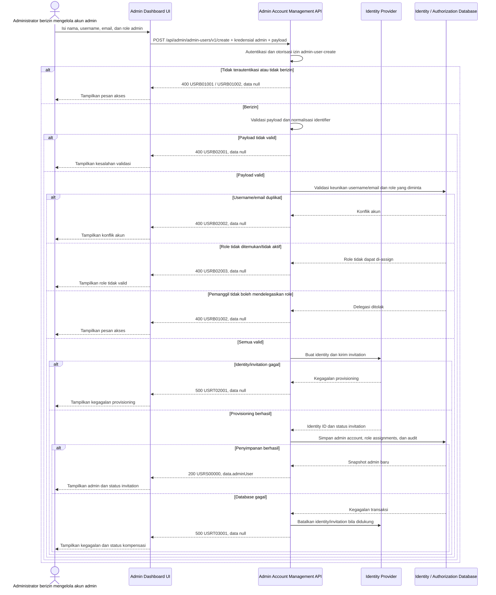

# Admin Dashboard - Create Admin User Interface Agreement

> **Document Type:** IFA / API Contract  
> **Status:** Draft  
> **Service / Domain:** Admin Dashboard — Admin Account Management  
> **Consumer / Partner:** JokiHub Admin Dashboard (authorized administrator)

## Design

API ini membuat akun administrator dan menetapkan satu atau lebih role RBAC pada akun tersebut. Pembuatan admin dipisahkan dari `POST /api/admin/users/v1/create` yang hanya membuat `MEMBER`. API memvalidasi kewenangan pemanggil untuk membuat akun admin dan mendelegasikan setiap role, lalu membuat akun, assignment role, invitation, dan audit secara konsisten. Admin baru tidak mengirim password melalui API; provisioning credential dilakukan oleh identity provider melalui invitation. Model `ADMIN_ACCOUNT`, role assignment, invitation, dan transaksi lintas identity provider belum dikonfirmasi pada ERD, sehingga pola provisioning dan kompensasi perlu disepakati sebelum implementasi.

## Sequence Diagram



## Performance / SLA Targets

| Success Rate                                     | VUser                                       | CPU / Memory                        | Response Time                                     |
| ------------------------------------------------ | ------------------------------------------- | ----------------------------------- | ------------------------------------------------- |
| TBD; confirm criticality and availability target | TBD; confirm peak concurrent administrators | TBD; set from capacity estimate/NFT | TBD; include identity-provider invitation latency |

## General Information

| Component          | Value                                                                                                                                                                                       |
| ------------------ | ------------------------------------------------------------------------------------------------------------------------------------------------------------------------------------------- |
| Description        | Membuat akun administrator dan menetapkan role RBAC serta memulai provisioning credential melalui invitation.                                                                               |
| Resource URL       | `https://{host}/api/admin/admin-users/v1/create`                                                                                                                                            |
| Transport Protocol | HTTPS, REST                                                                                                                                                                                 |
| Request Verb       | POST                                                                                                                                                                                        |
| Content Type       | `application/json`                                                                                                                                                                          |
| Interaction Type   | Synchronous; penyelesaian invitation berlangsung asinkron di identity provider                                                                                                              |
| Security Policy    | Admin authentication, izin admin-user-create, dan delegated-role checks. Identity provider dan permission names TBD. Least privilege, rate limiting, dan audit aktor/aksi wajib diterapkan. |

### Path / Endpoint

| Section        | Value                              |
| -------------- | ---------------------------------- |
| Host / Domain  | `{host}` (environment-specific)    |
| Service Name   | Admin Account Management           |
| Version        | `v1`                               |
| Resource       | `/admin/admin-users/v1/create`     |
| Final Endpoint | `/api/admin/admin-users/v1/create` |

### API Versioning

- **Decision:** New Endpoint
- **Previous Endpoint:** `POST /api/admin/users/v1/create` membuat member dan tidak memberikan role administrator.
- **Final Endpoint:** `POST /api/admin/admin-users/v1/create`
- **Backward Compatibility:** Endpoint create member tidak berubah. Endpoint baru memiliki resource dan kontrak terpisah.
- **Reason:** Pembuatan akun admin memiliki model, kontrol privilege, dan credential provisioning berbeda dari pembuatan member.

## Business Rules

1. Hanya administrator terautentikasi dengan izin admin-user-create yang dapat membuat akun administrator.
2. Pemanggil hanya boleh menetapkan role yang berada dalam kewenangan delegasinya. Role privileged seperti `SUPER_ADMIN` memerlukan policy atau approval eksplisit; default-nya tidak dapat didelegasikan.
3. `name`, `username`, `email`, dan `roles` wajib dikirim. Satu atau lebih role harus ditetapkan agar akun baru memiliki akses yang eksplisit.
4. Username dan email harus unik pada account namespace yang disepakati. Apakah uniqueness lintas `USER_ACCOUNT` dan `ADMIN_ACCOUNT` diperlukan harus ditetapkan oleh identity owner.
5. Role harus ada, aktif, dan dapat di-assign. Role protected/system tidak dapat dipilih kecuali policy secara eksplisit memberi wewenang.
6. API tidak menerima password, password hash, OTP, access token, atau recovery secret. Credential setup dilakukan melalui invitation identity provider.
7. Status akun awal adalah `INVITED`/`PENDING_ACTIVATION` hingga penerima menyelesaikan invitation; enum dan source of truth status TBD. Akun tidak boleh dapat login sebelum identity provider mengonfirmasi aktivasi.
8. Identity provider adalah source of truth untuk kredensial dan status invitation. Database aplikasi menyimpan identity reference dan status provisioning yang diperlukan.
9. Operasi membuat identity, akun admin, role assignment, dan audit harus memiliki konsistensi yang terdefinisi. Karena database dan identity provider mungkin tidak berbagi transaksi, implementasi harus memakai saga/kompensasi atau provisioning workflow yang dapat di-retry; jangan meninggalkan akun dengan hak parsial.
10. Request sukses mencatat aktor, waktu, role yang diberikan, dan hasil invitation. Audit storage/retention TBD.
11. Pengulangan request setelah timeout tidak boleh mengirim invitation berulang atau membuat akun ganda. Idempotency key atau client request ID perlu diputuskan sebelum implementasi.
12. ID akun dan identity ID dibuat oleh server/provider. Klien tidak dapat menetapkan ID, status provisioning, atribut privilege, atau audit fields.

## Request Headers

| Header            | E/N/T | Type   | M/O/C | Max Length | Description                                                          | Example                    |
| ----------------- | ----- | ------ | ----- | ---------: | -------------------------------------------------------------------- | -------------------------- |
| `Authorization`   | N     | String | M     |       4096 | Kredensial administrator pemanggil.                                  | `Bearer {access-token}`    |
| `Content-Type`    | N     | String | M     |        100 | Tipe media request.                                                  | `application/json`         |
| `Accept`          | N     | String | O     |        100 | Tipe media response yang diinginkan; default JSON.                   | `application/json`         |
| `X-Request-Id`    | N     | String | O     |        100 | ID korelasi untuk audit/support.                                     | `req-7f43ac`               |
| `Idempotency-Key` | N     | String | C     |        200 | Kunci deduplikasi; wajib bila idempotency diwajibkan oleh API owner. | `admin-create-20261012-01` |

## Request Parameters

None.

## Request Query Parameters

None.

## Request Body

| Attribute  | E/N/T | Type            | M/O/C | Max Length | Description                                                            | Example                                 |
| ---------- | ----- | --------------- | ----- | ---------: | ---------------------------------------------------------------------- | --------------------------------------- |
| `name`     | N     | String          | M     |        150 | Nama tampilan; trim sebelum disimpan.                                  | `Rina Admin`                            |
| `username` | N     | String          | M     |        100 | Username unik sesuai aturan identity provider.                         | `rina.admin`                            |
| `email`    | N     | String          | M     |        254 | Email untuk invitation; dinormalisasi sesuai aturan identity provider. | `rina@example.com`                      |
| `roles`    | N     | Array of String | M     |   20 items | Role IDs yang diminta; harus unik dan dapat didelegasikan pemanggil.   | `[`role_01JXYZ`]`                       |
| `message`  | N     | String          | O     |        500 | Pesan invitation opsional jika didukung provider.                      | `Akun admin JokiHub Anda telah dibuat.` |

### Example Request Body

```json
{
  "name": "Rina Admin",
  "username": "rina.admin",
  "email": "rina@example.com",
  "roles": ["role_01JXYZ"],
  "message": "Akun admin JokiHub Anda telah dibuat."
}
```

### Request Validation

1. `Authorization` harus mengidentifikasi administrator terautentikasi dengan izin admin-user-create. Kembalikan `USRB01001` bila belum terautentikasi dan `USRB01002` bila izin tidak tersedia.
2. Body harus JSON object dengan `name`, `username`, `email`, dan `roles`; body atau field wajib tidak valid mengembalikan `USRB02001`.
3. `name` harus string non-empty setelah trim dan maksimal 150 karakter.
4. `username` harus string non-empty, maksimal 100 karakter, dan memenuhi aturan karakter identity provider; format final TBD.
5. `email` harus alamat email valid dan maksimal 254 karakter. Normalisasi/case handling mengikuti aturan identity provider.
6. `roles` harus array berisi 1 sampai 20 role ID string unik. Role tidak dikenal atau inactive mengembalikan `USRB02003`.
7. Pemanggil harus dapat mendelegasikan seluruh role. Permintaan role privileged di luar kewenangan mengembalikan `USRB01002` tanpa membuat identity atau mengirim invitation.
8. `message`, bila dikirim, harus string maksimal 500 karakter dan diperlakukan sebagai teks biasa; provider tidak boleh menafsirkan input sebagai markup aktif.
9. Field tak dikenal dan field server-managed seperti `id`, `status`, `password`, `identityId`, `createdAt`, serta `updatedAt` ditolak dengan `USRB02001`.
10. Username/email yang sudah dipakai mengembalikan `USRB02002`. Pemeriksaan aplikasi dan unique constraint/provider conflict sama-sama harus ditangani untuk race condition.
11. Jika identity provider gagal atau timeout, kembalikan `USRT02001`; jangan simpan akun aktif tanpa identity/invitation state yang dapat dipulihkan.
12. Jika penyimpanan lokal gagal setelah identity berhasil dibuat, jalankan kompensasi atau tandai workflow untuk rekonsiliasi. Kembalikan `USRT03001` tanpa membocorkan detail provider/database.

## Response Body

Semua response menggunakan `status` dan `data`. Sukses mengembalikan snapshot akun dan status invitation; error mengembalikan `data: null`.

| Attribute                   | E/N/T | Type               | M/O/C | Max Length | Description                                                   | Example                                           |
| --------------------------- | ----- | ------------------ | ----- | ---------: | ------------------------------------------------------------- | ------------------------------------------------- |
| `status`                    | N     | Object             | M     |          — | Object status response.                                       | `{}`                                              |
| `status.code`               | N     | String             | M     |         20 | Service status code.                                          | `USRS00000`                                       |
| `status.message`            | N     | String             | O     |        200 | Pesan hasil untuk consumer.                                   | `Admin user created`                              |
| `data`                      | N     | Object/null        | M     |          — | Payload hasil; `null` ketika error.                           | `{}`                                              |
| `data.adminUser`            | N     | Object             | C     |          — | Snapshot akun admin yang dibuat.                              | `{}`                                              |
| `data.adminUser.id`         | N     | String             | C     |         64 | ID akun yang dibuat server.                                   | `admin_01JXYZ`                                    |
| `data.adminUser.identityId` | N     | String             | C     |        128 | Reference identity provider; dapat dihilangkan bila sensitif. | `idp_8392ab`                                      |
| `data.adminUser.name`       | N     | String             | C     |        150 | Nama tampilan tersimpan.                                      | `Rina Admin`                                      |
| `data.adminUser.username`   | N     | String             | C     |        100 | Username tersimpan.                                           | `rina.admin`                                      |
| `data.adminUser.email`      | N     | String             | C     |        254 | Email invitation; kebijakan masking response TBD.             | `rina@example.com`                                |
| `data.adminUser.status`     | N     | String             | C     |         30 | Status provisioning awal.                                     | `INVITED`                                         |
| `data.adminUser.roles`      | N     | Array of Object    | C     |   20 items | Role yang berhasil ditetapkan.                                | `[ {"id":"role_01JXYZ","code":"SUPPORT_ADMIN"} ]` |
| `data.invitation.status`    | N     | String             | C     |         30 | Status invitation yang diketahui provider.                    | `SENT`                                            |
| `data.invitation.sentAt`    | N     | String (date-time) | O     |         35 | Waktu pengiriman invitation dalam UTC.                        | `2026-10-12T09:45:00Z`                            |

### Success Example

```json
{
  "status": {
    "code": "USRS00000",
    "message": "Admin user created"
  },
  "data": {
    "adminUser": {
      "id": "admin_01JXYZ",
      "identityId": "idp_8392ab",
      "name": "Rina Admin",
      "username": "rina.admin",
      "email": "rina@example.com",
      "status": "INVITED",
      "roles": [{ "id": "role_01JXYZ", "code": "SUPPORT_ADMIN" }]
    },
    "invitation": {
      "status": "SENT",
      "sentAt": "2026-10-12T09:45:00Z"
    }
  }
}
```

### Business Error Example

```json
{
  "status": {
    "code": "USRB02002",
    "message": "Username or email already exists"
  },
  "data": null
}
```

### Technical Error Example

```json
{
  "status": {
    "code": "USRT02001",
    "message": "Identity provider is temporarily unavailable"
  },
  "data": null
}
```

## HTTP Status Codes

| HTTP Status | Usage                                                                                                                                                                                                           |
| ----------- | --------------------------------------------------------------------------------------------------------------------------------------------------------------------------------------------------------------- |
| `200`       | Akun admin berhasil dibuat dan status invitation dikembalikan. Konfirmasi apakah standar API memilih `201 Created` untuk operasi create.                                                                        |
| `400`       | Payload tidak valid, akses ditolak, username/email duplikat, atau role tidak valid/tidak dapat didelegasikan sesuai baseline response project. Konfirmasi apakah API standard mengharuskan `401`, `403`, `409`. |
| `500`       | Identity provider, database, atau workflow provisioning gagal secara tidak terduga; response tidak memuat detail internal.                                                                                      |

## Service Status Codes

Format: `[Service Prefix][Status Type][Category][Specific Error Code]`

| Code        | Type      | Category         | Meaning                                                                   |
| ----------- | --------- | ---------------- | ------------------------------------------------------------------------- |
| `USRS00000` | Success   | General          | Akun admin berhasil dibuat dan invitation dimulai.                        |
| `USRB01001` | Business  | Authentication   | Administrator pemanggil belum terautentikasi.                             |
| `USRB01002` | Business  | Authentication   | Pemanggil tidak memiliki izin create atau delegasi role yang diminta.     |
| `USRB02001` | Business  | User validation  | Body/field wajib, format, panjang, atau state request tidak valid.        |
| `USRB02002` | Business  | User validation  | Username atau email telah digunakan.                                      |
| `USRB02003` | Business  | User validation  | Satu atau lebih role tidak dikenal, inactive, atau tidak dapat di-assign. |
| `USRT02001` | Technical | External service | Identity provider/invitation gagal atau tidak tersedia.                   |
| `USRT03001` | Technical | Database         | Akun, role assignment, atau audit gagal disimpan/direkonsiliasi.          |

## API Exposure Classification

| Classification                 | Rationale                                                                                                                                                                         |
| ------------------------------ | --------------------------------------------------------------------------------------------------------------------------------------------------------------------------------- |
| Enterprise Intranet (proposed) | Endpoint membuat principal administratif dan hak akses. Jika internet-accessible, klasifikasikan sebagai Public dan terapkan proteksi API publik serta kontrol abuse yang sesuai. |

## Testing & Documentation Scope

| Scope      | Required | Rationale / Handoff                                                                                                                                                                                                          |
| ---------- | -------- | ---------------------------------------------------------------------------------------------------------------------------------------------------------------------------------------------------------------------------- |
| NFT        | Yes      | API admin write dan external identity integration. Uji create sukses, konflik unik/race, provider latency/failure, role validation, atomicity/compensation, retry/idempotency, dan beban admin puncak. Target VUser/TPS TBD. |
| VA/Pentest | Yes      | Endpoint membuat principal privileged. Uji authentication/authorization, privilege escalation, delegated-role bypass, mass assignment, IDOR, injection, invitation abuse/replay, dan audit attribution.                      |

## Assumptions

- Endpoint `/api/admin/admin-users/v1/create`, HTTP `POST`, envelope, dan prefix `USR` adalah usulan mengikuti pola solutioning user; API owner perlu menyetujui.
- Endpoint ini membuat `ADMIN_ACCOUNT`; endpoint `POST /api/admin/users/v1/create` tetap khusus `USER_ACCOUNT`/`MEMBER` dan tidak memberikan privilege admin.
- `ADMIN_ACCOUNT`, relasi akun-role, status `INVITED`, serta pemisahan dari `USER_ACCOUNT` perlu dicocokkan dengan ERD terbaru sebelum implementasi.
- Role IDs merujuk katalog role dari solutioning accounts-roles. Nama kode permission create, delegated-role policy, dan aturan `SUPER_ADMIN` perlu ditetapkan security/IAM owner.
- Identity provider, invitation flow, provider compensation/reconciliation, unique namespace username/email, idempotency, audit storage/retention, SLA, dan HTTP status mapping masih TBD.
- Password/OTP setup, CRUD role, assignment role setelah pembuatan, dan pengelolaan lifecycle admin berada di luar endpoint ini.

## References

- `./create-user.md` — pembuatan akun member; secara eksplisit tidak memberikan hak admin.
- `./update-user.md` — konvensi kontrak User Management.
- `../accounts-roles/create-role.md` — pembuatan role RBAC.
- `../accounts-roles/get-list-roles.md` — daftar role yang dapat dipilih, tunduk pada delegation policy.
- `docs/sprint_1/solutioning/TEMPLATE.md` — template kontrak API sprint.
- `src/features/AdminAccountsRoles/` — UI Admin Dashboard akun & role; model backend tetap perlu konfirmasi.
