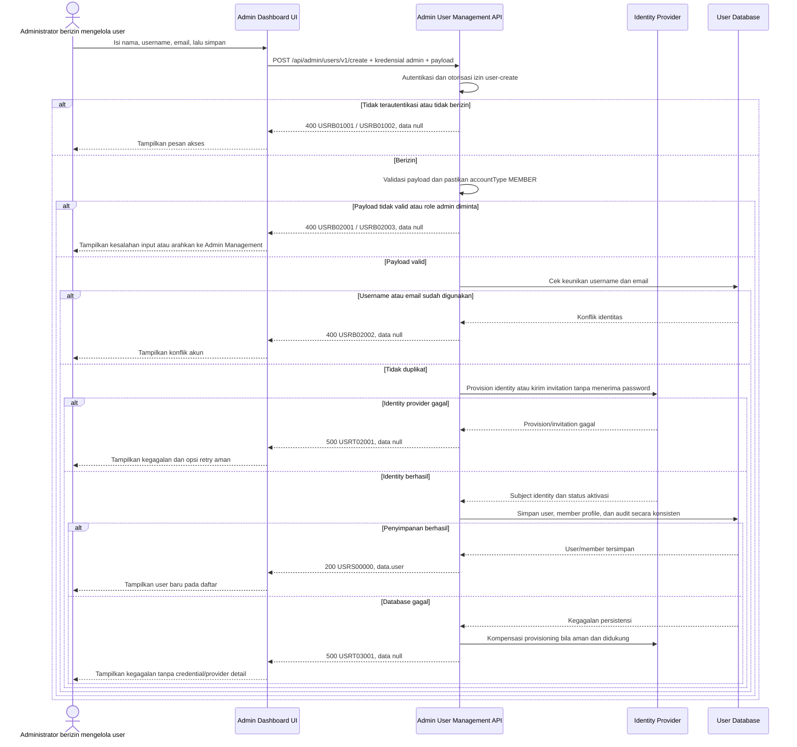

# Admin Dashboard - Create User Interface Agreement

> **Document Type:** IFA / API Contract  
> **Status:** Draft  
> **Service / Domain:** Admin Dashboard — User Management  
> **Consumer / Partner:** JokiHub Admin Dashboard (authorized administrator)

## Design

API ini membuat akun pengguna/member dari Admin Dashboard menggunakan nama, username, dan email. Akun dibuat sebagai `MEMBER`; endpoint ini tidak membuat akun admin atau memberikan hak `ADMIN`/`SUPER_ADMIN`. UI saat ini menampilkan pilihan role tersebut pada form User Management, tetapi model akun memisahkan `USER_ACCOUNT` dari `ADMIN_ACCOUNT` dan role admin memakai relasi RBAC; pembuatan admin harus melalui alur Admin Management dan assignment role yang terproteksi. Credential provisioning/invitation bergantung pada identity provider yang belum ditetapkan.

## Sequence Diagram



## Performance / SLA Targets

| Success Rate                                     | VUser                                       | CPU / Memory                        | Response Time                                                                             |
| ------------------------------------------------ | ------------------------------------------- | ----------------------------------- | ----------------------------------------------------------------------------------------- |
| TBD; confirm criticality and availability target | TBD; confirm peak concurrent administrators | TBD; set from capacity estimate/NFT | TBD; proposed less-critical web baseline: ideal 200 ms, acceptable 1 s, max tolerable 2 s |

## General Information

| Component          | Value                                                                                                                                                                                                 |
| ------------------ | ----------------------------------------------------------------------------------------------------------------------------------------------------------------------------------------------------- |
| Description        | Membuat akun member baru melalui Admin Dashboard dan memulai provisioning/invitation identitas.                                                                                                       |
| Resource URL       | `https://{host}/api/admin/users/v1/create`                                                                                                                                                            |
| Transport Protocol | HTTPS, REST                                                                                                                                                                                           |
| Request Verb       | POST                                                                                                                                                                                                  |
| Content Type       | `application/json`                                                                                                                                                                                    |
| Interaction Type   | Synchronous; identity provisioning and database persistence require orchestration/compensation policy.                                                                                                |
| Security Policy    | Admin authentication dan izin user-create. Identity provider, invitation process, least-privilege role, idempotency, dan audit policy TBD. Endpoint tidak menerima password, OTP, token, atau secret. |

### Path / Endpoint

| Section        | Value                           |
| -------------- | ------------------------------- |
| Host / Domain  | `{host}` (environment-specific) |
| Service Name   | User Management                 |
| Version        | `v1`                            |
| Resource       | `/admin/users/v1/create`        |
| Final Endpoint | `/api/admin/users/v1/create`    |

### API Versioning

- **Decision:** New Endpoint
- **Previous Endpoint:** Tidak ada API create user admin yang teridentifikasi pada solutioning sprint ini.
- **Final Endpoint:** `POST /api/admin/users/v1/create`
- **Backward Compatibility:** Belum ada consumer API create user yang teridentifikasi. Penambahan field response opsional bersifat kompatibel; perubahan kontrak yang mematahkan consumer memerlukan major version baru.
- **Reason:** Admin Dashboard memerlukan pembuatan akun member dengan identitas dan proses aktivasi yang dikelola secara aman.

## Business Rules

1. Hanya administrator terautentikasi dengan izin `user-create` yang dapat membuat akun melalui endpoint ini. Nama izin final dan role mapping TBD.
2. Endpoint hanya membuat `USER_ACCOUNT` dan `MEMBER_PROFILE`; jenis akun adalah `MEMBER`. Akun admin dibuat lewat alur Admin Management/identity invitation dan role assignment, bukan lewat endpoint user umum.
3. `userId`, `joinedAt`, `createdAt`, `updatedAt`, dan tier awal dibuat oleh service. Client tidak dapat menetapkannya.
4. `name`, `username`, dan `email` wajib. Username dan email dinormalisasi sesuai kebijakan identity; perbandingan duplikasi harus konsisten dengan indeks canonical.
5. Akun baru berstatus `ACTIVE` hanya jika identity provisioning dan persyaratan aktivasi terpenuhi. Jika sistem menggunakan invitation, status awal yang tepat (mis. `PENDING_ACTIVATION`) perlu ditambahkan ke model sebelum implementasi; jangan menandai akun dapat login sebelum aktivasi.
6. Member profile menerima tier awal sesuai kebijakan tier yang disetujui. User Management ERD mengusulkan tier `BRONZE`/Bronze sebagai default; default ini perlu konfirmasi dan tier tidak dikirim oleh endpoint umum.
7. Tidak ada password, password hash, OTP, recovery code, bearer token, atau secret yang diterima/dikembalikan. Identity provider menangani autentikasi dan invitation.
8. Identity provider dan database merupakan dua sistem terpisah. Implementasi wajib memakai idempotency/correlation dan saga/kompensasi atau provisioning asynchronous yang tahan retry agar tidak membuat akun parsial/duplikat. Mekanisme final TBD.
9. Jika provisioning gagal, user/member profile tidak disimpan sebagai akun aktif. Jika persistensi lokal gagal setelah identity berhasil, kompensasikan identity jika aman; bila kompensasi tidak tersedia, rekonsiliasi melalui status provisioning tertunda dan audit, bukan mengembalikan sukses palsu.
10. Create request sukses mencatat aktor admin dan waktu melalui audit mechanism. Storage, retention, dan correlation ID policy TBD.
11. Endpoint tidak mengirim WhatsApp atau membuat tier/order metrics. Penambahan nomor WhatsApp/verification menjadi perubahan kontrak dan kebijakan terpisah.

## Request Headers

| Header            | E/N/T | Type   | M/O/C | Max Length | Description                                                                                                              | Example                 |
| ----------------- | ----- | ------ | ----- | ---------: | ------------------------------------------------------------------------------------------------------------------------ | ----------------------- |
| `Authorization`   | N     | String | M     |       4096 | Kredensial administrator; skema autentikasi bergantung identity provider.                                                | `Bearer {access-token}` |
| `Content-Type`    | N     | String | M     |        100 | Tipe media request.                                                                                                      | `application/json`      |
| `Accept`          | N     | String | O     |        100 | Tipe media response yang diinginkan; default JSON.                                                                       | `application/json`      |
| `Idempotency-Key` | N     | String | C     |        100 | Wajib jika create memanggil identity provider atau operasi dapat diulang; mencegah provisioning ganda. Exact policy TBD. | `idem-62bd22`           |
| `X-Request-Id`    | N     | String | O     |        100 | ID korelasi request untuk audit dan rekonsiliasi.                                                                        | `req-7f63c1`            |

## Request Parameters

None.

## Request Query Parameters

None.

## Request Body

| Attribute     | E/N/T | Type   | M/O/C | Max Length | Description                                                                       | Example            |
| ------------- | ----- | ------ | ----- | ---------: | --------------------------------------------------------------------------------- | ------------------ |
| `name`        | N     | String | M     |        150 | Nama tampilan user; trim sebelum disimpan.                                        | `Budi Santoso`     |
| `username`    | N     | String | M     |        100 | Username unik; dinormalisasi lowercase sesuai UI convention.                      | `budi.santoso`     |
| `email`       | N     | String | M     |        254 | Email valid untuk kontak/invitation; normalisasi case policy TBD.                 | `budi@example.com` |
| `accountType` | N     | String | C     |         20 | Jika dikirim harus `MEMBER`. Field ini tidak memberi hak admin. Default `MEMBER`. | `MEMBER`           |

### Example Request Body

```json
{
  "name": "Budi Santoso",
  "username": "budi.santoso",
  "email": "budi@example.com",
  "accountType": "MEMBER"
}
```

### Request Validation

1. `Authorization` harus mengidentifikasi administrator terautentikasi dengan izin `user-create`. Kembalikan `USRB01001` bila belum terautentikasi dan `USRB01002` bila izin tidak tersedia.
2. `name` wajib berupa string non-empty setelah trim dan maksimal 150 karakter.
3. `username` wajib berupa string 3–100 karakter dan hanya berisi karakter yang diizinkan kebijakan username. Usulan mengikuti UI: huruf kecil ASCII, angka, titik, underscore, dan hyphen; regex final perlu disetujui.
4. `email` wajib valid dan maksimal 254 karakter. Normalisasi email dan kebijakan verified/invitation ditentukan oleh identity provider.
5. `accountType`, bila dikirim, wajib bernilai `MEMBER`. Nilai `ADMIN`, `SUPER_ADMIN`, atau nilai lain ditolak dengan `USRB02003` dan diarahkan ke Admin Management.
6. Field tak dikenal, termasuk `password`, `passwordHash`, `role`, `status`, `id`, `joinedAt`, dan tier, ditolak dengan `USRB02001`.
7. Email atau username yang sudah digunakan oleh akun yang masih berlaku mengembalikan `USRB02002`. Kebijakan penggunaan ulang setelah akun soft-delete harus konsisten dengan unique index.
8. `Idempotency-Key` wajib untuk operasi provisioning eksternal jika kebijakan API mengharuskannya. Retry dengan key yang sama mengembalikan hasil request awal; key yang sama dengan payload berbeda ditolak. Masa retensi key TBD.
9. Validasi field dan duplikasi dilakukan sebelum provisioning. Kegagalan identity provider mengembalikan `USRT02001`; kegagalan persistensi mengembalikan `USRT03001`. Jangan mengembalikan credential atau detail internal.

## Response Body

Semua response menggunakan envelope `status` dan `data`. Sukses mengembalikan profil user tanpa credential; error mengembalikan `data: null`.

| Attribute               | E/N/T | Type               | M/O/C | Max Length | Description                                                                                     | Example                |
| ----------------------- | ----- | ------------------ | ----- | ---------: | ----------------------------------------------------------------------------------------------- | ---------------------- |
| `status`                | N     | Object             | M     |          — | Object status response.                                                                         | `{}`                   |
| `status.code`           | N     | String             | M     |         20 | Service status code.                                                                            | `USRS00000`            |
| `status.message`        | N     | String             | O     |        200 | Pesan hasil untuk consumer.                                                                     | `User created`         |
| `data`                  | N     | Object/null        | M     |          — | Payload hasil; `null` ketika error.                                                             | `{}`                   |
| `data.user`             | N     | Object             | C     |          — | Snapshot akun member tersimpan.                                                                 | `{}`                   |
| `data.user.id`          | N     | String             | C     |         64 | ID immutable user yang dibuat service/identity provider.                                        | `usr_01JXYZ`           |
| `data.user.name`        | N     | String             | C     |        150 | Nama tampilan tersimpan.                                                                        | `Budi Santoso`         |
| `data.user.username`    | N     | String             | C     |        100 | Username tersimpan.                                                                             | `budi.santoso`         |
| `data.user.email`       | N     | String             | C     |        254 | Email tersimpan; masking response mengikuti policy PII.                                         | `budi@example.com`     |
| `data.user.accountType` | N     | String             | C     |         20 | Jenis akun; selalu `MEMBER` pada endpoint ini.                                                  | `MEMBER`               |
| `data.user.status`      | N     | String             | C     |         30 | Status provisioning/aktivasi hasil create. Nilai final bergantung identity flow.                | `PENDING_ACTIVATION`   |
| `data.user.tier`        | N     | String             | C     |         20 | Tier awal sesuai kebijakan membership yang disetujui.                                           | `BRONZE`               |
| `data.user.joinedAt`    | N     | String (date-time) | C     |         35 | Waktu akun/member mulai bergabung ISO 8601 UTC. Semantik saat invitation menunggu aktivasi TBD. | `2026-10-11T10:30:00Z` |
| `data.user.createdAt`   | N     | String (date-time) | C     |         35 | Waktu record dibuat ISO 8601 UTC.                                                               | `2026-10-11T10:30:00Z` |

### Success Example

```json
{
  "status": {
    "code": "USRS00000",
    "message": "User created"
  },
  "data": {
    "user": {
      "id": "usr_01JXYZ",
      "name": "Budi Santoso",
      "username": "budi.santoso",
      "email": "budi@example.com",
      "accountType": "MEMBER",
      "status": "PENDING_ACTIVATION",
      "tier": "BRONZE",
      "joinedAt": "2026-10-11T10:30:00Z",
      "createdAt": "2026-10-11T10:30:00Z"
    }
  }
}
```

### Business Error Example

```json
{
  "status": {
    "code": "USRB02002",
    "message": "Username or email already exists"
  },
  "data": null
}
```

### Technical Error Example

```json
{
  "status": {
    "code": "USRT02001",
    "message": "Identity provisioning is temporarily unavailable"
  },
  "data": null
}
```

## HTTP Status Codes

| HTTP Status | Usage                                                                                                                                                                                         |
| ----------- | --------------------------------------------------------------------------------------------------------------------------------------------------------------------------------------------- |
| `200`       | Member account dan profile berhasil dibuat mengikuti baseline response project. Konfirmasi apakah API standard menggunakan `201`.                                                             |
| `400`       | Request tidak valid, akses admin ditolak, account type tidak diizinkan, atau username/email duplikat sesuai baseline saat ini. Konfirmasi apakah API standard mengharuskan `401`/`403`/`409`. |
| `500`       | Identity provider, database, atau service mengalami kegagalan teknis. Kegagalan identity provider dapat dipetakan ke `502`/`503` bila API standard mengizinkan.                               |

## Service Status Codes

Format: `[Service Prefix][Status Type][Category][Specific Error Code]`

| Code        | Type      | Category         | Meaning                                                                            |
| ----------- | --------- | ---------------- | ---------------------------------------------------------------------------------- |
| `USRS00000` | Success   | General          | Akun member berhasil dibuat.                                                       |
| `USRB01001` | Business  | Authentication   | Administrator belum terautentikasi.                                                |
| `USRB01002` | Business  | Authentication   | Administrator tidak memiliki izin user-create.                                     |
| `USRB02001` | Business  | User validation  | Field wajib, tipe, format, panjang, atau field tak dikenal tidak valid.            |
| `USRB02002` | Business  | User validation  | Username atau email sudah digunakan.                                               |
| `USRB02003` | Business  | User validation  | Jenis akun bukan `MEMBER`; pembuatan akun admin tidak diizinkan oleh endpoint ini. |
| `USRT02001` | Technical | External service | Identity provider gagal membuat identity atau memulai invitation.                  |
| `USRT03001` | Technical | Database         | User/member record atau audit gagal disimpan/database tidak tersedia.              |

## API Exposure Classification

| Classification                 | Rationale                                                                                                                                                                                                  |
| ------------------------------ | ---------------------------------------------------------------------------------------------------------------------------------------------------------------------------------------------------------- |
| Enterprise Intranet (proposed) | Endpoint administratif untuk Admin Dashboard. Pastikan boundary internal; jika internet-accessible, klasifikasikan sebagai Public dan terapkan proteksi API publik. Data identity harus tetap terlindungi. |

## Testing & Documentation Scope

| Scope      | Required | Rationale / Handoff                                                                                                                                                                                                                       |
| ---------- | -------- | ----------------------------------------------------------------------------------------------------------------------------------------------------------------------------------------------------------------------------------------- |
| NFT        | Yes      | API create baru dengan identity/database dependencies. Uji create valid, duplikasi, provider failure, persistence failure/compensation, retry/idempotency, dan peak admin load. VUser, CPU/memory, dan target TPS TBD mengikuti forecast. |
| VA/Pentest | Yes      | Endpoint membuat identity. Uji authentication/authorization, privilege escalation, role escalation, mass assignment, account enumeration, email/username abuse, idempotency replay, PII exposure, dan secret/password rejection.          |

## Assumptions

- Endpoint `/api/admin/users/v1/create` ditujukan untuk akun member/customer saja, bukan admin. API owner harus menyetujui pemisahan ini karena UI User Management saat ini menawarkan `Member`, `Admin`, dan `Super Admin` dalam satu form.
- Admin create/invitation dan role assignment dilakukan melalui Admin Management dan RBAC workflow; jangan mengizinkan `role` bebas atau `SUPER_ADMIN` pada endpoint ini.
- Field name/username/email mengikuti `AdminUserForm`; `whatsapp` tidak disertakan karena form user tidak memintanya. Jika membuat member, email verification dan WhatsApp capture policy perlu diselaraskan dengan checkout/member registration.
- Identity provider, invite mechanism, username rules, email normalization/verification, tier awal, activation status, idempotency retention, compensation/reconciliation, audit storage, SLA, serta HTTP status mapping masih TBD.
- User Management ERD membedakan `USER_ACCOUNT` dan `ADMIN_ACCOUNT`; kontrak response menggunakan `accountType=MEMBER` sebagai penegas domain, bukan kolom role bebas.
- API belum siap implementasi sampai model lifecycle `PENDING_ACTIVATION` dan integrasi identity provider diputuskan, atau kontrak disesuaikan dengan mekanisme aktivasi yang disetujui.

## References

- `src/features/AdminUsers/views/interfaces/admin-user.interface.ts` — user form fields and current role/status options.
- `src/features/AdminUsers/views/templates/AdminUsers.template.tsx` — create-user form in the admin UI.
- `src/features/AdminManagement/views/interfaces/admin-account.interface.ts` — separate admin account role and status model.
- `src/features/AdminManagement/views/templates/AdminManagement.template.tsx` — admin-account creation and note that invitation/permissions are not yet connected.
- `docs/sprint_1/solutioning/erd/user-management-erd.md` — proposed user/admin account separation and account fields.
- `docs/sprint_1/solutioning/erd/role-erd.md` — admin role/permission assignment model.
- `docs/sprint_1/solutioning/TEMPLATE.md` — API contract template.
