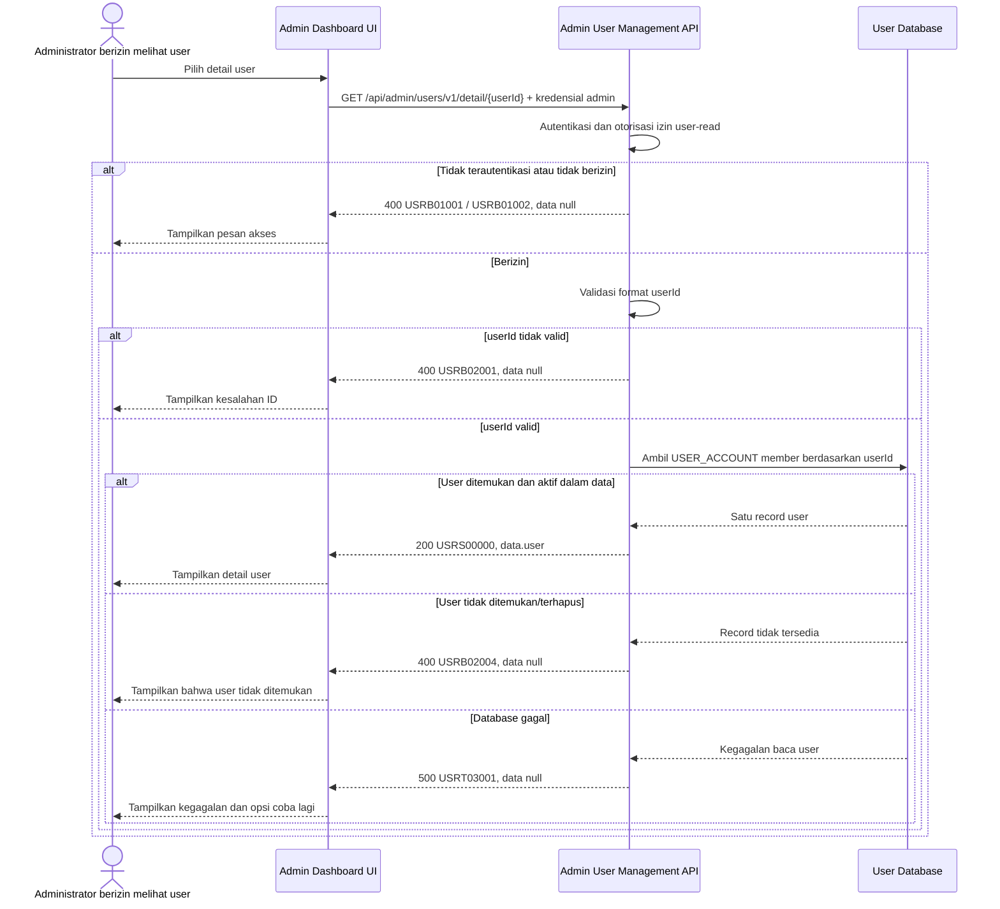

# Admin Dashboard - Get Detail User Interface Agreement

> **Document Type:** IFA / API Contract  
> **Status:** Draft  
> **Service / Domain:** Admin Dashboard — User Management  
> **Consumer / Partner:** JokiHub Admin Dashboard (authorized administrator)

## Design

API ini mengambil detail satu akun member berdasarkan `userId` untuk modal detail atau form edit pada menu User Management. Response mengikuti field yang ditampilkan UI dan kontrak [Get List Users](./get-list-users.md). Endpoint hanya mengakses `USER_ACCOUNT`; akun admin dan role admin tetap dikelola melalui Admin Management/RBAC.

## Sequence Diagram



## Performance / SLA Targets

| Success Rate                                     | VUser                                       | CPU / Memory                        | Response Time                                                                             |
| ------------------------------------------------ | ------------------------------------------- | ----------------------------------- | ----------------------------------------------------------------------------------------- |
| TBD; confirm criticality and availability target | TBD; confirm peak concurrent administrators | TBD; set from capacity estimate/NFT | TBD; proposed less-critical web baseline: ideal 200 ms, acceptable 1 s, max tolerable 2 s |

## General Information

| Component          | Value                                                                                                                                                         |
| ------------------ | ------------------------------------------------------------------------------------------------------------------------------------------------------------- |
| Description        | Mengambil satu akun member beserta informasi yang diperlukan untuk tampilan detail User Management.                                                           |
| Resource URL       | `https://{host}/api/admin/users/v1/detail/{userId}`                                                                                                           |
| Transport Protocol | HTTPS, REST                                                                                                                                                   |
| Request Verb       | GET                                                                                                                                                           |
| Content Type       | Tidak ada request body                                                                                                                                        |
| Interaction Type   | Synchronous                                                                                                                                                   |
| Security Policy    | Admin authentication dan izin user-read. Identity provider dan nama permission TBD. Batasi PII sesuai role/akses admin dan lakukan audit akses sesuai policy. |

### Path / Endpoint

| Section        | Value                                 |
| -------------- | ------------------------------------- |
| Host / Domain  | `{host}` (environment-specific)       |
| Service Name   | User Management                       |
| Version        | `v1`                                  |
| Resource       | `/admin/users/v1/detail/{userId}`     |
| Final Endpoint | `/api/admin/users/v1/detail/{userId}` |

### API Versioning

- **Decision:** New Endpoint
- **Previous Endpoint:** Tidak ada API detail user admin yang teridentifikasi.
- **Final Endpoint:** `GET /api/admin/users/v1/detail/{userId}`
- **Backward Compatibility:** Belum ada consumer API detail user yang teridentifikasi. Penambahan field response opsional bersifat kompatibel; perubahan kontrak yang mematahkan consumer memerlukan major version baru.
- **Reason:** Admin Dashboard memerlukan pembacaan satu akun member untuk modal detail dan form edit.

## Business Rules

1. Hanya administrator terautentikasi dengan izin `user-read` yang dapat mengakses endpoint. Role mapping dan nama permission final TBD.
2. `userId` mengidentifikasi satu akun `USER_ACCOUNT`; akun admin tidak dikembalikan melalui endpoint ini.
3. Response memuat data yang diperlukan UI: `id`, `name`, `username`, `email`, `accountType`, `status`, dan `joinedAt`. WhatsApp, credential, order metrics, dan informasi internal tidak disertakan.
4. `accountType` selalu `MEMBER`. Akun yang tidak termasuk domain member atau akun soft-deleted dikembalikan sebagai not found agar endpoint tidak membuka jenis akun atau keberadaannya kepada consumer yang salah.
5. Status storage `ACTIVE`/`BLOCKED` dipetakan ke label UI `Aktif`/`Diblokir`; endpoint hanya membaca dan tidak mengubah status.
6. Email merupakan PII dan hanya boleh dikembalikan kepada administrator dengan izin melihat data kontak. Masking berdasarkan role perlu ditetapkan dalam access policy.
7. Jika `userId` tidak ditemukan, sudah dihapus, atau bukan member, kembalikan `USRB02004` tanpa membedakan kondisi tersebut.
8. Response tidak berisi password, password hash, OTP, recovery token, access token, atau provider secret.
9. Endpoint bersifat read-only. Update profil atau perubahan status menggunakan endpoint terpisah.

## Request Headers

| Header          | E/N/T | Type   | M/O/C | Max Length | Description                                                               | Example                 |
| --------------- | ----- | ------ | ----- | ---------: | ------------------------------------------------------------------------- | ----------------------- |
| `Authorization` | N     | String | M     |       4096 | Kredensial administrator; skema autentikasi bergantung identity provider. | `Bearer {access-token}` |
| `Accept`        | N     | String | O     |        100 | Tipe media response yang diinginkan; default JSON.                        | `application/json`      |
| `X-Request-Id`  | N     | String | O     |        100 | ID korelasi request untuk audit/support.                                  | `req-b8072d`            |

## Request Parameters

| Parameter | E/N/T | Type   | M/O/C | Max Length | Description                            | Example      |
| --------- | ----- | ------ | ----- | ---------: | -------------------------------------- | ------------ |
| `userId`  | N     | String | M     |         64 | ID immutable akun member yang diminta. | `usr_01JXYZ` |

## Request Query Parameters

None.

## Request Body

Tidak ada request body.

### Request Validation

1. `Authorization` harus mengidentifikasi administrator terautentikasi dengan izin `user-read`. Kembalikan `USRB01001` bila belum terautentikasi dan `USRB01002` bila izin tidak tersedia.
2. `userId` wajib tersedia, tidak kosong, dan maksimal 64 karakter. Format ID mengikuti strategi pembuatan ID yang TBD; nilai tidak valid mengembalikan `USRB02001`.
3. Record harus merupakan user member yang belum soft-deleted. Bila tidak ditemukan/tidak eligible, kembalikan `USRB02004`.
4. Request body tidak digunakan. Parameter tambahan tidak boleh mengubah target record atau membuka field lain.
5. Kegagalan database mengembalikan HTTP 500 tanpa detail internal.

## Response Body

Semua response menggunakan `status` dan `data`. Sukses mengembalikan satu user; error mengembalikan `data: null`.

| Attribute               | E/N/T | Type               | M/O/C | Max Length | Description                           | Example                 |
| ----------------------- | ----- | ------------------ | ----- | ---------: | ------------------------------------- | ----------------------- |
| `status`                | N     | Object             | M     |          — | Object status response.               | `{}`                    |
| `status.code`           | N     | String             | M     |         20 | Service status code.                  | `USRS00000`             |
| `status.message`        | N     | String             | O     |        200 | Pesan hasil untuk consumer.           | `User detail retrieved` |
| `data`                  | N     | Object/null        | M     |          — | Payload hasil; `null` ketika error.   | `{}`                    |
| `data.user`             | N     | Object             | C     |          — | Snapshot user member.                 | `{}`                    |
| `data.user.id`          | N     | String             | C     |         64 | ID immutable user.                    | `usr_01JXYZ`            |
| `data.user.name`        | N     | String             | C     |        150 | Nama tampilan user.                   | `Budi Santoso`          |
| `data.user.username`    | N     | String             | C     |        100 | Username user.                        | `budi.santoso`          |
| `data.user.email`       | N     | String             | C     |        254 | Email user sesuai access/PII policy.  | `budi@example.com`      |
| `data.user.accountType` | N     | String             | C     |         20 | Jenis akun; selalu `MEMBER`.          | `MEMBER`                |
| `data.user.status`      | N     | String             | C     |         20 | Status akun: `ACTIVE` atau `BLOCKED`. | `ACTIVE`                |
| `data.user.joinedAt`    | N     | String (date-time) | C     |         35 | Waktu user bergabung ISO 8601 UTC.    | `2026-10-11T10:30:00Z`  |

### Success Example

```json
{
  "status": {
    "code": "USRS00000",
    "message": "User detail retrieved"
  },
  "data": {
    "user": {
      "id": "usr_01JXYZ",
      "name": "Budi Santoso",
      "username": "budi.santoso",
      "email": "budi@example.com",
      "accountType": "MEMBER",
      "status": "ACTIVE",
      "joinedAt": "2026-10-11T10:30:00Z"
    }
  }
}
```

### Business Error Example

```json
{
  "status": {
    "code": "USRB02004",
    "message": "User not found"
  },
  "data": null
}
```

### Technical Error Example

```json
{
  "status": {
    "code": "USRT03001",
    "message": "User service is temporarily unavailable"
  },
  "data": null
}
```

## HTTP Status Codes

| HTTP Status | Usage                                                                                                                                                                                         |
| ----------- | --------------------------------------------------------------------------------------------------------------------------------------------------------------------------------------------- |
| `200`       | Detail user berhasil ditemukan dan dikembalikan.                                                                                                                                              |
| `400`       | ID tidak valid, akses administrator ditolak, atau user tidak ditemukan/tidak eligible sesuai baseline response project. Konfirmasi apakah API standard mengharuskan `401`, `403`, atau `404`. |
| `500`       | Kegagalan service atau database user yang tidak terduga.                                                                                                                                      |

## Service Status Codes

Format: `[Service Prefix][Status Type][Category][Specific Error Code]`

| Code        | Type      | Category        | Meaning                                                     |
| ----------- | --------- | --------------- | ----------------------------------------------------------- |
| `USRS00000` | Success   | General         | Detail user berhasil dikembalikan.                          |
| `USRB01001` | Business  | Authentication  | Administrator belum terautentikasi.                         |
| `USRB01002` | Business  | Authentication  | Administrator tidak memiliki izin user-read.                |
| `USRB02001` | Business  | User validation | `userId` tidak tersedia atau format/panjangnya tidak valid. |
| `USRB02004` | Business  | User validation | User tidak ditemukan, sudah dihapus, atau bukan member.     |
| `USRT03001` | Technical | Database        | User gagal dibaca atau database tidak tersedia.             |

## API Exposure Classification

| Classification                 | Rationale                                                                                                                                                                                                        |
| ------------------------------ | ---------------------------------------------------------------------------------------------------------------------------------------------------------------------------------------------------------------- |
| Enterprise Intranet (proposed) | Endpoint administratif untuk Admin Dashboard. Pastikan hanya dapat dijangkau melalui boundary internal yang disetujui; jika internet-accessible, klasifikasikan sebagai Public dan terapkan proteksi API publik. |

## Testing & Documentation Scope

| Scope      | Required | Rationale / Handoff                                                                                                                                                                                        |
| ---------- | -------- | ---------------------------------------------------------------------------------------------------------------------------------------------------------------------------------------------------------- |
| NFT        | Yes      | API admin baru. Uji record ditemukan/tidak ditemukan, akun blocked, soft-deleted/non-member, beban modal detail, dan kegagalan database. VUser, CPU/memory, dan target TPS TBD mengikuti forecast traffic. |
| VA/Pentest | Yes      | Endpoint mengekspos PII. Uji authentication/authorization, IDOR pada `userId`, enumerasi akun, PII masking/access, dan kebocoran credential/provider metadata.                                             |

## Assumptions

- Endpoint `/api/admin/users/v1/detail/{userId}`, field response, envelope, prefix `USR`, dan status codes mengikuti kontrak [Get List Users](./get-list-users.md) dan [Create User](./create-user.md); API owner perlu menyetujui.
- Route action-based `/detail/{userId}` mengikuti pola solutioning admin project. Konfirmasi jika API standard memilih REST `GET /api/admin/users/v1/{userId}`.
- Endpoint hanya membaca `USER_ACCOUNT` member; daftar/detail akun admin ada di Admin Management.
- `accountType=MEMBER` adalah pembatas domain pada response, bukan kolom role bebas. Status menggunakan `ACTIVE`/`BLOCKED` sesuai usulan User Management ERD.
- Identity provider, permission `user-read`, ID format, email masking policy, status invitation, SLA, audit access policy, serta HTTP auth/not-found mapping masih TBD.
- Endpoint tidak mengembalikan WhatsApp, member tier, orderCount, totalSpend, atau admin role/permission.

## References

- `./get-list-users.md` — list user, status, PII boundaries, dan service codes.
- `./create-user.md` — cakupan member dan pemisahan admin account creation.
- `../../erd/user-management-erd.md` — user/admin account model.
- `src/features/AdminUsers/views/interfaces/admin-user.interface.ts` — field detail user di UI.
- `src/features/AdminUsers/views/templates/AdminUsers.template.tsx` — modal detail user dan data yang ditampilkan.
- `docs/sprint_1/solutioning/dashboard/games/get-detail-game.md` — pola endpoint detail admin.
