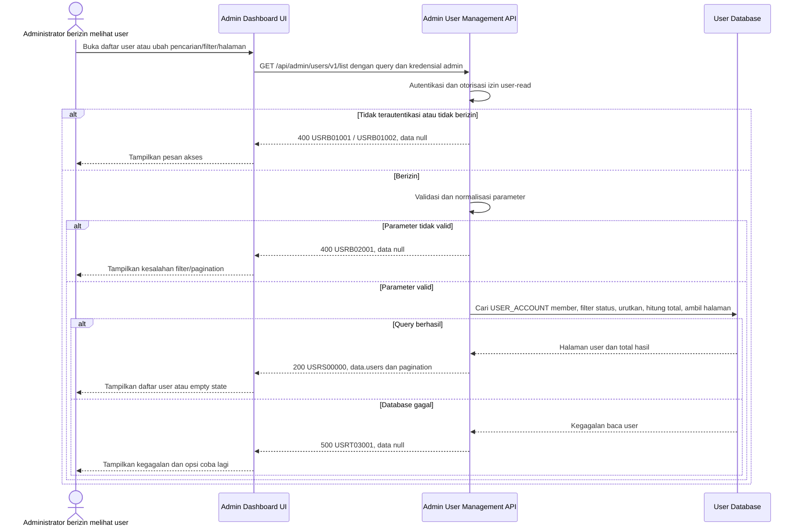

# Admin Dashboard - Get List Users Interface Agreement

> **Document Type:** IFA / API Contract  
> **Status:** Draft  
> **Service / Domain:** Admin Dashboard — User Management  
> **Consumer / Partner:** JokiHub Admin Dashboard (authorized administrator)

## Design

API ini mengambil daftar akun member pada menu User Management dengan pencarian, filter status, dan pagination. Kontrak mengikuti field UI user (`name`, `username`, `email`, `status`, `joinedAt`) dan membatasi hasil ke `USER_ACCOUNT`; akun admin serta role admin dikelola melalui Admin Management/RBAC terpisah. PII yang dikembalikan dibatasi pada field yang ditampilkan UI.

## Sequence Diagram



## Performance / SLA Targets

| Success Rate                                     | VUser                                       | CPU / Memory                        | Response Time                                                                             |
| ------------------------------------------------ | ------------------------------------------- | ----------------------------------- | ----------------------------------------------------------------------------------------- |
| TBD; confirm criticality and availability target | TBD; confirm peak concurrent administrators | TBD; set from capacity estimate/NFT | TBD; proposed less-critical web baseline: ideal 200 ms, acceptable 1 s, max tolerable 2 s |

## General Information

| Component          | Value                                                                                                                                          |
| ------------------ | ---------------------------------------------------------------------------------------------------------------------------------------------- |
| Description        | Mengambil daftar akun member untuk menu User Management Admin Dashboard.                                                                       |
| Resource URL       | `https://{host}/api/admin/users/v1/list`                                                                                                       |
| Transport Protocol | HTTPS, REST                                                                                                                                    |
| Request Verb       | GET                                                                                                                                            |
| Content Type       | Tidak ada request body                                                                                                                         |
| Interaction Type   | Synchronous                                                                                                                                    |
| Security Policy    | Admin authentication dan izin user-read. Identity provider dan nama permission TBD. Terapkan rate limiting, audit akses, serta pembatasan PII. |

### Path / Endpoint

| Section        | Value                           |
| -------------- | ------------------------------- |
| Host / Domain  | `{host}` (environment-specific) |
| Service Name   | User Management                 |
| Version        | `v1`                            |
| Resource       | `/admin/users/v1/list`          |
| Final Endpoint | `/api/admin/users/v1/list`      |

### API Versioning

- **Decision:** New Endpoint
- **Previous Endpoint:** Tidak ada API daftar user admin yang teridentifikasi.
- **Final Endpoint:** `GET /api/admin/users/v1/list`
- **Backward Compatibility:** Belum ada consumer API daftar user yang teridentifikasi. Penambahan field response opsional bersifat kompatibel; perubahan kontrak yang mematahkan consumer memerlukan major version baru.
- **Reason:** Admin Dashboard memerlukan daftar akun member yang dapat dicari dan difilter.

## Business Rules

1. Hanya administrator terautentikasi dengan izin `user-read` yang dapat mengakses endpoint. Role mapping dan nama permission final TBD.
2. Endpoint hanya mengembalikan akun member dari `USER_ACCOUNT`. `ADMIN_ACCOUNT` dan assignment `ADMIN_ROLE` tidak termasuk hasil; gunakan modul Admin Management/RBAC.
3. User soft-deleted dikecualikan dari hasil standar. Kebijakan restore dan filter arsip tidak termasuk kontrak ini.
4. `search` mencocokkan `name`, `username`, dan `email` tanpa membedakan huruf besar/kecil setelah normalisasi. WhatsApp tidak dicari/dikembalikan pada endpoint ini untuk membatasi PII.
5. Filter `status` memakai nilai domain `ACTIVE` atau `BLOCKED`; UI menampilkan label `Aktif` atau `Diblokir`.
6. Filter `accountType` atau `role` tidak disediakan. Untuk setiap record yang dikembalikan, `accountType` adalah `MEMBER`; UI saat ini menampilkan pilihan Admin/Super Admin yang harus dipisahkan ke Admin Management.
7. Hasil diurutkan `joined_at DESC`, lalu `user_id DESC` untuk urutan deterministik.
8. Pagination memakai `page` berbasis 1 dan `pageSize`; `totalItems` dihitung setelah filter sebelum pagination, dan `totalPages` bernilai `0` bila hasil kosong.
9. Pencarian email mengembalikan nilai email sesuai hak akses admin dan kebijakan PII. Masking email untuk role tertentu perlu ditentukan oleh access policy.
10. Endpoint hanya membaca. Status user diubah melalui API status/update terpisah; tidak ada mutasi data saat daftar dibuka.

## Request Headers

| Header          | E/N/T | Type   | M/O/C | Max Length | Description                                                               | Example                 |
| --------------- | ----- | ------ | ----- | ---------: | ------------------------------------------------------------------------- | ----------------------- |
| `Authorization` | N     | String | M     |       4096 | Kredensial administrator; skema autentikasi bergantung identity provider. | `Bearer {access-token}` |
| `Accept`        | N     | String | O     |        100 | Tipe media response yang diinginkan; default JSON.                        | `application/json`      |
| `X-Request-Id`  | N     | String | O     |        100 | ID korelasi untuk audit/support.                                          | `req-c85120`            |

## Request Parameters

None.

## Request Query Parameters

| Parameter  | E/N/T | Type    | M/O/C | Max Length | Description                                                             | Example  |
| ---------- | ----- | ------- | ----- | ---------: | ----------------------------------------------------------------------- | -------- |
| `search`   | N     | String  | O     |        100 | Pencarian pada `name`, `username`, dan `email`; trim sebelum pencarian. | `budi`   |
| `status`   | N     | String  | O     |         20 | Filter status akun: `ACTIVE` atau `BLOCKED`. Default tanpa filter.      | `ACTIVE` |
| `page`     | N     | Integer | O     |  10 digits | Nomor halaman berbasis 1; default `1`.                                  | `1`      |
| `pageSize` | N     | Integer | O     |  10 digits | Jumlah user per halaman; default `20`, maksimum usulan `100`.           | `20`     |

## Request Body

Tidak ada request body.

### Request Validation

1. `Authorization` harus mengidentifikasi administrator terautentikasi dengan izin `user-read`. Kembalikan `USRB01001` bila belum terautentikasi dan `USRB01002` bila izin tidak tersedia.
2. `search`, bila dikirim, harus string dan maksimal 100 karakter setelah trim. Input diperlakukan sebagai nilai pencarian, bukan fragmen query database.
3. `status`, bila dikirim, harus `ACTIVE` atau `BLOCKED`; nilai lain mengembalikan `USRB02001`.
4. `page` harus integer >= 1; default `1`.
5. `pageSize` harus integer antara 1 dan 100; default `20`.
6. Parameter query yang tidak dikenal ditolak dengan `USRB02001`.
7. Hasil kosong tetap sukses dengan `users: []`, `totalItems: 0`, dan `totalPages: 0`.
8. Kegagalan database mengembalikan HTTP 500 dan tidak mengungkap detail internal.

## Response Body

Semua response memakai envelope `status` dan `data`. Sukses mengembalikan satu halaman user; error mengembalikan `data: null`.

| Attribute                    | E/N/T | Type               | M/O/C |       Max Length | Description                                                  | Example                |
| ---------------------------- | ----- | ------------------ | ----- | ---------------: | ------------------------------------------------------------ | ---------------------- |
| `status`                     | N     | Object             | M     |                — | Object status response.                                      | `{}`                   |
| `status.code`                | N     | String             | M     |               20 | Service status code.                                         | `USRS00000`            |
| `status.message`             | N     | String             | O     |              200 | Pesan hasil untuk consumer.                                  | `User list retrieved`  |
| `data`                       | N     | Object/null        | M     |                — | Payload hasil; `null` ketika error.                          | `{}`                   |
| `data.users`                 | N     | Array of Object    | M     | `pageSize` items | User member pada halaman; array kosong jika tidak ada hasil. | `[]`                   |
| `data.users[].id`            | N     | String             | M     |               64 | ID immutable user.                                           | `usr_01JXYZ`           |
| `data.users[].name`          | N     | String             | M     |              150 | Nama tampilan user.                                          | `Budi Santoso`         |
| `data.users[].username`      | N     | String             | M     |              100 | Username user.                                               | `budi.santoso`         |
| `data.users[].email`         | N     | String             | M     |              254 | Email user sesuai access/PII policy.                         | `budi@example.com`     |
| `data.users[].accountType`   | N     | String             | M     |               20 | Jenis akun; selalu `MEMBER`.                                 | `MEMBER`               |
| `data.users[].status`        | N     | String             | M     |               20 | Status akun: `ACTIVE` atau `BLOCKED`.                        | `ACTIVE`               |
| `data.users[].joinedAt`      | N     | String (date-time) | M     |               35 | Waktu user bergabung ISO 8601 UTC.                           | `2026-10-11T10:30:00Z` |
| `data.pagination`            | N     | Object             | M     |                — | Metadata pagination.                                         | `{}`                   |
| `data.pagination.page`       | N     | Integer            | M     |        10 digits | Halaman yang dikembalikan.                                   | `1`                    |
| `data.pagination.pageSize`   | N     | Integer            | M     |        10 digits | Ukuran halaman efektif.                                      | `20`                   |
| `data.pagination.totalItems` | N     | Integer            | M     |        10 digits | Jumlah hasil setelah filter sebelum pagination.              | `1`                    |
| `data.pagination.totalPages` | N     | Integer            | M     |        10 digits | Jumlah halaman; `0` untuk hasil kosong.                      | `1`                    |

### Success Example

```json
{
  "status": {
    "code": "USRS00000",
    "message": "User list retrieved"
  },
  "data": {
    "users": [
      {
        "id": "usr_01JXYZ",
        "name": "Budi Santoso",
        "username": "budi.santoso",
        "email": "budi@example.com",
        "accountType": "MEMBER",
        "status": "ACTIVE",
        "joinedAt": "2026-10-11T10:30:00Z"
      }
    ],
    "pagination": {
      "page": 1,
      "pageSize": 20,
      "totalItems": 1,
      "totalPages": 1
    }
  }
}
```

### Business Error Example

```json
{
  "status": {
    "code": "USRB02001",
    "message": "Invalid user-list query parameters"
  },
  "data": null
}
```

### Technical Error Example

```json
{
  "status": {
    "code": "USRT03001",
    "message": "User service is temporarily unavailable"
  },
  "data": null
}
```

## HTTP Status Codes

| HTTP Status | Usage                                                                                                                                         |
| ----------- | --------------------------------------------------------------------------------------------------------------------------------------------- |
| `200`       | Daftar user berhasil diambil, termasuk ketika hasil kosong.                                                                                   |
| `400`       | Query tidak valid atau akses administrator ditolak sesuai baseline response project. Konfirmasi apakah API standard mengharuskan `401`/`403`. |
| `500`       | Kegagalan service atau database user yang tidak terduga.                                                                                      |

## Service Status Codes

Format: `[Service Prefix][Status Type][Category][Specific Error Code]`

| Code        | Type      | Category        | Meaning                                                   |
| ----------- | --------- | --------------- | --------------------------------------------------------- |
| `USRS00000` | Success   | General         | Daftar user berhasil dikembalikan.                        |
| `USRB01001` | Business  | Authentication  | Administrator belum terautentikasi.                       |
| `USRB01002` | Business  | Authentication  | Administrator tidak memiliki izin user-read.              |
| `USRB02001` | Business  | User validation | Parameter pencarian, status, atau pagination tidak valid. |
| `USRT03001` | Technical | Database        | Daftar user gagal dibaca atau database tidak tersedia.    |

## API Exposure Classification

| Classification                 | Rationale                                                                                                                                                                                                        |
| ------------------------------ | ---------------------------------------------------------------------------------------------------------------------------------------------------------------------------------------------------------------- |
| Enterprise Intranet (proposed) | Endpoint administratif untuk Admin Dashboard. Pastikan hanya dapat dijangkau melalui boundary internal yang disetujui; jika internet-accessible, klasifikasikan sebagai Public dan terapkan proteksi API publik. |

## Testing & Documentation Scope

| Scope      | Required | Rationale / Handoff                                                                                                                                                                                                          |
| ---------- | -------- | ---------------------------------------------------------------------------------------------------------------------------------------------------------------------------------------------------------------------------- |
| NFT        | Yes      | API admin baru yang mencari dan memaginasi data user. Uji query tanpa hasil, pencarian pada field yang diizinkan, filter status, pagination, dan beban puncak. VUser, CPU/memory, target TPS TBD mengikuti forecast traffic. |
| VA/Pentest | Yes      | Endpoint mengekspos PII. Uji authentication/authorization, enumerasi user, PII disclosure, injection pada search, query tampering, serta akses akun lintas domain/admin.                                                     |

## Assumptions

- Endpoint `/api/admin/users/v1/list`, query parameters, envelope, prefix `USR`, dan status codes mengikuti pola kontrak create-user; API owner perlu menyetujui.
- User Management UI saat ini juga menawarkan `Admin` dan `Super Admin`; kontrak ini mengecualikan akun tersebut karena ERD memisahkan `USER_ACCOUNT` dan `ADMIN_ACCOUNT`. Admin Management menjadi sumber daftar admin.
- Status storage menggunakan `ACTIVE`/`BLOCKED`, sementara UI menampilkan `Aktif`/`Diblokir`. Lifecycle invitation/pending activation belum dimodelkan oleh ERD dan tidak termasuk filter ini.
- Pencarian email dan role-based PII masking, page defaults, maximum page size, exact username/email normalization, status audit, SLA, dan HTTP auth error mapping masih TBD.
- Endpoint tidak mengembalikan WhatsApp, tier, orderCount, atau totalSpend. Member Management memiliki kontrak terpisah untuk data tersebut bila diperlukan.

## References

- `./create-user.md` — cakupan akun member dan create-user security boundaries.
- `../accounts-roles/get-list-roles.md` — role management tetap dipisahkan dari user list.
- `../../erd/user-management-erd.md` — user/admin account fields and status model.
- `src/features/AdminUsers/views/interfaces/admin-user.interface.ts` — UI list fields and filters.
- `src/features/AdminUsers/views/templates/AdminUsers.template.tsx` — user table, search, filters, and role options.
- `docs/sprint_1/solutioning/dashboard/games/get-list-games.md` — admin list pagination and response pattern.
