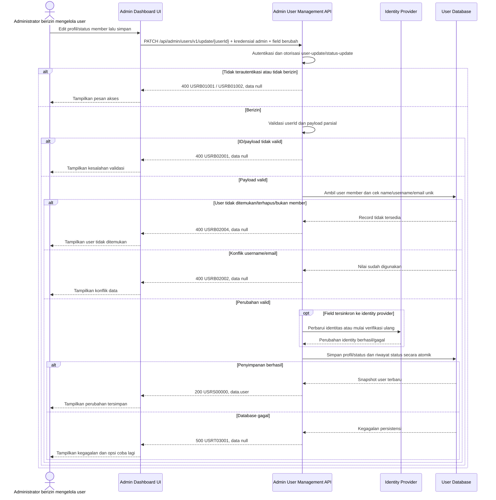

# Admin Dashboard - Update User Interface Agreement

> **Document Type:** IFA / API Contract  
> **Status:** Draft  
> **Service / Domain:** Admin Dashboard — User Management  
> **Consumer / Partner:** JokiHub Admin Dashboard (authorized administrator)

## Design

API ini memperbarui profil dan status satu akun member berdasarkan `userId`. Request bersifat parsial untuk `name`, `username`, `email`, dan `status`; `role` tidak dapat diubah melalui endpoint ini karena akun admin dan role RBAC dikelola melalui Admin Management. Perubahan identitas harus diselaraskan dengan identity provider bila field tersebut digunakan untuk login; aturan verification dan session revocation masih perlu ditetapkan.

## Sequence Diagram



## Performance / SLA Targets

| Success Rate                                     | VUser                                       | CPU / Memory                        | Response Time                                                                             |
| ------------------------------------------------ | ------------------------------------------- | ----------------------------------- | ----------------------------------------------------------------------------------------- |
| TBD; confirm criticality and availability target | TBD; confirm peak concurrent administrators | TBD; set from capacity estimate/NFT | TBD; proposed less-critical web baseline: ideal 200 ms, acceptable 1 s, max tolerable 2 s |

## General Information

| Component          | Value                                                                                                                                                                                         |
| ------------------ | --------------------------------------------------------------------------------------------------------------------------------------------------------------------------------------------- |
| Description        | Memperbarui profil dan/atau status satu akun member melalui Admin Dashboard.                                                                                                                  |
| Resource URL       | `https://{host}/api/admin/users/v1/update/{userId}`                                                                                                                                           |
| Transport Protocol | HTTPS, REST                                                                                                                                                                                   |
| Request Verb       | PATCH                                                                                                                                                                                         |
| Content Type       | `application/json`                                                                                                                                                                            |
| Interaction Type   | Synchronous; identity synchronization may require orchestration or pending-verification workflow.                                                                                             |
| Security Policy    | Admin authentication dan izin `user-update`; perubahan status memerlukan izin tambahan `user-status-update`. Identity provider, permission names, session invalidation, dan audit policy TBD. |

### Path / Endpoint

| Section        | Value                                 |
| -------------- | ------------------------------------- |
| Host / Domain  | `{host}` (environment-specific)       |
| Service Name   | User Management                       |
| Version        | `v1`                                  |
| Resource       | `/admin/users/v1/update/{userId}`     |
| Final Endpoint | `/api/admin/users/v1/update/{userId}` |

### API Versioning

- **Decision:** New Endpoint
- **Previous Endpoint:** Tidak ada API update user admin yang teridentifikasi.
- **Final Endpoint:** `PATCH /api/admin/users/v1/update/{userId}`
- **Backward Compatibility:** Belum ada consumer API update user yang teridentifikasi. Penambahan field response opsional bersifat kompatibel; perubahan kontrak yang mematahkan consumer memerlukan major version baru.
- **Reason:** Admin Dashboard memerlukan update parsial profil/status akun member.

## Business Rules

1. Administrator harus terautentikasi dan memiliki `user-update`. Jika `status` ikut diubah, administrator juga wajib memiliki `user-status-update`; nama permission dan mapping role TBD.
2. Endpoint hanya mengubah akun member (`USER_ACCOUNT`). Akun admin, role admin, dan assignment permission tidak dapat diubah melalui endpoint ini.
3. Request bersifat parsial; field yang tidak dikirim tidak berubah. Minimal satu field mutable harus disertakan.
4. `name`, `username`, dan `email` dapat diperbarui sesuai validasi. Perubahan email atau username yang menjadi identifier login harus disinkronkan ke identity provider; bila perlu verification, perubahan tidak boleh dianggap aktif sampai verifikasi berhasil.
5. Username dan email harus unik setelah normalisasi dibandingkan semua user lain, tidak termasuk `userId` yang sedang diperbarui.
6. `status` hanya menerima `ACTIVE` atau `BLOCKED`. Perubahan status ditulis ke `user_status_history` dengan aktor, old/new status, waktu, dan alasan bila diberikan.
7. Memblokir user harus menghentikan akses sesuai policy, termasuk mencabut sesi/refresh token aktif bila didukung identity provider. Perubahan database saja tidak cukup bila token masih valid.
8. Mengaktifkan kembali user yang belum menyelesaikan invitation/email verification tidak diperbolehkan. Model status `PENDING_ACTIVATION` belum ada pada ERD; lifecycle tersebut perlu disepakati.
9. Field `role`, `accountType`, `id`, `joinedAt`, `createdAt`, `updatedAt`, `deletedAt`, tier, dan credential tidak dapat diubah melalui request. `accountType` untuk endpoint ini tetap `MEMBER`.
10. Update profil dan status beserta status history disimpan atomik. Jika perubahan identity provider gagal, local record tidak boleh menyatakan perubahan login/email sudah aktif; gunakan rollback atau status verifikasi tertunda yang disetujui.
11. `updatedAt` dibuat oleh service dalam UTC pada setiap update sukses. Actor/action dicatat pada audit mechanism; storage/retention TBD.
12. Optimistic locking untuk dua administrator yang memperbarui user bersamaan belum ditetapkan. API owner perlu memutuskan ETag/`If-Match` atau version field sebelum implementasi.

## Request Headers

| Header          | E/N/T | Type   | M/O/C | Max Length | Description                                                               | Example                 |
| --------------- | ----- | ------ | ----- | ---------: | ------------------------------------------------------------------------- | ----------------------- |
| `Authorization` | N     | String | M     |       4096 | Kredensial administrator; skema autentikasi bergantung identity provider. | `Bearer {access-token}` |
| `Content-Type`  | N     | String | M     |        100 | Tipe media request.                                                       | `application/json`      |
| `Accept`        | N     | String | O     |        100 | Tipe media response yang diinginkan; default JSON.                        | `application/json`      |
| `X-Request-Id`  | N     | String | O     |        100 | ID korelasi untuk audit/support.                                          | `req-d29214`            |
| `If-Match`      | N     | String | O     |        100 | ETag/versi record untuk optimistic locking bila API standard mendukung.   | `"user-v3"`             |

## Request Parameters

| Parameter | E/N/T | Type   | M/O/C | Max Length | Description                                    | Example      |
| --------- | ----- | ------ | ----- | ---------: | ---------------------------------------------- | ------------ |
| `userId`  | N     | String | M     |         64 | ID immutable akun member yang akan diperbarui. | `usr_01JXYZ` |

## Request Query Parameters

None.

## Request Body

| Attribute  | E/N/T | Type   | M/O/C | Max Length | Description                                                                                               | Example                       |
| ---------- | ----- | ------ | ----- | ---------: | --------------------------------------------------------------------------------------------------------- | ----------------------------- |
| `name`     | N     | String | O     |        150 | Nama tampilan baru; trim sebelum disimpan.                                                                | `Budi Santoso`                |
| `username` | N     | String | O     |        100 | Username baru; dinormalisasi lowercase sesuai kebijakan identity.                                         | `budi.santoso`                |
| `email`    | N     | String | O     |        254 | Email baru; validasi dan verification mengikuti identity provider.                                        | `budi.new@example.com`        |
| `status`   | N     | String | O     |         20 | Status baru: `ACTIVE` atau `BLOCKED`; memerlukan izin status-update tambahan.                             | `BLOCKED`                     |
| `reason`   | N     | String | C     |        500 | Alasan perubahan status; conditional wajib untuk `BLOCKED` atau perubahan status sesuai policy audit TBD. | `Permintaan pemblokiran akun` |

### Example Request Body

```json
{
  "name": "Budi Santoso",
  "email": "budi.new@example.com",
  "status": "ACTIVE",
  "reason": "Akun diverifikasi oleh tim support"
}
```

### Request Validation

1. `Authorization` harus mengidentifikasi administrator dengan `user-update`. Bila body mengubah `status`, validasi izin `user-status-update` juga; kembalikan `USRB01001` untuk unauthenticated dan `USRB01002` untuk permission tidak tersedia.
2. `userId` wajib, non-empty, dan maksimal 64 karakter. Format mengikuti strategi ID yang TBD; nilai tidak valid mengembalikan `USRB02001`.
3. Body harus object dan memuat minimal satu dari `name`, `username`, `email`, atau `status`; body kosong mengembalikan `USRB02001`.
4. `name`, bila dikirim, harus string non-empty setelah trim dan maksimal 150 karakter.
5. `username`, bila dikirim, harus 3–100 karakter dan mengikuti karakter yang diizinkan kebijakan username. Usulan karakter: lowercase ASCII, angka, titik, underscore, dan hyphen; regex final TBD.
6. `email`, bila dikirim, harus berformat email dan maksimal 254 karakter. Normalisasi dan verifikasi mengikuti identity provider.
7. `status`, bila dikirim, hanya `ACTIVE` atau `BLOCKED`. Nilai lain atau transisi yang melanggar activation policy mengembalikan `USRB02001`.
8. `reason` hanya boleh dikirim saat `status` berubah; tipe string maksimal 500 karakter. Bila policy mewajibkan alasan untuk block, field ini wajib pada transisi tersebut.
9. Field tak dikenal/immutable termasuk `role`, `accountType`, `id`, `joinedAt`, `createdAt`, `updatedAt`, `deletedAt`, `password`, dan `passwordHash` ditolak dengan `USRB02001`.
10. User harus ditemukan, belum soft-deleted, dan merupakan member. Jika tidak, kembalikan `USRB02004`.
11. Konflik username/email mengembalikan `USRB02002`. Perbandingan mengecualikan user dengan `userId` yang sama.
12. Perubahan identitas yang memerlukan sync ke provider harus diselesaikan atau ditandai pending sesuai flow yang disetujui sebelum local state dianggap efektif. Kegagalan provider mengembalikan `USRT02001`; kegagalan database mengembalikan `USRT03001`.
13. Validasi seluruh request sebelum commit. Tidak boleh ada update sebagian; error mengembalikan `data: null`.

## Response Body

Semua response menggunakan `status` dan `data`. Sukses mengembalikan snapshot profil/status terbaru tanpa credential; error mengembalikan `data: null`.

| Attribute               | E/N/T | Type               | M/O/C | Max Length | Description                                  | Example                |
| ----------------------- | ----- | ------------------ | ----- | ---------: | -------------------------------------------- | ---------------------- |
| `status`                | N     | Object             | M     |          — | Object status response.                      | `{}`                   |
| `status.code`           | N     | String             | M     |         20 | Service status code.                         | `USRS00000`            |
| `status.message`        | N     | String             | O     |        200 | Pesan hasil untuk consumer.                  | `User updated`         |
| `data`                  | N     | Object/null        | M     |          — | Payload hasil; `null` ketika error.          | `{}`                   |
| `data.user`             | N     | Object             | C     |          — | Snapshot user member terbaru.                | `{}`                   |
| `data.user.id`          | N     | String             | C     |         64 | ID immutable user.                           | `usr_01JXYZ`           |
| `data.user.name`        | N     | String             | C     |        150 | Nama terbaru.                                | `Budi Santoso`         |
| `data.user.username`    | N     | String             | C     |        100 | Username terbaru.                            | `budi.santoso`         |
| `data.user.email`       | N     | String             | C     |        254 | Email terbaru sesuai access/PII policy.      | `budi.new@example.com` |
| `data.user.accountType` | N     | String             | C     |         20 | Jenis akun; tetap `MEMBER`.                  | `MEMBER`               |
| `data.user.status`      | N     | String             | C     |         20 | Status terbaru: `ACTIVE` atau `BLOCKED`.     | `ACTIVE`               |
| `data.user.joinedAt`    | N     | String (date-time) | C     |         35 | Waktu bergabung ISO 8601 UTC; tidak berubah. | `2026-10-11T10:30:00Z` |
| `data.user.updatedAt`   | N     | String (date-time) | C     |         35 | Waktu update terbaru ISO 8601 UTC.           | `2026-10-11T11:10:00Z` |

### Success Example

```json
{
  "status": {
    "code": "USRS00000",
    "message": "User updated"
  },
  "data": {
    "user": {
      "id": "usr_01JXYZ",
      "name": "Budi Santoso",
      "username": "budi.santoso",
      "email": "budi.new@example.com",
      "accountType": "MEMBER",
      "status": "ACTIVE",
      "joinedAt": "2026-10-11T10:30:00Z",
      "updatedAt": "2026-10-11T11:10:00Z"
    }
  }
}
```

### Business Error Example

```json
{
  "status": {
    "code": "USRB02002",
    "message": "Username or email already exists"
  },
  "data": null
}
```

### Technical Error Example

```json
{
  "status": {
    "code": "USRT02001",
    "message": "Identity provider update is temporarily unavailable"
  },
  "data": null
}
```

## HTTP Status Codes

| HTTP Status | Usage                                                                                                                                                                                              |
| ----------- | -------------------------------------------------------------------------------------------------------------------------------------------------------------------------------------------------- |
| `200`       | User berhasil diperbarui dan snapshot terbaru dikembalikan.                                                                                                                                        |
| `400`       | Request tidak valid, akses admin ditolak, user tidak ditemukan, atau username/email konflik sesuai baseline response project. Konfirmasi apakah API standard mengharuskan `401`/`403`/`404`/`409`. |
| `500`       | Kegagalan service atau database user yang tidak terduga. Kegagalan identity provider dapat menggunakan `502`/`503` jika API standard mendukung.                                                    |

## Service Status Codes

Format: `[Service Prefix][Status Type][Category][Specific Error Code]`

| Code        | Type      | Category         | Meaning                                                                      |
| ----------- | --------- | ---------------- | ---------------------------------------------------------------------------- |
| `USRS00000` | Success   | General          | User berhasil diperbarui.                                                    |
| `USRB01001` | Business  | Authentication   | Administrator belum terautentikasi.                                          |
| `USRB01002` | Business  | Authentication   | Administrator tidak memiliki izin update atau status-update yang diperlukan. |
| `USRB02001` | Business  | User validation  | ID/body/field/format/panjang/status transition tidak valid.                  |
| `USRB02002` | Business  | User validation  | Username atau email sudah digunakan user lain.                               |
| `USRB02004` | Business  | User validation  | User tidak ditemukan, sudah dihapus, atau bukan member.                      |
| `USRT02001` | Technical | External service | Identity provider gagal memperbarui identitas atau memulai verifikasi.       |
| `USRT03001` | Technical | Database         | User atau status history gagal diperbarui/database tidak tersedia.           |

## API Exposure Classification

| Classification                 | Rationale                                                                                                                                                                      |
| ------------------------------ | ------------------------------------------------------------------------------------------------------------------------------------------------------------------------------ |
| Enterprise Intranet (proposed) | Endpoint administrasi yang mengubah data dan akses user. Pastikan boundary internal; jika internet-accessible, klasifikasikan sebagai Public dan terapkan proteksi API publik. |

## Testing & Documentation Scope

| Scope      | Required | Rationale / Handoff                                                                                                                                                                                                                      |
| ---------- | -------- | ---------------------------------------------------------------------------------------------------------------------------------------------------------------------------------------------------------------------------------------- |
| NFT        | Yes      | API admin write baru. Uji update parsial, konflik username/email, perubahan status, provider synchronization, status history atomicity, retry, dan concurrency. VUser, CPU/memory, target TPS TBD mengikuti forecast traffic.            |
| VA/Pentest | Yes      | Endpoint mengubah profil/status identity. Uji authentication/authorization, `userId` IDOR, role escalation via mass assignment, blocked-user session revocation, email/username takeover, injection, PII leakage, dan audit attribution. |

## Assumptions

- Endpoint `/api/admin/users/v1/update/{userId}`, HTTP `PATCH`, request/response fields, envelope, prefix `USR`, dan codes mengikuti kontrak create/list/detail user; API owner perlu menyetujui.
- Endpoint hanya memperbarui member. Field role yang saat ini ada di User Management UI tidak diterima; admin role/assignment dikelola terpisah melalui Admin Management/RBAC.
- `status` update dipertahankan karena UI menyediakan Aktif/Diblokir. Status storage menggunakan `ACTIVE`/`BLOCKED`; role `user-status-update` tambahan diperlukan.
- User Management ERD belum memiliki `PENDING_ACTIVATION`; sinkronisasi email/username, verification, session revocation, state history, and compensation rules perlu diputuskan sebelum implementasi.
- Username normalization/regex, email verification, alasan status wajib, ETag/optimistic locking, identity provider, audit retention, SLA, dan HTTP status mapping masih TBD.
- Endpoint tidak mengubah WhatsApp, member tier, orderCount, totalSpend, credentials, admin roles, atau user deletion state.

## References

- `./create-user.md` — create-user scope and member/admin account boundary.
- `./get-list-users.md` — list fields, status mapping, and PII policy.
- `./get-detail-user.md` — detail fields returned to User Management UI.
- `../../erd/user-management-erd.md` — user account and status history model.
- `src/features/AdminUsers/views/interfaces/admin-user.interface.ts` — UI profile, role, and status fields.
- `src/features/AdminUsers/views/templates/AdminUsers.template.tsx` — edit-user form currently includes role/status selectors.
- `docs/sprint_1/solutioning/dashboard/games/update-game.md` — partial update API pattern.
