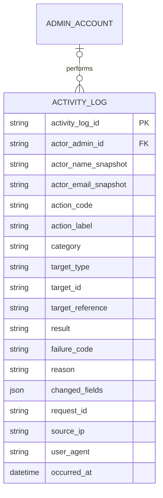

# Activity Log ERD

> **Document Type:** ERD  
> **Status:** Draft  
> **Scope:** Append-only audit events for administrative actions in JokiHub Admin Dashboard. Authentication/security telemetry that is not tied to an admin business action may use a separate security event store.

## ERD

`ACTIVITY_LOG` is an immutable event record written by backend services when an admin action is attempted or completed. `actor_admin_id` may be null for a system-initiated event or after anonymization; snapshots preserve useful audit context subject to retention/privacy policy. There is intentionally no foreign key to business targets because events may reference orders, services, users, settings, and other entities across domains, and target records may later be archived.

## Table: `activity_log`

| Column                 | Data Type                | Null | Key / Constraint                                                                           | Description                                                                                 |
| ---------------------- | ------------------------ | ---- | ------------------------------------------------------------------------------------------ | ------------------------------------------------------------------------------------------- |
| `activity_log_id`      | String, max 64           | No   | PK                                                                                         | Immutable event identifier generated by the audit service.                                  |
| `actor_admin_id`       | String, max 64           | Yes  | FK → `admin_account.admin_account_id`; nullable for system actor                           | Admin who initiated the action.                                                             |
| `actor_name_snapshot`  | String, max 150          | Yes  | —                                                                                          | Admin name when event occurred; may be null for system actor or privacy erasure.            |
| `actor_email_snapshot` | String, max 254          | Yes  | Restricted PII; retention/erasure policy required                                          | Admin email snapshot for audit display/search.                                              |
| `action_code`          | String, max 100          | No   | Stable enum/code; indexed                                                                  | Machine-readable event such as `ORDER_STATUS_UPDATED`.                                      |
| `action_label`         | String, max 200          | No   | Plain text                                                                                 | Customer/admin-facing display label such as `Mengubah status pesanan`.                      |
| `category`             | String, max 30           | No   | Proposed enum: `ORDER`, `PRODUCT`, `USER`, `CONTENT`, `SETTINGS`, `AUTH`, `ROLE`, `SYSTEM` | Stable category for filters. Keep independent from localized labels.                        |
| `target_type`          | String, max 50           | No   | —                                                                                          | Target resource type, e.g. `ORDER`, `GAME_SERVICE`, `ADMIN_ACCOUNT`.                        |
| `target_id`            | String, max 64           | Yes  | —                                                                                          | Internal target identifier. No cross-domain FK; target may be null for global actions.      |
| `target_reference`     | String, max 150          | Yes  | —                                                                                          | Human-readable target reference, e.g. order number; avoid unnecessary PII.                  |
| `result`               | String, max 20           | No   | Proposed enum: `SUCCESS`, `FAILED`                                                         | Outcome of the action attempt.                                                              |
| `failure_code`         | String, max 100          | Yes  | —                                                                                          | Safe business/technical error code for failed action; do not persist raw exception details. |
| `reason`               | String, max 500          | Yes  | Plain text, sanitized/redacted                                                             | Optional admin-supplied or system reason for action/outcome.                                |
| `changed_fields`       | JSON                     | Yes  | Allowlisted, redacted diff only                                                            | Before/after field changes for audited mutations; secrets and unnecessary PII are excluded. |
| `request_id`           | String, max 100          | Yes  | —                                                                                          | Correlation ID linking request and service logs without duplicating payload.                |
| `source_ip`            | String, max 45           | Yes  | Valid IPv4/IPv6 representation; restricted access                                          | Client IP derived only from trusted proxy configuration.                                    |
| `user_agent`           | String, max 512          | Yes  | Sanitized; retention policy required                                                       | Client agent summary for security/audit investigation.                                      |
| `occurred_at`          | Timestamp with time zone | No   | Default current UTC timestamp                                                              | Time action occurred, generated by trusted server clock.                                    |

## Indexes and Constraints

| Name                            | Columns / Rule                                         | Type                            | Purpose                                           |
| ------------------------------- | ------------------------------------------------------ | ------------------------------- | ------------------------------------------------- |
| `pk_activity_log`               | `activity_log_id`                                      | Primary key                     | Identify immutable event.                         |
| `ix_activity_log_occurred`      | `occurred_at DESC`, `activity_log_id DESC`             | Non-unique                      | Newest-first activity list and stable pagination. |
| `ix_activity_log_category_time` | `category`, `occurred_at DESC`, `activity_log_id DESC` | Non-unique                      | Category/date filtered list.                      |
| `ix_activity_log_result_time`   | `result`, `occurred_at DESC`                           | Non-unique                      | Summary and result filtering.                     |
| `ix_activity_log_actor_time`    | `actor_admin_id`, `occurred_at DESC`                   | Non-unique                      | Actor history lookup.                             |
| `ix_activity_log_target`        | `target_type`, `target_id`, `occurred_at DESC`         | Non-unique                      | Find actions for a business resource.             |
| `ix_activity_log_action_time`   | `action_code`, `occurred_at DESC`                      | Non-unique                      | Action-specific investigation.                    |
| `ix_activity_log_request_id`    | `request_id`                                           | Non-unique                      | Correlate events from one request/trace.          |
| `ck_activity_log_result`        | `result IN ('SUCCESS','FAILED')`                       | Check                           | Keep outcome values consistent.                   |
| `ck_activity_log_category`      | Category is in approved taxonomy                       | Check or application validation | Keep category filtering stable.                   |

Search indexes for actor snapshots, action label, and target reference are database-specific. Add only after query patterns and PII policy are approved. Consider a time-partitioned table for high volume; partitioning/retention depend on database engine and audit requirements.

## Relationships

| Parent          | Child          | Cardinality | Rule                                                                                                       |
| --------------- | -------------- | ----------- | ---------------------------------------------------------------------------------------------------------- |
| `admin_account` | `activity_log` | 1 to 0..N   | Admin may perform many logged actions. Actor may be null for system event or retained after anonymization. |

Targets are polymorphic references (`target_type`, `target_id`, `target_reference`) and deliberately do not use foreign keys. This avoids coupling the shared audit store to every feature schema and preserves event history when target data is deleted or archived.

## Data Rules

1. Activity events are append-only. Application consumers cannot update or delete events; retention/purge is performed by a restricted, separately audited operational process.
2. Record both successful mutations and failed admin action attempts after actor authentication/authorization. Rejected unauthenticated traffic belongs in security telemetry unless a specific policy requires an audit event.
3. Generate event ID and `occurred_at` server-side. Do not trust client-provided actor, timestamp, category, result, IP, target ID, or changed values.
4. Keep `action_code` stable and machine-readable; localized `action_label` may change without changing the event meaning.
5. Store only allowlisted before/after diffs in `changed_fields`. Always redact passwords, tokens, OTPs, payment credentials, secrets, and unnecessary customer PII.
6. `source_ip` must be derived from a trusted reverse-proxy chain; ignore arbitrary client-supplied forwarding headers.
7. Sanitize `reason`, `target_reference`, and `user_agent` for length/control characters. Render all text as escaped plain text.
8. Actor snapshots and IP/email are sensitive. Restrict read access to authorized administrators, mask where possible, and define retention/anonymization before production.
9. Business mutation and audit write should be atomic when they share a database. For a separate audit service, use a transactional outbox or durable event delivery; define fail-open/fail-closed behavior by action criticality.
10. Retries must not create duplicate audit events. Use a unique event/deduplication key or request/action identity where at-least-once delivery is possible.
11. API list filters and aggregates must use the same predicate. Default ordering is `occurred_at DESC`, then `activity_log_id DESC`.
12. `changed_fields` must not be used as an unbounded request/response dump. Enforce a payload size limit and store large evidence in a separately protected system only when required.
13. Keep audit events for a documented period based on legal, security, and operational requirements. Do not cascade-delete history when an admin account is deleted.

## Assumptions / Decisions Needed

- Table/column names, lengths, categories, action taxonomy, result codes, indexes, and retention behavior are proposals; database engine and audit platform are TBD.
- Current Activity Logs UI shows admin name/email, action, target, category, time, IP, and result. Actor ID, action code, target type/ID, request ID, failure code, and redacted field diff are proposed audit-grade additions.
- Category taxonomy extends current UI categories with `AUTH`, `ROLE`, and `SYSTEM`; confirm whether `TRANSACTION`, `PAYMENT`, `SERVICE_CATEGORY`, and `GAME` should be distinct categories or grouped under `PRODUCT`/`ORDER`.
- Confirm whether `action_label` is stored as a snapshot or generated from `action_code` at read time. Snapshot preserves wording at event time; generated labels simplify localization.
- Confirm actor snapshot PII retention, IP/user-agent access, data retention period, archive/purge workflow, and legal hold requirements.
- Confirm audit service ownership, transaction-outbox/retry behavior, event deduplication key, fail-open/fail-closed policy, pagination strategy (offset vs cursor), and search indexing.
- `actor_admin_id` references `ADMIN_ACCOUNT` in `user-management-erd.md`; reconcile its canonical definition with `role-erd.md` before implementation.

## References

- `../dashboard/activity-logs/get-list-activity-logs.md` — admin activity log list/filter contract.
- `./user-management-erd.md` — `ADMIN_ACCOUNT` actor reference.
- `./role-erd.md` — admin identity and RBAC references.
- `src/features/AdminActivityLogs/views/interfaces/admin-activity-log.interface.ts` — current UI activity fields and category labels.
- `src/features/AdminActivityLogs/views/pages/AdminActivityLogs.page.tsx` — mock events and client-side filtering.
- `src/features/AdminActivityLogs/views/templates/AdminActivityLogs.template.tsx` — activity table and visible information.
