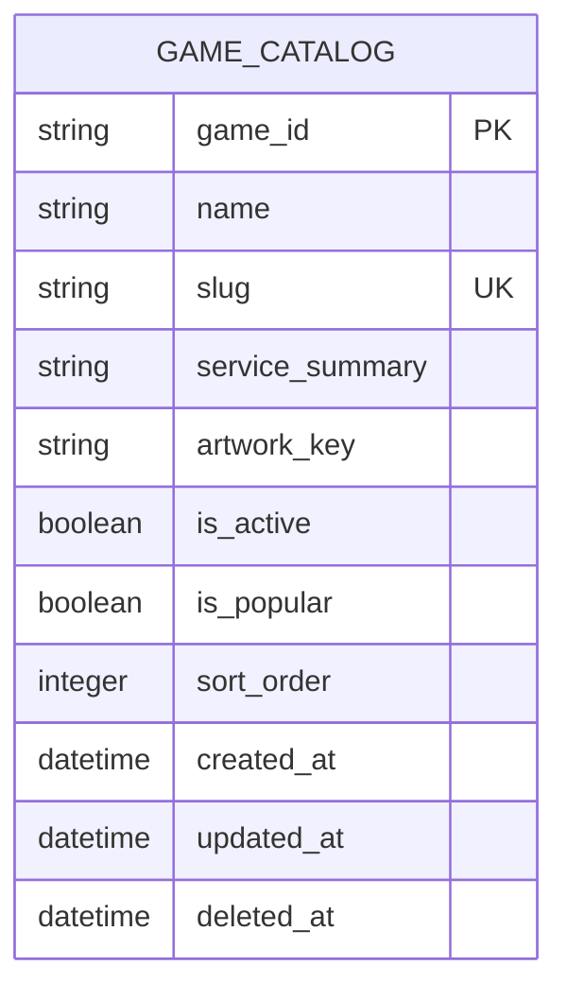

# Game ERD

> **Document Type:** ERD  
> **Status:** Draft  
> **Scope:** Data used by Admin Dashboard game create/list/update and public popular-games list.

## ERD

Current scope needs one entity only. Admin identity belongs to the authentication system and is not modeled here. Audit-event storage remains TBD; `created_at` and `updated_at` provide record timestamps, not a full change history.

## Table: `game_catalog`

| Column            | Data Type                | Null | Key / Constraint                               | Description                                                                          |
| ----------------- | ------------------------ | ---- | ---------------------------------------------- | ------------------------------------------------------------------------------------ |
| `game_id`         | String, max 64           | No   | PK                                             | Immutable identifier generated by service. Generation strategy TBD.                  |
| `name`            | String, max 100          | No   | Unique, case-insensitive after trim (proposed) | Display name used by Admin Dashboard and storefront.                                 |
| `slug`            | String, max 100          | No   | Unique                                         | Lowercase URL-safe identifier. Format: `^[a-z0-9]+(?:-[a-z0-9]+)*$`.                 |
| `service_summary` | String, max 160          | Yes  | —                                              | Short service description shown on game card.                                        |
| `artwork_key`     | String, max 160          | Yes  | —                                              | Key to approved artwork asset. Asset registry integration TBD.                       |
| `is_active`       | Boolean                  | No   | Default `false` (proposed)                     | Whether game is available in storefront.                                             |
| `is_popular`      | Boolean                  | No   | Default `false` (proposed)                     | Whether game may appear in popular-games list. Must be false when `is_active=false`. |
| `sort_order`      | Integer                  | No   | Default `0`; check `>= 0`                      | Display order; lower value appears first.                                            |
| `created_at`      | Timestamp with time zone | No   | Default current UTC timestamp                  | Record creation time. Immutable after insert.                                        |
| `updated_at`      | Timestamp with time zone | No   | Default current UTC timestamp                  | Time of most recent record update.                                                   |
| `deleted_at`      | Timestamp with time zone | Yes  | Null means available                           | Soft-delete marker; deletion preserves service and order references.                 |

## Indexes

| Index                             | Columns                                 | Type                                                 | Purpose                                                                   |
| --------------------------------- | --------------------------------------- | ---------------------------------------------------- | ------------------------------------------------------------------------- |
| `uq_game_catalog_slug`            | `slug`                                  | Unique                                               | Enforce unique game route.                                                |
| `uq_game_catalog_name_normalized` | normalized `name`                       | Unique (proposed)                                    | Prevent duplicate display names ignoring case and surrounding whitespace. |
| `ix_game_catalog_admin_list`      | `sort_order`, `name`, `game_id`         | Non-unique                                           | Support deterministic Admin Dashboard list ordering.                      |
| `ix_game_catalog_popular`         | `is_active`, `is_popular`, `sort_order` | Non-unique; partial index where supported (proposed) | Support active popular-games lookup.                                      |

## Relationships

| Parent                | Child                 | Cardinality | Rule                                                                                                            |
| --------------------- | --------------------- | ----------- | --------------------------------------------------------------------------------------------------------------- |
| None in current scope | None in current scope | —           | Game services, orders, and admin users are outside this ERD. Add foreign keys when their data model is defined. |

## Data Rules

1. `game_id` is generated by the service and never changes.
2. `name` is trimmed before storage; uniqueness is case-insensitive (proposal pending confirmation).
3. `slug` is trimmed, lowercased, and unique.
4. `is_popular=true` requires `is_active=true`.
5. `sort_order` cannot be negative.
6. `created_at` is immutable; service updates `updated_at` on every successful change.
7. Delete is soft: set `deleted_at`, deactivate game, and clear popular flag. Never cascade into services or order history.
8. Updating a game changes only supplied mutable attributes; `game_id` and `created_at` remain immutable.

## Assumptions / Decisions Needed

- Table and column names, data types, identifier generation, defaults, uniqueness, and indexes are proposed; database engine and naming convention are TBD.
- `service_summary` and `artwork_key` come from existing storefront-card needs. `mark` is excluded because there is no confirmed product requirement.
- Confirm whether game name uniqueness should be enforced case-insensitively at database level; current service checks normalized names before write.
- Create Game solutioning proposes defaults `is_active=false`, `is_popular=false`, and `sort_order=0`; confirm before schema implementation.
- Audit actor/history model is outside this ERD and remains TBD.

## References

- `docs/sprint_1/solutioning/dashboard/games/create-game.md`
- `docs/sprint_1/solutioning/dashboard/games/get-list-games.md`
- `docs/sprint_1/solutioning/dashboard/games/update-game.md`
- `docs/sprint_1/solutioning/public/games/get-popular-games.md`
