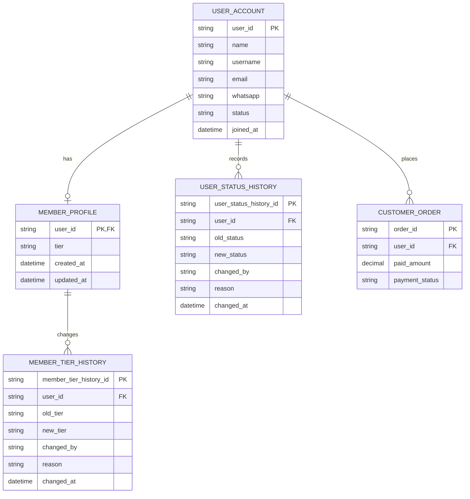

# Member ERD

> **Document Type:** ERD  
> **Status:** Draft  
> **Scope:** Member profile, membership tier/status, and member-facing administrative read model. User identity and order/payment entities remain owned by their respective ERDs.

## ERD

`USER_ACCOUNT` and `USER_STATUS_HISTORY` are defined in [User Management ERD](./user-management-erd.md). `CUSTOMER_ORDER` is a reference entity only; its full schema and relationship lifecycle must be defined in a separate Order ERD. `orderCount` and `totalSpend` are derived read values, not authoritative columns on `member_profile`.

## Table: `member_profile`

| Column       | Data Type                | Null | Key / Constraint                                        | Description                                                                                                                |
| ------------ | ------------------------ | ---- | ------------------------------------------------------- | -------------------------------------------------------------------------------------------------------------------------- |
| `user_id`    | String, max 64           | No   | PK, FK → `user_account.user_id`                         | Member identity; one-to-one profile relationship. User Management ERD currently proposes optional member profile per user. |
| `tier`       | Enum/string, max 20      | No   | Proposed values: `BRONZE`, `SILVER`, `GOLD`, `PLATINUM` | Member tier shown in Admin Dashboard. Whether manually set or computed from business rules is TBD.                         |
| `created_at` | Timestamp with time zone | No   | Default current UTC timestamp                           | Member profile creation time.                                                                                              |
| `updated_at` | Timestamp with time zone | No   | Default current UTC timestamp                           | Time of most recent profile/tier update.                                                                                   |

The current UI renders member identity fields from `USER_ACCOUNT`: `name`, `username`, `email`, `whatsapp`, `status`, and `joinedAt`. Do not duplicate those fields on `member_profile`; expose them by joining the account record.

## Derived Member Metrics

| UI Field       | Source / Calculation                                                                                                                          | Persistence Decision                                                                                                    |
| -------------- | --------------------------------------------------------------------------------------------------------------------------------------------- | ----------------------------------------------------------------------------------------------------------------------- |
| `orderCount`   | Count eligible orders for `user_id`, with eligibility determined by approved order statuses and time scope.                                   | Derived at query time or served by a maintained read model. Do not store as an independently editable member attribute. |
| `totalSpend`   | Sum of eligible paid amounts for `user_id`, with refunds, cancellations, chargebacks, and currency treatment defined by finance/order policy. | Derived at query time or served by a reconciled read model. Do not store as an authoritative member attribute.          |
| `averageSpend` | Aggregate over selected member population, as shown by the admin dashboard summary.                                                           | Dashboard aggregate; not persisted per member.                                                                          |

If these aggregates become expensive, create a separately governed member metrics projection with source watermark/reconciliation behavior. No such projection is implied by this ERD.

## Table: `member_tier_history`

| Column                   | Data Type                | Null | Key / Constraint                                          | Description                                                              |
| ------------------------ | ------------------------ | ---- | --------------------------------------------------------- | ------------------------------------------------------------------------ |
| `member_tier_history_id` | String, max 64           | No   | PK                                                        | Immutable history event ID.                                              |
| `user_id`                | String, max 64           | No   | FK → `member_profile.user_id`                             | Member whose tier changed.                                               |
| `old_tier`               | String, max 20           | Yes  | —                                                         | Previous tier; null when recording initial tier assignment.              |
| `new_tier`               | String, max 20           | No   | —                                                         | New tier after change.                                                   |
| `changed_by`             | String, max 64           | Yes  | Reference to admin identity or system actor; exact FK TBD | Actor or automated process that changed tier.                            |
| `reason`                 | String, max 500          | Yes  | —                                                         | Optional explanation; do not store secrets or unnecessary personal data. |
| `changed_at`             | Timestamp with time zone | No   | Default current UTC timestamp                             | Event time.                                                              |

Tier history is proposed because tier may be changed manually or recalculated. If tier is always derived and never persisted, remove `tier` from `member_profile` and calculate it from a versioned policy instead; do not keep competing sources of truth.

## Indexes

| Index                                | Columns                     | Type                          | Purpose                                                                                                                                                |
| ------------------------------------ | --------------------------- | ----------------------------- | ------------------------------------------------------------------------------------------------------------------------------------------------------ |
| `ix_member_profile_tier`             | `tier`, `user_id`           | Non-unique                    | Support tier filter in Admin Dashboard.                                                                                                                |
| `ix_member_tier_history_user_time`   | `user_id`, `changed_at`     | Non-unique                    | Retrieve tier change history chronologically.                                                                                                          |
| `ix_user_status_history_member_time` | `user_id`, `changed_at`     | Non-unique                    | Retrieve member block/unblock status history; table defined in User Management ERD.                                                                    |
| `ix_customer_order_member_eligible`  | `user_id`, `payment_status` | Non-unique, database-specific | Support member order/spend aggregates from qualifying orders. Exact statuses and whether separate indexes are needed depend on Order ERD and workload. |

## Relationships

| Parent           | Child                 | Cardinality | Rule                                                                                                                                                          |
| ---------------- | --------------------- | ----------- | ------------------------------------------------------------------------------------------------------------------------------------------------------------- |
| `user_account`   | `member_profile`      | 1 to 0..1   | User may have one membership profile. Confirm whether every customer account is always a member; if yes, merge profile fields into the canonical user entity. |
| `member_profile` | `member_tier_history` | 1 to 0..N   | Tier changes retain history; no cascade hard delete while retention applies.                                                                                  |
| `user_account`   | `user_status_history` | 1 to 0..N   | Block/unblock events use shared history table from User Management ERD.                                                                                       |
| `user_account`   | `customer_order`      | 1 to 0..N   | A member may place multiple orders. Order entity and status semantics belong to Order ERD.                                                                    |

## Data Rules

1. Member ID is the same immutable `user_id`; no separate member identity is generated.
2. Member profile references an existing user account. Deleting or blocking an account must not cascade-delete membership history or order records.
3. UI tier labels map to proposed stored values: Bronze=`BRONZE`, Silver=`SILVER`, Gold=`GOLD`, Platinum=`PLATINUM`.
4. Tier assignment source must be singular: manual admin assignment, spend/order-based policy, or another approved rule. If automated, store policy/version or tier history sufficient to explain changes.
5. Member status maps UI values `Aktif` and `Diblokir` to proposed `ACTIVE` and `BLOCKED`, defined by `user_account.status` in User Management ERD. Do not duplicate member status in `member_profile`.
6. Blocking a member changes account access state, not order/payment history. Treatment of active orders, refunds, and customer communications requires product and operations policy.
7. `orderCount` and `totalSpend` are derived from the order/payment source of truth. Define qualifying statuses, refunds, cancellations, chargebacks, currency, rounding, lifetime/time-window semantics, and freshness before exposing as authoritative values.
8. Tier and status mutations record actor/system source, previous value, new value, timestamp, and optional reason in history or shared audit mechanism. Mutation and history persistence must be atomic where stored together.
9. Personal data (email and WhatsApp) is exposed only to authorized admin roles and retained according to approved privacy policy.
10. Tier history and order records must follow retention policy; hard deletion of member/account rows requires an approved anonymization or retention process.

## Assumptions / Decisions Needed

- Current AdminMembers interface includes identity fields, tier, status, order count, total spend, and joined date. This ERD maps identity/status/joined date to `USER_ACCOUNT`, tier to `MEMBER_PROFILE`, and spend/order metrics to Order-derived data.
- Confirm whether `member_profile` is needed. User Management ERD models it as optional one-to-one; if all storefront users are members, merge tier into a canonical user/member table.
- Confirm whether tier is manual or computed; define thresholds, recalculation schedule, downgrade rules, exception handling, and policy version if computed.
- Confirm order statuses included in `orderCount`, financial statuses included in `totalSpend`, refund/chargeback treatment, currency, and lifetime versus period totals.
- Confirm whether values are computed live or served from a materialized/read-model projection and define acceptable freshness/reconciliation interval.
- Confirm member block/unblock semantics, active-order handling, history/audit owner, retention, and account deletion/anonymization policy.
- User Management ERD and this ERD share `USER_ACCOUNT` and `USER_STATUS_HISTORY`; maintain one canonical definition rather than creating duplicate tables.
- Order/payment model does not exist in the current solutioning folder; `CUSTOMER_ORDER` is a relationship placeholder, not a complete schema.

## References

- `./user-management-erd.md` — canonical proposed user/member account and status model.
- `./role-erd.md` — administrator role model; member roles are not defined by that ERD.
- `src/features/AdminMembers/views/interfaces/admin-member.interface.ts` — member UI data fields.
- `src/features/AdminMembers/views/pages/AdminMembers.page.tsx` — current mock data and local status behavior.
- `src/features/AdminMembers/views/templates/AdminMembers.template.tsx` — member list/detail, tier/status filters, order metrics.
