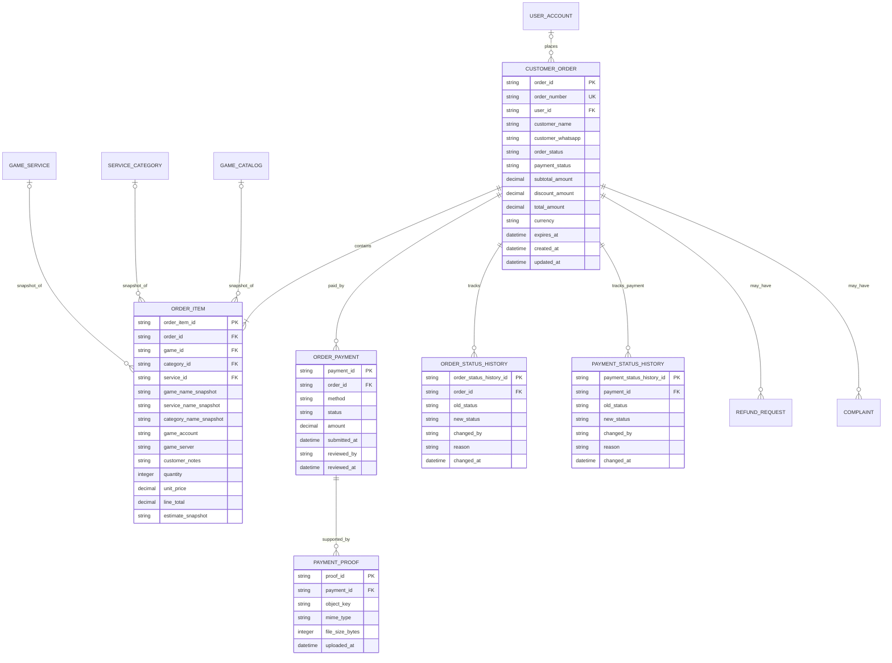

# Order ERD

> **Document Type:** ERD  
> **Status:** Draft  
> **Scope:** Customer checkout orders, item snapshots, manual QRIS/BCA payment validation, and order status history. Refund, complaint, and fulfillment details remain in their own modules and reference the order.

## ERD

`USER_ACCOUNT`, `GAME_CATALOG`, `SERVICE_CATEGORY`, and `GAME_SERVICE` are defined in their respective ERDs. Order item snapshots preserve the purchase-time display and pricing facts if catalog records change. A nullable `user_id` supports guest checkout because current checkout UI collects customer details without requiring sign-in.

## Table: `customer_order`

| Column              | Data Type                | Null | Key / Constraint                                | Description                                                                                                      |
| ------------------- | ------------------------ | ---- | ----------------------------------------------- | ---------------------------------------------------------------------------------------------------------------- |
| `order_id`          | String, max 64           | No   | PK                                              | Immutable internal identifier generated by service.                                                              |
| `order_number`      | String, max 32           | No   | Unique                                          | Customer/admin-facing reference, e.g. `JH-2026-001248`; generation and collision handling must be transactional. |
| `user_id`           | String, max 64           | Yes  | FK → `user_account.user_id`, nullable for guest | Authenticated account when linked. Do not infer/link account solely from matching email/phone.                   |
| `customer_name`     | String, max 150          | No   | —                                               | Checkout-time customer name snapshot.                                                                            |
| `customer_whatsapp` | String, max 32           | No   | —                                               | Checkout-time phone snapshot in normalized international format; used for tracking verification.                 |
| `order_status`      | Enum/string, max 30      | No   | Proposed lifecycle below                        | Fulfillment/order progress status. Separate from payment status.                                                 |
| `payment_status`    | Enum/string, max 30      | No   | Proposed lifecycle below                        | Payment state used by checkout and admin payment review.                                                         |
| `subtotal_amount`   | Decimal(18,2)            | No   | `>= 0`                                          | Sum of item line totals before discounts.                                                                        |
| `discount_amount`   | Decimal(18,2)            | No   | Default `0`; `>= 0`                             | Applied discount; promo UI is currently not integrated, so non-zero values require an approved promotion flow.   |
| `total_amount`      | Decimal(18,2)            | No   | `>= 0`                                          | Amount due after discounts, captured as order snapshot.                                                          |
| `currency`          | String, 3                | No   | ISO 4217 (proposed)                             | Currency code. Current UI implies IDR; confirm platform-wide currency.                                           |
| `expires_at`        | Timestamp with time zone | Yes  | —                                               | Payment/order expiry time; UI mock shows a 15-minute timer, but actual timeout policy is TBD.                    |
| `created_at`        | Timestamp with time zone | No   | Default current UTC timestamp                   | Order creation time.                                                                                             |
| `updated_at`        | Timestamp with time zone | No   | Default current UTC timestamp                   | Most recent order state/metadata update.                                                                         |

## Table: `order_item`

| Column                   | Data Type            | Null | Key / Constraint                                              | Description                                                                                               |
| ------------------------ | -------------------- | ---- | ------------------------------------------------------------- | --------------------------------------------------------------------------------------------------------- |
| `order_item_id`          | String, max 64       | No   | PK                                                            | Immutable order-line identifier.                                                                          |
| `order_id`               | String, max 64       | No   | FK → `customer_order.order_id`                                | Parent order.                                                                                             |
| `game_id`                | String, max 64       | Yes  | FK → `game_catalog.game_id`, restrict physical delete         | Source game reference when retained.                                                                      |
| `category_id`            | String, max 64       | Yes  | FK → `service_category.category_id`, restrict physical delete | Source category reference when retained.                                                                  |
| `service_id`             | String, max 64       | Yes  | FK → `game_service.service_id`, restrict physical delete      | Source service reference when retained.                                                                   |
| `game_name_snapshot`     | String, max 100      | No   | —                                                             | Game name at purchase time.                                                                               |
| `service_name_snapshot`  | String, max 150      | No   | —                                                             | Service name at purchase time.                                                                            |
| `category_name_snapshot` | String, max 100      | Yes  | —                                                             | Category name at purchase time.                                                                           |
| `game_account`           | String, max 150      | No   | —                                                             | Username/user ID entered for fulfillment. Never store game password or OTP.                               |
| `game_server`            | String, max 100      | Yes  | —                                                             | Game server/region supplied at checkout.                                                                  |
| `customer_notes`         | Text, max length TBD | Yes  | —                                                             | Additional fulfillment instructions. Define limits and retention.                                         |
| `quantity`               | Integer              | No   | `>= 1`                                                        | Requested quantity.                                                                                       |
| `unit_price`             | Decimal(18,2)        | Yes  | `>= 0` when present                                           | Price snapshot. Null is allowed only for quote/custom-priced orders and requires separate quote workflow. |
| `line_total`             | Decimal(18,2)        | Yes  | `>= 0` when present                                           | `unit_price * quantity` snapshot; null for quote-required items until accepted quote is modeled.          |
| `estimate_snapshot`      | String, max 100      | No   | —                                                             | Display estimate captured at purchase time; not a delivery guarantee.                                     |

Current checkout UI selects one game/service and quantity, but the normalized model permits multiple lines per order. Confirm whether MVP should enforce exactly one `order_item` per order.

## Table: `order_payment`

| Column           | Data Type                | Null | Key / Constraint                          | Description                                                                                                                     |
| ---------------- | ------------------------ | ---- | ----------------------------------------- | ------------------------------------------------------------------------------------------------------------------------------- |
| `payment_id`     | String, max 64           | No   | PK                                        | Immutable payment attempt identifier.                                                                                           |
| `order_id`       | String, max 64           | No   | FK → `customer_order.order_id`            | Order being paid.                                                                                                               |
| `method`         | Enum/string, max 30      | No   | Proposed `QRIS` or `BCA_TRANSFER`         | Payment method selected by customer. Initial scope supports manual validation only.                                             |
| `status`         | Enum/string, max 30      | No   | Proposed payment lifecycle below          | Payment attempt state.                                                                                                          |
| `amount`         | Decimal(18,2)            | No   | `>= 0`                                    | Amount submitted/expected for this payment attempt. Must agree with payable order amount under approved partial-payment policy. |
| `reference_note` | String, max 100          | Yes  | —                                         | Optional transfer reference entered by customer; do not store sensitive banking credentials.                                    |
| `submitted_at`   | Timestamp with time zone | Yes  | —                                         | Time customer submits proof for manual validation.                                                                              |
| `reviewed_by`    | String, max 64           | Yes  | Reference to admin identity, if available | Administrator who approved/rejected proof.                                                                                      |
| `reviewed_at`    | Timestamp with time zone | Yes  | —                                         | Manual review timestamp.                                                                                                        |
| `review_note`    | String, max 500          | Yes  | —                                         | Safe review explanation. PII/secret policy applies.                                                                             |
| `created_at`     | Timestamp with time zone | No   | Default current UTC timestamp             | Payment attempt creation time.                                                                                                  |
| `updated_at`     | Timestamp with time zone | No   | Default current UTC timestamp             | Most recent payment attempt change.                                                                                             |

The UI currently supports QRIS and manual BCA transfer, with proof upload and admin validation. Provider transaction IDs, virtual accounts, settlement callbacks, and automated payment status are out of current scope.

## Table: `payment_proof`

| Column            | Data Type                | Null | Key / Constraint                       | Description                                                                                      |
| ----------------- | ------------------------ | ---- | -------------------------------------- | ------------------------------------------------------------------------------------------------ |
| `proof_id`        | String, max 64           | No   | PK                                     | Immutable proof submission identifier.                                                           |
| `payment_id`      | String, max 64           | No   | FK → `order_payment.payment_id`        | Payment attempt supported by this file.                                                          |
| `object_key`      | String, max 512          | No   | Unique                                 | Private object-storage key. Do not store raw image bytes in relational row or expose public URL. |
| `mime_type`       | String, max 100          | No   | Allowlist TBD                          | Uploaded media type validated against file signature and policy.                                 |
| `file_size_bytes` | Integer                  | No   | `> 0`; max TBD                         | Uploaded proof size.                                                                             |
| `uploaded_at`     | Timestamp with time zone | No   | Default current UTC timestamp          | Upload time.                                                                                     |
| `uploaded_by`     | String, max 64           | Yes  | User/account reference where available | Uploader identity; guest flow may require a separate safe identifier.                            |

Multiple proof records preserve resubmission history. File retention, malware scanning, allowed formats/size, and replacement policy are TBD.

## Status Lifecycles

### Order status (`order_status`)

| Status               | Meaning                                                         |
| -------------------- | --------------------------------------------------------------- |
| `PENDING_PAYMENT`    | Order created; customer has not submitted payment proof.        |
| `PENDING_VALIDATION` | Proof submitted; awaiting manual administrator review.          |
| `PROCESSING`         | Payment accepted and fulfillment is in progress.                |
| `COMPLETED`          | Fulfillment is complete.                                        |
| `CANCELLED`          | Order cancelled or expired under an approved cancellation rule. |

Proposed transitions: `PENDING_PAYMENT → PENDING_VALIDATION → PROCESSING → COMPLETED`; cancellation/expiry may move eligible pre-completion orders to `CANCELLED`. Rejection/resubmission behavior and post-processing cancellation need product/operations approval.

### Payment status (`payment_status` / `order_payment.status`)

| Status           | Meaning                                                      |
| ---------------- | ------------------------------------------------------------ |
| `UNPAID`         | No proof has been submitted.                                 |
| `PENDING_REVIEW` | Payment proof awaits manual validation.                      |
| `PAID`           | Administrator accepted proof and confirmed payment manually. |
| `REJECTED`       | Submitted proof was rejected; resubmission policy applies.   |
| `FAILED`         | Payment attempt failed or expired.                           |

UI labels map approximately as follows: `Belum Dibayar` → `UNPAID`, `Menunggu Validasi` → `PENDING_REVIEW`, `Dibayar` → `PAID`, `Gagal` → `FAILED` or `REJECTED` depending reason. Keep rejected proof distinguishable from technical/payment failure in persisted state.

## Tables: Status History

### `order_status_history`

| Column                    | Data Type                | Null | Key / Constraint                      | Description                                      |
| ------------------------- | ------------------------ | ---- | ------------------------------------- | ------------------------------------------------ |
| `order_status_history_id` | String, max 64           | No   | PK                                    | Immutable event identifier.                      |
| `order_id`                | String, max 64           | No   | FK → `customer_order.order_id`        | Order whose status changed.                      |
| `old_status`              | String, max 30           | Yes  | —                                     | Previous state; null for initial creation event. |
| `new_status`              | String, max 30           | No   | —                                     | State after transition.                          |
| `changed_by`              | String, max 64           | Yes  | User/admin/system actor reference TBD | Actor initiating the change.                     |
| `reason`                  | String, max 500          | Yes  | —                                     | Optional transition reason.                      |
| `changed_at`              | Timestamp with time zone | No   | Default current UTC timestamp         | Transition time.                                 |

### `payment_status_history`

| Column                      | Data Type                | Null | Key / Constraint                      | Description                           |
| --------------------------- | ------------------------ | ---- | ------------------------------------- | ------------------------------------- |
| `payment_status_history_id` | String, max 64           | No   | PK                                    | Immutable event identifier.           |
| `payment_id`                | String, max 64           | No   | FK → `order_payment.payment_id`       | Payment attempt whose state changed.  |
| `old_status`                | String, max 30           | Yes  | —                                     | Previous payment state.               |
| `new_status`                | String, max 30           | No   | —                                     | Payment state after transition.       |
| `changed_by`                | String, max 64           | Yes  | User/admin/system actor reference TBD | Actor initiating the change.          |
| `reason`                    | String, max 500          | Yes  | —                                     | Optional review or transition reason. |
| `changed_at`                | Timestamp with time zone | No   | Default current UTC timestamp         | Transition time.                      |

History and primary state updates must commit atomically. The platform activity log may additionally record detailed before/after audit events; retention ownership is TBD.

## Indexes

| Index                                    | Columns                                        | Type       | Purpose                                                                                   |
| ---------------------------------------- | ---------------------------------------------- | ---------- | ----------------------------------------------------------------------------------------- |
| `uq_customer_order_number`               | `order_number`                                 | Unique     | Resolve customer tracking number and admin order reference.                               |
| `ix_customer_order_status_created`       | `order_status`, `created_at`, `order_id`       | Non-unique | Support admin status filtering and newest-first list.                                     |
| `ix_customer_order_payment_status`       | `payment_status`, `created_at`                 | Non-unique | Find orders needing manual payment action.                                                |
| `ix_customer_order_user_created`         | `user_id`, `created_at`                        | Non-unique | List orders for signed-in user/member.                                                    |
| `ix_customer_order_phone_number`         | normalized `customer_whatsapp`, `order_number` | Non-unique | Support order lookup after both order number and WhatsApp are verified; apply throttling. |
| `ix_order_item_order`                    | `order_id`, `order_item_id`                    | Non-unique | Fetch order items in stable order.                                                        |
| `ix_order_item_service`                  | `service_id`                                   | Non-unique | Catalog reference and historical sales analysis.                                          |
| `ix_order_payment_order_status`          | `order_id`, `status`, `created_at`             | Non-unique | Resolve active/latest payment attempt and review queue.                                   |
| `ix_payment_proof_payment_uploaded`      | `payment_id`, `uploaded_at`                    | Non-unique | Retrieve proof submissions by attempt/time.                                               |
| `ix_order_status_history_order_time`     | `order_id`, `changed_at`                       | Non-unique | Render order tracking timeline and audit transitions.                                     |
| `ix_payment_status_history_payment_time` | `payment_id`, `changed_at`                     | Non-unique | Audit manual payment review lifecycle.                                                    |

## Relationships

| Parent             | Child                    | Cardinality                            | Rule                                                                                                                                                               |
| ------------------ | ------------------------ | -------------------------------------- | ------------------------------------------------------------------------------------------------------------------------------------------------------------------ |
| `user_account`     | `customer_order`         | 1 to 0..N; order FK optional           | Signed-in user may have many orders; guest orders have null `user_id` and retain customer snapshots.                                                               |
| `customer_order`   | `order_item`             | 1 to 1..N                              | Every created order must contain one or more item snapshots.                                                                                                       |
| `customer_order`   | `order_payment`          | 1 to 0..N                              | An order may have payment attempts/resubmissions. Exactly one accepted payment should satisfy payable amount unless partial/multi-payment is explicitly supported. |
| `order_payment`    | `payment_proof`          | 1 to 0..N                              | Payment attempt may have multiple proof submissions; review decision applies to a specific submitted proof/attempt.                                                |
| `customer_order`   | `order_status_history`   | 1 to 0..N                              | Preserve each order transition.                                                                                                                                    |
| `order_payment`    | `payment_status_history` | 1 to 0..N                              | Preserve payment attempt transitions and reviewer decisions.                                                                                                       |
| `game_catalog`     | `order_item`             | 1 to 0..N; nullable reference proposed | Snapshots preserve history if referenced catalog entities are archived.                                                                                            |
| `game_service`     | `order_item`             | 1 to 0..N; nullable reference proposed | Do not hard-delete catalog service while referenced; snapshot is historical source.                                                                                |
| `service_category` | `order_item`             | 1 to 0..N; nullable reference proposed | Category snapshot preserves purchase-time classification.                                                                                                          |
| `customer_order`   | Refund module            | 1 to 0..N                              | Refund requests reference order; exact table and cardinality belong in Refund ERD.                                                                                 |
| `customer_order`   | Complaint module         | 1 to 0..N                              | Complaints reference order; exact table belongs in Complaint ERD.                                                                                                  |

## Data Rules

1. Create order, item snapshot(s), initial order status history, and initial payment attempt must be one database transaction; no partially-created payable order.
2. Server recalculates item price, quantity, fees, discounts, and total from authoritative catalog/promotion data. Client totals are display-only.
3. Store the purchase-time price and descriptive snapshots on `order_item`; future catalog edits must not change historical order amount or labels.
4. Quantity must be at least one. Fixed-price items require non-negative unit and line totals. Quote/custom-priced order requires an explicit quote acceptance and final amount before payment; quote flow is not modeled in current UI.
5. Currency is stored explicitly on order and payment amounts use the same currency. FX/multi-currency conversion is outside current scope.
6. Never collect/store game account passwords, OTPs, raw card data, or banking credentials. Store only account identifiers and fulfillment notes necessary to process the order.
7. Customer name and WhatsApp are checkout-time snapshots even when `user_id` is linked, preserving the contact used for the specific order.
8. Payment methods in current scope are manual `QRIS` and `BCA_TRANSFER`. QR image and BCA account destination are configuration/reference data, not customer-order columns; payment proof file bytes live in private object storage.
9. Payment status and order/fulfillment status are separate. Transition validation must prevent `PROCESSING` before payment is accepted, except for an explicitly approved no-payment/quote workflow.
10. Manual payment approval/rejection records reviewer identity, decision, timestamp, and reason. Approved payment and resulting order transition must be atomic or recoverably coordinated.
11. Public tracking requires both order number and matching WhatsApp verification, with rate limiting and enumeration protection. Store phone normalized; mask it in responses/logs.
12. A submitted payment proof is untrusted input. Enforce file allowlist, signature validation, size limit, malware scanning policy, private storage, and time-limited authorized access. Exact controls/retention TBD.
13. Expiration, cancellation, payment rejection/resubmission, duplicate proof submission, and idempotency rules require explicit product/operations policy. UI countdown alone is not an authoritative timeout.
14. Keep order, item, payment, proof metadata, and status history according to financial/legal retention. Prefer restricted/anonymized PII where permitted; do not cascade-delete historical orders.
15. Refunds and complaints reference `order_id`; they must not rewrite original order/payment facts. Refund settlement and complaint messages require separate entities and ERDs.

## Assumptions / Decisions Needed

- Schema is proposed from the current Admin Orders, Checkout, Payment, Payment Success, and Order Tracking UIs; there is no approved backend order contract in `docs/sprint_1/solutioning`.
- Confirm guest checkout versus mandatory account. Current checkout form does not require sign-in, so `user_id` is nullable and customer details are snapshotted.
- Confirm one order item per order for MVP versus multi-line order support. Current UI selects one service but quantity may exceed one.
- Confirm order number format/sequence, status transitions, cancellation/expiry window, proof rejection/resubmission, and whether an order may have multiple payment attempts or partial payments.
- Confirm payment method codes, QRIS/BCA destination configuration ownership, payment-proof file constraints and retention, manual reviewer permissions, and reviewer audit requirements.
- Confirm IDR-only currency assumption, fees/discounts/tax/refund treatment, fixed-price versus custom quote flow, and price snapshot precision.
- Define user, game, category, service, refund, and complaint FK policies plus order snapshot retention in their canonical ERDs.
- Define order tracking lookup protections, phone normalization, throttling, PII masking, and data retention.
- Define fulfillment inputs allowed for each service. Current UI collects game account ID, optional server, and notes; password/OTP collection is prohibited by project guidance.
- Status history and payment-proof metadata are included as proposals. Confirm shared activity log, audit store, and object-storage services as sources of record.

## References

- `src/features/AdminOrders/views/interfaces/admin-order.interface.ts` — admin order and payment UI status values.
- `src/features/AdminOrders/views/pages/AdminOrders.page.tsx` — mock order fields and payment methods.
- `src/features/Checkout/views/organisms/OrderDetailsForm.organism.tsx` — customer contact, game account ID, server, and notes fields.
- `src/features/Checkout/views/organisms/OrderSummary.organism.tsx` — service, quantity, price, estimate, and total display.
- `src/features/Checkout/views/organisms/PaymentStep.organism.tsx` — QRIS/BCA manual payment options, proof upload, and countdown UI.
- `src/features/Checkout/views/organisms/PaymentSuccess.organism.tsx` — simulated submission and manual validation status.
- `src/features/OrderTracking/views/pages/OrderTracking.page.tsx` — order number plus WhatsApp tracking lookup.
- `src/features/OrderTracking/views/pages/OrderTrackingResult.page.tsx` — tracking timeline and displayed state.
- `src/features/AdminRefunds/views/interfaces/admin-refund.interface.ts` — refund order reference and review state.
- `src/features/AdminComplaints/views/interfaces/admin-complaint.interface.ts` — complaint order reference and conversation state.
- `./user-management-erd.md` — user account reference.
- `./game-erd.md` — game catalog reference.
- `./service-category-erd.md` — category reference.
- `./service-erd.md` — service and catalog price reference.
