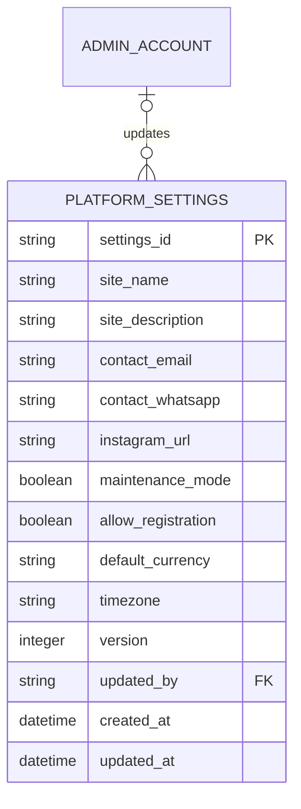

# Platform Settings ERD

> **Document Type:** ERD  
> **Status:** Draft  
> **Scope:** General platform settings managed from Admin Dashboard and consumed by the public storefront. Payment secrets, provider credentials, and full audit history are out of scope.

## ERD

`PLATFORM_SETTINGS` stores the current general-settings snapshot. The proposed singleton rule allows exactly one active row for the platform; `settings_id` may use a fixed key such as `default`. Every successful update increments `version` and updates `updated_by` and `updated_at`. Detailed before/after history belongs in the shared audit log, not duplicated as rows in this table.

`ADMIN_ACCOUNT` is defined in [User Management ERD](./user-management-erd.md). `updated_by` is nullable for bootstrap/system-managed configuration and references the admin actor for interactive updates. If audit retention requires the actor record to survive account deletion, retain the immutable actor ID in the audit store independently.

## Table: `platform_settings`

| Column               | Data Type                | Null | Key / Constraint                               | Description                                                                     |
| -------------------- | ------------------------ | ---- | ---------------------------------------------- | ------------------------------------------------------------------------------- |
| `settings_id`        | String, max 32           | No   | PK; singleton value proposed as `default`      | Stable identifier for the platform's current general settings.                  |
| `site_name`          | String, max 100          | No   | Trimmed; non-empty                             | Public platform name.                                                           |
| `site_description`   | String, max 500          | Yes  | —                                              | Public description, stored as plain text.                                       |
| `contact_email`      | String, max 254          | No   | Valid email format (application validation)    | Public support email.                                                           |
| `contact_whatsapp`   | String, max 16           | No   | E.164 proposed; application validation         | Public support WhatsApp number.                                                 |
| `instagram_url`      | String, max 2048         | Yes  | HTTPS URL and allowed host validation          | Optional public Instagram profile URL.                                          |
| `maintenance_mode`   | Boolean                  | No   | Default `false`                                | Whether public storefront is in maintenance mode.                               |
| `allow_registration` | Boolean                  | No   | Default `true`                                 | Whether public member registration is enabled; does not control admin creation. |
| `default_currency`   | String, length 3         | No   | ISO 4217 proposed; current allowed value `IDR` | Default storefront currency.                                                    |
| `timezone`           | String, max 64           | No   | IANA timezone allowlist                        | Platform display/reporting timezone.                                            |
| `version`            | Integer                  | No   | Default `1`; check `>= 1`                      | Incrementing configuration version for optimistic concurrency/cache keys.       |
| `updated_by`         | String, max 64           | Yes  | FK → `admin_account.admin_account_id`          | Admin actor for most recent interactive update; null for bootstrap/system.      |
| `created_at`         | Timestamp with time zone | No   | Default current UTC timestamp                  | Time singleton settings row was initialized. Immutable.                         |
| `updated_at`         | Timestamp with time zone | No   | Default current UTC timestamp                  | Time of most recent successful update in UTC.                                   |

## Constraints and Indexes

| Name                             | Columns / Rule                    | Type                         | Purpose                                      |
| -------------------------------- | --------------------------------- | ---------------------------- | -------------------------------------------- |
| `pk_platform_settings`           | `settings_id`                     | Primary key                  | Identify the settings snapshot.              |
| `ck_platform_settings_singleton` | Only one row is permitted         | Singleton/check or fixed-key | Enforce one current general-settings record. |
| `ck_platform_settings_version`   | `version >= 1`                    | Check                        | Prevent invalid version values.              |
| `fk_settings_updated_by`         | `updated_by` → `admin_account_id` | Foreign key, nullable        | Link current updater when actor is an admin. |
| `ix_platform_settings_updated`   | `updated_at DESC`                 | Non-unique                   | Operational lookup and freshness monitoring. |

The exact singleton implementation depends on the database engine. A fixed primary key (`settings_id='default'`) is portable and prevents multiple rows without a separate singleton table. Do not add a unique index to every setting field.

## Relationships

| Parent          | Child               | Cardinality               | Rule                                                                                           |
| --------------- | ------------------- | ------------------------- | ---------------------------------------------------------------------------------------------- |
| `admin_account` | `platform_settings` | 1 to 0..N historical refs | Current row references its most recent admin updater; history/previous actors belong in audit. |

The conceptual current-state relationship is many admins may update the singleton over time, while the row retains only the latest `updated_by`. Audit history must preserve prior actors separately.

## Data Rules

1. Bootstrap exactly one row with approved initial values before serving settings reads. UI mock values are not production defaults unless explicitly confirmed by the business.
2. `site_name` is trimmed and non-empty. Display fields are plain text; HTML is escaped by consumers at render time.
3. `contact_email` must pass email validation. `contact_whatsapp` is normalized to the agreed international format; proposed format is E.164.
4. `instagram_url` may be null. If present, require HTTPS and an allowlisted host; do not permit arbitrary active content or URL schemes.
5. `maintenance_mode` and `allow_registration` are booleans. Disabling registration affects member sign-up only and must not block admin account provisioning or existing authentication.
6. `default_currency` currently supports `IDR` only. Add currencies only after price, rounding, payment, and reporting contracts support them.
7. `timezone` must be a valid IANA value in the approved allowlist. Current UI proposes `Asia/Jakarta`, `Asia/Makassar`, and `Asia/Jayapura`.
8. Updates replace the full mutable settings snapshot in one transaction. Increment `version` exactly once and set `updated_at`/`updated_by` on successful commit.
9. Use `version` or an ETag/If-Match value to reject stale updates. A stale write must not silently overwrite another administrator's changes.
10. Store only public contact/configuration values here. Do not store SMTP passwords, API keys, payment provider secrets, access tokens, or other credentials in this table.
11. Persist settings and audit event atomically where possible. If the audit system is separate, use a durable outbox or equivalent so successful writes cannot silently lose audit records.
12. After commit, publish/invalidate storefront configuration cache using the new `version`. Persistence success and propagation status are distinct; retry propagation without reverting a committed settings row.
13. Settings read APIs should return `version` and `updated_at` so clients/cache can perform concurrency and freshness checks.
14. Database credentials and row access are restricted to settings services. Public consumers receive only fields they need; `updated_by` is admin-only metadata.
15. Detailed change history, changed-field diff, request correlation ID, IP, actor, and retention are owned by the shared audit log. Never place secrets or unnecessary PII in audit diffs.

## Assumptions / Decisions Needed

- Table/column names, types, constraints, singleton strategy, defaults, and index are proposed from `AdminSettings` UI and `general-settings.md`; database engine and naming standards are TBD.
- The proposed singleton stores one platform-wide configuration. Multi-tenant or per-brand settings would require a tenant/brand key and revised cardinality.
- Confirm bootstrap values; UI's current initial values are demonstration data and should not be treated as approved production contact details.
- Confirm whether `default_currency` is persisted here or owned by a dedicated commerce/finance configuration service.
- Confirm timezone's effect: display/reporting preference versus business-operation timezone. Timestamps remain stored in UTC regardless.
- Confirm if Instagram must be configurable or if more social/contact fields are required.
- Define shared audit table/service, retention, actor deletion policy, cache invalidation mechanism, propagation SLA, and settings permission names.
- Current Settings ERD contains only general settings. Payment destination accounts, QRIS assets, fee rules, promo, SEO, banners, and provider credentials require separate domain/config models.

## References

- `docs/sprint_1/dashboard/settings/general-settings.md` — general-settings API contract and field validation proposal.
- `src/features/AdminSettings/views/interfaces/admin-settings.interface.ts` — current settings UI fields.
- `src/features/AdminSettings/views/templates/AdminSettings.template.tsx` — settings sections and controls.
- `src/features/AdminSettings/views/pages/AdminSettings.page.tsx` — demo defaults and session-only save behavior.
- `./user-management-erd.md` — `ADMIN_ACCOUNT` actor reference.
