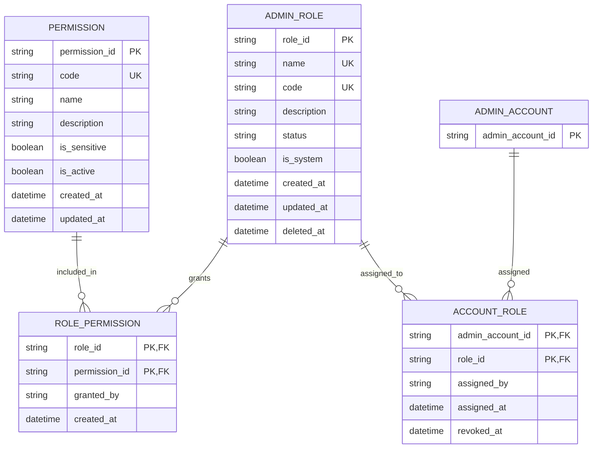

# Role ERD

> **Document Type:** ERD  
> **Status:** Draft  
> **Scope:** Role definitions, permission catalog, role-permission grants, and account-role assignments required by Admin Dashboard Account & Role Management APIs.

## ERD

This is a proposed authorization model. `ADMIN_ACCOUNT` is a reference entity owned by the admin identity model; only its identifier is shown here. Confirm whether admin and customer accounts share one account table before implementation. Audit event history remains outside this ERD; relationship timestamps and actor fields are not a substitute for a complete audit log.

## Table: `admin_role`

| Column        | Data Type                | Null | Key / Constraint                                                                | Description                                                                                                             |
| ------------- | ------------------------ | ---- | ------------------------------------------------------------------------------- | ----------------------------------------------------------------------------------------------------------------------- |
| `role_id`     | String, max 64           | No   | PK                                                                              | Immutable role identifier generated by service; generation strategy TBD.                                                |
| `name`        | String, max 100          | No   | Unique among non-deleted roles, case-insensitive after trim (proposed)          | Display name used in Admin Dashboard.                                                                                   |
| `code`        | String, max 50           | No   | Unique among non-deleted roles; uppercase format `^[A-Z][A-Z0-9_]*$` (proposed) | Stable machine-readable role code.                                                                                      |
| `description` | String, max 500          | Yes  | —                                                                               | Role purpose and scope.                                                                                                 |
| `status`      | Enum/string, max 20      | No   | `ACTIVE` or `INACTIVE` (proposed)                                               | Controls whether role can be assigned or used for authorization. Exact lifecycle semantics TBD.                         |
| `is_system`   | Boolean                  | No   | Default `false` (proposed)                                                      | Marks built-in/protected role that regular role-management APIs cannot update/delete. Owner and bootstrap behavior TBD. |
| `created_at`  | Timestamp with time zone | No   | Default current UTC timestamp                                                   | Creation time; immutable after insert.                                                                                  |
| `updated_at`  | Timestamp with time zone | No   | Default current UTC timestamp                                                   | Time of most recent change.                                                                                             |
| `deleted_at`  | Timestamp with time zone | Yes  | Null means not soft-deleted                                                     | Soft-delete timestamp. Retention and restore policy TBD.                                                                |

## Table: `permission`

| Column          | Data Type                | Null | Key / Constraint              | Description                                                                                                              |
| --------------- | ------------------------ | ---- | ----------------------------- | ------------------------------------------------------------------------------------------------------------------------ |
| `permission_id` | String, max 64           | No   | PK                            | Immutable permission identifier.                                                                                         |
| `code`          | String, max 120          | No   | Unique                        | Stable permission key consumed by authorization checks, e.g. `admin.orders.read`. Naming convention and granularity TBD. |
| `name`          | String, max 100          | No   | —                             | Human-readable permission name.                                                                                          |
| `description`   | String, max 500          | Yes  | —                             | Explanation of capability granted.                                                                                       |
| `is_sensitive`  | Boolean                  | No   | Default `false` (proposed)    | Indicates permission requires additional delegation/visibility control. Classification policy TBD.                       |
| `is_active`     | Boolean                  | No   | Default `true` (proposed)     | Whether permission can be granted to roles. Deactivation behavior for existing grants TBD.                               |
| `created_at`    | Timestamp with time zone | No   | Default current UTC timestamp | Permission creation time.                                                                                                |
| `updated_at`    | Timestamp with time zone | No   | Default current UTC timestamp | Time of most recent permission metadata change.                                                                          |

Permission catalog ownership (code-managed vs database-managed), seed process, and who may add or deactivate permissions are TBD. Permission definitions should not be user-created through role CRUD APIs.

## Table: `role_permission`

| Column          | Data Type                | Null | Key / Constraint                             | Description                               |
| --------------- | ------------------------ | ---- | -------------------------------------------- | ----------------------------------------- |
| `role_id`       | String, max 64           | No   | PK, FK → `admin_role.role_id`                | Role receiving the grant.                 |
| `permission_id` | String, max 64           | No   | PK, FK → `permission.permission_id`          | Permission granted to role.               |
| `granted_by`    | String, max 64           | Yes  | FK/reference to admin identity, if available | Administrator who granted the permission. |
| `created_at`    | Timestamp with time zone | No   | Default current UTC timestamp                | Time of grant.                            |

The composite primary key prevents duplicate grants for the same role and permission. Updating role permissions replaces grants transactionally under the current update-role proposal; a full grant/revoke audit trail requires a separate audit-event store.

## Table: `account_role`

| Column             | Data Type                | Null | Key / Constraint                             | Description                                                                                   |
| ------------------ | ------------------------ | ---- | -------------------------------------------- | --------------------------------------------------------------------------------------------- |
| `admin_account_id` | String, max 64           | No   | PK, FK → admin identity account              | Administrator receiving role. Confirm whether customer accounts may also receive admin roles. |
| `role_id`          | String, max 64           | No   | PK, FK → `admin_role.role_id`                | Assigned role.                                                                                |
| `assigned_by`      | String, max 64           | Yes  | FK/reference to admin identity, if available | Administrator who made assignment.                                                            |
| `assigned_at`      | Timestamp with time zone | No   | Default current UTC timestamp                | Time role was assigned.                                                                       |
| `revoked_at`       | Timestamp with time zone | Yes  | Null means assignment active                 | Time assignment was revoked; preserves assignment history.                                    |

Only one active assignment for a given account-role pair is allowed at a time. Database-specific partial unique index or transactional enforcement is required. Whether multiple simultaneous roles per account are supported is proposed as yes and needs confirmation.

## Indexes

| Index                           | Columns                       | Type                                                      | Purpose                                                                                          |
| ------------------------------- | ----------------------------- | --------------------------------------------------------- | ------------------------------------------------------------------------------------------------ |
| `uq_admin_role_name_active`     | normalized `name`             | Unique, partial where `deleted_at IS NULL` (proposed)     | Prevent duplicate active role names while permitting reuse after soft delete if policy approves. |
| `uq_admin_role_code_active`     | normalized `code`             | Unique, partial where `deleted_at IS NULL` (proposed)     | Prevent duplicate active role codes. Reuse after delete needs approval.                          |
| `ix_admin_role_list`            | `status`, `name`, `role_id`   | Non-unique; partial where `deleted_at IS NULL` (proposed) | Support filtered and deterministic role listing.                                                 |
| `uq_permission_code`            | `code`                        | Unique                                                    | Ensure permission code identifies exactly one permission.                                        |
| `ix_permission_active_code`     | `is_active`, `code`           | Non-unique                                                | Resolve assignable permissions.                                                                  |
| `ix_role_permission_permission` | `permission_id`, `role_id`    | Non-unique                                                | Find roles granted a permission and support permission lifecycle checks.                         |
| `uq_account_role_active`        | `admin_account_id`, `role_id` | Unique, partial where `revoked_at IS NULL` (proposed)     | Prevent duplicate active assignments.                                                            |
| `ix_account_role_role_active`   | `role_id`, `admin_account_id` | Non-unique, partial where `revoked_at IS NULL` (proposed) | Check assignments before role deactivation or deletion.                                          |

## Relationships

| Parent                 | Child             | Cardinality | Rule                                                                                                                                                   |
| ---------------------- | ----------------- | ----------- | ------------------------------------------------------------------------------------------------------------------------------------------------------ |
| `admin_role`           | `role_permission` | 1 to 0..N   | Role may grant multiple permissions. Soft-deleting role must not hard-delete grant history automatically.                                              |
| `permission`           | `role_permission` | 1 to 0..N   | Permission may be granted to multiple roles. Permission deletion is outside role CRUD; prefer deactivation and retain referenced rows.                 |
| Admin identity account | `account_role`    | 1 to 0..N   | Account may hold multiple roles under proposed RBAC model.                                                                                             |
| `admin_role`           | `account_role`    | 1 to 0..N   | Role may be assigned to multiple accounts. Role deletion/deactivation is blocked while active assignments exist unless approved migration is provided. |

## Data Rules

1. `role_id` and `permission_id` are immutable, service-managed identifiers.
2. Role `name` is trimmed; uniqueness is case-insensitive among non-deleted roles (proposed).
3. Role `code` is normalized uppercase and unique among non-deleted roles (proposed); code format is `^[A-Z][A-Z0-9_]*$`.
4. `status` is proposed as `ACTIVE` or `INACTIVE`. Inactive roles cannot be newly assigned or used to grant authorization. Existing assignment behavior on deactivation must be confirmed; current API solutioning proposes rejecting deactivation while active assignments remain.
5. `is_system=true` identifies built-in/protected roles. Create/update/delete APIs cannot modify protected roles except for explicitly approved fields and actors.
6. A role can contain multiple permission grants; duplicate `(role_id, permission_id)` is prohibited.
7. Only active permissions may be added to a role. Permission IDs must come from the controlled catalog and must be within the caller's delegated authority.
8. Role permission replacement must be atomic: either all requested grants are stored or none are.
9. Soft delete sets `admin_role.deleted_at`; soft-deleted roles are excluded from role list and detail by default, cannot receive new assignments, and cannot authorize requests. Restore is a separately authorized operation if supported.
10. Role deletion is rejected while active account assignments exist. No cascade deletion of accounts, permission records, assignments, or audit events.
11. Revoking an account-role assignment sets `revoked_at`; it does not erase historical assignment data.
12. Role metadata uses UTC timestamps. Every mutation records actor, action, target role, and time in an audit mechanism; this ERD stores only grant/assignment attribution, not full before/after audit history.
13. Permission changes must propagate to authorization checks through cache invalidation or another approved consistency mechanism. Propagation target and session refresh behavior TBD.

## Assumptions / Decisions Needed

- Table names, columns, types, indexes, and `ROL` API model are proposals; database engine and physical naming conventions are TBD.
- Confirm whether account-role management applies only to administrator accounts or also customer/member accounts. If admin identities live in an external IdP, decide whether `ADMIN_ACCOUNT` remains a local reference table or is replaced by an external subject identifier.
- Confirm whether permission catalog is maintained in code/configuration or in the database, and whether permission rows need localized display names.
- Confirm role status lifecycle, role system/protected marker, soft-delete policy, uniqueness reuse after delete, restore policy, and behavior of assignments when role becomes inactive.
- Confirm whether all administrators can see all permissions or only delegated subsets; define high-risk permission classification and delegation safeguards.
- Confirm whether a role with zero permissions is allowed. Current create-role contract proposes at least one permission.
- Confirm audit event store, actor FK, retention, and immutable history requirements.
- Current `get-list-roles.md`, `get-detail-role.md`, `update-role.md`, and `delete-role.md` contracts depend on some columns/relationships proposed here. Reconcile API fields and rules with approved model before implementation.

## References

- `docs/sprint_1/solutioning/dashboard/accounts-roles/get-list-roles.md`
- `docs/sprint_1/solutioning/dashboard/accounts-roles/get-detail-role.md`
- `docs/sprint_1/solutioning/dashboard/accounts-roles/update-role.md`
- `docs/sprint_1/solutioning/dashboard/accounts-roles/delete-role.md`
- `docs/sprint_1/solutioning/TEMPLATE.md`
