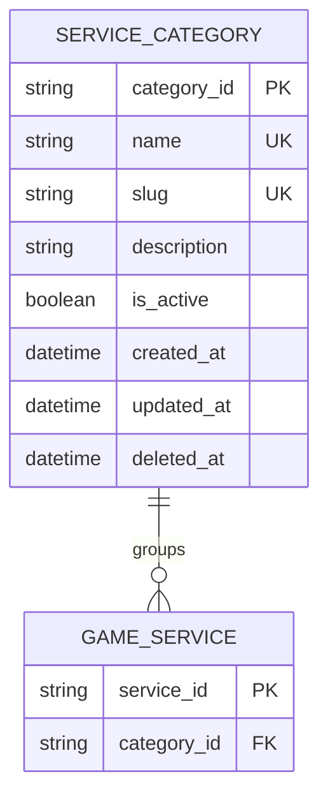

# Service Category ERD

> **Document Type:** ERD  
> **Status:** Draft  
> **Scope:** Admin Dashboard service categories and their relationship to game services.

## ERD

`GAME_SERVICE` is a reference entity; its complete attributes belong in a separate service ERD. The current Admin Services UI allows one category selection per service, so the proposed relationship is one category to many services. Confirm whether business rules require a service to belong to multiple categories before implementation.

## Table: `service_category`

| Column        | Data Type                | Null | Key / Constraint                                                            | Description                                                                                                          |
| ------------- | ------------------------ | ---- | --------------------------------------------------------------------------- | -------------------------------------------------------------------------------------------------------------------- |
| `category_id` | String, max 64           | No   | PK                                                                          | Immutable category identifier generated by service; generation strategy TBD. UI currently labels it `id`.            |
| `name`        | String, max 100          | No   | Unique among non-deleted categories, case-insensitive after trim (proposed) | Display name shown in Admin Dashboard and service selection.                                                         |
| `slug`        | String, max 100          | No   | Unique among non-deleted categories (proposed)                              | URL-safe identifier; lowercase alphanumeric segments separated by hyphens. Slug reuse after deletion needs approval. |
| `description` | String, max 500          | Yes  | —                                                                           | Description of category content. UI currently accepts free text; maximum length is proposed.                         |
| `is_active`   | Boolean                  | No   | Default `true` (proposed)                                                   | Whether category is available for catalog/service selection. UI labels this field `active`.                          |
| `created_at`  | Timestamp with time zone | No   | Default current UTC timestamp                                               | Creation time; immutable.                                                                                            |
| `updated_at`  | Timestamp with time zone | No   | Default current UTC timestamp                                               | Time of most recent change.                                                                                          |
| `deleted_at`  | Timestamp with time zone | Yes  | Null means not soft-deleted                                                 | Optional soft delete marker proposed to preserve references; deletion policy TBD.                                    |

## Relationship: `game_service.category_id`

| Column        | Data Type      | Null | Key / Constraint                               | Description                                                                                        |
| ------------- | -------------- | ---- | ---------------------------------------------- | -------------------------------------------------------------------------------------------------- |
| `category_id` | String, max 64 | No   | FK → `service_category.category_id` (proposed) | Category assigned to the game service. Admin Services form currently requires a selected category. |

The FK is shown on the service entity but is documented here to define category ownership. Do not create a duplicate category name/string on service records as the authoritative relationship. Use joins/projections to display category name.

## Indexes

| Index                             | Columns                            | Type                                                      | Purpose                                                                          |
| --------------------------------- | ---------------------------------- | --------------------------------------------------------- | -------------------------------------------------------------------------------- |
| `uq_service_category_name_active` | normalized `name`                  | Unique, partial where `deleted_at IS NULL` (proposed)     | Prevent duplicate active category names regardless of case/outer whitespace.     |
| `uq_service_category_slug_active` | `slug`                             | Unique, partial where `deleted_at IS NULL` (proposed)     | Ensure active category slug uniqueness.                                          |
| `ix_service_category_admin_list`  | `is_active`, `name`, `category_id` | Non-unique; partial where `deleted_at IS NULL` (proposed) | Support admin list filtering and deterministic ordering.                         |
| `ix_game_service_category`        | `category_id`                      | Non-unique                                                | Find services in category; calculate category `serviceCount`; enforce FK checks. |

Database engine is TBD. If partial unique indexes are unavailable, enforce uniqueness with a compatible generated active key or transactional validation plus unique constraints.

## Relationships

| Parent             | Child          | Cardinality | Rule                                                                                                       |
| ------------------ | -------------- | ----------- | ---------------------------------------------------------------------------------------------------------- |
| `service_category` | `game_service` | 1 to 0..N   | A category groups zero or more services. Each service has exactly one category under the current UI model. |

## Data Rules

1. `category_id` is immutable and generated by service.
2. `name` is trimmed before storage; normalized names are unique among non-deleted categories, case-insensitive (proposal).
3. `slug` is trimmed, lowercased, and follows `^[a-z0-9]+(?:-[a-z0-9]+)*$`. Slug changes may affect URLs/links; reference impact and slug immutability policy require confirmation.
4. `description` is optional and must not exceed the approved maximum length.
5. `is_active=false` prevents assigning category to new active services or showing it in storefront category selection. Existing services remain linked; whether they should be automatically deactivated is TBD. No cascade update.
6. Category deletion must not orphan services. Hard delete is blocked while services reference the category. Proposed soft delete requires either no linked services or an approved reassignment/deactivation workflow.
7. Deleting a category does not delete its services, order history, or other references. No cascading delete.
8. `serviceCount` shown in Admin Dashboard is a derived count from `game_service` records. Confirm whether count includes inactive/soft-deleted services; UI currently shows count without a filter definition.
9. `created_at` is immutable. Service sets `updated_at` on each successful category mutation.
10. Category create/update/delete operations should record actor and time in the platform audit mechanism. Audit storage/retention is outside this ERD and TBD.

## Assumptions / Decisions Needed

- Column names, types, lengths, defaults, uniqueness, and indexes are proposals based on `src/features/AdminServiceCategories` UI interfaces and templates; database engine/naming convention are TBD.
- Confirm whether a category may be linked to multiple services only (current UI), or whether services can belong to multiple categories. If many-to-many is required, replace `game_service.category_id` with a join entity such as `game_service_category`.
- Confirm whether category name and slug uniqueness apply to inactive/deleted rows and whether slug can change after publication.
- Confirm whether category deletion is soft delete, hard delete with restriction, or prevented whenever any service references it. UI currently removes only local demo state and does not define persistence behavior.
- Confirm whether deactivating a category also deactivates linked services or only prevents new assignment/publication.
- Confirm description length, default active state, and `serviceCount` counting rules.
- `game_service` entity, game relationship, price/estimate model, service status, and order/service retention are outside this ERD; add FK and lifecycle rules when service ERD is created.
- API contracts and backend solutioning for category CRUD were not found under `docs/sprint_1/solutioning`; this ERD infers requirements from the current UI.

## References

- `src/features/AdminServiceCategories/views/interfaces/admin-service-category.interface.ts` — category fields and status.
- `src/features/AdminServiceCategories/views/templates/AdminServiceCategories.template.tsx` — create/edit/delete flows and category form.
- `src/features/AdminServices/views/interfaces/admin-service.interface.ts` — service category association.
- `src/features/AdminServices/views/templates/AdminServices.template.tsx` — one category selector per service.
- `docs/sprint_1/solutioning/erd/game-erd.md` — related catalog entity pattern.
