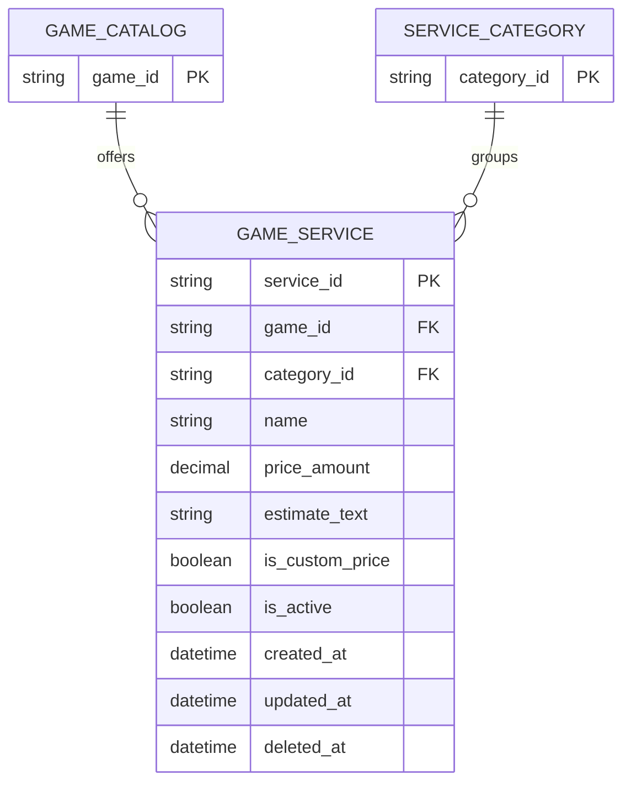

# Service ERD

> **Document Type:** ERD  
> **Status:** Draft  
> **Scope:** Admin Dashboard game services and their required relationships to game catalog and service category. Order snapshots and fulfillment execution are outside this ERD.

## ERD

`GAME_CATALOG` and `SERVICE_CATEGORY` are reference entities defined in [Game ERD](./game-erd.md) and [Service Category ERD](./service-category-erd.md). This ERD defines their foreign keys from `game_service`; it does not duplicate their full schemas.

## Table: `game_service`

| Column            | Data Type                | Null | Key / Constraint                    | Description                                                                                                                                                                                                     |
| ----------------- | ------------------------ | ---- | ----------------------------------- | --------------------------------------------------------------------------------------------------------------------------------------------------------------------------------------------------------------- |
| `service_id`      | String, max 64           | No   | PK                                  | Immutable service identifier generated by service; generation strategy TBD. UI currently labels it `id`.                                                                                                        |
| `game_id`         | String, max 64           | No   | FK → `game_catalog.game_id`         | Game for which service is offered. UI currently selects one game per service.                                                                                                                                   |
| `category_id`     | String, max 64           | No   | FK → `service_category.category_id` | Service category. UI currently selects one category per service.                                                                                                                                                |
| `name`            | String, max 150          | No   | —                                   | Service display name, e.g. `Top Up Diamond 100`. Uniqueness scope TBD.                                                                                                                                          |
| `price_amount`    | Decimal(18,2)            | Yes  | `>= 0` when present                 | Fixed service price in the platform's configured currency. UI represents a custom/quote price with `null`; currency is currently implied as IDR and must be confirmed or modeled explicitly.                    |
| `is_custom_price` | Boolean                  | No   | Default `false` (proposed)          | `true` means price requires admin confirmation and `price_amount` must be null. This makes custom pricing explicit in storage. Confirm if `price_amount IS NULL` alone should represent custom pricing instead. |
| `estimate_text`   | String, max 100          | No   | —                                   | Customer-facing completion estimate such as `Instan` or `1–2 hari`. Stored as display text because current UI has free-form text; structured duration is not modeled.                                           |
| `is_active`       | Boolean                  | No   | Default `true` (proposed)           | Whether service is available in storefront. UI labels this field `active`.                                                                                                                                      |
| `created_at`      | Timestamp with time zone | No   | Default current UTC timestamp       | Creation time; immutable.                                                                                                                                                                                       |
| `updated_at`      | Timestamp with time zone | No   | Default current UTC timestamp       | Time of most recent change.                                                                                                                                                                                     |
| `deleted_at`      | Timestamp with time zone | Yes  | Null means not soft-deleted         | Soft-delete marker proposed to preserve order/service references; deletion and retention policy TBD.                                                                                                            |

## Relationships

| Parent             | Child          | Cardinality | Rule                                                                                                           |
| ------------------ | -------------- | ----------- | -------------------------------------------------------------------------------------------------------------- |
| `game_catalog`     | `game_service` | 1 to 0..N   | A game may have multiple services. Each service references exactly one game under current UI model.            |
| `service_category` | `game_service` | 1 to 0..N   | A category may contain multiple services. Each service references exactly one category under current UI model. |

No direct relationship to orders is modeled here because order schema and snapshot requirements are not available in the current solutioning folder.

## Constraints and Indexes

| Name                              | Columns / Rule                                                                                              | Type                                                                           | Purpose                                                                                           |
| --------------------------------- | ----------------------------------------------------------------------------------------------------------- | ------------------------------------------------------------------------------ | ------------------------------------------------------------------------------------------------- |
| `fk_game_service_game`            | `game_id` → `game_catalog.game_id`                                                                          | Foreign key, restrict delete                                                   | Prevent service from pointing to missing game.                                                    |
| `fk_game_service_category`        | `category_id` → `service_category.category_id`                                                              | Foreign key, restrict delete                                                   | Prevent service from pointing to missing category.                                                |
| `ck_game_service_price`           | `price_amount IS NULL OR price_amount >= 0`                                                                 | Check                                                                          | Prevent negative fixed price.                                                                     |
| `ck_game_service_custom_price`    | `is_custom_price = true AND price_amount IS NULL` OR `is_custom_price = false AND price_amount IS NOT NULL` | Check (proposed)                                                               | Keep fixed/custom pricing state consistent. Confirm if draft services may temporarily omit price. |
| `ix_game_service_game_status`     | `game_id`, `is_active`, `name`, `service_id`                                                                | Non-unique; partial where `deleted_at IS NULL` (proposed)                      | Support game filtering and deterministic admin list.                                              |
| `ix_game_service_category_status` | `category_id`, `is_active`, `name`, `service_id`                                                            | Non-unique; partial where `deleted_at IS NULL` (proposed)                      | Support category filtering and category service counts.                                           |
| `ix_game_service_storefront`      | `game_id`, `category_id`, `name`                                                                            | Non-unique, partial where `is_active = true AND deleted_at IS NULL` (proposed) | Support storefront service lookup.                                                                |

Database engine is TBD. Confirm whether indexes should include inactive rows and adapt partial indexes to database capabilities.

## Data Rules

1. `service_id` is immutable and generated by service.
2. `game_id` must reference an existing game that is eligible for service association. Whether inactive games may retain services is allowed; assigning a new active service to an inactive game should be rejected unless product rules permit it.
3. `category_id` must reference an existing non-deleted category. New active services cannot use an inactive category. Existing services retain the reference if category becomes inactive.
4. `name` is trimmed and non-empty. Uniqueness within one game, or across all services, requires product confirmation; no unique constraint is proposed yet.
5. Fixed-price services require a non-negative `price_amount`; quote/custom-price services set `is_custom_price=true` and `price_amount=null`. Currency and rounding rules need confirmation.
6. `estimate_text` is a display estimate, not a guaranteed SLA. If operational reporting or fulfillment scheduling needs computation, replace/add structured estimate fields with an approved unit and range model.
7. `is_active=false` prevents new storefront selection but does not erase existing orders or historical references.
8. Deleting game or category records must not cascade-delete services. Parent deletes are restricted while service references exist; use disable/reassign or a separately approved archival strategy.
9. Service deletion should use soft delete if orders or other durable records reference the service. `deleted_at` remains a proposal until order retention requirements and restore policy are approved.
10. `updated_at` is set in UTC by service for each successful mutation. Actor, action, and before/after change details belong in the platform audit mechanism.
11. Order creation must snapshot service name, game/category identifiers or display names, price, currency, and relevant estimate at purchase time. This ERD does not define that order snapshot; later catalog edits must not rewrite historical order facts.
12. `serviceCount` on category is derived from `game_service`. Confirm whether it counts inactive or soft-deleted services.

## Assumptions / Decisions Needed

- Table/column names, field lengths, types, defaults, checks, and indexes are proposals inferred from the current Admin Services UI interfaces and seed data.
- Confirm whether one service may be associated with multiple games or categories. UI currently provides single-select fields, so this model uses one `game_id` and one `category_id`; use join entities if many-to-many is required.
- Confirm currency model. Current UI formats prices as IDR but does not store currency; this ERD assumes one platform-wide currency and flags it for approval.
- Confirm whether custom pricing is stored as nullable amount alone or as explicit `is_custom_price` plus nullable amount. Current UI uses `price === null` to represent custom price.
- Confirm whether services need description, slug, service-specific input fields, quantity/variant tiers, rank progression endpoints, or multiple price options. Those concepts are not present in current service interface and are not added here.
- Confirm category/game inactive behavior, service soft-delete policy, name uniqueness, estimate length/semantics, and serviceCount counting rules.
- Define service to order foreign keys and immutable order snapshot schema in a separate order ERD before backend order implementation.
- No service API contracts or backend solutioning were found in `docs/sprint_1/solutioning`; this ERD is based on AdminServices UI and related game/category ERDs.

## References

- `src/features/AdminServices/views/interfaces/admin-service.interface.ts` — service UI fields.
- `src/features/AdminServices/views/pages/AdminServices.page.tsx` — current seed data and custom-price representation.
- `src/features/AdminServices/views/templates/AdminServices.template.tsx` — service form, single game/category selection, price, estimate, and status controls.
- `src/features/AdminServiceCategories/views/interfaces/admin-service-category.interface.ts` — category fields and status.
- `./service-category-erd.md` — category entity and category-to-service relationship.
- `./game-erd.md` — game catalog entity.
