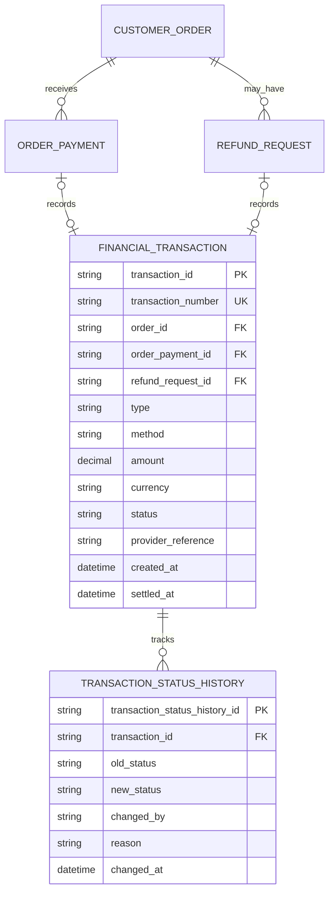

# Transaction ERD

> **Document Type:** ERD  
> **Status:** Draft  
> **Scope:** Admin Dashboard transaction reporting for order payments and refunds. Order/payment and refund details remain owned by their source entities. Payouts are separate disbursements and are outside this transaction-list scope.

## ERD

`ORDER_PAYMENT` is defined in [Order ERD](./order-erd.md). `REFUND_REQUEST` is a reference to the Refund module and requires a separate Refund ERD. A financial transaction represents one payment/refund attempt or confirmed movement for reporting; it does not replace the order's payment status or refund workflow state.

## Table: `financial_transaction`

| Column                      | Data Type                | Null | Key / Constraint                                                          | Description                                                                                                                                   |
| --------------------------- | ------------------------ | ---- | ------------------------------------------------------------------------- | --------------------------------------------------------------------------------------------------------------------------------------------- |
| `transaction_id`            | String, max 64           | No   | PK                                                                        | Immutable internal transaction identifier generated by service.                                                                               |
| `transaction_number`        | String, max 64           | No   | Unique                                                                    | Human/support reference shown in transaction list. Generation strategy and whether this duplicates `transaction_id` are TBD.                  |
| `order_id`                  | String, max 64           | No   | FK → `customer_order.order_id`                                            | Order associated with transaction; supports UI order lookup.                                                                                  |
| `order_payment_id`          | String, max 64           | Yes  | FK → `order_payment.payment_id`; unique when present                      | Payment source record for order payment transaction.                                                                                          |
| `refund_request_id`         | String, max 64           | Yes  | FK → Refund module request; unique when present                           | Refund source record for refund transaction. Exact table/ID TBD.                                                                              |
| `type`                      | Enum/string, max 30      | No   | Proposed `ORDER_PAYMENT` or `REFUND`                                      | Financial transaction direction/type. UI labels map to “Pembayaran Pesanan” and “Refund”.                                                     |
| `method`                    | Enum/string, max 30      | No   | Proposed `QRIS` or `BCA_TRANSFER`; BCA Virtual Account needs confirmation | Payment channel/source method. Refund method may be original method or separate payout method; policy TBD.                                    |
| `amount`                    | Decimal(18,2)            | No   | `> 0` (proposed)                                                          | Transaction amount. Refund amount cannot exceed remaining refundable settled payment amount.                                                  |
| `currency`                  | String, 3                | No   | ISO 4217 (proposed)                                                       | Currency code; current storefront implies IDR.                                                                                                |
| `status`                    | Enum/string, max 30      | No   | Proposed lifecycle below                                                  | Reporting status for financial movement. Source workflow remains authoritative for review state.                                              |
| `provider_reference`        | String, max 128          | Yes  | Unique only when non-null and provider guarantees uniqueness              | External provider/bank reference if available. Manual transfer reference is not asserted to be a verified provider reference.                 |
| `customer_name_snapshot`    | String, max 150          | Yes  | —                                                                         | Customer name snapshot for reporting. Prefer join to order where retained; snapshot only if transaction reporting must survive anonymization. |
| `customer_contact_snapshot` | String, max 32           | Yes  | —                                                                         | Optional masked/retained contact snapshot for report export; PII retention decision required.                                                 |
| `created_at`                | Timestamp with time zone | No   | Default current UTC timestamp                                             | Time transaction record/attempt was created.                                                                                                  |
| `settled_at`                | Timestamp with time zone | Yes  | —                                                                         | Time funds were confirmed received or refund completed. Not populated on pending/rejected/failed records.                                     |
| `updated_at`                | Timestamp with time zone | No   | Default current UTC timestamp                                             | Time of most recent transaction status/reference update.                                                                                      |

Exactly one source link (`order_payment_id` or `refund_request_id`) must be populated and must agree with `type`; database-specific check constraint is proposed. `order_id` must match the order linked by source record.

## Transaction Status

| Status     | Meaning                                                                                                          |
| ---------- | ---------------------------------------------------------------------------------------------------------------- |
| `PENDING`  | Payment/refund transaction is awaiting required manual review or completion.                                     |
| `SUCCESS`  | Payment was manually confirmed received or refund was confirmed completed.                                       |
| `FAILED`   | Attempt could not be completed or was rejected. Distinguish rejection reason in source workflow/history.         |
| `REVERSED` | Previously successful movement was reversed/returned. Use only when supported by actual reconciliation evidence. |

UI mapping proposal: `Berhasil` → `SUCCESS`, `Menunggu` → `PENDING`, `Gagal` → `FAILED`, `Dikembalikan` → `REVERSED`. Refund request statuses (`Menunggu Review`, `Disetujui`, `Ditolak`, `Selesai`) are not identical to financial movement statuses; only create/update a refund transaction when the corresponding workflow reaches a documented financial state.

## Table: `transaction_status_history`

| Column                          | Data Type                | Null | Key / Constraint                            | Description                                                                     |
| ------------------------------- | ------------------------ | ---- | ------------------------------------------- | ------------------------------------------------------------------------------- |
| `transaction_status_history_id` | String, max 64           | No   | PK                                          | Immutable status event identifier.                                              |
| `transaction_id`                | String, max 64           | No   | FK → `financial_transaction.transaction_id` | Transaction whose status changed.                                               |
| `old_status`                    | String, max 30           | Yes  | —                                           | Previous status; null for initial status.                                       |
| `new_status`                    | String, max 30           | No   | —                                           | New transaction status.                                                         |
| `changed_by`                    | String, max 64           | Yes  | Admin/system actor reference TBD            | Administrator or system responsible for transition.                             |
| `reason`                        | String, max 500          | Yes  | —                                           | Review/reconciliation explanation; do not store credentials or unnecessary PII. |
| `changed_at`                    | Timestamp with time zone | No   | Default current UTC timestamp               | Status transition time.                                                         |

Status changes and history insertion must be atomic. Shared activity/audit log may additionally retain before/after details; audit source and retention TBD.

## Indexes and Constraints

| Name                                      | Columns / Rule                                       | Type                           | Purpose                                                                                                                                      |
| ----------------------------------------- | ---------------------------------------------------- | ------------------------------ | -------------------------------------------------------------------------------------------------------------------------------------------- |
| `uq_financial_transaction_number`         | `transaction_number`                                 | Unique                         | Lookup by support/reporting reference.                                                                                                       |
| `uq_financial_transaction_payment_source` | `order_payment_id`                                   | Unique, partial where not null | Prevent duplicate transaction rows for the same order payment source. Confirm if multiple transaction events per payment attempt are needed. |
| `uq_financial_transaction_refund_source`  | `refund_request_id`                                  | Unique, partial where not null | Prevent duplicate transaction rows for the same refund source. Confirm partial/multiple refund disbursement policy.                          |
| `ck_transaction_source_type`              | Exactly one source FK is non-null and matches `type` | Check                          | Keep transaction origin unambiguous.                                                                                                         |
| `ck_transaction_amount`                   | `amount > 0`                                         | Check                          | Prevent zero/negative movement records.                                                                                                      |
| `ix_transaction_created`                  | `created_at DESC`, `transaction_id`                  | Non-unique                     | Newest-first transaction list.                                                                                                               |
| `ix_transaction_status_created`           | `status`, `created_at DESC`                          | Non-unique                     | Filter pending/success/failed/reversed transactions.                                                                                         |
| `ix_transaction_method_created`           | `method`, `created_at DESC`                          | Non-unique                     | Filter by payment method.                                                                                                                    |
| `ix_transaction_order`                    | `order_id`, `created_at DESC`                        | Non-unique                     | Resolve transactions for an order.                                                                                                           |
| `ix_transaction_status_history_time`      | `transaction_id`, `changed_at`                       | Non-unique                     | Read transaction timeline and audit.                                                                                                         |

Database engine and index syntax are TBD. If a source payment can produce multiple settled movements (e.g. partial payments), replace source uniqueness with an approved sequence/idempotency key model.

## Relationships

| Parent                  | Child                        | Cardinality          | Rule                                                                                                                   |
| ----------------------- | ---------------------------- | -------------------- | ---------------------------------------------------------------------------------------------------------------------- |
| `customer_order`        | `order_payment`              | 1 to 0..N            | Payment attempts are defined by Order ERD.                                                                             |
| `order_payment`         | `financial_transaction`      | 1 to 0..1 (proposed) | One reporting record per payment attempt; only populate according to transaction-record creation policy.               |
| `customer_order`        | `refund_request`             | 1 to 0..N            | Refund request lifecycle belongs to Refund module.                                                                     |
| `refund_request`        | `financial_transaction`      | 1 to 0..1 (proposed) | A refund transaction is associated with its source refund request. Partial refund handling may require 1 to N instead. |
| `customer_order`        | `financial_transaction`      | 1 to 0..N            | Order reference is denormalized for reporting; must match source record's order.                                       |
| `financial_transaction` | `transaction_status_history` | 1 to 0..N            | Preserve status transitions and manual review/reconciliation events.                                                   |

## Data Rules

1. The transaction list combines order payment and refund movements; payout requests are a separate outbound disbursement flow and should use payout/ledger modeling rather than be mixed into payment transactions without explicit accounting rules.
2. `financial_transaction` is a reporting/financial movement record. `customer_order.payment_status`, `order_payment.status`, and refund-request status remain their workflow source of truth; define a single transactional or event-driven synchronization mechanism.
3. Create or update transaction status only when supported by the corresponding payment/refund workflow event. A submitted proof awaiting manual validation is `PENDING`, not `SUCCESS`.
4. A manual QRIS/BCA proof is not proof of settlement by itself. `SUCCESS` and `settled_at` require authorized admin confirmation under current manual process.
5. `amount` and `currency` are immutable after settlement. Corrections use reversal/adjustment records with references, not destructive edits.
6. Refund transaction amount must be positive and within remaining settled amount. Partial refunds, multiple refunds, fees, and chargebacks require explicit accounting policy.
7. `provider_reference` is nullable. For manual bank transfers, store customer-provided transfer reference only in a separately labeled field unless verified by provider/bank evidence.
8. Customer name/contact are derived from order where possible. If copied into transaction for reporting/export, apply PII minimization, masking, access control, and retention rules.
9. Payment methods currently confirmed in checkout UI are QRIS and manual BCA transfer. Admin transaction UI labels BCA as “BCA Virtual Account”; resolve whether real VA/provider integration is in scope before storing a separate method code.
10. Status transitions record actor, timestamp, and reason; manual approval/rejection is auditable. Do not expose internal provider or account secrets in transaction list.
11. Financial records and their history are retained under approved finance/legal policy. Do not hard-delete successful movements or cascade-delete them with orders.
12. Currency, amount precision, rounding, refunds, and settlement date semantics must be consistent across order, payment, refund, and transaction models.

## Assumptions / Decisions Needed

- Model is inferred from `AdminTransactions` UI, `Order ERD`, and refund/payout interfaces; no approved transaction API or accounting ledger specification exists in `docs/sprint_1/solutioning`.
- Confirm whether transaction table is a derived read model from payment/refund tables or the financial system of record. This ERD treats it as a linked transaction record while preserving source workflows.
- Resolve method mismatch: checkout currently offers `QRIS` and manual `Transfer Bank BCA`; AdminTransactions UI uses `QRIS` and `BCA Virtual Account`. Confirm manual transfer vs actual VA provider before fixing method enum.
- Confirm whether failed/rejected payment attempts appear as transaction rows or only settled/financially relevant movements.
- Confirm whether each payment/refund source maps one-to-one or one-to-many financial transaction rows, including partial payments/refunds and reversals.
- Define refund request schema, approval vs settlement timing, refund payment channel, and whether refund status `Disetujui` creates a pending movement or only `Selesai` creates a successful transaction.
- Define provider reconciliation, provider references, idempotency key, settlement time source, status synchronization, amount/currency policy, and immutable correction/reversal approach.
- Confirm whether transaction list needs customer snapshot fields or should join order and mask contact at query time.
- Payouts are excluded from this ERD because UI has a distinct Payout module; confirm if accounting ledger should unify inbound and outbound movements in a later design.
- Audit storage/retention, identity references for reviewer, database engine, and index implementation are TBD.

## References

- `src/features/AdminTransactions/views/interfaces/admin-transaction.interface.ts` — transaction list types, labels, methods, and statuses.
- `src/features/AdminRefunds/views/interfaces/admin-refund.interface.ts` — refund source fields and status flow.
- `src/features/AdminPayouts/views/interfaces/admin-payout.interface.ts` — separate payout/disbursement interface.
- `src/features/AdminBankAccounts/views/interfaces/admin-bank-account.interface.ts` — bank destination account fields.
- `./order-erd.md` — order payment attempts and manual proof validation model.
- `./user-management-erd.md` — user account reference.
