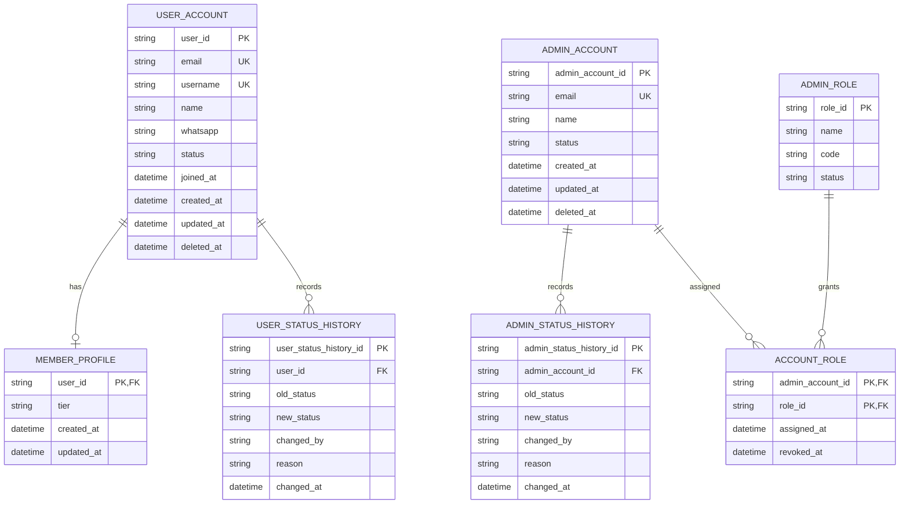

# User Management ERD

> **Document Type:** ERD  
> **Status:** Draft  
> **Scope:** Admin Dashboard member/user management and admin-account management records. Order-derived member metrics and role definitions are referenced, not duplicated here.

## ERD

`ADMIN_ACCOUNT` and `ADMIN_ROLE` overlap with [Role ERD](./role-erd.md), which currently shows an `ADMIN_ACCOUNT` reference entity and owns role assignment modeling. This document extends that entity with account-management attributes; reconcile into one canonical schema before implementation. Authentication credentials and provider subjects are owned by the identity/authentication design and are intentionally not specified here.

## Table: `user_account`

| Column       | Data Type                | Null | Key / Constraint                       | Description                                                                                             |
| ------------ | ------------------------ | ---- | -------------------------------------- | ------------------------------------------------------------------------------------------------------- |
| `user_id`    | String, max 64           | No   | PK                                     | Immutable user identifier generated by the service or identity provider; source TBD.                    |
| `email`      | String, max 254          | No   | Unique (normalization policy TBD)      | User email displayed and used for account contact. Authentication use is not assumed by this ERD.       |
| `username`   | String, max 100          | No   | Unique (case/normalization policy TBD) | User display handle. Confirm whether username is required and globally unique.                          |
| `name`       | String, max 150          | No   | —                                      | User's display name.                                                                                    |
| `whatsapp`   | String, max 32           | Yes  | Unique only if product requires (TBD)  | Contact number in international format; exact validation and verification policy TBD.                   |
| `status`     | Enum/string, max 20      | No   | Proposed `ACTIVE` / `BLOCKED`          | Account status shown as Aktif/Diblokir in Admin Dashboard. Block semantics and allowed transitions TBD. |
| `joined_at`  | Timestamp with time zone | No   | Default current UTC timestamp          | Time account joined; immutable.                                                                         |
| `created_at` | Timestamp with time zone | No   | Default current UTC timestamp          | Record creation time.                                                                                   |
| `updated_at` | Timestamp with time zone | No   | Default current UTC timestamp          | Time of most recent profile/status update.                                                              |
| `deleted_at` | Timestamp with time zone | Yes  | Null means not soft-deleted            | Optional soft-delete marker; retention and account recovery policy TBD.                                 |

## Table: `member_profile`

| Column       | Data Type                | Null | Key / Constraint                                | Description                                                                                                                |
| ------------ | ------------------------ | ---- | ----------------------------------------------- | -------------------------------------------------------------------------------------------------------------------------- |
| `user_id`    | String, max 64           | No   | PK, FK → `user_account.user_id`                 | One-to-one member profile identity.                                                                                        |
| `tier`       | Enum/string, max 20      | No   | Proposed `BRONZE`, `SILVER`, `GOLD`, `PLATINUM` | Membership tier shown in Admin Dashboard. Tier rules, assignment source, and whether it is computed from spend/orders TBD. |
| `created_at` | Timestamp with time zone | No   | Default current UTC timestamp                   | Member profile creation time.                                                                                              |
| `updated_at` | Timestamp with time zone | No   | Default current UTC timestamp                   | Time of most recent tier/profile change.                                                                                   |

`orderCount` and `totalSpend` shown in member management are derived metrics. They belong to order/payment facts and should be aggregated from their source of truth or a maintained read model; do not persist duplicate authoritative values here without a projection/reconciliation design.

## Table: `admin_account`

| Column             | Data Type                | Null | Key / Constraint                                        | Description                                                                                            |
| ------------------ | ------------------------ | ---- | ------------------------------------------------------- | ------------------------------------------------------------------------------------------------------ |
| `admin_account_id` | String, max 64           | No   | PK                                                      | Immutable administrator identifier; generation strategy TBD.                                           |
| `email`            | String, max 254          | No   | Unique (case-insensitive after normalization, proposed) | Administrative account email.                                                                          |
| `name`             | String, max 150          | No   | —                                                       | Administrator display name.                                                                            |
| `status`           | Enum/string, max 20      | No   | Proposed `ACTIVE` / `INACTIVE`                          | Determines whether admin account can authenticate/use dashboard.                                       |
| `created_at`       | Timestamp with time zone | No   | Default current UTC timestamp                           | Account creation time.                                                                                 |
| `updated_at`       | Timestamp with time zone | No   | Default current UTC timestamp                           | Time of most recent account update.                                                                    |
| `deleted_at`       | Timestamp with time zone | Yes  | Null means not soft-deleted                             | Proposed soft deletion marker; disabling an account may be sufficient instead of deletion. Policy TBD. |

The admin UI displays one `role` per account. `ACCOUNT_ROLE` in the Role ERD supports multiple roles. Product/security owner must choose single-role or multi-role assignment; until then, the UI's single displayed role must be treated as a presentation limitation, not a data constraint.

## Table: `user_status_history`

| Column                   | Data Type                | Null | Key / Constraint                          | Description                                                   |
| ------------------------ | ------------------------ | ---- | ----------------------------------------- | ------------------------------------------------------------- |
| `user_status_history_id` | String, max 64           | No   | PK                                        | Immutable history event ID.                                   |
| `user_id`                | String, max 64           | No   | FK → `user_account.user_id`               | Account whose status changed.                                 |
| `old_status`             | String, max 20           | Yes  | —                                         | Previous status; null for initial status event if recorded.   |
| `new_status`             | String, max 20           | No   | —                                         | Status after change.                                          |
| `changed_by`             | String, max 64           | Yes  | Reference to admin identity, if available | Actor initiating the change; system actor representation TBD. |
| `reason`                 | String, max 500          | Yes  | —                                         | Optional administrative reason; PII/secret policy applies.    |
| `changed_at`             | Timestamp with time zone | No   | Default current UTC timestamp             | Event timestamp.                                              |

## Table: `admin_status_history`

| Column                    | Data Type                | Null | Key / Constraint                          | Description                                                 |
| ------------------------- | ------------------------ | ---- | ----------------------------------------- | ----------------------------------------------------------- |
| `admin_status_history_id` | String, max 64           | No   | PK                                        | Immutable history event ID.                                 |
| `admin_account_id`        | String, max 64           | No   | FK → `admin_account.admin_account_id`     | Admin account whose status changed.                         |
| `old_status`              | String, max 20           | Yes  | —                                         | Previous status; null for initial status event if recorded. |
| `new_status`              | String, max 20           | No   | —                                         | Status after change.                                        |
| `changed_by`              | String, max 64           | Yes  | Reference to admin identity, if available | Actor initiating the change.                                |
| `reason`                  | String, max 500          | Yes  | —                                         | Optional reason; do not store credentials or secrets.       |
| `changed_at`              | Timestamp with time zone | No   | Default current UTC timestamp             | Event timestamp.                                            |

These status history tables are proposed domain history, not a replacement for the platform-wide immutable activity/audit log. Confirm whether status changes should be stored here, in a shared audit service, or both.

## Indexes

| Index                                  | Columns                                           | Type                     | Purpose                                                                    |
| -------------------------------------- | ------------------------------------------------- | ------------------------ | -------------------------------------------------------------------------- |
| `uq_user_account_email_normalized`     | normalized `email`                                | Unique                   | Prevent duplicate user emails under approved normalization policy.         |
| `uq_user_account_username_normalized`  | normalized `username`                             | Unique                   | Support user lookup and uniqueness if username is required.                |
| `ix_user_account_admin_list`           | `created_at`, `user_id`                           | Non-unique               | Support deterministic admin user listing.                                  |
| `ix_user_account_status`               | `status`, `created_at`                            | Non-unique               | Filter active/blocked users.                                               |
| `ix_user_account_name_search`          | normalized/searchable `name`, `username`, `email` | DB-specific search index | Support Admin Dashboard search; implementation depends on database engine. |
| `ix_member_profile_tier`               | `tier`, `user_id`                                 | Non-unique               | Filter member list by tier.                                                |
| `uq_admin_account_email_normalized`    | normalized `email`                                | Unique                   | Prevent duplicate admin account emails.                                    |
| `ix_admin_account_status`              | `status`, `name`, `admin_account_id`              | Non-unique               | Support admin-account list and status filters.                             |
| `ix_user_status_history_user_time`     | `user_id`, `changed_at`                           | Non-unique               | Retrieve user status history in chronological order.                       |
| `ix_admin_status_history_account_time` | `admin_account_id`, `changed_at`                  | Non-unique               | Retrieve admin status history in chronological order.                      |

## Relationships

| Parent          | Child                  | Cardinality | Rule                                                                                                                       |
| --------------- | ---------------------- | ----------- | -------------------------------------------------------------------------------------------------------------------------- |
| `user_account`  | `member_profile`       | 1 to 0..1   | A user may have one member profile. Confirm whether every storefront account is a member and whether profile is mandatory. |
| `user_account`  | `user_status_history`  | 1 to 0..N   | Keep status changes; no cascade hard delete while history retention applies.                                               |
| `admin_account` | `admin_status_history` | 1 to 0..N   | Keep admin status changes for auditability.                                                                                |
| `admin_account` | `account_role`         | 1 to 0..N   | Role assignments are modeled in [Role ERD](./role-erd.md); reconcile this shared entity and assignment cardinality.        |
| `admin_role`    | `account_role`         | 1 to 0..N   | Role may be assigned to multiple admin accounts. Assignment history uses `revoked_at` per Role ERD.                        |

## Data Rules

1. User/admin IDs are immutable and generated by the service or identity provider according to the selected identity architecture.
2. User and admin account records are separate in this proposed model. A person may have both identities only if product and identity policy permit it; no automatic linking by matching email is assumed.
3. Credentials, password hashes, OTPs, recovery tokens, and provider secrets are not stored in these management tables. Use approved authentication/identity storage.
4. `user_account.status` maps UI values `Aktif` and `Diblokir` to proposed stored values `ACTIVE` and `BLOCKED`. `admin_account.status` maps `Aktif`/`Nonaktif` to `ACTIVE`/`INACTIVE`.
5. Blocking a user or disabling an admin account must not erase order, payment, or activity history. Access behavior, notification, and unblock policy require product/security confirmation.
6. Status changes record actor, timestamp, previous status, and new status in history or shared audit service. Updates and history writes must be atomic where stored together.
7. Member tier values in the UI are proposed catalog values. Whether tier is manually assigned or derived from order/spend thresholds is TBD; one source of truth must be selected.
8. `orderCount` and `totalSpend` are derived from order/transaction data. Define currency, refund treatment, time window, and consistency/freshness before presenting as authoritative metrics.
9. Soft-deleted accounts, if enabled, are excluded from standard lists and cannot authenticate. Retention, restore, and uniqueness reuse policies must be approved.
10. Role assignment and permission rules follow [Role ERD](./role-erd.md). Do not implement role changes using a free-text role field on `admin_account`.
11. Personally identifying data such as email and WhatsApp is returned only to authorized administrators and must follow retention/access policy.

## Assumptions / Decisions Needed

- This ERD combines the distinct Admin Dashboard views `AdminUsers`, `AdminMembers`, and `AdminManagement`; confirm whether `AdminUsers` is a general account view overlapping the member list or a separate customer segment.
- Confirm whether member is a one-to-one profile on a user account, or whether every user record is inherently a member and `member_profile` should be merged into `user_account`.
- Confirm canonical source for user authentication, admin authentication, ID generation, and whether admin identities are local records or external identity-provider subjects.
- Confirm unique/verified status and normalization policy for email, username, and WhatsApp.
- Confirm block/disable/delete lifecycle, soft-delete policy, history/audit ownership, retention, and actor identity relation.
- Confirm member-tier ownership and calculation; `orderCount`/`totalSpend` source, aggregation, currency, refunds, and freshness.
- Confirm whether admin users can have multiple roles. Role ERD models many-to-many while AdminManagement UI currently displays one role.
- Confirm database engine, naming conventions, index implementation, and PII retention policy.
- No user/admin management API solutioning or AC was found in `docs/sprint_1/solutioning`; current ERD proposals are inferred from UI-facing interfaces in `src/features/AdminUsers`, `src/features/AdminMembers`, and `src/features/AdminManagement`.

## References

- `./role-erd.md` — proposed role, permission, and account-role assignment entities.
- `../dashboard/accounts-roles/get-list-roles.md`
- `../dashboard/accounts-roles/get-detail-role.md`
- `../dashboard/accounts-roles/update-role.md`
- `../dashboard/accounts-roles/delete-role.md`
- `src/features/AdminUsers/views/interfaces/admin-user.interface.ts`
- `src/features/AdminMembers/views/interfaces/admin-member.interface.ts`
- `src/features/AdminManagement/views/interfaces/admin-account.interface.ts`
