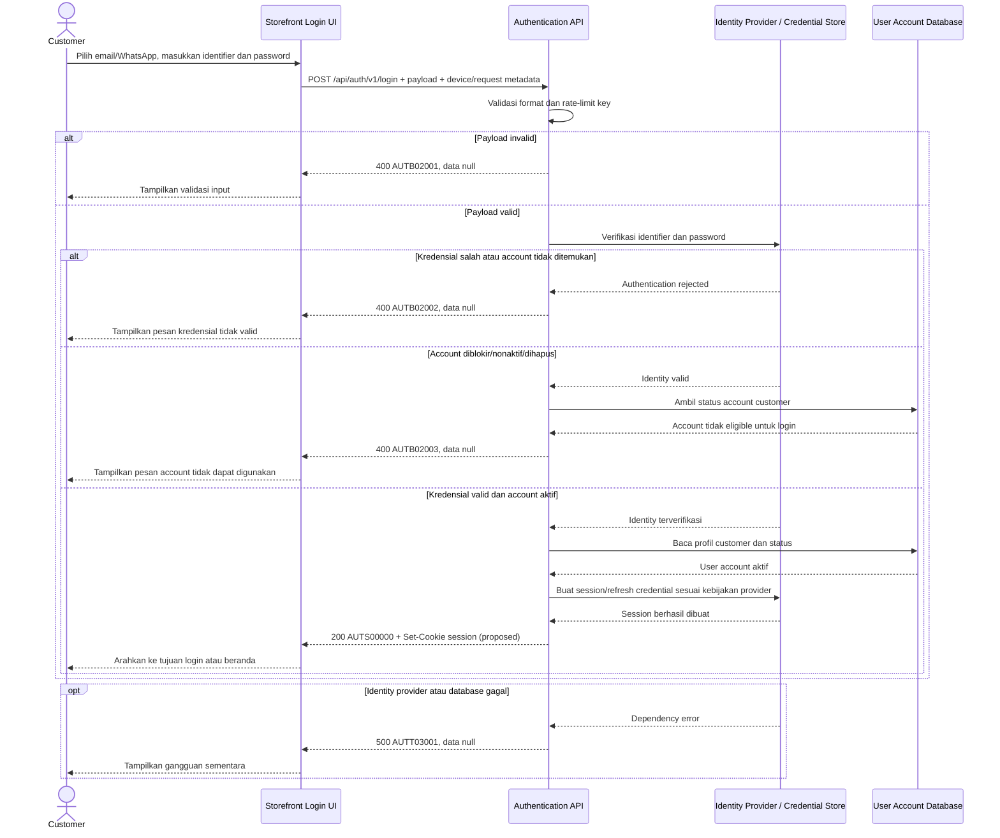

# Customer Login - Interface Agreement

> **Document Type:** IFA / API Contract  
> **Status:** Draft  
> **Service / Domain:** Authentication  
> **Consumer / Partner:** JokiHub Storefront (customer account)

## Design

Login page meminta email atau nomor WhatsApp dan password. API memverifikasi kredensial melalui identity/authentication provider yang disetujui, memastikan akun customer dapat digunakan, lalu membuat session. ERD memisahkan `USER_ACCOUNT` dari `ADMIN_ACCOUNT` dan secara eksplisit menyerahkan credential/provider subject ke desain authentication; endpoint ini hanya untuk customer, bukan login admin.

## Sequence Diagram



## Performance / SLA Targets

| Success Rate                                        | VUser                                   | CPU / Memory                             | Response Time                                                                                                                                   |
| --------------------------------------------------- | --------------------------------------- | ---------------------------------------- | ----------------------------------------------------------------------------------------------------------------------------------------------- |
| TBD; konfirmasi criticality dan availability target | TBD; konfirmasi concurrent login puncak | TBD; tetapkan dari capacity estimate/NFT | TBD; usulan baseline web non-kritis: ideal 200 ms, acceptable 1 s, max tolerable 2 s; tidak termasuk MFA/provider latency bila kelak diwajibkan |

## General Information

| Component          | Value                                                                                                                                                                                                |
| ------------------ | ---------------------------------------------------------------------------------------------------------------------------------------------------------------------------------------------------- |
| Description        | Memverifikasi kredensial customer dan membuat session login storefront.                                                                                                                              |
| Resource URL       | `https://{host}/api/auth/v1/login`                                                                                                                                                                   |
| Transport Protocol | HTTPS, REST                                                                                                                                                                                          |
| Request Verb       | POST                                                                                                                                                                                                 |
| Content Type       | `application/json`                                                                                                                                                                                   |
| Interaction Type   | Synchronous                                                                                                                                                                                          |
| Security Policy    | Public endpoint; TLS wajib, password tidak boleh dicatat, rate limit/brute-force protection wajib, session menggunakan secure HttpOnly cookie sebagai usulan. Authentication provider belum dipilih. |

### Path / Endpoint

| Section        | Value                           |
| -------------- | ------------------------------- |
| Host / Domain  | `{host}` (environment-specific) |
| Service Name   | Authentication                  |
| Version        | `v1`                            |
| Resource       | `/auth/v1/login`                |
| Final Endpoint | `POST /api/auth/v1/login`       |

### API Versioning

- **Decision:** New Endpoint
- **Previous Endpoint:** Tidak ada login API yang teridentifikasi; login UI saat ini menampilkan notice bahwa autentikasi belum terhubung.
- **Final Endpoint:** `POST /api/auth/v1/login`
- **Backward Compatibility:** Belum ada consumer API ini. Penambahan response field opsional bersifat kompatibel; perubahan credential/session contract yang mematahkan consumer memerlukan major version baru.
- **Reason:** Storefront membutuhkan authentication flow untuk customer login menggunakan email atau WhatsApp dan password.

## Business Rules

1. Endpoint ini mengautentikasi customer `USER_ACCOUNT`; `ADMIN_ACCOUNT` menggunakan authentication policy terpisah dan tidak boleh memperoleh hak admin melalui endpoint customer.
2. Login identifier adalah salah satu dari `email` atau `whatsapp`, dipilih melalui `identifierType`. Tepat satu identifier diterima per request.
3. Password dikirim hanya melalui TLS dan diverifikasi oleh identity provider/credential store. API tidak menyimpan atau mencatat plaintext password; password hash hanya dikelola oleh komponen authentication yang disetujui.
4. Email/WhatsApp dinormalisasi sesuai kebijakan identity provider. Nomor WhatsApp harus dalam format internasional canonical sebelum lookup; UI saat ini memasukkan nomor tanpa kode negara di field lokal, jadi normalisasi country code perlu disepakati.
5. Kredensial salah, identifier yang tidak terdaftar, dan identifier yang belum terverifikasi menggunakan respons generik yang sama agar tidak mengungkap keberadaan akun.
6. Akun dengan status bukan `ACTIVE` atau `deleted_at IS NOT NULL` tidak dapat login. ERD mengusulkan status `ACTIVE`/`BLOCKED`; status terhapus juga ditolak.
7. Successful authentication membuat session baru. Rekomendasi: session opaque server-side dengan cookie `Secure`, `HttpOnly`, `SameSite=Lax` dan rotasi session ID; token storage dan lifecycle harus mengikuti keputusan identity platform.
8. Response sukses hanya mengembalikan profil minimum (`userId`, `name`, `email`, `username`) yang diperlukan UI. Jangan mengembalikan password hash, recovery data, provider subject, role internal, atau PII tambahan.
9. Rate limit diterapkan per kombinasi identifier yang dinormalisasi dan IP/device signal; lockout, cooldown, CAPTCHA/MFA, serta response saat throttling ditentukan security policy. Jangan melakukan permanent lockout yang bisa dipicu attacker.
10. Login gagal tidak boleh menghasilkan account status mutation kecuali policy lockout yang disetujui; setiap attempt dicatat tanpa password dan dengan identifier yang dimasking/hashed.
11. Setelah login, tujuan redirect ditentukan oleh UI dari allowlisted relative path; API tidak menerima arbitrary redirect URL.
12. Logout, refresh session, password recovery, account registration, dan login admin adalah API/flow terpisah.

## Request Headers

| Header         | E/N/T | Type   | M/O/C | Max Length | Description                                               | Example            |
| -------------- | ----- | ------ | ----- | ---------: | --------------------------------------------------------- | ------------------ |
| `Content-Type` | N     | String | M     |        100 | Format request payload.                                   | `application/json` |
| `Accept`       | N     | String | O     |        100 | Format response yang diterima client.                     | `application/json` |
| `X-Request-Id` | N     | String | O     |        100 | ID korelasi acak; tidak boleh memuat identifier/password. | `req-3e8b1a`       |
| `User-Agent`   | N     | String | O     |        512 | Metadata browser/client untuk security telemetry.         | `Mozilla/5.0 ...`  |

## Request Parameters

Tidak ada path/query parameter.

## Request Body

| Attribute        | E/N/T | Type          | M/O/C | Max Length | Description                                             | Example                 |
| ---------------- | ----- | ------------- | ----- | ---------: | ------------------------------------------------------- | ----------------------- |
| `identifierType` | N     | String (enum) | M     |         10 | Jenis identifier: `EMAIL` atau `WHATSAPP`.              | `EMAIL`                 |
| `identifier`     | N     | String        | M     |        254 | Email atau nomor WhatsApp sesuai `identifierType`.      | `customer@example.test` |
| `password`       | N     | String        | M     |        128 | Password akun. Nilai contoh hanya placeholder sintetis. | `ExamplePass!234`       |

### Example Request Body

```json
{
  "identifierType": "EMAIL",
  "identifier": "customer@example.test",
  "password": "ExamplePass!234"
}
```

Contoh WhatsApp:

```json
{
  "identifierType": "WHATSAPP",
  "identifier": "+6281234567890",
  "password": "ExamplePass!234"
}
```

### Request Validation

1. Body wajib JSON object valid dan hanya menerima `identifierType`, `identifier`, dan `password`; field tambahan ditolak dengan `AUTB02001`.
2. `identifierType` wajib tepat `EMAIL` atau `WHATSAPP`.
3. `identifier` wajib string non-empty setelah trim. Untuk `EMAIL`, validasi sintaks email dan panjang maksimum 254 karakter. Untuk `WHATSAPP`, validasi format internasional E.164 (maksimum 32 karakter sesuai ERD) setelah normalisasi yang disepakati.
4. `password` wajib string, tidak di-trim atau dinormalisasi karena perubahan karakter dapat mengubah secret, serta dibatasi maksimum 128 karakter untuk mencegah payload abuse. Batas minimum mengikuti kebijakan password saat pendaftaran; policy final TBD.
5. Bila kombinasi field tidak cocok dengan tipe, ukuran, atau format, kembalikan `AUTB02001` tanpa melakukan lookup credential.
6. Rate-limit check dilakukan sebelum credential verification. Detail limit dan HTTP mapping throttling perlu diselaraskan dengan API gateway/security standard.
7. Untuk identifier/password salah atau user tidak ditemukan, kembalikan `AUTB02002` dengan pesan generik dan waktu respons yang tidak membocorkan hasil lookup.
8. User yang ditemukan tetapi blocked, soft-deleted, atau belum memenuhi status verifikasi yang diwajibkan menghasilkan `AUTB02003`. Apakah verifikasi kontak diwajibkan untuk login harus dikonfirmasi.
9. Dependency authentication/DB failure menghasilkan HTTP 500 `AUTT03001`; jangan mengembalikan error provider, credential, atau stack trace.

## Response Body

Semua response menggunakan envelope `status` dan `data`. Error mengembalikan `data: null`. Pada sukses, session cookie diset melalui response header; tidak ada bearer token di JSON selama cookie-based session menjadi pilihan.

| Attribute                | E/N/T | Type               | M/O/C | Max Length | Description                                                                                     | Example                 |
| ------------------------ | ----- | ------------------ | ----- | ---------: | ----------------------------------------------------------------------------------------------- | ----------------------- |
| `status`                 | N     | Object             | M     |          — | Object status response.                                                                         | `{}`                    |
| `status.code`            | N     | String             | M     |         20 | Service status code.                                                                            | `AUTS00000`             |
| `status.message`         | N     | String             | O     |        200 | Pesan hasil untuk consumer.                                                                     | `Login successful`      |
| `data`                   | N     | Object/null        | M     |          — | Payload profil minimum; null saat gagal.                                                        | `{}`                    |
| `data.user`              | N     | Object             | M     |          — | Profil customer minimal.                                                                        | `{}`                    |
| `data.user.id`           | N     | String             | M     |         64 | User ID internal immutable.                                                                     | `usr_01JXYZ`            |
| `data.user.name`         | N     | String             | M     |        150 | Nama tampilan customer.                                                                         | `Rani Example`          |
| `data.user.email`        | N     | String             | M     |        254 | Email akun; dapat null bila account hanya memakai WhatsApp, sesuai model final.                 | `customer@example.test` |
| `data.user.username`     | N     | String             | O     |        100 | Username display bila sudah disetel.                                                            | `rani_play`             |
| `data.session.expiresAt` | N     | String (date-time) | M     |         35 | Expiry session dalam ISO 8601 UTC. Lifetime ditentukan auth policy.                             | `2026-10-11T18:00:00Z`  |
| `data.session.csrfToken` | N     | String             | C     |        TBD | CSRF token bila diperlukan oleh pola cookie/session. Jangan gunakan sebagai session credential. | `csrf_{opaque}`         |

### Success Example

```json
{
  "status": {
    "code": "AUTS00000",
    "message": "Login successful"
  },
  "data": {
    "user": {
      "id": "usr_01JXYZ",
      "name": "Rani Example",
      "email": "customer@example.test",
      "username": "rani_play"
    },
    "session": {
      "expiresAt": "2026-10-11T18:00:00Z",
      "csrfToken": "csrf_{opaque}"
    }
  }
}
```

Header sukses usulan:

```http
Set-Cookie: __Host-jokihub-session={opaque-session-id}; Path=/; Secure; HttpOnly; SameSite=Lax
```

### Business Error Example

```json
{
  "status": {
    "code": "AUTB02002",
    "message": "Email/WhatsApp atau password tidak valid"
  },
  "data": null
}
```

### Technical Error Example

```json
{
  "status": {
    "code": "AUTT03001",
    "message": "Authentication service is temporarily unavailable"
  },
  "data": null
}
```

## HTTP Status Codes

| HTTP Status | Usage                                                                                                                                                                                                  |
| ----------- | ------------------------------------------------------------------------------------------------------------------------------------------------------------------------------------------------------ |
| `200`       | Kredensial valid, account eligible, dan session dibuat.                                                                                                                                                |
| `400`       | Payload invalid atau kegagalan business authentication sesuai baseline API project. Auth-specific `401`, account `403`, dan throttling `429` perlu dikonfirmasi terhadap standar API/security gateway. |
| `500`       | Authentication provider atau database mengalami kegagalan tak terduga.                                                                                                                                 |

## Service Status Codes

Format: `[Service Prefix][Status Type][Category][Specific Error Code]`

| Code        | Type      | Category        | Meaning                                                                               |
| ----------- | --------- | --------------- | ------------------------------------------------------------------------------------- |
| `AUTS00000` | Success   | General         | Customer login berhasil dan session dibuat.                                           |
| `AUTB02001` | Business  | User validation | Body, identifier type, format, atau panjang input tidak valid.                        |
| `AUTB02002` | Business  | User validation | Identifier/password salah atau akun tidak ditemukan; pesan generik.                   |
| `AUTB02003` | Business  | User validation | Akun tidak eligible untuk login karena status blocked/deleted atau policy verifikasi. |
| `AUTT03001` | Technical | Database        | Identity provider, credential store, atau user database tidak tersedia.               |

## API Exposure Classification

| Classification | Rationale                                                                                                                                                                                                      |
| -------------- | -------------------------------------------------------------------------------------------------------------------------------------------------------------------------------------------------------------- |
| Public         | Dipanggil oleh storefront customer melalui internet. Endpoint memproses credential dan mengeluarkan session, sehingga wajib mendapat proteksi TLS, rate limiting, brute-force controls, dan logging redaction. |

## Testing & Documentation Scope

| Scope      | Required | Rationale / Handoff                                                                                                                                                                                                                      |
| ---------- | -------- | ---------------------------------------------------------------------------------------------------------------------------------------------------------------------------------------------------------------------------------------- |
| NFT        | Yes      | Public authentication API dan customer access flow. Uji email/WhatsApp login, traffic burst, provider latency/failure, session creation, dan throttling. VUser, CPU/memory, serta target TPS TBD berdasarkan forecast.                   |
| VA/Pentest | Yes      | Public credential endpoint. Uji brute force, credential stuffing, account enumeration, timing leak, session fixation/rotation, cookie flags, CSRF, transport/log redaction, password injection, dan customer/admin privilege separation. |

## Assumptions

- Endpoint, envelope, service codes, field naming, dan cookie session adalah rancangan karena auth provider/session architecture belum disetujui.
- Current UI mendukung email dan WhatsApp dengan password; login sosial pada register UI tidak otomatis termasuk dalam endpoint ini.
- Authentication credentials tidak berada pada `USER_ACCOUNT` ERD. Tentukan identity provider, password storage/hash, account linking, verification, recovery, session store, rotation, expiry, revocation, and CSRF strategy sebelum implementasi.
- Auth UI tidak menentukan apakah WhatsApp login identifier harus menerima nomor lokal atau E.164; kontrak memakai E.164 canonical dan perlu country-code normalization pada UI.
- Password maximum 128, session cookie name, session lifetime, rate limits, lockout/cooldown, audit retention, serta auth HTTP codes adalah proposal/TBD.
- `USER_ACCOUNT.email` diwajibkan non-null pada draft ERD, tetapi response mengizinkan null untuk mode WhatsApp only. Selaraskan customer account schema/registration policy sebelum kontrak disetujui.
- Login admin adalah flow terpisah dengan `ADMIN_ACCOUNT`, role/permission checks, dan security policy yang lebih ketat.

## References

- `../../erd/user-management-erd.md` — account status, PII, pemisahan customer/admin, dan kepemilikan credential eksternal.
- `../../erd/role-erd.md` — role/permission model untuk admin; login customer tidak memberi hak admin.
- `src/features/Auth/views/organisms/LoginForm.organism.tsx` — email/WhatsApp identifier dan password form; auth belum terhubung.
- `src/features/Auth/views/pages/Login.page.tsx` — login page composition.
- `../../dashboard/users/create-user.md` — customer account provisioning baseline.
