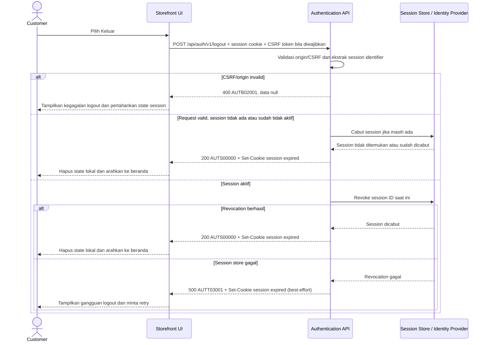

# Customer Logout - Interface Agreement

> **Document Type:** IFA / API Contract  
> **Status:** Draft  
> **Service / Domain:** Authentication  
> **Consumer / Partner:** JokiHub Storefront (customer account)

## Design

API mengakhiri session customer aktif, mencabut session pada auth/session store, lalu menghapus cookie browser. Endpoint dirancang idempotent: request tanpa session valid tetap mengembalikan sukses dan mengirim cookie kedaluwarsa. Login contract mengusulkan opaque server-side session dalam secure HttpOnly cookie; pilihan identity provider dan session architecture masih perlu disetujui. Endpoint ini tidak menangani logout admin.

## Sequence Diagram



## Performance / SLA Targets

| Success Rate                                        | VUser                                    | CPU / Memory                             | Response Time                                                                        |
| --------------------------------------------------- | ---------------------------------------- | ---------------------------------------- | ------------------------------------------------------------------------------------ |
| TBD; konfirmasi criticality dan availability target | TBD; konfirmasi concurrent logout puncak | TBD; tetapkan dari capacity estimate/NFT | TBD; usulan baseline web non-kritis: ideal 200 ms, acceptable 1 s, max tolerable 2 s |

## General Information

| Component          | Value                                                                                                                                                             |
| ------------------ | ----------------------------------------------------------------------------------------------------------------------------------------------------------------- |
| Description        | Mencabut session customer saat ini dan membersihkan cookie login storefront.                                                                                      |
| Resource URL       | `https://{host}/api/auth/v1/logout`                                                                                                                               |
| Transport Protocol | HTTPS, REST                                                                                                                                                       |
| Request Verb       | POST                                                                                                                                                              |
| Content Type       | `application/json` response; tidak ada request body.                                                                                                              |
| Interaction Type   | Synchronous                                                                                                                                                       |
| Security Policy    | Public endpoint dengan session cookie Secure/HttpOnly; validasi CSRF/origin wajib jika memakai cookie authentication. Jangan menerima session ID dari body/query. |

### Path / Endpoint

| Section        | Value                           |
| -------------- | ------------------------------- |
| Host / Domain  | `{host}` (environment-specific) |
| Service Name   | Authentication                  |
| Version        | `v1`                            |
| Resource       | `/auth/v1/logout`               |
| Final Endpoint | `POST /api/auth/v1/logout`      |

### API Versioning

- **Decision:** New Endpoint
- **Previous Endpoint:** Tidak ada logout API yang teridentifikasi; auth UI saat ini belum terhubung ke backend.
- **Final Endpoint:** `POST /api/auth/v1/logout`
- **Backward Compatibility:** Belum ada consumer API ini. Perubahan session transport atau response contract yang mematahkan consumer memerlukan major version baru.
- **Reason:** Storefront membutuhkan operasi eksplisit untuk mencabut session customer dan membersihkan browser credential.

## Business Rules

1. Endpoint hanya mengakhiri session customer storefront; session admin dikelola oleh flow authentication admin yang terpisah.
2. Session identifier hanya dibaca dari cookie HttpOnly yang ditetapkan login contract atau mekanisme session resmi identity provider. Jangan menerima session credential melalui URL, request body, atau query parameter.
3. Untuk session aktif, server mencabut session pada sumber otoritatif sebelum merespons sukses. Dengan demikian cookie lama tidak dapat dipakai untuk autentikasi setelah logout sukses.
4. Logout bersifat idempotent. Cookie tidak ada, session sudah kedaluwarsa, atau session sudah dicabut tetap menghasilkan sukses dan menghapus cookie client.
5. Logout hanya mencabut session saat ini. Logout semua perangkat, refresh-token family revocation, dan revoke semua session account memerlukan operasi terpisah.
6. Cookie dihapus menggunakan nama, domain/path, dan atribut yang sama dengan cookie login; nilai `Max-Age=0` atau waktu expired di masa lalu. Jangan mengirim ulang session credential dalam response.
7. Jika memakai cookie authentication, validasi CSRF token dan origin/Referer sesuai policy; `SameSite` cookie tidak menggantikan semua CSRF controls. Bila provider memakai bearer header, ikuti revocation policy provider dan jangan menerima token dari body.
8. Request yang gagal validasi CSRF tidak mencabut session. Kegagalan session store saat revoke dikembalikan sebagai technical error; client tetap diperintahkan menghapus credential lokal, tetapi revoke server-side belum terkonfirmasi sampai retry berhasil.
9. Response tidak mengembalikan profil, token, session ID, atau informasi apakah session tertentu masih ada.
10. Jangan mencatat cookie, CSRF secret, bearer token, atau session identifier mentah ke log/tracing. Catat event logout dengan ID korelasi dan account/session reference yang dimasking atau di-hash.
11. API tidak menghapus user account, member profile, order, payment, atau histori.

## Request Headers

| Header         | E/N/T | Type   | M/O/C | Max Length | Description                                                                           | Example                                      |
| -------------- | ----- | ------ | ----- | ---------: | ------------------------------------------------------------------------------------- | -------------------------------------------- |
| `Cookie`       | N     | String | C     |       4096 | Memuat cookie session HttpOnly dari login; tidak dikirim manual oleh browser JS.      | `__Host-jokihub-session={opaque-session-id}` |
| `X-CSRF-Token` | N     | String | C     |        TBD | Wajib bila cookie-based session policy memerlukannya; token bukan session credential. | `csrf_{opaque}`                              |
| `Origin`       | N     | String | C     |        255 | Browser origin yang divalidasi terhadap allowlist.                                    | `https://{storefront-host}`                  |
| `Accept`       | N     | String | O     |        100 | Tipe media response yang diterima client.                                             | `application/json`                           |
| `X-Request-Id` | N     | String | O     |        100 | ID korelasi acak; jangan memuat token atau PII.                                       | `req-4ca7d2`                                 |

## Request Parameters

Tidak ada path/query parameter.

## Request Body

Tidak ada request body.

### Request Validation

1. Endpoint menerima hanya session credential melalui cookie/header authentication resmi. Tolak session ID pada body/query untuk mencegah credential leakage.
2. Jika request memakai cookie session, validasi `Origin` terhadap allowlist yang dikonfigurasi. Tolak origin asing dengan `AUTB02001`.
3. Validasi `X-CSRF-Token` bila diwajibkan oleh session policy. Token hilang/tidak valid menghasilkan `AUTB02001`; jangan revoke session.
4. Jika cookie tidak ada, invalid, expired, atau session sudah dicabut, jalankan idempotent success dan kirim cookie expired. Jangan membedakan kondisi tersebut pada response body.
5. Jika session aktif, revoke pada authoritative session store. Kegagalan revoke menghasilkan HTTP 500 `AUTT03001` dan cookie clearing best-effort.
6. Request tidak membutuhkan JSON body; body atau query parameter yang tidak didefinisikan ditolak sesuai API gateway policy.
7. Session cookie clearing harus menggunakan atribut cookie yang sama dengan login configuration, termasuk `Path`, `Domain` bila dipakai, `Secure`, `HttpOnly`, dan `SameSite`.

## Response Body

Semua response menggunakan envelope `status` dan `data`. Response sukses tanpa session aktif maupun dengan session aktif menggunakan payload yang sama.

| Attribute        | E/N/T | Type        | M/O/C | Max Length | Description                                                                           | Example             |
| ---------------- | ----- | ----------- | ----- | ---------: | ------------------------------------------------------------------------------------- | ------------------- |
| `status`         | N     | Object      | M     |          — | Object status response.                                                               | `{}`                |
| `status.code`    | N     | String      | M     |         20 | Service status code.                                                                  | `AUTS00000`         |
| `status.message` | N     | String      | O     |        200 | Pesan hasil untuk consumer.                                                           | `Logout successful` |
| `data`           | N     | Object/null | M     |          — | Metadata hasil logout; `null` pada error.                                             | `{}`                |
| `data.loggedOut` | N     | Boolean     | M     |          — | Menyatakan request logout diproses; tidak mengungkap apakah session sebelumnya aktif. | `true`              |

### Success Example

```json
{
  "status": {
    "code": "AUTS00000",
    "message": "Logout successful"
  },
  "data": {
    "loggedOut": true
  }
}
```

Header sukses:

```http
Set-Cookie: __Host-jokihub-session=; Path=/; Max-Age=0; Secure; HttpOnly; SameSite=Lax
```

### Business Error Example

```json
{
  "status": {
    "code": "AUTB02001",
    "message": "Logout request validation failed"
  },
  "data": null
}
```

### Technical Error Example

```json
{
  "status": {
    "code": "AUTT03001",
    "message": "Authentication service is temporarily unavailable"
  },
  "data": null
}
```

## HTTP Status Codes

| HTTP Status | Usage                                                                                                                                                          |
| ----------- | -------------------------------------------------------------------------------------------------------------------------------------------------------------- |
| `200`       | Session berhasil dicabut atau request tanpa session valid diproses idempotently; cookie dihapus.                                                               |
| `400`       | CSRF/origin/header request tidak valid sesuai baseline API project. Auth/CSRF-specific mapping perlu dikonfirmasi.                                             |
| `500`       | Session store/identity provider gagal mencabut session secara otoritatif. Cookie clearing dikirim best-effort; client harus retry untuk memastikan revocation. |

## Service Status Codes

Format: `[Service Prefix][Status Type][Category][Specific Error Code]`

| Code        | Type      | Category        | Meaning                                                               |
| ----------- | --------- | --------------- | --------------------------------------------------------------------- |
| `AUTS00000` | Success   | General         | Logout diproses; session dicabut bila masih aktif dan cookie dihapus. |
| `AUTB02001` | Business  | User validation | Validasi origin, CSRF, atau bentuk request gagal.                     |
| `AUTT03001` | Technical | Database        | Session store/identity provider tidak dapat mencabut session.         |

## API Exposure Classification

| Classification | Rationale                                                                                                                                                                                                  |
| -------------- | ---------------------------------------------------------------------------------------------------------------------------------------------------------------------------------------------------------- |
| Public         | Dipanggil oleh storefront customer melalui internet. Endpoint menerima session cookie dan mengubah authentication state, sehingga perlu CSRF/origin validation, TLS, rate limiting, dan logging redaction. |

## Testing & Documentation Scope

| Scope      | Required | Rationale / Handoff                                                                                                                                                                                |
| ---------- | -------- | -------------------------------------------------------------------------------------------------------------------------------------------------------------------------------------------------- |
| NFT        | Yes      | Public auth lifecycle API. Uji logout session aktif, cookie hilang/expired, retry, session store latency/failure, dan concurrent requests. VUser, CPU/memory, target TPS TBD berdasarkan forecast. |
| VA/Pentest | Yes      | Uji CSRF, origin spoofing, session fixation/replay setelah logout sukses, cookie attribute/path matching, token leakage, CORS, dan customer/admin session separation.                              |

## Assumptions

- Endpoint, response envelope, cookie name, status codes, dan session revocation mechanics mengikuti proposal [Login](./login.md); belum disetujui auth architecture.
- Login menggunakan server-side opaque session dengan cookie `__Host-jokihub-session`; jika identity provider memakai token-based session, endpoint harus memanggil revoke endpoint/provider yang sesuai.
- Browser UI menghapus state lokal setelah response sukses; server-side revocation tetap sumber otoritatif.
- CSRF mechanism, allowed origins, cookie lifetime, session store, rate limits, concurrent logout semantics, dan auth HTTP mapping TBD.
- Logout admin dan global logout seluruh device tidak termasuk scope.

## References

- `./login.md` — customer login contract dan proposed session cookie.
- `../../erd/user-management-erd.md` — customer account status/lifecycle dan pemisahan admin account.
- `src/features/Auth/views/organisms/LoginForm.organism.tsx` — current auth UI; backend belum terhubung.
