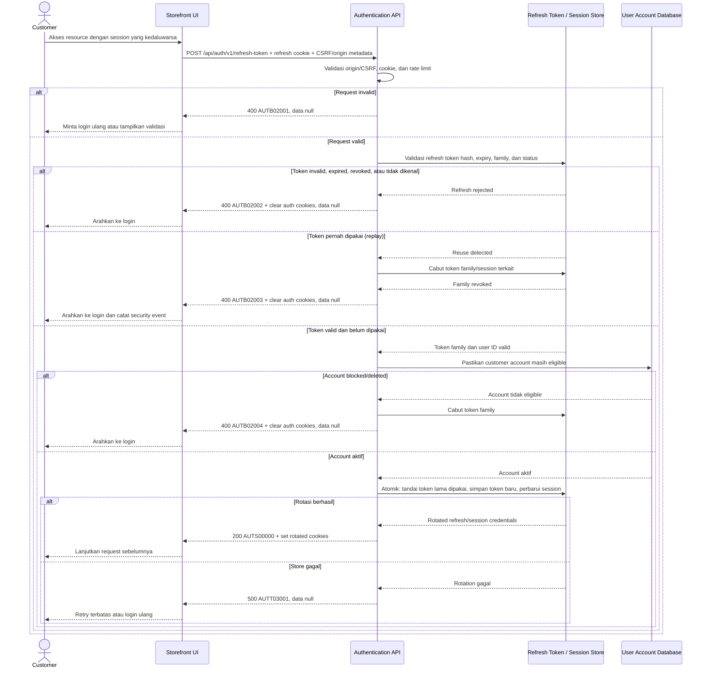

# Customer Refresh Token - Interface Agreement

> **Document Type:** IFA / API Contract  
> **Status:** Draft  
> **Service / Domain:** Authentication  
> **Consumer / Partner:** JokiHub Storefront (customer account)

## Design

API memperbarui session customer menggunakan refresh token opaque pada cookie HttpOnly, lalu merotasi refresh token agar credential lama tidak dapat dipakai lagi. Endpoint juga memperbarui session/access cookie sesuai pola session auth yang disetujui. Login contract saat ini hanya mendefinisikan `__Host-jokihub-session`; implementasi endpoint ini mensyaratkan login contract diperbarui untuk menerbitkan refresh cookie dan menyimpan token family pada auth/session store.

## Sequence Diagram



## Performance / SLA Targets

| Success Rate                                        | VUser                                     | CPU / Memory                             | Response Time                                                                        |
| --------------------------------------------------- | ----------------------------------------- | ---------------------------------------- | ------------------------------------------------------------------------------------ |
| TBD; konfirmasi criticality dan availability target | TBD; konfirmasi concurrent refresh puncak | TBD; tetapkan dari capacity estimate/NFT | TBD; usulan baseline web non-kritis: ideal 200 ms, acceptable 1 s, max tolerable 2 s |

## General Information

| Component          | Value                                                                                                                                                                                               |
| ------------------ | --------------------------------------------------------------------------------------------------------------------------------------------------------------------------------------------------- |
| Description        | Memvalidasi dan merotasi refresh token customer untuk memperbarui session storefront.                                                                                                               |
| Resource URL       | `https://{host}/api/auth/v1/refresh-token`                                                                                                                                                          |
| Transport Protocol | HTTPS, REST                                                                                                                                                                                         |
| Request Verb       | POST                                                                                                                                                                                                |
| Content Type       | `application/json` response; tidak ada request body.                                                                                                                                                |
| Interaction Type   | Synchronous                                                                                                                                                                                         |
| Security Policy    | Public endpoint; refresh credential hanya melalui Secure HttpOnly cookie, TLS wajib, CSRF/origin controls dan rate limit wajib. Token disimpan server-side dalam bentuk hash/secure representation. |

### Path / Endpoint

| Section        | Value                             |
| -------------- | --------------------------------- |
| Host / Domain  | `{host}` (environment-specific)   |
| Service Name   | Authentication                    |
| Version        | `v1`                              |
| Resource       | `/auth/v1/refresh-token`          |
| Final Endpoint | `POST /api/auth/v1/refresh-token` |

### API Versioning

- **Decision:** New Endpoint
- **Previous Endpoint:** Tidak ada refresh-token API yang teridentifikasi pada solutioning sprint ini.
- **Final Endpoint:** `POST /api/auth/v1/refresh-token`
- **Backward Compatibility:** Belum ada consumer API ini. Perubahan cookie/token rotation contract yang mematahkan consumer memerlukan major version baru.
- **Reason:** Storefront memerlukan cara memperbarui session tanpa meminta customer memasukkan password setiap kali masa berlaku session/access credential berakhir.

## Business Rules

1. Endpoint hanya memperbarui session customer. Admin refresh/session memakai identity policy terpisah.
2. Refresh credential diterima hanya melalui cookie `HttpOnly`; jangan menerima token melalui JSON body, URL, atau query string karena raw token dapat bocor ke browser logs/referrer/analytics.
3. Token adalah opaque, berentropi tinggi, terkait satu user/session family, dan memiliki absolute expiry serta idle expiry yang ditetapkan security policy. Simpan hash/token verifier, bukan raw token.
4. Setiap refresh memakai single-use rotation: token lama ditandai consumed dan token baru diterbitkan dalam satu operasi atomik. Token lama tidak boleh mengeluarkan session baru.
5. Replay token yang sudah dipakai menandakan kemungkinan pencurian credential; cabut token family/session terkait, catat security event tanpa token mentah, dan minta customer login ulang.
6. Request concurrent dapat membuat refresh yang sah tampak seperti replay. Client harus mengoordinasikan satu refresh request per browser/session; grace window atau idempotency behavior harus ditentukan oleh implementasi security sebelum produksi.
7. Refresh hanya berhasil bila user masih eligible: account berstatus `ACTIVE`, belum soft-deleted, dan telah memenuhi verifikasi yang diwajibkan. Jika blocked/deleted, cabut token family.
8. Sukses memperbarui session/access cookie dan refresh cookie secara bersamaan. Gunakan nama, atribut, dan `Path`/domain yang sesuai dengan login cookie configuration; raw token tidak dimasukkan dalam JSON.
9. Token invalid, expired, revoked, atau tidak dikenal menghasilkan pesan generik yang sama agar tidak membocorkan validitas token. Hapus auth cookies di response.
10. Validasi CSRF dan `Origin` berlaku untuk refresh berbasis cookie. `SameSite` cookie saja bukan kontrol CSRF lengkap; exact policy mengikuti deployment origins.
11. Refresh gagal karena session store/auth provider unavailable tidak boleh mengonsumsi token lama secara parsial. Rotasi harus atomic sehingga retry aman atau client diarahkan login ulang.
12. Refresh tidak memperpanjang absolute lifetime melewati batas maksimum session family. Access/session TTL, refresh idle TTL, dan absolute TTL TBD.
13. Endpoint tidak mengubah profil customer, status member, order, atau role admin. Jangan mengeluarkan claim/privilege admin untuk customer session.
14. Logout harus mencabut session/token family sesuai definisi scope yang disetujui; logout contract saat ini menyebut revoke session saat ini tetapi belum menyebut refresh token family dan perlu diselaraskan.
15. Jangan mencatat cookie, raw refresh token, session ID, CSRF secret, atau bearer token di application logs/traces.

## Request Headers

| Header         | E/N/T | Type   | M/O/C | Max Length | Description                                                                                                    | Example                                         |
| -------------- | ----- | ------ | ----- | ---------: | -------------------------------------------------------------------------------------------------------------- | ----------------------------------------------- |
| `Cookie`       | N     | String | M     |       4096 | Memuat refresh cookie HttpOnly yang diterbitkan login/refresh. Browser mengirim otomatis sesuai cookie policy. | `__Host-jokihub-refresh={opaque-refresh-token}` |
| `X-CSRF-Token` | N     | String | C     |        TBD | Wajib jika cookie/session policy menggunakannya. Token CSRF bukan authentication credential.                   | `csrf_{opaque}`                                 |
| `Origin`       | N     | String | C     |        255 | Browser origin untuk validasi allowlist.                                                                       | `https://{storefront-host}`                     |
| `Accept`       | N     | String | O     |        100 | Format response yang diterima client.                                                                          | `application/json`                              |
| `X-Request-Id` | N     | String | O     |        100 | ID korelasi acak; jangan memuat token/PII.                                                                     | `req-b5de31`                                    |

## Request Parameters

Tidak ada path/query parameter.

## Request Body

Tidak ada request body. Refresh token hanya berasal dari cookie authentication yang ditetapkan server.

### Request Validation

1. Wajib ada refresh cookie dengan nama yang disepakati login contract (`__Host-jokihub-refresh` sebagai usulan). Tolak raw token dalam body/query/header selain cookie yang telah ditetapkan.
2. Validasi `Origin` terhadap allowlist bila header tersedia/diwajibkan deployment policy. Origin asing menghasilkan `AUTB02001` tanpa mengonsumsi token.
3. Validasi `X-CSRF-Token` sesuai cookie-auth policy. Token hilang/invalid menghasilkan `AUTB02001` tanpa mengonsumsi token.
4. Refresh cookie harus terformat sesuai token opaque yang diterbitkan server. Jangan membedakan malformed, unknown, expired, dan revoked pada pesan publik; gunakan `AUTB02002` dan hapus auth cookies.
5. Token yang telah dikonsumsi sebelumnya memicu replay handling: revoke token family secara atomik, kembalikan `AUTB02003`, dan clear auth cookies.
6. User ID yang terikat token harus masih ada, berstatus `ACTIVE`, tidak soft-deleted, dan memenuhi verification policy. Jika tidak eligible, revoke family dan kembalikan `AUTB02004`.
7. Rotasi token lama ke token baru dan pembaruan session harus dilakukan atomic. Jika penyimpanan gagal, jangan mengembalikan cookie credential baru yang belum tersimpan.
8. Tidak ada parameter/body lain yang diterima. Session store/provider failure menghasilkan HTTP 500 `AUTT03001` tanpa detail internal.

## Response Body

Semua response menggunakan envelope `status` dan `data`. Credential hanya dikirim melalui `Set-Cookie`; tidak pernah dikembalikan sebagai JSON field.

| Attribute                | E/N/T | Type               | M/O/C | Max Length | Description                                                           | Example                |
| ------------------------ | ----- | ------------------ | ----- | ---------: | --------------------------------------------------------------------- | ---------------------- |
| `status`                 | N     | Object             | M     |          — | Object status response.                                               | `{}`                   |
| `status.code`            | N     | String             | M     |         20 | Service status code.                                                  | `AUTS00000`            |
| `status.message`         | N     | String             | O     |        200 | Pesan hasil untuk consumer.                                           | `Session refreshed`    |
| `data`                   | N     | Object/null        | M     |          — | Metadata sesi tanpa credential mentah; null pada error.               | `{}`                   |
| `data.session.expiresAt` | N     | String (date-time) | M     |         35 | Waktu expiry access/session credential yang diperbarui, UTC.          | `2026-10-11T18:30:00Z` |
| `data.session.csrfToken` | N     | String             | C     |        TBD | Token CSRF baru jika strategi cookie membutuhkan token yang dirotasi. | `csrf_{opaque}`        |

### Success Example

```json
{
  "status": {
    "code": "AUTS00000",
    "message": "Session refreshed"
  },
  "data": {
    "session": {
      "expiresAt": "2026-10-11T18:30:00Z",
      "csrfToken": "csrf_{opaque}"
    }
  }
}
```

Header sukses usulan:

```http
Set-Cookie: __Host-jokihub-session={new-opaque-session-id}; Path=/; Secure; HttpOnly; SameSite=Lax
Set-Cookie: __Host-jokihub-refresh={new-opaque-refresh-token}; Path=/; Secure; HttpOnly; SameSite=Strict
```

### Business Error Example

```json
{
  "status": {
    "code": "AUTB02002",
    "message": "Session cannot be refreshed; sign in again"
  },
  "data": null
}
```

### Technical Error Example

```json
{
  "status": {
    "code": "AUTT03001",
    "message": "Authentication service is temporarily unavailable"
  },
  "data": null
}
```

## HTTP Status Codes

| HTTP Status | Usage                                                                                                                                                                                                            |
| ----------- | ---------------------------------------------------------------------------------------------------------------------------------------------------------------------------------------------------------------- |
| `200`       | Refresh token berhasil dirotasi dan session diperbarui.                                                                                                                                                          |
| `400`       | Request/CSRF invalid, refresh token invalid/expired/revoked, replay terdeteksi, atau account tidak eligible sesuai baseline response project. Auth-specific `401`/`403` dan throttling `429` perlu dikonfirmasi. |
| `500`       | Session store, identity provider, atau user database gagal memproses refresh secara atomic.                                                                                                                      |

## Service Status Codes

Format: `[Service Prefix][Status Type][Category][Specific Error Code]`

| Code        | Type      | Category        | Meaning                                                                                |
| ----------- | --------- | --------------- | -------------------------------------------------------------------------------------- |
| `AUTS00000` | Success   | General         | Refresh token dirotasi dan session diperbarui.                                         |
| `AUTB02001` | Business  | User validation | Origin, CSRF, atau bentuk request tidak valid.                                         |
| `AUTB02002` | Business  | User validation | Token hilang/invalid/expired/revoked atau tidak dapat dipakai; login ulang diperlukan. |
| `AUTB02003` | Business  | User validation | Token reuse/replay terdeteksi dan family dicabut.                                      |
| `AUTB02004` | Business  | User validation | Akun blocked, soft-deleted, atau tidak memenuhi kebijakan verifikasi.                  |
| `AUTT03001` | Technical | Database        | Auth/session store atau user database tidak tersedia/gagal atomic.                     |

## API Exposure Classification

| Classification | Rationale                                                                                                                                                                           |
| -------------- | ----------------------------------------------------------------------------------------------------------------------------------------------------------------------------------- |
| Public         | Dipanggil oleh storefront customer melalui internet dan memproses refresh credential/session. Wajib TLS, CSRF/origin controls, replay defense, rate limiting, dan secret redaction. |

## Testing & Documentation Scope

| Scope      | Required | Rationale / Handoff                                                                                                                                                                                               |
| ---------- | -------- | ----------------------------------------------------------------------------------------------------------------------------------------------------------------------------------------------------------------- |
| NFT        | Yes      | Public auth lifecycle API. Uji rotasi token, expiry, concurrency, provider/session-store latency, account-status lookup, retry, serta peak refresh burst. VUser, CPU/memory, target TPS TBD berdasarkan forecast. |
| VA/Pentest | Yes      | Uji token replay/family revocation, race/concurrent refresh, CSRF, origin validation, cookie flags, token theft/reuse, account status enforcement, logout interaction, dan credential leakage.                    |

## Assumptions

- Endpoint, service codes, cookie names, rotation, expiry, dan refresh-family storage adalah rancangan karena auth/session architecture belum disetujui.
- Login contract perlu diubah untuk menerbitkan `__Host-jokihub-refresh` serta mendefinisikan session/access cookie dan refresh-token family. Login saat ini hanya mendokumentasikan session cookie.
- Logout contract perlu menghapus refresh cookie dan mencabut token family; saat ini hanya menyebut session cookie/session saat ini.
- Refresh token opaque server-side diusulkan; bila identity provider memakai OAuth/OIDC, kontrak harus mengikuti refresh grant/token rotation dan revocation behavior provider.
- Access/session TTL, idle/absolute refresh TTL, token family schema, concurrency grace/idempotency, CSRF policy, cookie SameSite/domain, rate limit, identity provider, role/customer eligibility, dan SLA TBD.
- Recovery setelah refresh dependency failure harus diselaraskan dengan rotation semantics agar token tidak terpakai tanpa credential baru yang terkirim.

## References

- `./login.md` — customer login dan session-cookie proposal.
- `./logout.md` — session revocation dan cookie clearing.
- `./register.md` — account verification state yang menentukan kelayakan refresh.
- `../../erd/user-management-erd.md` — account lifecycle, status, dan pemisahan customer/admin.
