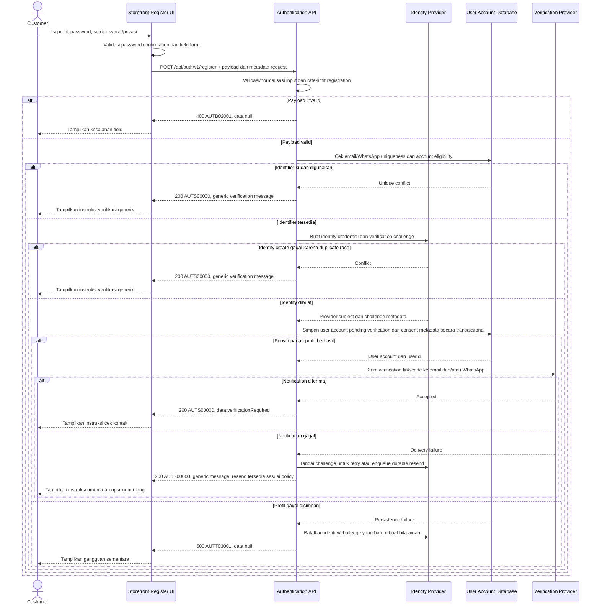

# Customer Registration - Interface Agreement

> **Document Type:** IFA / API Contract  
> **Status:** Draft  
> **Service / Domain:** Authentication / Customer Account  
> **Consumer / Partner:** JokiHub Storefront (customer account)

## Design

API mendaftarkan akun customer dari form register dengan nama, email, nomor WhatsApp, password, dan persetujuan syarat/privasi. API membuat identity credential melalui auth provider, menyimpan profil customer, lalu memulai verifikasi kontak sebelum account boleh login. Form juga meminta konfirmasi password; client memeriksa kecocokan dan tidak perlu mengirim field konfirmasi. ERD memisahkan `USER_ACCOUNT` dan `ADMIN_ACCOUNT`, tetapi belum memodelkan status verifikasi, credential/provider subject, atau bukti persetujuan legal.

## Sequence Diagram



## Performance / SLA Targets

| Success Rate                                        | VUser                                          | CPU / Memory                             | Response Time                                                                                                                                          |
| --------------------------------------------------- | ---------------------------------------------- | ---------------------------------------- | ------------------------------------------------------------------------------------------------------------------------------------------------------ |
| TBD; konfirmasi criticality dan availability target | TBD; konfirmasi concurrent registration puncak | TBD; tetapkan dari capacity estimate/NFT | TBD; usulan baseline web non-kritis: ideal 200 ms, acceptable 1 s, max tolerable 2 s; notification delivery async dianjurkan dan SLA provider terpisah |

## General Information

| Component          | Value                                                                                                                                                                                    |
| ------------------ | ---------------------------------------------------------------------------------------------------------------------------------------------------------------------------------------- |
| Description        | Membuat akun customer baru dan memulai verifikasi kontak.                                                                                                                                |
| Resource URL       | `https://{host}/api/auth/v1/register`                                                                                                                                                    |
| Transport Protocol | HTTPS, REST                                                                                                                                                                              |
| Request Verb       | POST                                                                                                                                                                                     |
| Content Type       | `application/json`                                                                                                                                                                       |
| Interaction Type   | Synchronous registration with asynchronous verification notification (proposed)                                                                                                          |
| Security Policy    | Public endpoint; TLS wajib, password tidak boleh dicatat, rate-limit/abuse controls wajib, verifikasi kontak sebelum login. Credential disimpan hanya oleh auth provider yang disetujui. |

### Path / Endpoint

| Section        | Value                           |
| -------------- | ------------------------------- |
| Host / Domain  | `{host}` (environment-specific) |
| Service Name   | Authentication                  |
| Version        | `v1`                            |
| Resource       | `/auth/v1/register`             |
| Final Endpoint | `POST /api/auth/v1/register`    |

### API Versioning

- **Decision:** New Endpoint
- **Previous Endpoint:** Tidak ada registration API yang teridentifikasi; register UI saat ini hanya menampilkan notice bahwa layanan akun belum tersedia.
- **Final Endpoint:** `POST /api/auth/v1/register`
- **Backward Compatibility:** Belum ada consumer API ini. Penambahan field request opsional bersifat kompatibel; perubahan credential/verification contract yang mematahkan consumer memerlukan major version baru.
- **Reason:** Storefront membutuhkan provisioning akun customer dan verifikasi kontak sebelum akses account diberikan.

## Business Rules

1. Endpoint hanya membuat `USER_ACCOUNT` customer. Endpoint tidak membuat `ADMIN_ACCOUNT`, role, atau permission.
2. Nama lengkap, email, nomor WhatsApp, password, dan persetujuan terms/privacy wajib sesuai form UI.
3. Password dikirim melalui TLS dan diberikan ke identity provider/credential store. API tidak menyimpan plaintext password atau password confirmation; credential hash dikelola oleh komponen auth yang disetujui.
4. `passwordConfirmation` adalah validasi UI saja dan tidak dikirim ke API. Jika product/API standard mengharuskan server-side confirmation, tambahkan field secara eksplisit; jangan log nilainya.
5. Email dinormalisasi dengan trim dan case-fold sesuai policy identity provider; nomor WhatsApp dinormalisasi ke format internasional E.164. Country code dipilih di UI dan harus digabung ke nilai `whatsapp` sebelum request.
6. Email harus unik karena menjadi contact/login identifier. Nomor WhatsApp harus unik dan terverifikasi bila dipakai sebagai identifier login; unique rule final harus konsisten dengan user ERD dan login contract.
7. Credential creation dan user profile provisioning harus konsisten. Gunakan orchestration/outbox/compensation agar kegagalan di salah satu sistem tidak meninggalkan orphan identity atau profil tanpa credential.
8. Akun baru berstatus verification-pending dan belum boleh login sampai kontak yang diwajibkan diverifikasi. User ERD saat ini hanya mengusulkan `ACTIVE`/`BLOCKED`; status `PENDING_VERIFICATION` atau state identity provider perlu ditambahkan/ditetapkan.
9. Account ID, username, status, joined/created/updated timestamps, provider subject, dan verification challenge dibuat server/provider. Username tidak ada pada register form tetapi diwajibkan di draft ERD; strategi generate atau penghapusan kebutuhan username perlu diputuskan.
10. Jangan mengirim password/session otomatis setelah register sebelum verifikasi berhasil. Login dibuat melalui endpoint login setelah account memenuhi verification policy.
11. Persetujuan syarat dan kebijakan privasi disimpan dengan versi dokumen dan waktu persetujuan. Form saat ini hanya menyediakan checkbox; versi dan consent record perlu disediakan server dan dimodelkan pada audit/consent store.
12. Untuk mencegah account enumeration, identifier yang sudah digunakan menerima response generik yang sama seperti registration diterima. Jangan mengirimkan status “email sudah terdaftar” secara eksplisit pada endpoint publik.
13. Bila identifier telah terdaftar tetapi belum verified, resend challenge hanya dilakukan sesuai cooldown dan tidak memperpanjang/mereset limit tanpa policy.
14. Verification link/code memiliki expiry, sekali pakai, rate limit, dan storage aman; nilai token tidak disimpan/log dalam bentuk plaintext. Detail TTL, channel, resend, dan lockout policy TBD.
15. Error notification setelah profil/identity berhasil dibuat tidak membatalkan account secara ambigu. Simpan event secara durable dan sediakan resend verification flow; endpoint tetap dapat mengembalikan pesan umum tanpa membocorkan status.
16. Data PII dan authentication event mengikuti minimisasi, enkripsi, akses terbatas, dan retention policy. Order/member profile tidak dibuat ganda jika account register diulang.

## Request Headers

| Header         | E/N/T | Type   | M/O/C | Max Length | Description                                      | Example            |
| -------------- | ----- | ------ | ----- | ---------: | ------------------------------------------------ | ------------------ |
| `Content-Type` | N     | String | M     |        100 | Format payload.                                  | `application/json` |
| `Accept`       | N     | String | O     |        100 | Tipe media response yang diterima client.        | `application/json` |
| `X-Request-Id` | N     | String | O     |        100 | ID korelasi acak; jangan memuat PII atau secret. | `req-8c91af`       |
| `User-Agent`   | N     | String | O     |        512 | Metadata client untuk abuse/security telemetry.  | `Mozilla/5.0 ...`  |

## Request Parameters

Tidak ada path/query parameter.

## Request Body

| Attribute       | E/N/T | Type    | M/O/C | Max Length | Description                                                                                                | Example                 |
| --------------- | ----- | ------- | ----- | ---------: | ---------------------------------------------------------------------------------------------------------- | ----------------------- |
| `name`          | N     | String  | M     |        150 | Nama lengkap customer.                                                                                     | `Rani Example`          |
| `email`         | N     | String  | M     |        254 | Email contact dan login identifier; dinormalisasi.                                                         | `customer@example.test` |
| `whatsapp`      | N     | String  | M     |         32 | Nomor WhatsApp canonical E.164, termasuk country code pilihan UI.                                          | `+6281234567890`        |
| `password`      | N     | String  | M     |        128 | Password baru; contoh sintetis.                                                                            | `ExamplePass!234`       |
| `termsAccepted` | N     | Boolean | M     |          — | Pernyataan customer menyetujui terms dan privacy policy yang ditampilkan. Versi dokumen ditentukan server. | `true`                  |

### Example Request Body

```json
{
  "name": "Rani Example",
  "email": "customer@example.test",
  "whatsapp": "+6281234567890",
  "password": "ExamplePass!234",
  "termsAccepted": true
}
```

`passwordConfirmation` tidak dikirim. UI wajib memastikan nilainya sama dengan `password` sebelum request.

### Request Validation

1. Body wajib JSON object valid dan hanya menerima `name`, `email`, `whatsapp`, `password`, dan `termsAccepted`; field tambahan seperti `userId`, `username`, `status`, `role`, `passwordConfirmation`, `createdAt`, atau provider subject ditolak dengan `AUTB02001`.
2. `name` wajib string; trim sebelum simpan, tidak boleh kosong, maksimal 150 karakter.
3. `email` wajib string valid, trim/case-normalize sesuai provider policy, dan maksimal 254 karakter.
4. `whatsapp` wajib string dalam E.164 canonical setelah UI menggabungkan country code; maksimal 32 karakter. Tolak nomor lokal yang ambigu tanpa country code.
5. `password` wajib string 6–128 karakter mengikuti minimum pada register UI dan maksimum usulan 128. Terapkan password policy server-side; jangan trim atau menormalisasi karakter password.
6. `termsAccepted` wajib boolean `true`. Nilai false atau tidak ada menghasilkan `AUTB02001`; server merekam versi terms/privacy aktif dan waktu consent.
7. Validasi sintaks dilakukan sebelum provider call. Rate-limit/anti-bot check dilakukan sebelum membuat credential atau mengirim verification message.
8. Email/WhatsApp conflict tidak mengembalikan detail identifier mana yang telah terdaftar. Endpoint menghasilkan response generik `AUTS00000` dengan `verificationRequired=true`; verification/resend flow tetap harus mencegah pengambilalihan akun.
9. Identity provider dan user database failure menghasilkan HTTP 500 `AUTT03001`. Lakukan compensation atau durable retry sesuai langkah yang telah berhasil; jangan expose provider response/stack trace.
10. Verification notification failure setelah provisioning tidak membatalkan keberhasilan provisioning; simpan retry/resend event durable dan tetap gunakan pesan publik generik.

## Response Body

Semua response menggunakan envelope `status` dan `data`. Untuk mengurangi enumeration, response sukses generik tidak mengungkap apakah identifier baru dibuat atau telah ada.

| Attribute                   | E/N/T | Type        | M/O/C | Max Length | Description                                                                     | Example                                               |
| --------------------------- | ----- | ----------- | ----- | ---------: | ------------------------------------------------------------------------------- | ----------------------------------------------------- |
| `status`                    | N     | Object      | M     |          — | Object status response.                                                         | `{}`                                                  |
| `status.code`               | N     | String      | M     |         20 | Service status code.                                                            | `AUTS00000`                                           |
| `status.message`            | N     | String      | O     |        200 | Pesan generik untuk consumer.                                                   | `If eligible, verification instructions will be sent` |
| `data`                      | N     | Object/null | M     |          — | Payload minimal; `null` ketika technical/validation error.                      | `{}`                                                  |
| `data.verificationRequired` | N     | Boolean     | M     |          — | Menunjukkan flow verifikasi diperlukan; tidak mengkonfirmasi account existence. | `true`                                                |
| `data.nextStep`             | N     | String      | M     |         30 | Instruksi client berikutnya.                                                    | `CHECK_CONTACT`                                       |

### Success Example

```json
{
  "status": {
    "code": "AUTS00000",
    "message": "If eligible, verification instructions will be sent"
  },
  "data": {
    "verificationRequired": true,
    "nextStep": "CHECK_CONTACT"
  }
}
```

### Business Error Example

```json
{
  "status": {
    "code": "AUTB02001",
    "message": "Registration request is invalid"
  },
  "data": null
}
```

### Technical Error Example

```json
{
  "status": {
    "code": "AUTT03001",
    "message": "Registration service is temporarily unavailable"
  },
  "data": null
}
```

## HTTP Status Codes

| HTTP Status | Usage                                                                                                                                                                      |
| ----------- | -------------------------------------------------------------------------------------------------------------------------------------------------------------------------- |
| `200`       | Request valid dan generic registration/verification instruction diberikan; identifier conflict tidak diungkap. Konfirmasi apakah create standard memilih `201` atau `202`. |
| `400`       | Payload/consent invalid sesuai baseline response project. Auth-specific `422` atau `429` untuk rate limit perlu diselaraskan dengan API gateway standard.                  |
| `500`       | Authentication provider, user database, atau required durable workflow mengalami kegagalan tak terduga.                                                                    |

## Service Status Codes

Format: `[Service Prefix][Status Type][Category][Specific Error Code]`

| Code        | Type      | Category        | Meaning                                                                          |
| ----------- | --------- | --------------- | -------------------------------------------------------------------------------- |
| `AUTS00000` | Success   | General         | Registration request diproses dengan pesan verifikasi generik.                   |
| `AUTB02001` | Business  | User validation | Input, format, password policy, atau persetujuan terms/privacy invalid.          |
| `AUTT03001` | Technical | Database        | Identity/profile provisioning gagal atau dependency registration tidak tersedia. |

## API Exposure Classification

| Classification | Rationale                                                                                                                                                                                 |
| -------------- | ----------------------------------------------------------------------------------------------------------------------------------------------------------------------------------------- |
| Public         | Dipanggil storefront customer melalui internet. Mengelola PII dan password serta mengirim verification challenge; wajib TLS, abuse protection, enumeration defense, dan secret redaction. |

## Testing & Documentation Scope

| Scope      | Required | Rationale / Handoff                                                                                                                                                                                                                                      |
| ---------- | -------- | -------------------------------------------------------------------------------------------------------------------------------------------------------------------------------------------------------------------------------------------------------- |
| NFT        | Yes      | Public onboarding API. Uji registration success, duplicate identifier generic response, email/WhatsApp delivery queue, provider latency/failure, database compensation, retry, dan burst signup. VUser, CPU/memory, target TPS TBD berdasarkan forecast. |
| VA/Pentest | Yes      | Uji mass assignment, credential handling, password policy, account enumeration, spam/abuse, verification token leakage/replay/expiry, consent integrity, duplicate/race creation, PII logs, dan pemisahan customer/admin.                                |

## Assumptions

- Endpoint, response envelope, service codes, field mapping, dan verification workflow adalah rancangan karena authentication provider belum dipilih.
- Form saat ini meminta semua field dan minimum password 6 karakter; kekuatan password policy final perlu security approval.
- Login UI menerima email atau WhatsApp. Agar keduanya dapat dipakai login, kontak yang diwajibkan harus terverifikasi dan identifier uniqueness/normalization harus konsisten antara Register dan Login.
- User ERD mewajibkan `email`, `username`, dan `status`, sementara register UI tidak meminta username dan ERD belum punya verification state. Tetapkan generated username/ubah schema, serta tambahkan state verification atau serahkan state ke identity provider sebelum implementasi.
- `whatsapp` ditandai nullable di ERD tetapi wajib di UI; schema dan product policy perlu diselaraskan.
- Model consent harus menyimpan versi Syarat & Ketentuan/Kebijakan Privasi dan waktu persetujuan; belum ada entitas consent pada ERD.
- Identity provider, password hash policy, verification channel/order, challenge TTL, resend endpoint, rate limits, anti-bot, account linking, idempotency, notification provider, retry/outbox, auth HTTP mapping, dan SLA TBD.
- Social registration buttons pada auth UI tidak termasuk endpoint ini; setiap provider login/registration memerlukan kontrak tersendiri.

## References

- `./login.md` — customer login identifier dan syarat account eligible sebelum session dibuat.
- `./logout.md` — session lifecycle setelah autentikasi.
- `../../erd/user-management-erd.md` — profil customer, identifier constraints, account status, dan credential ownership.
- `src/features/Auth/views/organisms/RegisterForm.organism.tsx` — field register, minimum password, confirmation validation, country code options, dan consent checkbox.
- `src/features/Auth/views/pages/Register.page.tsx` — register page composition.
