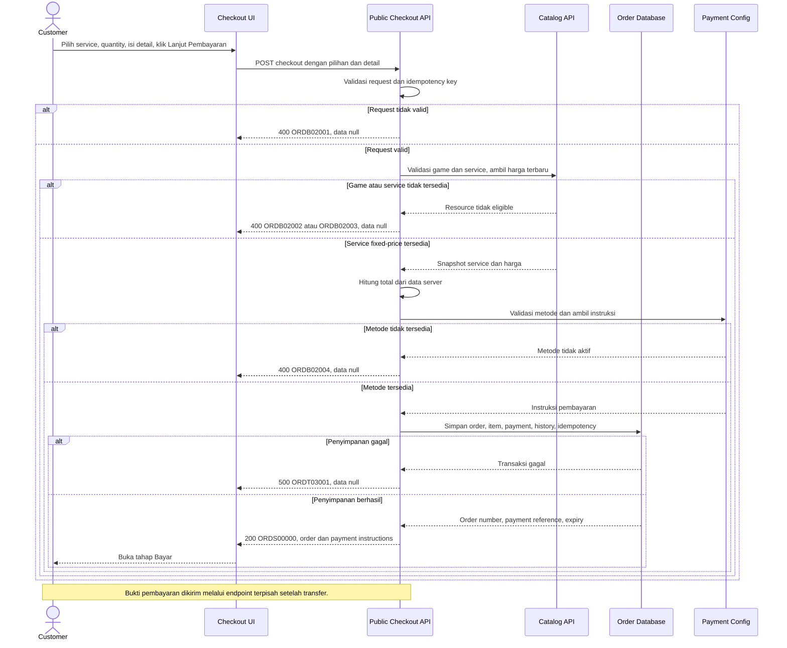

# Checkout Service - Continue to Payment Interface Agreement

> **Document Type:** API Contract  
> **Status:** Draft  
> **Service / Domain:** Public Checkout — Order & Manual Payment  
> **Consumer / Partner:** JokiHub storefront (`/order/:gameSlug`)

## Design

Kontrak ini mendukung CTA `Lanjut Pembayaran` pada ringkasan checkout. CTA memvalidasi pilihan game/service, jumlah, serta detail customer, lalu membuat order dan payment attempt menggunakan data harga authoritative server. API mengembalikan nomor order, nilai final, batas waktu, dan instruksi metode pembayaran agar UI membuka tahap `Bayar`. Untuk flow QRIS/transfer manual pada UI saat ini, pembuatan order belum berarti pembayaran berhasil: customer membayar di luar aplikasi lalu mengirim bukti melalui endpoint terpisah; admin melakukan validasi manual. Promo belum terintegrasi dan tidak boleh mengurangi total kecuali diverifikasi server. Custom/quote service tidak boleh melewati alur ini sebelum quote disetujui dan harga final tersedia.

## Sequence Diagram



## Performance / SLA Targets

| Success Rate                                     | VUser                                | CPU / Memory                        | Response Time                                                          |
| ------------------------------------------------ | ------------------------------------ | ----------------------------------- | ---------------------------------------------------------------------- |
| TBD; define checkout/order creation availability | TBD; forecast peak checkout visitors | TBD; capacity estimate/NFT required | TBD; excludes manual payment settlement; agree provider/config latency |

## General Information

| Component          | Value                                                                                                                                             |
| ------------------ | ------------------------------------------------------------------------------------------------------------------------------------------------- |
| Description        | Memvalidasi checkout, membuat order dan payment attempt pending, lalu mengembalikan nominal authoritative serta instruksi pembayaran manual.      |
| Resource URL       | `https://{host}/api/orders/v1/checkout`                                                                                                           |
| Transport Protocol | HTTPS, REST                                                                                                                                       |
| Request Verb       | POST                                                                                                                                              |
| Content Type       | `application/json`                                                                                                                                |
| Interaction Type   | Synchronous                                                                                                                                       |
| Security Policy    | Public checkout endpoint; rate limiting, bot/abuse controls, PII minimization, idempotency, and payment-proof controls. Guest/account policy TBD. |

### Path / Endpoint

| Section        | Value                           |
| -------------- | ------------------------------- |
| Host / Domain  | `{host}` (environment-specific) |
| Service Name   | Public Checkout / Order         |
| Version        | `v1`                            |
| Resource       | `/orders/v1/checkout`           |
| Final Endpoint | `/api/orders/v1/checkout`       |

### API Versioning

- **Decision:** New Endpoint
- **Previous Endpoint:** Tidak ada public order-creation API yang teridentifikasi; checkout saat ini menggunakan state simulasi UI.
- **Final Endpoint:** `POST /api/orders/v1/checkout`
- **Backward Compatibility:** Belum ada API consumer checkout yang teridentifikasi. Payment proof submission tetap endpoint terpisah. Perubahan payload wajib/semantik memerlukan koordinasi consumer atau major version.
- **Reason:** CTA checkout membutuhkan server-side validation, price calculation, immutable order snapshot, dan payment attempt.

## Business Rules

1. Guest checkout diizinkan sebagai asumsi dari UI saat ini; `userId` opsional hanya berasal dari sesi autentikasi tervalidasi, tidak dipercaya dari body.
2. Request membawa ID game/service, quantity, detail customer, dan payment method yang dipilih. Nama, harga, currency, estimate, game/category labels, dan total dari klien tidak authoritative.
3. Game, kategori, dan service harus masih aktif/publik dan memiliki relasi yang cocok. `gameSlug` route harus resolve ke `gameId` yang sama dengan service.
4. Quantity minimal `1`; batas maksimum per item TBD dan harus ditegakkan server-side.
5. Fixed-price service dihitung ulang dari catalog dalam transaksi/consistent snapshot. `lineTotal = unitPrice × quantity`; subtotal/discount/fee/total mengikuti keputusan finance. Client total diabaikan.
6. Service `isCustomPrice=true` atau `priceAmount=null` tidak dapat dibeli melalui endpoint ini sampai quote/final amount disetujui eksplisit. API mengembalikan error yang dapat dipahami dan mengarahkan ke quote flow.
7. Promo code tidak diterima pada kontrak awal karena promo UI belum memiliki backend. Diskon hanya boleh diterapkan jika promo service memvalidasi code, eligibility, expiry, usage limit, dan amount server-side. Jangan menerima `discountAmount` dari klien.
8. Customer name, WhatsApp, game account identifier, server (opsional), dan notes disimpan hanya seperlunya sebagai order snapshot. Password, OTP, access token, credential game, atau raw card/bank credential dilarang.
9. Nomor WhatsApp dinormalisasi sesuai format internasional dan divalidasi. Game account ID diwajibkan sesuai service; server/notes optional dan dibatasi panjang/karakter.
10. Order, item snapshot, initial `PENDING_PAYMENT` order status, `PENDING_REVIEW`/pending payment attempt sesuai status model, initial history, dan idempotency record harus dibuat atomik.
11. Status storage yang diusulkan: `orderStatus=PENDING_PAYMENT`, `paymentStatus=PENDING_REVIEW` atau `UNPAID` sesuai final Order ERD. Pastikan tidak ada status ambigu; API owner menetapkan satu transisi awal yang konsisten.
12. Payment method harus aktif dan tersedia pada konfigurasi saat submit. Metode saat ini QRIS dan transfer manual BCA; code `QRIS`/`BCA_TRANSFER` perlu diselaraskan dengan UI dan ERD.
13. Response mengembalikan instruksi transfer publik yang aktif: QR image asset/temporary URL untuk QRIS atau bank name, account number, account holder untuk transfer. Instruksi tidak boleh berasal dari hardcoded client mock.
14. `expiresAt` ditetapkan server dan menjadi waktu kedaluwarsa authoritative. Countdown di browser hanya presentasi; setelah expiry pembayaran/proof tidak dapat diterima kecuali kebijakan perpanjangan disetujui.
15. CTA membuat order/payment attempt tetapi tidak mengonfirmasi dana diterima dan tidak menandai order paid. Manual review mengubah status melalui workflow admin terpisah.
16. Bukti pembayaran diunggah lewat API terpisah dengan signed upload/private object storage atau controlled multipart flow; file bytes tidak dikirim sebagai bagian request checkout ini. Bukti harus tervalidasi, scan, dibatasi ukuran/tipe, dan tidak boleh public.
17. `Idempotency-Key` mencegah klik ganda/retry membuat order ganda. Key disimpan dengan fingerprint request; key sama dan payload sama mengembalikan response order yang sama, key sama dengan payload berbeda ditolak.
18. Jika catalog berubah atau service dinonaktifkan sebelum commit, checkout ditolak tanpa order parsial. Unique/locking/concurrency policy untuk harga dan ketersediaan mengikuti data store.
19. Response tidak mengekspos internal database/provider secrets. PII hanya dikembalikan sebatas kebutuhan UI dan tracking.

## Request Headers

| Header            | E/N/T | Type   | M/O/C | Max Length | Description                                                         | Example                  |
| ----------------- | ----- | ------ | ----- | ---------: | ------------------------------------------------------------------- | ------------------------ |
| `Content-Type`    | N     | String | M     |        100 | Tipe media request.                                                 | `application/json`       |
| `Accept`          | N     | String | O     |        100 | Tipe media response yang diinginkan; default JSON.                  | `application/json`       |
| `X-Request-Id`    | N     | String | O     |        100 | ID korelasi untuk tracing dan audit.                                | `req-19c7e2`             |
| `Idempotency-Key` | N     | String | M     |        200 | Key unik untuk mencegah duplicate checkout saat retry/double click. | `checkout-roblox-9f19a1` |
| `Authorization`   | N     | String | O     |       4096 | Bearer token bila customer sudah login; guest policy tetap TBD.     | `Bearer {access-token}`  |

## Request Parameters

None. Game slug dapat disertakan di body agar server memvalidasi konteks route; alternatifnya endpoint nested per game perlu dipilih API owner.

## Request Query Parameters

None.

## Request Body

| Attribute            | E/N/T | Type        | M/O/C | Max Length | Description                                           | Example                         |
| -------------------- | ----- | ----------- | ----- | ---------: | ----------------------------------------------------- | ------------------------------- |
| `gameSlug`           | N     | String      | M     |        100 | Slug game dari route; server resolve ke catalog ID.   | `roblox`                        |
| `serviceId`          | N     | String      | M     |         64 | Service ID yang dipilih.                              | `svc_01JXYZ`                    |
| `quantity`           | N     | Integer     | M     |  10 digits | Jumlah service; minimal 1, maksimum TBD.              | `1`                             |
| `paymentMethod`      | N     | String      | M     |         30 | `QRIS` atau `BCA_TRANSFER` bila masih aktif/tersedia. | `QRIS`                          |
| `customer.name`      | N     | String      | M     |        150 | Nama customer untuk order snapshot.                   | `Budi Santoso`                  |
| `customer.whatsapp`  | N     | String      | M     |         32 | Nomor WhatsApp customer; dinormalisasi server.        | `+6281234567890`                |
| `item.gameAccount`   | N     | String      | M     |        100 | Username/ID akun game yang diperlukan fulfillment.    | `roblox_user_88`                |
| `item.gameServer`    | N     | String/null | O     |        100 | Server game bila service/game memerlukannya.          | `Asia`                          |
| `item.customerNotes` | N     | String/null | O     |       1000 | Catatan tambahan, bukan credential.                   | `Tolong proses setelah jam 18.` |

### Example Request Body

```json
{
  "gameSlug": "roblox",
  "serviceId": "svc_01JXYZ",
  "quantity": 1,
  "paymentMethod": "QRIS",
  "customer": {
    "name": "Budi Santoso",
    "whatsapp": "+6281234567890"
  },
  "item": {
    "gameAccount": "roblox_user_88",
    "gameServer": null,
    "customerNotes": "Tolong proses setelah jam 18."
  }
}
```

### Request Validation

1. Body harus JSON object dengan `gameSlug`, `serviceId`, `quantity`, `paymentMethod`, `customer.name`, `customer.whatsapp`, dan `item.gameAccount`; invalid/missing field mengembalikan `ORDB02001`.
2. `gameSlug` harus valid format slug dan resolve ke game aktif. Bila tidak tersedia, kembalikan `ORDB02002`.
3. `serviceId` harus ada, aktif, belum soft-deleted, public, terkait dengan game slug, dan category eligible; jika tidak, kembalikan `ORDB02003`.
4. Custom/quote price tanpa approved final quote ditolak dengan `ORDB02003` atau kode quote-specific yang disetujui.
5. `quantity` harus integer >= 1 dan <= batas konfigurasi service/order. Nilai di luar batas mengembalikan `ORDB02001`.
6. `paymentMethod` harus enum valid dan aktif. Metode tidak tersedia mengembalikan `ORDB02004`.
7. Nama harus non-empty setelah trim dan maksimal 150 karakter. WhatsApp harus valid/normalizable dan maksimal 32 karakter.
8. `gameAccount` wajib non-empty, maksimal 100 karakter. `gameServer` maksimal 100 karakter dan `customerNotes` maksimal 1000 karakter; tolak credential-like sensitive data sesuai policy dan jangan log body mentah.
9. Field server-managed seperti `userId`, `orderId`, `orderNumber`, `price`, `subtotal`, `discount`, `total`, `currency`, `status`, `expiresAt`, serta audit fields ditolak sebagai mass assignment.
10. Idempotency key wajib, valid, dan scope-nya ditetapkan per guest/session. Key reuse dengan fingerprint berbeda mengembalikan `ORDB02005`.
11. Server menghitung unit price, line total, subtotal, discount, fees, total, dan currency dari source of truth. Tidak menerima client totals.
12. Order, snapshots, payment attempt, initial histories, dan idempotency record disimpan atomik. Kegagalan storage menghasilkan `ORDT03001` tanpa partial payable order.
13. Payment instructions harus tersedia sebelum response sukses. Jika configuration unavailable, gagal dengan safe technical error; jangan tampilkan placeholder transfer/QR di production response.
14. Promo field tidak didukung sampai promo validation service dikontrak. Unknown fields ditolak.

## Response Body

Semua response menggunakan envelope `status` dan `data`. Sukses mengembalikan order payable dan instruksi metode; bukan bukti pembayaran/konfirmasi settlement.

| Attribute                                 | E/N/T | Type               | M/O/C | Max Length | Description                                                   | Example                      |
| ----------------------------------------- | ----- | ------------------ | ----- | ---------: | ------------------------------------------------------------- | ---------------------------- |
| `status`                                  | N     | Object             | M     |          — | Object status response.                                       | `{}`                         |
| `status.code`                             | N     | String             | M     |         20 | Service status code.                                          | `ORDS00000`                  |
| `status.message`                          | N     | String             | O     |        200 | Pesan hasil untuk consumer.                                   | `Checkout created`           |
| `data`                                    | N     | Object/null        | M     |          — | Payload hasil; null saat error.                               | `{}`                         |
| `data.order`                              | N     | Object             | C     |          — | Snapshot ringkas order yang dibuat.                           | `{}`                         |
| `data.order.id`                           | N     | String             | C     |         64 | ID internal order.                                            | `ord_01JXYZ`                 |
| `data.order.orderNumber`                  | N     | String             | C     |         32 | Nomor order untuk tracking/support.                           | `JH-2026-001248`             |
| `data.order.orderStatus`                  | N     | String             | C     |         30 | Status order awal.                                            | `PENDING_PAYMENT`            |
| `data.order.paymentStatus`                | N     | String             | C     |         30 | Status pembayaran awal; belum dianggap paid.                  | `PENDING_REVIEW`             |
| `data.order.game`                         | N     | Object             | C     |          — | Game snapshot.                                                | `{}`                         |
| `data.order.game.name`                    | N     | String             | C     |        100 | Nama game authoritative dari catalog.                         | `Roblox`                     |
| `data.order.service`                      | N     | Object             | C     |          — | Service snapshot.                                             | `{}`                         |
| `data.order.service.id`                   | N     | String             | C     |         64 | ID service yang dibeli.                                       | `svc_01JXYZ`                 |
| `data.order.service.name`                 | N     | String             | C     |        150 | Nama service authoritative dari catalog.                      | `Robux 400`                  |
| `data.order.quantity`                     | N     | Integer            | C     |  10 digits | Quantity accepted.                                            | `1`                          |
| `data.order.unitPrice`                    | N     | Decimal            | C     |       18,2 | Unit price yang diverifikasi server.                          | `25000.00`                   |
| `data.order.subtotal`                     | N     | Decimal            | C     |       18,2 | Subtotal sebelum diskon/fee.                                  | `25000.00`                   |
| `data.order.discountAmount`               | N     | Decimal            | C     |       18,2 | Diskon tervalidasi; nol jika tidak ada promo.                 | `0.00`                       |
| `data.order.totalAmount`                  | N     | Decimal            | C     |       18,2 | Total final yang harus dibayar.                               | `25000.00`                   |
| `data.order.currency`                     | N     | String             | C     |          3 | ISO 4217 currency.                                            | `IDR`                        |
| `data.order.expiresAt`                    | N     | String (date-time) | C     |         35 | Expiry authoritative dalam ISO 8601 UTC.                      | `2026-10-12T10:00:00Z`       |
| `data.payment`                            | N     | Object             | C     |          — | Payment attempt dan instructions.                             | `{}`                         |
| `data.payment.id`                         | N     | String             | C     |         64 | Payment attempt ID.                                           | `pay_01JXYZ`                 |
| `data.payment.method`                     | N     | String             | C     |         30 | Method terpilih.                                              | `QRIS`                       |
| `data.payment.status`                     | N     | String             | C     |         30 | Status payment attempt awal.                                  | `PENDING_REVIEW`             |
| `data.payment.amount`                     | N     | Decimal            | C     |       18,2 | Amount payable, sama dengan total order sesuai model.         | `25000.00`                   |
| `data.payment.instructions`               | N     | Object             | C     |          — | Instruksi public sesuai method yang aktif.                    | `{}`                         |
| `data.payment.instructions.qrImageUrl`    | N     | String/null        | C     |       2048 | QRIS image URL/key yang aman, jika method QRIS.               | `https://cdn.example/qr/abc` |
| `data.payment.instructions.bankName`      | N     | String/null        | C     |        100 | Nama bank, jika transfer.                                     | `BCA`                        |
| `data.payment.instructions.accountNumber` | N     | String/null        | C     |         50 | Nomor tujuan transfer publik.                                 | `1234567890`                 |
| `data.payment.instructions.accountHolder` | N     | String/null        | C     |        150 | Nama pemilik rekening tujuan.                                 | `PT JokiHub Digital`         |
| `data.payment.instructions.reference`     | N     | String/null        | O     |        100 | Reference/nominal unik bila didukung metode.                  | `JH12648`                    |
| `data.nextAction`                         | N     | String             | M     |         30 | Tindakan UI selanjutnya: `SHOW_PAYMENT_INSTRUCTIONS`.         | `SHOW_PAYMENT_INSTRUCTIONS`  |
| `data.idempotentReplay`                   | N     | Boolean            | M     |          — | True jika response berasal dari request idempotent yang sama. | `false`                      |

### Success Example

```json
{
  "status": {
    "code": "ORDS00000",
    "message": "Checkout created"
  },
  "data": {
    "order": {
      "id": "ord_01JXYZ",
      "orderNumber": "JH-2026-001248",
      "orderStatus": "PENDING_PAYMENT",
      "paymentStatus": "PENDING_REVIEW",
      "game": { "name": "Roblox" },
      "service": { "id": "svc_01JXYZ", "name": "Robux 400" },
      "quantity": 1,
      "unitPrice": 25000.0,
      "subtotal": 25000.0,
      "discountAmount": 0.0,
      "totalAmount": 25000.0,
      "currency": "IDR",
      "expiresAt": "2026-10-12T10:00:00Z"
    },
    "payment": {
      "id": "pay_01JXYZ",
      "method": "QRIS",
      "status": "PENDING_REVIEW",
      "amount": 25000.0,
      "instructions": {
        "qrImageUrl": "https://cdn.example/qr/abc",
        "bankName": null,
        "accountNumber": null,
        "accountHolder": null,
        "reference": "JH12648"
      }
    },
    "nextAction": "SHOW_PAYMENT_INSTRUCTIONS",
    "idempotentReplay": false
  }
}
```

### Business Error Example

```json
{
  "status": {
    "code": "ORDB02003",
    "message": "Selected service is unavailable or requires a quote"
  },
  "data": null
}
```

### Technical Error Example

```json
{
  "status": {
    "code": "ORDT03001",
    "message": "Checkout service is temporarily unavailable"
  },
  "data": null
}
```

## HTTP Status Codes

| HTTP Status | Usage                                                                                                                                               |
| ----------- | --------------------------------------------------------------------------------------------------------------------------------------------------- |
| `200`       | Checkout order dan payment attempt berhasil dibuat; mengikuti baseline envelope project. API owner dapat memilih `201 Created` untuk resource baru. |
| `400`       | Request invalid, service/quote/method tidak eligible, atau idempotency conflict sesuai baseline response project.                                   |
| `500`       | Unexpected order database/configuration failure. Tidak ada partial payable order.                                                                   |

## Service Status Codes

Format: `[Service Prefix][Status Type][Category][Specific Error Code]`

| Code        | Type      | Category        | Meaning                                                               |
| ----------- | --------- | --------------- | --------------------------------------------------------------------- |
| `ORDS00000` | Success   | General         | Checkout order dan payment attempt berhasil dibuat.                   |
| `ORDB02001` | Business  | User validation | Payload, detail customer, quantity, atau field tidak valid.           |
| `ORDB02002` | Business  | User validation | Game slug tidak ditemukan/tidak aktif/tidak tersedia.                 |
| `ORDB02003` | Business  | User validation | Service tidak tersedia untuk game atau quote belum disetujui.         |
| `ORDB02004` | Business  | User validation | Payment method tidak tersedia/tidak aktif.                            |
| `ORDB02005` | Business  | User validation | Idempotency key digunakan ulang dengan payload berbeda.               |
| `ORDT03001` | Technical | Database        | Order/payment/history gagal disimpan atau persistence tidak tersedia. |

## API Exposure Classification

| Classification | Rationale                                                                                                                                                          |
| -------------- | ------------------------------------------------------------------------------------------------------------------------------------------------------------------ |
| Public         | Customer-facing endpoint creates payable orders and returns payment instructions; apply public API abuse controls, PII protection, and strict server-side pricing. |

## Testing & Documentation Scope

| Scope      | Required | Rationale / Handoff                                                                                                                                                                             |
| ---------- | -------- | ----------------------------------------------------------------------------------------------------------------------------------------------------------------------------------------------- |
| NFT        | Yes      | Uji checkout throughput, idempotent retry, concurrent catalog update, order transaction atomicity, payment instruction lookup, dan expiry generation. TPS/CPU/memory serta latency targets TBD. |
| VA/Pentest | Yes      | Uji price tampering, service/game IDOR, mass assignment, guest abuse, idempotency replay, PII handling, sensitive credential rejection, payment instruction integrity, dan quote bypass.        |

## Assumptions

- CTA “Lanjut Pembayaran” memanggil create-checkout endpoint dan membuat order/payment attempt sebelum payment proof dikirim. UI saat ini masih simulasi dan belum terhubung ke API.
- Endpoint `/api/orders/v1/checkout`, payload, response envelope, `ORD` codes, and HTTP status mapping are proposals; API owner review required.
- Route `/order/:gameSlug` mengambil game/service dari public catalog API; selected service ID menjadi input, sedangkan server mengambil nama, harga, estimate, category, dan currency authoritative.
- Flow guest checkout dianggap diizinkan karena UI belum mewajibkan login. User-account linking policy tetap perlu dikonfirmasi.
- Payment methods QRIS/BCA manual mengikuti Order ERD proposal. QRIS asset, rekening tujuan, fee, expiry duration, dan instruction configuration perlu disediakan melalui approved settings/payment configuration.
- `PENDING_REVIEW` sebagai payment state awal mengikuti UI manual validation, tetapi Order ERD juga memuat `UNPAID`; tetapkan enum/transisi konsisten sebelum implementasi.
- Upload bukti pembayaran, review admin, status tracking, promo validation, quote approval, cancellation/expiry, retry payment, refund, and payment gateway integrations are separate contracts or TBD.
- Request hanya menyimpan identifier akun game dan notes; password, OTP, raw card data, dan banking credentials dilarang.

## References

- `src/app/order/[gameSlug]/page.tsx` — dynamic game slug route.
- `src/features/Checkout/views/pages/Checkout.page.tsx` — selected game/service, quantity, and simulated continue action.
- `src/features/Checkout/views/organisms/OrderSummary.organism.tsx` — `Lanjut Pembayaran` CTA and order summary.
- `src/features/Checkout/views/organisms/PaymentStep.organism.tsx` — QRIS/BCA method choice, promo placeholder, payment instructions, and proof upload UI.
- `src/features/Checkout/views/organisms/PaymentSuccess.organism.tsx` — simulated success copy and manual validation state.
- `docs/sprint_1/solutioning/public/services/get-list-services-by-game.md` — public game service catalog and pricing behavior.
- `docs/sprint_1/solutioning/erd/order-erd.md` — order/payment/proof model and checkout invariants.
- `docs/sprint_1/solutioning/erd/service-erd.md` — authoritative service pricing, custom price, and availability.
- `docs/sprint_1/solutioning/TEMPLATE.md` — API contract template.
