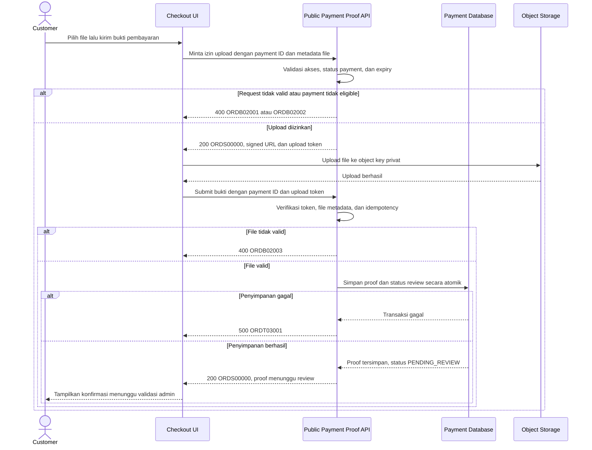

# Checkout Service - Submit Payment Proof Interface Agreement

> **Document Type:** API Contract  
> **Status:** Draft  
> **Service / Domain:** Public Checkout — Manual Payment Proof  
> **Consumer / Partner:** JokiHub storefront (`/order/:gameSlug`, tahap Bayar)

## Design

API ini menerima bukti pembayaran untuk payment attempt yang dibuat setelah customer menekan `Lanjut Pembayaran`. Bukti file disimpan di private object storage melalui upload terkontrol (presigned upload atau multipart endpoint), kemudian metadata file dikirim untuk dikaitkan ke `paymentId`. Setelah bukti diterima, payment berstatus menunggu pemeriksaan manual; order tidak otomatis menjadi lunas. Upload dan submit harus dibatasi pada order/payment yang masih berlaku, metode pembayaran yang sesuai, serta retry yang aman.

## Sequence Diagram



## Performance / SLA Targets

| Success Rate                                     | VUser                                | CPU / Memory                        | Response Time                                                                |
| ------------------------------------------------ | ------------------------------------ | ----------------------------------- | ---------------------------------------------------------------------------- |
| TBD; define proof submission availability target | TBD; forecast peak checkout visitors | TBD; capacity estimate/NFT required | TBD; upload throughput, size limits, and metadata commit target to be agreed |

## General Information

| Component          | Value                                                                                                                                                            |
| ------------------ | ---------------------------------------------------------------------------------------------------------------------------------------------------------------- |
| Description        | Mengunggah bukti pembayaran manual untuk payment attempt dan mengirim metadata agar masuk antrean validasi admin.                                                |
| Resource URL       | `https://{host}/api/orders/v1/payments/{paymentId}/proof-upload` dan `.../{paymentId}/proofs`                                                                    |
| Transport Protocol | HTTPS, REST                                                                                                                                                      |
| Request Verb       | POST untuk meminta upload authorization dan submit proof metadata; PUT ke object storage untuk file upload                                                       |
| Content Type       | `application/json` untuk API; MIME file yang diizinkan untuk storage upload                                                                                      |
| Interaction Type   | Synchronous API; upload file dapat langsung ke object storage                                                                                                    |
| Security Policy    | Public checkout API dengan payment/order access verification, short-lived signed upload, private storage, file validation/scanning, throttling, dan idempotency. |

### Path / Endpoint

| Section        | Value                                                                                                      |
| -------------- | ---------------------------------------------------------------------------------------------------------- |
| Host / Domain  | `{host}` (API) dan storage host terkelola                                                                  |
| Service Name   | Public Order / Payment                                                                                     |
| Version        | `v1`                                                                                                       |
| Resource       | `/orders/v1/payments/{paymentId}/proof-upload`, `/orders/v1/payments/{paymentId}/proofs`                   |
| Final Endpoint | `POST /api/orders/v1/payments/{paymentId}/proof-upload`; `POST /api/orders/v1/payments/{paymentId}/proofs` |

### API Versioning

- **Decision:** New Endpoints
- **Previous Endpoint:** Tidak ada API upload/submit bukti pembayaran teridentifikasi; UI saat ini hanya mock.
- **Final Endpoint:** `POST /api/orders/v1/payments/{paymentId}/proof-upload` and `POST /api/orders/v1/payments/{paymentId}/proofs`
- **Backward Compatibility:** Belum ada consumer teridentifikasi. Kontrak ini memisahkan otorisasi upload file dari pencatatan payment proof; perubahan field metadata opsional kompatibel.
- **Reason:** Bukti pembayaran memerlukan kontrol penyimpanan file terpisah dari update status payment.

## Business Rules

1. Customer harus merujuk `paymentId` dari checkout response. Karena guest checkout mungkin digunakan, akses harus dibuktikan dengan opaque checkout access token/order secret atau mekanisme kepemilikan terverifikasi; `paymentId` saja bukan authorization.
2. Payment attempt harus ada, terkait ke order yang sama, menggunakan metode manual yang menerima bukti (`QRIS`/transfer), belum expired, dan belum berstatus accepted/settled/cancelled.
3. Order/payment expiry ditetapkan server. Countdown browser bukan source of truth. Bukti yang di-submit setelah `expiresAt` ditolak kecuali kebijakan operasional memberi grace period eksplisit.
4. File upload menggunakan short-lived signed URL atau multipart service yang memvalidasi akses sebelum memberi izin upload. Object key dibuat server dan tidak dapat dipilih bebas oleh client.
5. Storage bucket private. File tidak boleh dapat diakses melalui URL publik permanen; admin/customer preview memakai signed read URL berumur pendek dan authorization checks.
6. Allowlist format, MIME sniffing, maximum file size, maximum proofs per attempt, malware scanning, image/PDF dimension limits, and retention period harus ditetapkan sebelum implementasi. Client-provided MIME type tidak dipercaya.
7. File harus diperiksa signature/content sebenarnya, bukan hanya nama ekstensi. Tolak executable, archive tak diizinkan, file rusak, file kosong, dan konten yang tidak dapat dipindai sesuai policy.
8. Tahap upload URL tidak mengubah payment state. Payment proof baru tercatat setelah metadata submit berhasil dan file telah tersedia/terverifikasi.
9. Setelah proof disimpan, payment masuk status review (usulan `PENDING_REVIEW`) dan audit/history dicatat atomik. `orderStatus` tetap `PENDING_PAYMENT`/status terkait; tidak menjadi `PROCESSING` atau `PAID` sampai admin mengonfirmasi pembayaran.
10. Payment boleh menerima beberapa proof submission untuk resubmission setelah reject hanya bila payment/order policy mengizinkan. Setiap proof memiliki status/attempt identity sendiri dan tidak menimpa file sebelumnya.
11. Idempotency key pada submit metadata mencegah double-click/retry membuat proof duplicate. Upload authorization token hanya berlaku untuk satu payment, satu object key, satu upload, dan TTL pendek.
12. Jika file ter-upload tetapi metadata submission gagal, object menjadi orphan candidate dan dihapus oleh cleanup job setelah TTL; cleanup tidak boleh menghapus bukti yang sudah direferensikan.
13. Server menyimpan `objectKey`, original filename yang sudah disanitasi (jika diperlukan), detected MIME, byte size, checksum, upload time, payment ID, submitter/customer reference, dan status scan. Jangan simpan file bytes di database.
14. `notes` opsional tidak menggantikan bukti transaksi dan harus dibatasi panjangnya; jangan meminta data kartu, rekening login, PIN, OTP, atau credential.
15. Response sukses hanya berarti bukti berhasil dikirim dan menunggu review. Tidak menyatakan uang diterima atau pembayaran berhasil.
16. QRIS image atau rekening tujuan yang ditampilkan di checkout adalah konfigurasi pembayaran resmi; bukti tidak diverifikasi otomatis oleh endpoint ini.

## Request Headers

| Header            | E/N/T | Type   | M/O/C | Max Length | Description                                                                                   | Example                          |
| ----------------- | ----- | ------ | ----- | ---------: | --------------------------------------------------------------------------------------------- | -------------------------------- |
| `Authorization`   | N     | String | C     |       4096 | Bearer token jika user login; guest access token/order secret diperlukan.                     | `Bearer {checkout-access-token}` |
| `Content-Type`    | N     | String | M     |        100 | `application/json` untuk kedua API; PUT ke storage memakai content type terdeteksi/diizinkan. | `application/json`               |
| `Accept`          | N     | String | O     |        100 | Tipe media response yang diinginkan; default JSON.                                            | `application/json`               |
| `X-Request-Id`    | N     | String | O     |        100 | ID korelasi untuk tracing upload dan metadata commit.                                         | `req-2fd318`                     |
| `Idempotency-Key` | N     | String | M     |        200 | Deduplikasi submit proof metadata.                                                            | `proof-submit-ord-01JXYZ-1`      |

## Request Parameters

| Parameter   | E/N/T | Type   | M/O/C | Max Length | Description                                | Example      |
| ----------- | ----- | ------ | ----- | ---------: | ------------------------------------------ | ------------ |
| `paymentId` | N     | String | M     |         64 | Payment attempt ID dari checkout response. | `pay_01JXYZ` |

## Request Query Parameters

None.

## Request Body

### A. Request Upload Authorization

| Attribute     | E/N/T | Type    | M/O/C | Max Length | Description                                                            | Example              |
| ------------- | ----- | ------- | ----- | ---------: | ---------------------------------------------------------------------- | -------------------- |
| `fileName`    | N     | String  | M     |        255 | Nama asal file; disanitasi dan tidak menjadi object key.               | `bukti-transfer.jpg` |
| `contentType` | N     | String  | M     |        100 | MIME yang diklaim client; server tetap memeriksa file signature.       | `image/jpeg`         |
| `sizeBytes`   | N     | Integer | M     |  10 digits | Ukuran file dari client untuk pre-check; server/storage memverifikasi. | `845321`             |
| `checksum`    | N     | String  | O     |        128 | Digest file, misalnya SHA-256, untuk integritas upload.                | `sha256:ab12...`     |

### Example Upload Authorization Body

```json
{
  "fileName": "bukti-transfer.jpg",
  "contentType": "image/jpeg",
  "sizeBytes": 845321,
  "checksum": "sha256:ab12cd34"
}
```

### B. Submit Proof Metadata

| Attribute     | E/N/T | Type   | M/O/C | Max Length | Description                                                          | Example                        |
| ------------- | ----- | ------ | ----- | ---------: | -------------------------------------------------------------------- | ------------------------------ |
| `uploadToken` | N     | String | M     |       2048 | Opaque token dari upload authorization, terikat pada payment/object. | `upl_eyJ...`                   |
| `notes`       | N     | String | O     |        500 | Catatan customer untuk admin; bukan data rahasia.                    | `Transfer dilakukan pukul 10.` |

### Example Submit Body

```json
{
  "uploadToken": "upl_eyJ...",
  "notes": "Transfer dilakukan pukul 10."
}
```

### Request Validation

1. `paymentId` wajib, valid, maksimal 64 karakter. Malformed ID mengembalikan `ORDB02001`.
2. Request harus lolos ownership/access proof. Jika payment tidak ditemukan atau tidak dapat diakses, kembalikan safe not-found/access error tanpa memungkinkan ID enumeration.
3. Payment/order harus masih eligible dan belum melewati `expiresAt`; expired/cancelled/accepted attempts ditolak dengan `ORDB02002`.
4. Upload authorization hanya menerima ekstensi/MIME allowlist yang disepakati (usulan: JPEG, PNG, atau PDF), file non-empty, dan ukuran dalam konfigurasi maksimum. Kode `ORDB02003` untuk file invalid.
5. Nama file dibuang path/dangerous characters; fileName bukan path tujuan penyimpanan.
6. `contentType` dan `sizeBytes` diverifikasi ulang saat upload/submit. Server mendeteksi MIME dari bytes dan menolak mismatch, checksum mismatch, atau file signature invalid.
7. `uploadToken` harus valid, belum expired/terpakai, dan terikat ke `paymentId`, object key, size/content constraints, serta identitas/checkout authorization yang sama.
8. Submit memverifikasi object ada, tidak quarantine, lolos malware/content scan, dan belum direferensikan sebagai proof lain.
9. `notes`, bila dikirim, harus string maksimal 500 karakter; ditampilkan sebagai plain text yang di-escape.
10. Field lain seperti `status`, `reviewedBy`, `paymentAmount`, `objectKey`, `orderId`, dan `uploadedAt` ditolak sebagai server-managed fields.
11. Idempotency key sama dan payload sama mengembalikan proof submission yang sama; key sama dengan token/payload berbeda ditolak `ORDB02004`.
12. Proof metadata, payment state transition, payment status history, dan audit harus atomic. Jika persistence gagal, tidak ada proof yang tampak submitted.
13. Bila upload berhasil tetapi submit tidak terjadi, server melakukan orphan cleanup setelah TTL; signed upload URL/token tidak dapat dipakai ulang.

## Response Body

### Upload Authorization Response

| Attribute              | E/N/T | Type               | M/O/C | Max Length | Description                            | Example                             |
| ---------------------- | ----- | ------------------ | ----- | ---------: | -------------------------------------- | ----------------------------------- |
| `status.code`          | N     | String             | M     |         20 | Service status code.                   | `ORDS00000`                         |
| `data.uploadUrl`       | N     | String             | M     |       4096 | Short-lived signed URL untuk PUT file. | `https://storage.example/signed...` |
| `data.uploadMethod`    | N     | String             | M     |         10 | Method untuk signed URL.               | `PUT`                               |
| `data.requiredHeaders` | N     | Object             | O     |          — | Header yang harus dikirim saat upload. | `{}`                                |
| `data.uploadToken`     | N     | String             | M     |       2048 | Token opaque untuk final submit.       | `upl_eyJ...`                        |
| `data.expiresAt`       | N     | String (date-time) | M     |         35 | Waktu URL/token upload berakhir UTC.   | `2026-10-12T10:00:00Z`              |
| `data.maxSizeBytes`    | N     | Integer            | M     |  10 digits | Maximum allowed file size.             | `5242880`                           |

### Proof Submission Response

| Attribute               | E/N/T | Type               | M/O/C | Max Length | Description                                               | Example                   |
| ----------------------- | ----- | ------------------ | ----- | ---------: | --------------------------------------------------------- | ------------------------- |
| `status.code`           | N     | String             | M     |         20 | Service status code.                                      | `ORDS00000`               |
| `status.message`        | N     | String             | O     |        200 | Hasil submit.                                             | `Payment proof submitted` |
| `data.proof.id`         | N     | String             | M     |         64 | Payment proof record ID.                                  | `proof_01JXYZ`            |
| `data.proof.paymentId`  | N     | String             | M     |         64 | Payment attempt reference.                                | `pay_01JXYZ`              |
| `data.proof.fileName`   | N     | String             | O     |        255 | Sanitized display name.                                   | `bukti-transfer.jpg`      |
| `data.proof.status`     | N     | String             | M     |         30 | Status file/proof; proposed `PENDING_REVIEW`.             | `PENDING_REVIEW`          |
| `data.proof.uploadedAt` | N     | String (date-time) | M     |         35 | Waktu submit proof ISO 8601 UTC.                          | `2026-10-12T09:50:00Z`    |
| `data.paymentStatus`    | N     | String             | M     |         30 | Payment state setelah submit; menunggu review.            | `PENDING_REVIEW`          |
| `data.orderNumber`      | N     | String             | M     |         32 | Referensi order untuk konfirmasi/tracking.                | `JH-2026-001248`          |
| `data.nextAction`       | N     | String             | M     |         40 | UI action berikutnya; proposed `SHOW_PENDING_VALIDATION`. | `SHOW_PENDING_VALIDATION` |

### Success Example — Upload Authorization

```json
{
  "status": {
    "code": "ORDS00000",
    "message": "Upload authorized"
  },
  "data": {
    "uploadUrl": "https://storage.example/signed-upload/abc",
    "uploadMethod": "PUT",
    "requiredHeaders": { "Content-Type": "image/jpeg" },
    "uploadToken": "upl_eyJ...",
    "expiresAt": "2026-10-12T10:00:00Z",
    "maxSizeBytes": 5242880
  }
}
```

### Success Example — Submit Proof

```json
{
  "status": {
    "code": "ORDS00000",
    "message": "Payment proof submitted"
  },
  "data": {
    "proof": {
      "id": "proof_01JXYZ",
      "paymentId": "pay_01JXYZ",
      "fileName": "bukti-transfer.jpg",
      "status": "PENDING_REVIEW",
      "uploadedAt": "2026-10-12T09:50:00Z"
    },
    "paymentStatus": "PENDING_REVIEW",
    "orderNumber": "JH-2026-001248",
    "nextAction": "SHOW_PENDING_VALIDATION"
  }
}
```

### Business Error Example

```json
{
  "status": {
    "code": "ORDB02003",
    "message": "Payment proof file is invalid or exceeds allowed limits"
  },
  "data": null
}
```

### Technical Error Example

```json
{
  "status": {
    "code": "ORDT04001",
    "message": "Payment proof storage is temporarily unavailable"
  },
  "data": null
}
```

## HTTP Status Codes

| HTTP Status | Usage                                                                                                                                                 |
| ----------- | ----------------------------------------------------------------------------------------------------------------------------------------------------- |
| `200`       | Upload authorization diberikan atau bukti berhasil dikaitkan ke payment dan menunggu review. API owner dapat memilih `201` untuk proof resource baru. |
| `400`       | Payment access/status/expiry tidak eligible, file invalid, payload salah, atau idempotency conflict sesuai baseline response project.                 |
| `404`       | Payment tidak ditemukan/tidak dapat diakses bila API standard mengadopsi resource semantics dan anti-enumeration policy mengizinkan.                  |
| `500`       | Database/object storage/scanning dependency gagal secara tak terduga; error aman tanpa detail internal.                                               |

## Service Status Codes

Format: `[Service Prefix][Status Type][Category][Specific Error Code]`

| Code        | Type      | Category        | Meaning                                                                             |
| ----------- | --------- | --------------- | ----------------------------------------------------------------------------------- |
| `ORDS00000` | Success   | General         | Upload authorized atau payment proof berhasil disubmit untuk review.                |
| `ORDB02001` | Business  | User validation | Payment ID atau request metadata tidak valid.                                       |
| `ORDB02002` | Business  | User validation | Payment/order tidak ditemukan, expired, atau tidak eligible menerima proof.         |
| `ORDB02003` | Business  | User validation | File kosong, MIME/signature invalid, ukuran/format tidak didukung, atau scan gagal. |
| `ORDB02004` | Business  | User validation | Idempotency key/token upload conflict atau sudah digunakan.                         |
| `ORDT03001` | Technical | Database        | Proof metadata/status/history gagal disimpan.                                       |
| `ORDT04001` | Technical | Object storage  | Signed upload/storage/scanning service tidak tersedia.                              |

## API Exposure Classification

| Classification | Rationale                                                                                                                                                              |
| -------------- | ---------------------------------------------------------------------------------------------------------------------------------------------------------------------- |
| Public         | Customer-facing endpoint menerima file bukti pembayaran finansial. Proteksi upload, private storage, anti-abuse, metadata minimization, dan access verification wajib. |

## Testing & Documentation Scope

| Scope      | Required | Rationale / Handoff                                                                                                                                                                                    |
| ---------- | -------- | ------------------------------------------------------------------------------------------------------------------------------------------------------------------------------------------------------ |
| NFT        | Yes      | Uji upload ukuran maksimum, concurrency, storage throughput, signed URL expiry, orphan cleanup, retry/idempotency, dan metadata transaction atomicity. Batas size/TPS/SLA TBD.                         |
| VA/Pentest | Yes      | Uji payment IDOR/enumeration, signed URL replay/scope, MIME spoofing, polyglot/malware files, oversized upload, path traversal, public object access, expiry bypass, duplicate proof, dan PII leakage. |

## Assumptions

- Endpoint terpisah untuk upload authorization dan submit proof metadata adalah usulan; API owner dapat memilih multipart upload bila private storage controls setara.
- Order ERD memodelkan `PAYMENT_PROOF` dengan `payment_id`, `object_key`, metadata file, dan upload time; status, checksum, scan state, and uploader fields perlu ditambahkan bila disetujui.
- Proof terikat ke payment attempt (`paymentId`) dari endpoint `POST /api/orders/v1/checkout`; order lookup/ownership proof harus dirancang karena guest checkout belum punya session policy final.
- `PENDING_REVIEW` sebagai payment status mengikuti UI, sementara Order ERD juga menyebut `UNPAID`; status transition dan apakah proof resubmission mengubah payment attempt perlu diselaraskan.
- File allowlist, file-size cap, number of submissions, scanner, object retention, signed URL TTL, orphan cleanup SLA, access token mechanism, payment expiry/grace period, and HTTP status mapping are TBD.
- Endpoint hanya menyimpan bukti; verifikasi pembayaran, approve/reject, retry instructions, and order fulfillment are handled by admin payment-review and order workflows.

## References

- `src/features/Checkout/views/organisms/PaymentStep.organism.tsx` — payment method, countdown, proof file input, and submission UI.
- `src/features/Checkout/views/organisms/PaymentSuccess.organism.tsx` — post-submit simulated manual validation state.
- `docs/sprint_1/solutioning/public/checkout/continue-to-payment.md` — order/payment attempt creation and returned payment instructions.
- `docs/sprint_1/solutioning/erd/order-erd.md` — `ORDER_PAYMENT`, `PAYMENT_PROOF`, expiry, payment status history, and upload security rules.
- `docs/sprint_1/solutioning/dashboard/orders/get-detail-order.md` — admin order/payment detail contract.
- `docs/sprint_1/solutioning/TEMPLATE.md` — API contract template.
