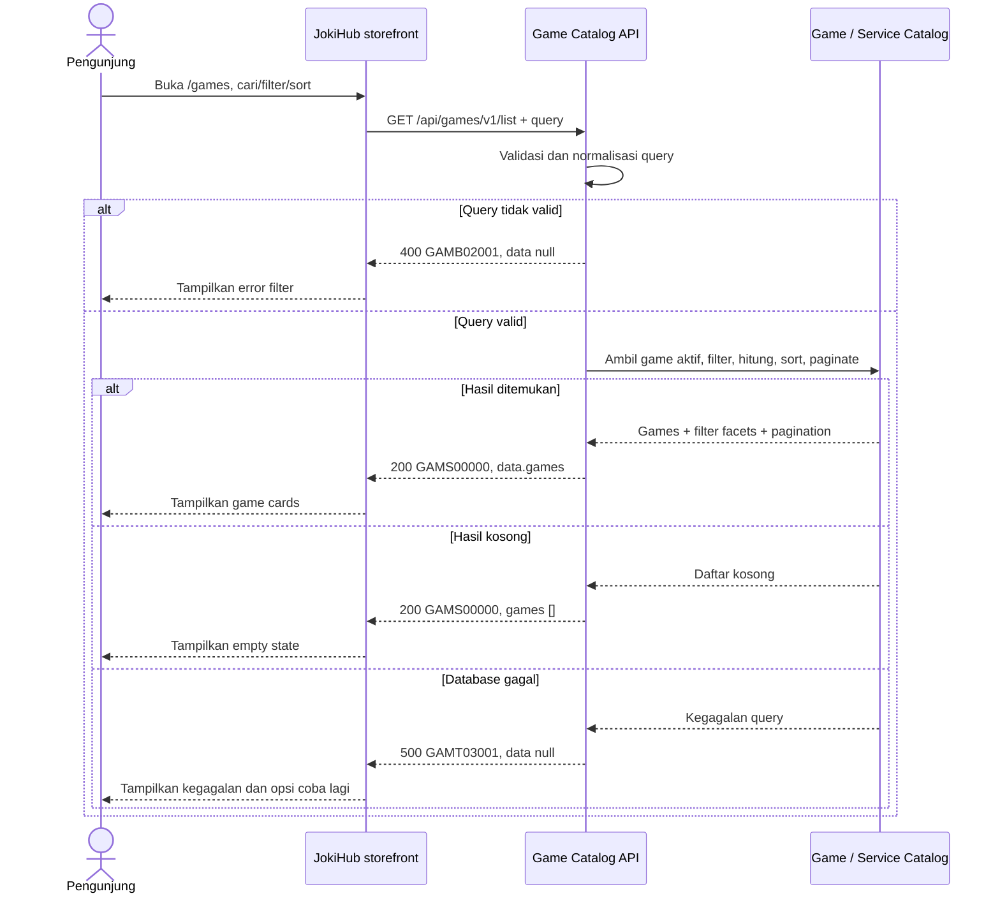

# Game Catalog Service - Get List Games Interface Agreement

> **Document Type:** API Contract  
> **Status:** Draft  
> **Service / Domain:** Game Catalog  
> **Consumer / Partner:** JokiHub public storefront

## Design

API ini mengambil katalog game aktif untuk halaman `/games`, dengan pencarian nama, filter platform/kategori layanan, pengurutan, dan pagination. Hanya game yang dipublikasikan dan aktif ditampilkan. Kontrak menggunakan field katalog inti (`id`, `name`, `slug`, `serviceSummary`, `artworkKey`) dan metadata listing yang saat ini dipakai UI. ERD `GAME_CATALOG` belum memiliki platform, rating/review, atau relasi kategori layanan; sumber metadata tambahan itu perlu diputuskan sebelum implementasi.

## Sequence Diagram



## Performance / SLA Targets

| Success Rate                                | VUser                                 | CPU / Memory                            | Response Time                                                                             |
| ------------------------------------------- | ------------------------------------- | --------------------------------------- | ----------------------------------------------------------------------------------------- |
| TBD; confirm service criticality and target | TBD; confirm peak concurrent visitors | TBD; define after capacity estimate/NFT | TBD; proposed less-critical web baseline: ideal 200 ms, acceptable 1 s, max tolerable 2 s |

## General Information

| Component          | Value                                                                                                |
| ------------------ | ---------------------------------------------------------------------------------------------------- |
| Description        | Mengambil katalog game aktif untuk listing publik dengan search, filter, sort, dan pagination.       |
| Resource URL       | `https://{host}/api/games/v1/list`                                                                   |
| Transport Protocol | HTTPS, REST                                                                                          |
| Request Verb       | GET                                                                                                  |
| Content Type       | `application/json`                                                                                   |
| Interaction Type   | Synchronous                                                                                          |
| Security Policy    | Public read API; rate limiting, cache policy, dan input validation. Tidak mengembalikan data privat. |

### Path / Endpoint

| Section        | Value                           |
| -------------- | ------------------------------- |
| Host / Domain  | `{host}` (environment-specific) |
| Service Name   | Game Catalog                    |
| Version        | `v1`                            |
| Resource       | `/list`                         |
| Final Endpoint | `/api/games/v1/list`            |

### API Versioning

- **Decision:** New Endpoint
- **Previous Endpoint:** Tidak ada API list katalog game yang teridentifikasi; `/api/games/v1/popular` hanya mengembalikan subset game populer.
- **Final Endpoint:** `GET /api/games/v1/list`
- **Backward Compatibility:** API popular tetap terpisah dan tidak berubah. Penambahan field response opsional kompatibel; perubahan semantik/filter atau field wajib memerlukan koordinasi/major version.
- **Reason:** Halaman `/games` membutuhkan seluruh katalog aktif dan opsi filter/sort, bukan hanya game populer.

## Business Rules

1. Hanya game dengan `is_active=true` dan status publikasi yang disetujui yang dapat ditampilkan. Jika model belum memiliki status publikasi, `is_active` menjadi gate publik.
2. Game diurutkan sesuai nilai `sort` yang diminta. Default `POPULAR` menggunakan popular designation atau ranking yang ditentukan catalog owner; fallback order deterministik `sortOrder ASC`, `name ASC`, `id ASC`.
3. `NAME_ASC` mengurutkan nama A–Z secara locale `id-ID`, lalu `id` sebagai tie-breaker.
4. `RATING_DESC` memakai rating publik tervalidasi; rating source, skala, jumlah minimum review, dan anti-manipulation policy TBD.
5. Search mencocokkan nama game dan alias publik yang disetujui. Query di-trim; case-insensitive behavior disarankan. Maksimal 100 karakter.
6. `platform` mengacu klasifikasi platform game (mis. `MOBILE`, `PC`, `CONSOLE`), bukan jenis layanan. Platform belum tersedia pada ERD dan memerlukan atribut/relasi katalog.
7. `serviceCategory` memfilter game yang mempunyai minimal satu service aktif pada kategori tersebut. Kategori serta relasi service-game harus menjadi source of truth; game tanpa service aktif tidak tersedia untuk filter kategori layanan.
8. Filter platform dan kategori layanan, bila keduanya dikirim, digabungkan dengan AND. Multi-valued filters tidak didukung pada kontrak awal.
9. `serviceCategories` pada response hanya memuat kategori layanan yang memiliki layanan aktif bagi game tersebut. Kode stabil digunakan dalam API; label localized dapat dikembalikan sebagai display metadata.
10. `serviceCount` menghitung service aktif yang dapat dipesan publik saat response dibuat. Hanya tampilkan jika definisi status service dan relasi game telah disepakati.
11. Rating/review fields bersifat opsional dan tidak boleh direkayasa dari mock. Jika belum ada rating service terpercaya, API menghilangkan `rating` dan `reviewCount` serta sort `RATING_DESC` dinonaktifkan atau memakai kebijakan eksplisit.
12. `artworkKey` merujuk asset registry/CDN yang disetujui, bukan URL arbitrary dari input pengguna. Frontend melakukan resolusi asset.
13. `limit` default `20`, maksimum `100`; `offset` default `0`. Nilai final diselaraskan dengan kapasitas dan UX.
14. Bila tidak ada hasil, response sukses berisi `games: []`, total `0`, dan facet counts sesuai definisi filter. Facet counts dapat berarti keseluruhan katalog aktif atau hasil filter selain facet tersebut; definisinya perlu konsisten dan disepakati.
15. API tidak mengembalikan game nonaktif, data admin/internal, service privat, atau informasi inventory yang belum dipublikasikan.

## Request Headers

| Header            | E/N/T | Type   | M/O/C | Max Length | Description                                              | Example            |
| ----------------- | ----- | ------ | ----- | ---------: | -------------------------------------------------------- | ------------------ |
| `Accept`          | N     | String | O     |        100 | Response media type. Defaults to JSON.                   | `application/json` |
| `Accept-Language` | N     | String | O     |         35 | Preferred localized display copy; fallback behavior TBD. | `id-ID`            |

## Request Parameters

None.

## Request Query Parameters

| Parameter         | E/N/T | Type    | M/O/C | Max Length | Description                                                            | Example    |
| ----------------- | ----- | ------- | ----- | ---------: | ---------------------------------------------------------------------- | ---------- |
| `search`          | N     | String  | O     |        100 | Cari nama/alias game; trim dan case-insensitive.                       | `mobile`   |
| `platform`        | N     | String  | O     |         30 | Filter platform, usulan `MOBILE`, `PC`, `CONSOLE`; enum final TBD.     | `MOBILE`   |
| `serviceCategory` | N     | String  | O     |         64 | Filter category code yang memiliki service aktif untuk game.           | `top-up`   |
| `sort`            | N     | String  | O     |         20 | `POPULAR`, `RATING_DESC`, `NAME_ASC`; default `POPULAR`.               | `NAME_ASC` |
| `limit`           | N     | Integer | O     |   3 digits | Page size; default `20`, range `1–100`.                                | `20`       |
| `offset`          | N     | Integer | O     |   9 digits | Zero-based number of matching games to skip; default `0`, minimum `0`. | `0`        |

## Request Body

None. GET request has no body.

### Request Validation

1. `search`, bila ada, harus string maksimal 100 karakter setelah trim.
2. `platform` harus salah satu enum platform yang didukung catalog. Nilai final menunggu model katalog; nilai tidak dikenal mengembalikan HTTP 400 `GAMB02001`.
3. `serviceCategory` harus category code valid dan aktif. Kategori tidak dikenal mengembalikan `GAMB02001`; kategori valid tanpa hasil memberi response kosong.
4. `sort` harus `POPULAR`, `RATING_DESC`, atau `NAME_ASC`. Bila rating belum tersedia, `RATING_DESC` ditolak dengan `GAMB02001` atau capability dinyatakan eksplisit oleh API.
5. `limit` harus integer 1–100; default `20`, selain itu `GAMB02001`.
6. `offset` harus non-negative integer dalam batas integer yang didukung; default `0`, selain itu `GAMB02001`.
7. Unknown query parameters ditolak dengan `GAMB02001` pada kontrak ini agar typo tidak menghasilkan filter diam-diam. Perilaku perlu dikonfirmasi API owner.
8. Query menggunakan parameterized statements; wildcard dan karakter khusus di-escape sesuai search policy.
9. Filter dan pagination hanya diterapkan pada game aktif/publik. Count total memakai predicate yang sama sebelum limit/offset.
10. Kegagalan database mengembalikan HTTP 500 `GAMT03001` tanpa detail internal.

## Response Body

Success responses always use `status` and `data`. `data.games` may be empty. Results contain public catalog/listing fields only.

| Attribute                          | E/N/T | Type         | M/O/C |          Max Length | Description                                                    | Example              |
| ---------------------------------- | ----- | ------------ | ----- | ------------------: | -------------------------------------------------------------- | -------------------- |
| `status`                           | N     | Object       | M     |                   — | Response status.                                               | `{}`                 |
| `status.code`                      | N     | String       | M     |                  20 | Service status code.                                           | `GAMS00000`          |
| `status.message`                   | N     | String       | O     |                 200 | Human-readable result.                                         | `Games retrieved`    |
| `data`                             | N     | Object/null  | M     |                   — | Result payload; null on errors.                                | `{}`                 |
| `data.games`                       | N     | Array        | M     |  `pagination.limit` | Current page of matching active games; empty when none match.  | `[]`                 |
| `data.games[].id`                  | N     | String       | M     |                  64 | Stable catalog identifier.                                     | `game_01JXYZ`        |
| `data.games[].name`                | N     | String       | M     |                 100 | Display name.                                                  | `Mobile Legends`     |
| `data.games[].slug`                | N     | String       | M     |                 100 | URL-safe game identifier used by storefront navigation.        | `mobile-legends`     |
| `data.games[].serviceSummary`      | N     | String/null  | O     |                 160 | Short summary of public services.                              | `Joki Rank / Top Up` |
| `data.games[].artworkKey`          | N     | String/null  | O     |                 160 | Approved local/CDN asset key.                                  | `mobile-legends`     |
| `data.games[].platform`            | N     | String/null  | O     |                  30 | Platform classification; requires catalog field.               | `MOBILE`             |
| `data.games[].serviceCategories`   | N     | Array        | O     | 50 items (proposed) | Active public service categories for this game.                | `[]`                 |
| `data.games[].serviceCount`        | N     | Integer      | O     |           10 digits | Count of active public services.                               | `12`                 |
| `data.games[].rating`              | N     | Decimal/null | O     |                 3,2 | Public rating on agreed scale; omit if no trusted source.      | `4.9`                |
| `data.games[].reviewCount`         | N     | Integer      | O     |           10 digits | Number of qualifying reviews.                                  | `1200`               |
| `data.games[].isPopular`           | N     | Boolean      | M     |                   — | Catalog popularity flag for popular sorting/label if approved. | `true`               |
| `data.games[].sortOrder`           | N     | Integer      | O     |           10 digits | Catalog display order, ascending.                              | `2`                  |
| `data.filters`                     | N     | Object       | O     |                   — | Available platform/service-category facets and counts.         | `{}`                 |
| `data.filters.platforms[]`         | N     | Object       | O     |         facet count | Platform code, label, and count.                               | `{}`                 |
| `data.filters.serviceCategories[]` | N     | Object       | O     |         facet count | Category code, label, and count.                               | `{}`                 |
| `data.pagination`                  | N     | Object       | M     |                   — | Pagination metadata.                                           | `{}`                 |
| `data.pagination.limit`            | N     | Integer      | M     |            3 digits | Applied page size.                                             | `20`                 |
| `data.pagination.offset`           | N     | Integer      | M     |            9 digits | Applied offset.                                                | `0`                  |
| `data.pagination.total`            | N     | Integer      | M     |           10 digits | Total matching active games before pagination.                 | `24`                 |

### Success Example

```json
{
  "status": {
    "code": "GAMS00000",
    "message": "Games retrieved"
  },
  "data": {
    "games": [
      {
        "id": "game_01JXYZ",
        "name": "Mobile Legends",
        "slug": "mobile-legends",
        "serviceSummary": "Joki Rank / Top Up",
        "artworkKey": "mobile-legends",
        "platform": "MOBILE",
        "serviceCategories": [
          { "code": "TOP_UP", "name": "Top Up" },
          { "code": "JOKI_RANK", "name": "Joki Rank" }
        ],
        "serviceCount": 12,
        "rating": 4.9,
        "reviewCount": 1200,
        "isPopular": true,
        "sortOrder": 2
      }
    ],
    "filters": {
      "platforms": [
        { "code": "MOBILE", "name": "Mobile", "count": 12 },
        { "code": "PC", "name": "PC", "count": 6 },
        { "code": "CONSOLE", "name": "Console", "count": 2 }
      ],
      "serviceCategories": [
        { "code": "TOP_UP", "name": "Top Up", "count": 18 },
        { "code": "JOKI_RANK", "name": "Joki Rank", "count": 15 },
        { "code": "ACCOUNT", "name": "Akun", "count": 4 },
        { "code": "VOUCHER", "name": "Voucher", "count": 3 }
      ]
    },
    "pagination": {
      "limit": 20,
      "offset": 0,
      "total": 1
    }
  }
}
```

### Business Error Example

```json
{
  "status": {
    "code": "GAMB02001",
    "message": "Invalid game-list query parameters"
  },
  "data": null
}
```

### Technical Error Example

```json
{
  "status": {
    "code": "GAMT03001",
    "message": "Game catalog is temporarily unavailable"
  },
  "data": null
}
```

## HTTP Status Codes

| HTTP Status | Usage                                                       |
| ----------- | ----------------------------------------------------------- |
| `200`       | Request valid; results may contain games or an empty array. |
| `400`       | Invalid search/filter/sort/pagination parameter.            |
| `500`       | Unexpected service or catalog database failure.             |

## Service Status Codes

Format: `[Service Prefix][Status Type][Category][Specific Error Code]`

| Code        | Type      | Category        | Meaning                                                         |
| ----------- | --------- | --------------- | --------------------------------------------------------------- |
| `GAMS00000` | Success   | General         | Daftar game berhasil dikembalikan.                              |
| `GAMB02001` | Business  | User validation | Search/filter/sort/pagination parameter tidak valid.            |
| `GAMT03001` | Technical | Database        | Game catalog atau facet data gagal dibaca/database unavailable. |

## API Exposure Classification

| Classification | Rationale                                                                                 |
| -------------- | ----------------------------------------------------------------------------------------- |
| Public         | Customer-facing storefront reads non-sensitive catalog and service availability metadata. |

## Testing & Documentation Scope

| Scope      | Required | Rationale / Handoff                                                                                                                                                    |
| ---------- | -------- | ---------------------------------------------------------------------------------------------------------------------------------------------------------------------- |
| NFT        | Yes      | Uji list/search/facet/sort/page pada peak visitors, termasuk cache hit/miss dan katalog besar. Target TPS, CPU/memory, serta response time menunggu traffic forecast.  |
| VA/Pentest | Yes      | Public API. Uji validasi query, injection, pagination bounds, inactive-game leakage, asset URL handling, category/platform filter bypass, dan excessive data exposure. |

## Assumptions

- Endpoint `/api/games/v1/list`, enum sort/platform/category, pagination, response fields, envelope, service codes, and unknown-query behavior are proposed; API owner review required.
- Existing `/api/games/v1/popular` remains the dedicated popular-games subset endpoint.
- [Game ERD](../../erd/game-catalog-erd.md) supplies active state, popular flag, sort order, name, slug, summary, and artwork key. Platform and rating/review are not currently modeled.
- Service category filtering/counts require confirmed game-service-category relationships and public/active service rules. Current Game ERD has no such relationship.
- Platform taxonomy, rating provider, service summary derivation, facet count semantics, cache/CDN strategy, rate limits, traffic targets, and published game inventory are TBD.
- Current `/games` UI's count/rating/tags/platform values are mock data and are not verified catalog facts.

## References

- `./get-popular-games.md` — public popular games subset contract and shared catalog conventions.
- `../../erd/game-catalog-erd.md` — game fields and active/popular/sort constraints.
- `../../erd/service-erd.md` — service catalog source; game relationship/category mapping requires confirmation.
- `src/features/Games/views/pages/Games.page.tsx` — current catalog UI mock data, search/filter/sort/pagination state.
- `src/features/Games/views/interfaces/game.interface.ts` — current game card display fields.
- `src/features/Games/views/atoms/SortSelect.atom.tsx` — visible sort choices.
- `DESIGN.md` — storefront language, responsive catalog direction, and illustrative catalog guidance.
