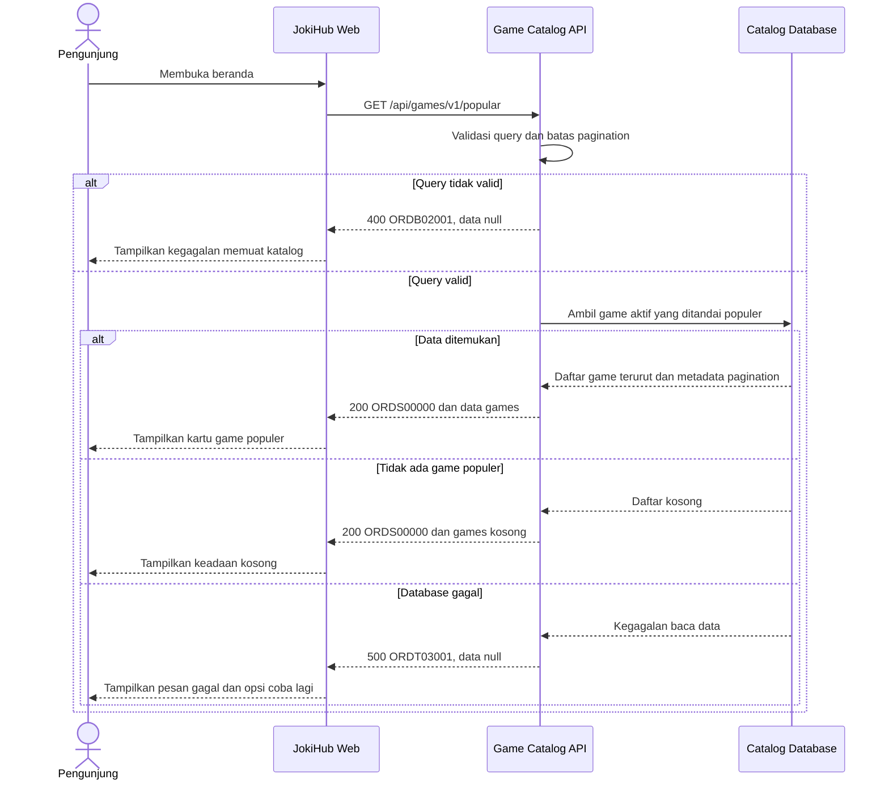

# Game Catalog Service - Get Popular Games Interface Agreement

> **Document Type:** API Contract  
> **Status:** Draft  
> **Service / Domain:** Game Catalog  
> **Consumer / Partner:** JokiHub storefront

## Design

The HomeV2 storefront displays popular games as cards with a game name, service summary, and artwork. Current UI reference: `src/features/HomeV2/views/organisms/PopularGames.organism.tsx` and `src/features/HomeV2/views/molecules/GameCard.molecule.tsx`. Current six-game content is illustrative and must be replaced or confirmed by catalog data.

## Sequence Diagram



## Performance / SLA Targets

| Success Rate                                | VUser                                 | CPU / Memory                            | Response Time                                                                             |
| ------------------------------------------- | ------------------------------------- | --------------------------------------- | ----------------------------------------------------------------------------------------- |
| TBD; confirm service criticality and target | TBD; confirm peak concurrent visitors | TBD; define after capacity estimate/NFT | TBD; proposed less-critical web baseline: ideal 200 ms, acceptable 1 s, max tolerable 2 s |

## General Information

| Component          | Value                                                                                 |
| ------------------ | ------------------------------------------------------------------------------------- |
| Description        | Mengambil daftar game aktif yang ditandai populer untuk ditampilkan pada storefront.  |
| Resource URL       | `https://{host}/api/games/v1/popular`                                                 |
| Transport Protocol | HTTPS, REST                                                                           |
| Request Verb       | GET                                                                                   |
| Content Type       | `application/json`                                                                    |
| Interaction Type   | Synchronous                                                                           |
| Security Policy    | Public read API; rate limiting dan input validation. Tidak mengembalikan data privat. |

### Path / Endpoint

| Section        | Value                           |
| -------------- | ------------------------------- |
| Host / Domain  | `{host}` (environment-specific) |
| Service Name   | Game Catalog                    |
| Version        | `v1`                            |
| Resource       | `/popular`                      |
| Final Endpoint | `/api/games/v1/popular`         |

### API Versioning

- **Decision:** New Endpoint
- **Previous Endpoint:** Not applicable; current HomeV2 list is static UI data.
- **Final Endpoint:** `/api/games/v1/popular`
- **Backward Compatibility:** No existing API consumer identified. Additive optional response fields are backward-compatible; breaking field or semantic changes require a new major version.
- **Reason:** Storefront needs a catalog-owned source for popular game cards.

## Business Rules

1. Only published and active games are eligible for the popular list.
2. Only games explicitly marked popular by the catalog owner are returned. The popularity selection method and owner are TBD.
3. Results use a deterministic order configured by the catalog owner; default ordering rule is TBD. `sortOrder` is the proposed stable ordering field.
4. `limit` and `offset` paginate results. When omitted, default `limit` is 6 and `offset` is 0; maximum `limit` is 50.
5. No matching popular games is a successful response with an empty `games` array.
6. `serviceSummary`, `artworkKey`, and `mark` are presentation metadata. Artwork is a key/path reference, not an embedded image or untrusted executable URL.
7. Example game names from current UI are illustrative until availability is confirmed in the catalog.

## Request Headers

| Header            | E/N/T | Type   | M/O/C | Max Length | Description                                                 | Example            |
| ----------------- | ----- | ------ | ----- | ---------: | ----------------------------------------------------------- | ------------------ |
| `Accept`          | N     | String | O     |        100 | Response media type. Defaults to JSON.                      | `application/json` |
| `Accept-Language` | N     | String | O     |         35 | Preferred localized display copy; fallback behavior is TBD. | `id-ID`            |

## Request Parameters

None.

## Request Query Parameters

| Parameter | E/N/T | Type    | M/O/C | Max Length | Description                                                        | Example |
| --------- | ----- | ------- | ----- | ---------: | ------------------------------------------------------------------ | ------- |
| `limit`   | N     | Integer | O     |   2 digits | Page size; default 6, range 1–50.                                  | `6`     |
| `offset`  | N     | Integer | O     |   9 digits | Zero-based number of matching games to skip; default 0, minimum 0. | `0`     |

## Request Body

None. GET request has no body.

### Request Validation

1. `limit`, when present, must be an integer from 1 through 50; otherwise return HTTP 400 with service code `GAMB02001`.
2. `offset`, when present, must be a non-negative integer; otherwise return HTTP 400 with `GAMB02001`.
3. Unknown query parameters are ignored for forward compatibility. This behavior requires API owner confirmation.

## Response Body

Success responses always use `status` and `data`. `data.games` may be empty. Game records are ordered and contain only public catalog presentation fields.

| Attribute                     | E/N/T | Type        | M/O/C | Max Length | Description                                                | Example                   |
| ----------------------------- | ----- | ----------- | ----- | ---------: | ---------------------------------------------------------- | ------------------------- |
| `status`                      | N     | Object      | M     |          - | Response status.                                           | `{}`                      |
| `status.code`                 | N     | String      | M     |         20 | Service status code.                                       | `GAMS00000`               |
| `status.message`              | N     | String      | O     |        200 | Human-readable result.                                     | `Popular games retrieved` |
| `data`                        | N     | Object/null | M     |          - | Result payload; null on errors.                            | `{}`                      |
| `data.games`                  | N     | Array       | M     |          - | Current page of popular games; empty when none match.      | `[]`                      |
| `data.games[].id`             | N     | String      | M     |         64 | Stable catalog identifier.                                 | `mobile-legends`          |
| `data.games[].name`           | N     | String      | M     |        100 | Display name.                                              | `Mobile Legends`          |
| `data.games[].slug`           | N     | String      | M     |        100 | URL-safe game identifier used by storefront navigation.    | `mobile-legends`          |
| `data.games[].serviceSummary` | N     | String      | O     |        160 | Short summary of available service categories.             | `Joki Rank / Top Up`      |
| `data.games[].artworkKey`     | N     | String      | O     |        160 | Approved local/CDN asset key; frontend resolves the asset. | `mobile-legends`          |
| `data.games[].sortOrder`      | N     | Integer     | M     |  10 digits | Stable ordering value, ascending.                          | `2`                       |
| `data.pagination`             | N     | Object      | M     |          - | Pagination metadata.                                       | `{}`                      |
| `data.pagination.limit`       | N     | Integer     | M     |   2 digits | Applied page size.                                         | `6`                       |
| `data.pagination.offset`      | N     | Integer     | M     |   9 digits | Applied offset.                                            | `0`                       |
| `data.pagination.total`       | N     | Integer     | M     |  10 digits | Total matching active popular games before pagination.     | `8`                       |

### Success Example

```json
{
  "status": {
    "code": "GAMS00000",
    "message": "Popular games retrieved"
  },
  "data": {
    "games": [
      {
        "id": "mobile-legends",
        "name": "Mobile Legends",
        "slug": "mobile-legends",
        "serviceSummary": "Joki Rank / Top Up",
        "artworkKey": "mobile-legends",
        "sortOrder": 2
      }
    ],
    "pagination": {
      "limit": 6,
      "offset": 0,
      "total": 1
    }
  }
}
```

### Business Error Example

```json
{
  "status": {
    "code": "GAMB02001",
    "message": "Invalid pagination parameter"
  },
  "data": null
}
```

### Technical Error Example

```json
{
  "status": {
    "code": "GAMT03001",
    "message": "Game catalog is temporarily unavailable"
  },
  "data": null
}
```

## HTTP Status Codes

| HTTP Status | Usage                                                       |
| ----------- | ----------------------------------------------------------- |
| `200`       | Request valid; results may contain games or an empty array. |
| `400`       | Invalid `limit` or `offset`.                                |
| `500`       | Unexpected service or catalog database failure.             |

## Service Status Codes

Format: `[Service Prefix][Status Type][Category][Specific Error Code]`

| Code        | Type      | Category        | Meaning                                          |
| ----------- | --------- | --------------- | ------------------------------------------------ |
| `GAMS00000` | Success   | General         | Popular games retrieved, including empty result. |
| `GAMB02001` | Business  | User validation | Invalid pagination parameter.                    |
| `GAMT03001` | Technical | Database        | Catalog data could not be read.                  |

## API Exposure Classification

| Classification | Rationale                                                    |
| -------------- | ------------------------------------------------------------ |
| Public         | Customer-facing storefront reads non-sensitive catalog data. |

## Testing & Documentation Scope

| Scope      | Required | Rationale / Handoff                                                                                                                |
| ---------- | -------- | ---------------------------------------------------------------------------------------------------------------------------------- |
| NFT        | Yes      | New customer-facing read API. Measure list retrieval at agreed peak concurrency; target TPS and CPU/memory await traffic forecast. |
| VA/Pentest | Yes      | Public API. Include valid pagination, invalid bounds, unknown query parameters, empty catalog, and response data exposure checks.  |

## Assumptions

- Endpoint prefix `/api`, service name, service codes, response envelope, pagination, and response field names are proposed contract decisions pending API owner review.
- Catalog source, popular designation workflow, ordering owner, localized text behavior, cache policy, authentication/rate-limit policy, traffic targets, and approved game inventory are TBD.
- Current static list in HomeV2 contains Roblox, Mobile Legends, Free Fire, PUBG Mobile, Valorant, and Genshin Impact as illustrative UI data only.

## References

- `DESIGN.md`, section 5.1 B — popular game cards and illustrative catalog.
- `src/features/HomeV2/views/organisms/PopularGames.organism.tsx` — current section display and list consumer.
- `src/features/HomeV2/views/molecules/GameCard.molecule.tsx` — current card fields and order link behavior.
- `src/features/HomeV2/views/interfaces/homeV2.interface.ts` — current UI model (`name`, `service`, `art`, `mark`).
