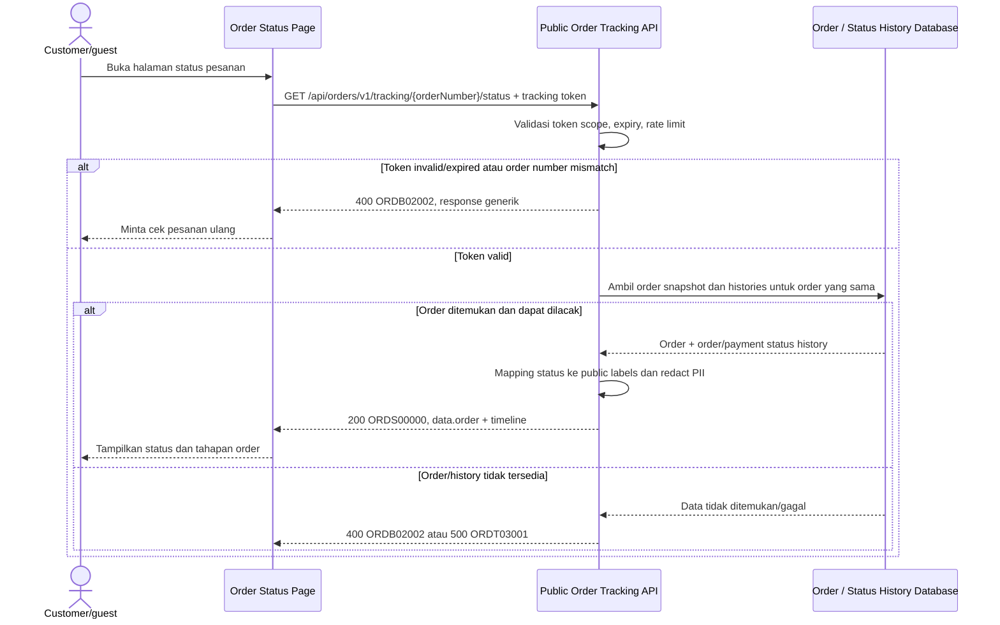

# Order Tracking Service - Get Order Status Interface Agreement

> **Document Type:** API Contract  
> **Status:** Draft  
> **Service / Domain:** Public Order Tracking  
> **Consumer / Partner:** JokiHub storefront (`/cek-pesanan/{orderNumber}`)

## Design

API ini mengembalikan status dan timeline customer-facing untuk satu order pada halaman detail tracking. Akses dilakukan dengan opaque tracking token berumur pendek yang diterbitkan setelah pasangan nomor order dan WhatsApp berhasil diverifikasi melalui endpoint lookup. Untuk akses langsung tanpa token, UI harus meminta verifikasi ulang order number + WhatsApp; path order number tidak menjadi credential. Response menampilkan status order, layanan, status pembayaran yang aman, dan timeline progres. Endpoint read-only dan tidak mengubah order/payment state.

## Sequence Diagram



## Performance / SLA Targets

| Success Rate                                      | VUser                                | CPU / Memory                        | Response Time                                            |
| ------------------------------------------------- | ------------------------------------ | ----------------------------------- | -------------------------------------------------------- |
| TBD; define customer tracking availability target | TBD; forecast public visitor traffic | TBD; capacity estimate/NFT required | TBD; include token validation and history lookup latency |

## General Information

| Component          | Value                                                                                                                   |
| ------------------ | ----------------------------------------------------------------------------------------------------------------------- |
| Description        | Mengambil status terkini dan timeline publik satu order setelah akses customer diverifikasi.                            |
| Resource URL       | `https://{host}/api/orders/v1/tracking/{orderNumber}/status`                                                            |
| Transport Protocol | HTTPS, REST                                                                                                             |
| Request Verb       | GET                                                                                                                     |
| Content Type       | Tidak ada request body; response `application/json`                                                                     |
| Interaction Type   | Synchronous                                                                                                             |
| Security Policy    | Public read with order-scoped tracking token, TLS, token TTL/scope, throttling, anti-enumeration, and PII minimization. |

### Path / Endpoint

| Section        | Value                                          |
| -------------- | ---------------------------------------------- |
| Host / Domain  | `{host}` (environment-specific)                |
| Service Name   | Public Order Tracking                          |
| Version        | `v1`                                           |
| Resource       | `/orders/v1/tracking/{orderNumber}/status`     |
| Final Endpoint | `/api/orders/v1/tracking/{orderNumber}/status` |

### API Versioning

- **Decision:** New Endpoint
- **Previous Endpoint:** `POST /api/orders/v1/tracking/lookup` (proposed) verifies order number and WhatsApp and returns initial status data/token.
- **Final Endpoint:** `GET /api/orders/v1/tracking/{orderNumber}/status`
- **Backward Compatibility:** Lookup endpoint remains unchanged. Detail endpoint uses order-scoped token; it does not expose admin order detail contract.
- **Reason:** Tracking page needs a refreshable status resource after secure lookup without resending WhatsApp in URL.

## Business Rules

1. Request requires a valid tracking token minted by successful lookup. Token must be scoped to the exact order number, purpose `ORDER_TRACKING_READ`, and allowed expiry.
2. Never authorize based on `orderNumber` alone. Direct page navigation with no token redirects UI to `/cek-pesanan` for verification.
3. If a token is supplied in `Authorization`, do not put it in query string, path, or referrer-prone URL. Prefer `Authorization: Bearer` or secure same-site HttpOnly cookie. Browser storage strategy needs security review.
4. Tracking token is opaque, high entropy, short-lived, revocable, and protected from replay outside its order scope. TTL, refresh/renewal method, and cookie policy TBD.
5. Endpoint returns only public-safe fields: order number, game/service snapshots, order status, optional safe payment status, timestamps, and sanitized timeline.
6. Do not return full WhatsApp, customer email, game account ID/server/notes, payment proof/object key, provider reference, internal actor IDs, internal review notes, or raw exception data.
7. Timeline derives from order/payment status history for the same `orderId`, ordered by `changedAt ASC` with stable tie-breaker. Internal states are mapped to customer-facing labels/descriptions.
8. Order and payment status remain distinct. Payment accepted/verified is a timeline event and does not replace order fulfillment status.
9. Proposed public order statuses: `PENDING_PAYMENT`, `PENDING_VALIDATION`, `PROCESSING`, `COMPLETED`, `CANCELLED`. Additional internal states such as rejected payment, expired, or refund workflow need explicit customer-safe mappings.
10. Payment status may map to a public stage: `UNPAID` → `Menunggu pembayaran`, `PENDING_REVIEW` → `Menunggu verifikasi pembayaran`, `PAID` → `Pembayaran terverifikasi`, `REJECTED`/`FAILED` → safe retry/help guidance. Final state mapping must align with Order ERD.
11. If token invalid, expired, revoked, or mismatched, return a generic verification error and do not reveal whether order exists.
12. Apply per-token/IP rate limits and monitoring. Status polling interval and cache behavior must avoid excessive load while preserving freshness target.
13. Response may include `updatedAt` and `dataAsOf` to show freshness. Conditional requests/ETag may be added if polling is frequent.
14. Endpoint is read-only: it does not retry payment, accept proofs, approve/reject payment, cancel order, or start fulfillment.
15. Retention/anonymization may make some old orders untrackable. Customer-facing behavior for expired retention data needs policy.

## Request Headers

| Header          | E/N/T | Type   | M/O/C | Max Length | Description                                                                                 | Example                   |
| --------------- | ----- | ------ | ----- | ---------: | ------------------------------------------------------------------------------------------- | ------------------------- |
| `Authorization` | N     | String | M     |       4096 | Order-scoped tracking token or authenticated customer token, per approved transport policy. | `Bearer {tracking-token}` |
| `Accept`        | N     | String | O     |        100 | Tipe media response yang diinginkan; default JSON.                                          | `application/json`        |
| `X-Request-Id`  | N     | String | O     |        100 | ID korelasi; jangan menyertakan PII atau token.                                             | `req-04c821`              |
| `If-None-Match` | N     | String | O     |        200 | ETag untuk conditional polling bila didukung.                                               | `"order-status-v5"`       |

## Request Parameters

| Parameter     | E/N/T | Type   | M/O/C | Max Length | Description                                              | Example          |
| ------------- | ----- | ------ | ----- | ---------: | -------------------------------------------------------- | ---------------- |
| `orderNumber` | N     | String | M     |         32 | Nomor order yang harus sama dengan scope tracking token. | `JH-2026-000123` |

## Request Query Parameters

None. Do not send WhatsApp or tracking token in the query string.

## Request Body

Tidak ada request body.

### Request Validation

1. `Authorization` harus membawa tracking token valid atau customer session yang telah terotorisasi untuk order tersebut. Tanpa credential, kembalikan `ORDB02002` atau minta client mengulang lookup.
2. `orderNumber` wajib, maksimal 32 karakter, dan harus sesuai format generator order number.
3. Token harus belum expired/revoked dan claim order reference-nya harus cocok dengan `orderNumber` path.
4. Token scope selain `ORDER_TRACKING_READ` ditolak. Token untuk order lain tidak boleh dipakai.
5. Query parameters yang tidak didukung ditolak atau diabaikan sesuai API policy; token/PII tidak boleh dicatat dalam logs.
6. Bila order atau history tidak ditemukan setelah token valid, kembalikan generic not-found/access response tanpa mengungkap detail internal.
7. Timeline size dibatasi server-side. Jika history panjang, pertahankan event penting atau gunakan pagination yang tidak mengubah urutan; batas final TBD.
8. Status history dan order snapshot dibaca konsisten; jangan mencampur event dari order/payment lain.
9. Kegagalan database mengembalikan HTTP 500 `ORDT03001` tanpa detail internal.

## Response Body

Semua response menggunakan envelope `status` dan `data`. Sukses mengembalikan snapshot status terbaru; error mengembalikan `data: null`.

| Attribute                           | E/N/T | Type               | M/O/C |           Max Length | Description                                            | Example                                 |
| ----------------------------------- | ----- | ------------------ | ----- | -------------------: | ------------------------------------------------------ | --------------------------------------- |
| `status`                            | N     | Object             | M     |                    — | Object status response.                                | `{}`                                    |
| `status.code`                       | N     | String             | M     |                   20 | Service status code.                                   | `ORDS00000`                             |
| `status.message`                    | N     | String             | O     |                  200 | Pesan hasil untuk consumer.                            | `Order status retrieved`                |
| `data`                              | N     | Object/null        | M     |                    — | Payload; null saat error.                              | `{}`                                    |
| `data.order`                        | N     | Object             | C     |                    — | Detail order publik.                                   | `{}`                                    |
| `data.order.orderNumber`            | N     | String             | C     |                   32 | Nomor order terverifikasi.                             | `JH-2026-000123`                        |
| `data.order.status`                 | N     | String             | C     |                   30 | Status order internal yang disetujui untuk response.   | `PROCESSING`                            |
| `data.order.statusLabel`            | N     | String             | C     |                   50 | Label status customer-facing.                          | `Sedang diproses`                       |
| `data.order.paymentStatus`          | N     | String             | O     |                   30 | Status pembayaran publik yang aman.                    | `PAID`                                  |
| `data.order.paymentStatusLabel`     | N     | String             | O     |                   50 | Label status pembayaran.                               | `Pembayaran terverifikasi`              |
| `data.order.gameName`               | N     | String             | M     |                  100 | Game snapshot saat order dibuat.                       | `Roblox`                                |
| `data.order.serviceName`            | N     | String             | M     |                  150 | Layanan snapshot saat order dibuat.                    | `Robux 400`                             |
| `data.order.createdAt`              | N     | String (date-time) | M     |                   35 | Waktu order dibuat ISO 8601 UTC.                       | `2026-10-12T09:30:00Z`                  |
| `data.order.updatedAt`              | N     | String (date-time) | M     |                   35 | Waktu update terakhir ISO 8601 UTC.                    | `2026-10-12T10:12:00Z`                  |
| `data.order.customerWhatsappMasked` | N     | String             | O     |                   32 | Nomor WhatsApp tersimpan dalam bentuk masked.          | `+628•••••890`                          |
| `data.timeline`                     | N     | Array of Object    | M     | 100 items (proposed) | Tahapan order/payment customer-safe, kronologis.       | `[]`                                    |
| `data.timeline[].status`            | N     | String             | M     |                   30 | Status/event code yang disetujui untuk publik.         | `PENDING_VALIDATION`                    |
| `data.timeline[].label`             | N     | String             | M     |                  100 | Judul tahap customer-facing.                           | `Menunggu verifikasi pembayaran`        |
| `data.timeline[].description`       | N     | String/null        | O     |                  200 | Copy penjelas aman tanpa data internal.                | `Admin akan memeriksa pembayaran kamu.` |
| `data.timeline[].state`             | N     | String             | M     |                   20 | `COMPLETED`, `CURRENT`, atau `UPCOMING`.               | `CURRENT`                               |
| `data.timeline[].occurredAt`        | N     | String/null        | O     |                   35 | Waktu event UTC; null untuk tahap yang belum tercapai. | `2026-10-12T09:50:00Z`                  |
| `data.dataAsOf`                     | N     | String (date-time) | M     |                   35 | Waktu status snapshot dihitung UTC.                    | `2026-10-12T10:12:00Z`                  |
| `data.refreshAfterSeconds`          | N     | Integer            | O     |             5 digits | Polling interval minimum yang disarankan.              | `30`                                    |
| `data.etag`                         | N     | String             | O     |                  200 | Version/ETag untuk conditional request.                | `order-status-v5`                       |

### Success Example

```json
{
  "status": {
    "code": "ORDS00000",
    "message": "Order status retrieved"
  },
  "data": {
    "order": {
      "orderNumber": "JH-2026-000123",
      "status": "PROCESSING",
      "statusLabel": "Sedang diproses",
      "paymentStatus": "PAID",
      "paymentStatusLabel": "Pembayaran terverifikasi",
      "gameName": "Roblox",
      "serviceName": "Robux 400",
      "createdAt": "2026-10-12T09:30:00Z",
      "updatedAt": "2026-10-12T10:12:00Z",
      "customerWhatsappMasked": "+628•••••890"
    },
    "timeline": [
      {
        "status": "PENDING_PAYMENT",
        "label": "Pesanan dibuat",
        "description": "Detail pesanan berhasil diterima.",
        "state": "COMPLETED",
        "occurredAt": "2026-10-12T09:30:00Z"
      },
      {
        "status": "PENDING_VALIDATION",
        "label": "Menunggu verifikasi pembayaran",
        "description": "Admin akan memeriksa pembayaran kamu.",
        "state": "COMPLETED",
        "occurredAt": "2026-10-12T09:50:00Z"
      },
      {
        "status": "PROCESSING",
        "label": "Pesanan diproses",
        "description": "Proses layanan sedang berjalan.",
        "state": "CURRENT",
        "occurredAt": "2026-10-12T10:12:00Z"
      },
      {
        "status": "COMPLETED",
        "label": "Pesanan selesai",
        "description": "Pesanan selesai.",
        "state": "UPCOMING",
        "occurredAt": null
      }
    ],
    "dataAsOf": "2026-10-12T10:12:00Z",
    "refreshAfterSeconds": 30,
    "etag": "order-status-v5"
  }
}
```

### Business Error Example

```json
{
  "status": {
    "code": "ORDB02002",
    "message": "Order status could not be verified. Check your tracking access and try again."
  },
  "data": null
}
```

### Technical Error Example

```json
{
  "status": {
    "code": "ORDT03001",
    "message": "Order tracking is temporarily unavailable"
  },
  "data": null
}
```

## HTTP Status Codes

| HTTP Status | Usage                                                                                                                        |
| ----------- | ---------------------------------------------------------------------------------------------------------------------------- |
| `200`       | Tracking token valid; current public order status and timeline returned.                                                     |
| `304`       | Optional conditional GET: order status unchanged for supplied ETag.                                                          |
| `400`       | Order number malformed, token invalid/expired/mismatched, or throttling policy denies request per baseline response mapping. |
| `500`       | Unexpected order/status-history database or tracking service failure.                                                        |

## Service Status Codes

Format: `[Service Prefix][Status Type][Category][Specific Error Code]`

| Code        | Type      | Category        | Meaning                                                                 |
| ----------- | --------- | --------------- | ----------------------------------------------------------------------- |
| `ORDS00000` | Success   | General         | Status order berhasil dikembalikan setelah akses terverifikasi.         |
| `ORDB02001` | Business  | User validation | Order number tidak tersedia atau formatnya tidak valid.                 |
| `ORDB02002` | Business  | User validation | Tracking token invalid/expired/mismatch atau order tidak dapat diakses. |
| `ORDB02003` | Business  | User validation | Request ditolak rate-limit/abuse policy dengan response generik.        |
| `ORDT03001` | Technical | Database        | Order/status history gagal dibaca atau tracking dependency unavailable. |

## API Exposure Classification

| Classification | Rationale                                                                                                                                           |
| -------------- | --------------------------------------------------------------------------------------------------------------------------------------------------- |
| Public         | Customer-facing status read exposes order information after verification; requires token scope, anti-enumeration, throttling, and PII minimization. |

## Testing & Documentation Scope

| Scope      | Required | Rationale / Handoff                                                                                                                                        |
| ---------- | -------- | ---------------------------------------------------------------------------------------------------------------------------------------------------------- |
| NFT        | Yes      | Uji polling concurrency, status-history lookup, ETag/cache behavior, dan throttling. Rate limit, freshness, VUser/TPS, dan latency targets TBD.            |
| VA/Pentest | Yes      | Uji token scope/order binding, replay/expiry, order enumeration, IDOR, URL/referrer leakage, status-history isolation, PII leakage, and rate-limit bypass. |

## Assumptions

- Endpoint `/api/orders/v1/tracking/{orderNumber}/status` adalah usulan untuk halaman detail status. Lookup sebelumnya (`POST /api/orders/v1/tracking/lookup`) menerbitkan tracking token setelah memverifikasi WhatsApp.
- Route `/cek-pesanan/[orderId]` saat ini hanya menerima path value dan menampilkan status simulasi. Path value diperlakukan sebagai order number/reference; UI harus membawa token secara aman atau kembali meminta verifikasi.
- Status order/payment dan history mengacu ke [Order ERD](../../erd/order-erd.md); public label/mapping perlu diselaraskan dengan enum/status transition final.
- Tidak ada WhatsApp raw pada request GET. Jika tidak memakai tracking token/cookie, gunakan POST lookup ulang dengan pair verification, bukan query parameter.
- Token transport/storage, TTL, refresh, ETag, polling cadence, retention, status labels, payment state mapping, permission/session policy, and HTTP status mapping TBD.
- Endpoint hanya read status/timeline; kirim bukti pembayaran, admin review, order cancellation, refund, dan fulfillment commands berada pada API terpisah.

## References

- `src/app/cek-pesanan/[orderId]/page.tsx` — public detail tracking route.
- `src/features/OrderTracking/views/pages/OrderTracking.page.tsx` — lookup form and current redirect behavior.
- `src/features/OrderTracking/views/pages/OrderTrackingResult.page.tsx` — timeline and public fields shown by UI.
- `docs/sprint_1/solutioning/public/orders/track-order.md` — lookup verification and tracking token proposal.
- `docs/sprint_1/solutioning/erd/order-erd.md` — order/payment status histories and customer snapshot.
- `docs/sprint_1/solutioning/TEMPLATE.md` — API contract template.
