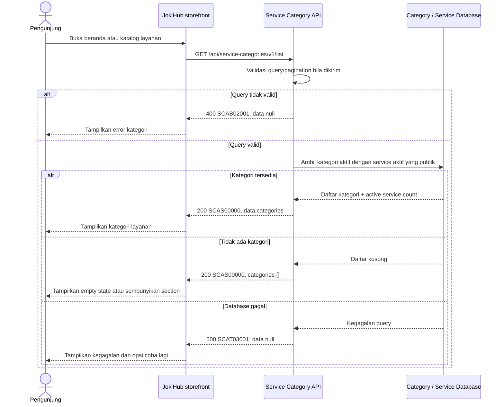

# Service Catalog Service - Get List Service Categories Interface Agreement

> **Document Type:** API Contract  
> **Status:** Draft  
> **Service / Domain:** Service Catalog — Service Categories  
> **Consumer / Partner:** JokiHub public storefront

## Design

API ini mengambil kategori layanan yang tersedia untuk pengunjung storefront, misalnya Joki Game, Top Up Game, dan Voucher Game. Kategori harus aktif dan memiliki minimal satu layanan aktif yang dapat ditampilkan/dipesan. Endpoint dapat dipakai untuk section kategori beranda dan filter katalog. Response hanya memuat metadata publik kategori dan count layanan; detail harga/layanan dimiliki API service listing. ERD kategori belum menyimpan icon key atau urutan tampilan khusus storefront, sehingga field tersebut perlu ditambahkan atau dikelola melalui konfigurasi presentasi yang disetujui.

## Sequence Diagram



## Performance / SLA Targets

| Success Rate                                | VUser                                 | CPU / Memory                            | Response Time                                                                             |
| ------------------------------------------- | ------------------------------------- | --------------------------------------- | ----------------------------------------------------------------------------------------- |
| TBD; confirm service criticality and target | TBD; confirm peak concurrent visitors | TBD; define after capacity estimate/NFT | TBD; proposed less-critical web baseline: ideal 200 ms, acceptable 1 s, max tolerable 2 s |

## General Information

| Component          | Value                                                                                                |
| ------------------ | ---------------------------------------------------------------------------------------------------- |
| Description        | Mengambil kategori layanan publik yang aktif dan memiliki layanan aktif.                             |
| Resource URL       | `https://{host}/api/service-categories/v1/list`                                                      |
| Transport Protocol | HTTPS, REST                                                                                          |
| Request Verb       | GET                                                                                                  |
| Content Type       | `application/json`                                                                                   |
| Interaction Type   | Synchronous                                                                                          |
| Security Policy    | Public read API; rate limiting, cache policy, dan input validation. Tidak mengembalikan data privat. |

### Path / Endpoint

| Section        | Value                             |
| -------------- | --------------------------------- |
| Host / Domain  | `{host}` (environment-specific)   |
| Service Name   | Service Catalog                   |
| Version        | `v1`                              |
| Resource       | `/service-categories/v1/list`     |
| Final Endpoint | `/api/service-categories/v1/list` |

### API Versioning

- **Decision:** New Endpoint
- **Previous Endpoint:** Tidak ada public API kategori layanan yang teridentifikasi; beranda menggunakan data kategori presentasional statis.
- **Final Endpoint:** `GET /api/service-categories/v1/list`
- **Backward Compatibility:** Belum ada consumer API public category list yang teridentifikasi. Penambahan field response opsional kompatibel; perubahan slug/field wajib atau semantik membutuhkan koordinasi consumer.
- **Reason:** Storefront membutuhkan kategori dari catalog source of truth, bukan daftar statis UI.

## Business Rules

1. Hanya kategori dengan `is_active=true` dan `deleted_at IS NULL` yang tersedia untuk publik.
2. Kategori hanya dikembalikan bila memiliki minimal satu `game_service` yang aktif, belum dihapus, dan memenuhi aturan publishability storefront. Definisi publishability service mengikuti service catalog.
3. `serviceCount` menghitung hanya layanan aktif/publik yang terkait dengan kategori, bukan seluruh row service termasuk inactive/deleted.
4. Kategori diurutkan oleh field display order yang stabil, lalu `name ASC`, lalu `categoryId ASC`. ERD belum memiliki `sort_order`; penambahannya atau sumber urutan lain perlu keputusan product/catalog owner.
5. `id`, `name`, `slug`, dan `description` bersumber dari `SERVICE_CATEGORY`. `slug` stabil untuk URL/filter; perubahan slug setelah publikasi memerlukan redirect/compatibility policy.
6. `iconKey` adalah asset key yang disetujui dan bukan URL arbitrary. Jika mapping ikon dikelola frontend, API boleh tidak mengirim field ini.
7. Kategori dan layanan yang tidak aktif, terhapus, belum dipublikasikan, atau hanya untuk admin tidak boleh bocor ke response publik.
8. Tanpa query parameter, API mengembalikan seluruh kategori publik. Pagination tidak diperlukan untuk jumlah kategori yang kecil; bila kategori bertambah, pagination dapat ditambahkan di versi kompatibel.
9. Jika kategori aktif tidak punya layanan aktif, kategori disembunyikan dari storefront untuk menghindari navigasi kosong.
10. Description dan display name diperlakukan sebagai teks biasa; frontend harus melakukan escaping. Tidak mengembalikan markup HTML aktif.
11. Response kosong merupakan sukses dengan `categories: []`.
12. Cache dapat digunakan karena data berubah melalui admin catalog; invalidation/TTL dan target freshness TBD.

## Request Headers

| Header            | E/N/T | Type   | M/O/C | Max Length | Description                                               | Example            |
| ----------------- | ----- | ------ | ----- | ---------: | --------------------------------------------------------- | ------------------ |
| `Accept`          | N     | String | O     |        100 | Response media type. Defaults to JSON.                    | `application/json` |
| `Accept-Language` | N     | String | O     |         35 | Bahasa display copy; kategori saat ini diasumsikan id-ID. | `id-ID`            |

## Request Parameters

None.

## Request Query Parameters

None. Endpoint mengembalikan seluruh kategori yang memenuhi kriteria publik.

## Request Body

None. GET request has no body.

### Request Validation

1. Tidak ada parameter request yang wajib.
2. Query parameter tak dikenal ditolak dengan HTTP 400 `SCAB02001`; perilaku ini perlu dikonfirmasi API owner bila konsistensi public API mengharuskan ignore.
3. Database query harus membatasi kategori dan service pada record aktif/non-deleted/public sebelum menghitung `serviceCount`.
4. Aggregate count tidak boleh menggandakan service akibat join tambahan; hitung distinct service ID.
5. Kegagalan database mengembalikan HTTP 500 `SCAT03001` tanpa detail internal.

## Response Body

Success responses always use `status` and `data`. `data.categories` may be empty. Response berisi metadata kategori publik dan count layanan aktif.

| Attribute                        | E/N/T | Type        | M/O/C |           Max Length | Description                                                      | Example                        |
| -------------------------------- | ----- | ----------- | ----- | -------------------: | ---------------------------------------------------------------- | ------------------------------ |
| `status`                         | N     | Object      | M     |                    — | Response status.                                                 | `{}`                           |
| `status.code`                    | N     | String      | M     |                   20 | Service status code.                                             | `SCAS00000`                    |
| `status.message`                 | N     | String      | O     |                  200 | Human-readable result.                                           | `Service categories retrieved` |
| `data`                           | N     | Object/null | M     |                    — | Result payload; null on errors.                                  | `{}`                           |
| `data.categories`                | N     | Array       | M     | 100 items (proposed) | Public category list; empty when no category has active service. | `[]`                           |
| `data.categories[].id`           | N     | String      | M     |                   64 | Stable category identifier.                                      | `cat_01JXYZ`                   |
| `data.categories[].name`         | N     | String      | M     |                  100 | Display name.                                                    | `Top Up Game`                  |
| `data.categories[].slug`         | N     | String      | M     |                  100 | URL-safe category identifier.                                    | `top-up-game`                  |
| `data.categories[].description`  | N     | String/null | O     |                  500 | Public category description.                                     | `Isi ulang game favoritmu.`    |
| `data.categories[].iconKey`      | N     | String/null | O     |                  160 | Approved icon asset key, jika dimodelkan/dikelola katalog.       | `top-up`                       |
| `data.categories[].serviceCount` | N     | Integer     | M     |            10 digits | Jumlah layanan aktif dan publik pada kategori.                   | `18`                           |
| `data.categories[].sortOrder`    | N     | Integer     | O     |            10 digits | Urutan display; field/source perlu ditetapkan.                   | `1`                            |

### Success Example

```json
{
  "status": {
    "code": "SCAS00000",
    "message": "Service categories retrieved"
  },
  "data": {
    "categories": [
      {
        "id": "cat_01JXYZ",
        "name": "Top Up Game",
        "slug": "top-up-game",
        "description": "Isi ulang game favoritmu.",
        "iconKey": "top-up",
        "serviceCount": 18,
        "sortOrder": 1
      },
      {
        "id": "cat_01JABC",
        "name": "Joki Game",
        "slug": "joki-game",
        "description": "Layanan joki game pilihan.",
        "iconKey": "joki",
        "serviceCount": 15,
        "sortOrder": 2
      }
    ]
  }
}
```

### Business Error Example

```json
{
  "status": {
    "code": "SCAB02001",
    "message": "Unsupported query parameter"
  },
  "data": null
}
```

### Technical Error Example

```json
{
  "status": {
    "code": "SCAT03001",
    "message": "Service catalog is temporarily unavailable"
  },
  "data": null
}
```

## HTTP Status Codes

| HTTP Status | Usage                                                       |
| ----------- | ----------------------------------------------------------- |
| `200`       | Request valid; category list may be empty.                  |
| `400`       | Unsupported query parameter, if query parameters are added. |
| `500`       | Unexpected service or catalog database failure.             |

## Service Status Codes

Format: `[Service Prefix][Status Type][Category][Specific Error Code]`

| Code        | Type      | Category        | Meaning                                                               |
| ----------- | --------- | --------------- | --------------------------------------------------------------------- |
| `SCAS00000` | Success   | General         | Daftar kategori layanan berhasil dikembalikan.                        |
| `SCAB02001` | Business  | User validation | Query parameter tidak didukung/tidak valid.                           |
| `SCAT03001` | Technical | Database        | Kategori atau service availability gagal dibaca/database unavailable. |

## API Exposure Classification

| Classification | Rationale                                                                                                 |
| -------------- | --------------------------------------------------------------------------------------------------------- |
| Public         | Storefront membaca metadata kategori dan ketersediaan layanan yang dipublikasikan; tidak ada data privat. |

## Testing & Documentation Scope

| Scope      | Required | Rationale / Handoff                                                                                                                                                   |
| ---------- | -------- | --------------------------------------------------------------------------------------------------------------------------------------------------------------------- |
| NFT        | Yes      | Uji latency query category-service aggregate, cache hit/miss, kategori tanpa layanan, dan peak storefront traffic. TPS dan resource target menunggu traffic forecast. |
| VA/Pentest | Yes      | Public API. Uji inactive/deleted category leakage, inactive service count leakage, injection, asset reference handling, caching, dan excessive data exposure.         |

## Assumptions

- Endpoint `/api/service-categories/v1/list`, envelope, prefix `SCA`, field response, dan status codes adalah usulan; API owner perlu menyetujui.
- [Service Category ERD](../../erd/service-category-erd.md) dan [Service ERD](../../erd/service-erd.md) menjadi sumber kategori dan relasi service. `is_active` serta `deleted_at` mengatur kelayakan storefront.
- Kategori UI di `HomeV2` berupa static presentational data dengan title/detail/icon, bukan bukti bahwa data kategori atau klaim ketersediaan telah dikonfirmasi.
- Category sort order, icon asset key, localization, service publishability, category count semantics, cache invalidation/TTL, rate limits, dan traffic targets masih TBD.
- Listing detail service/game, pencarian kategori, pagination, admin CRUD, dan category analytics berada di luar scope endpoint ini.

## References

- `../../erd/service-category-erd.md` — category attributes, active/deleted behavior, and service count notes.
- `../../erd/service-erd.md` — active service and category relationship.
- `src/features/HomeV2/views/interfaces/homeV2.interface.ts` — category card presentation fields.
- `src/features/HomeV2/views/organisms/ServiceCategories.organism.tsx` — public homepage category section.
- `src/features/HomeV2/views/molecules/CategoryCard.molecule.tsx` — category display and current navigation behavior.
- `docs/sprint_1/solutioning/public/games/get-list-games.md` — public catalog endpoint conventions.
- `docs/sprint_1/solutioning/TEMPLATE.md` — API contract template.
