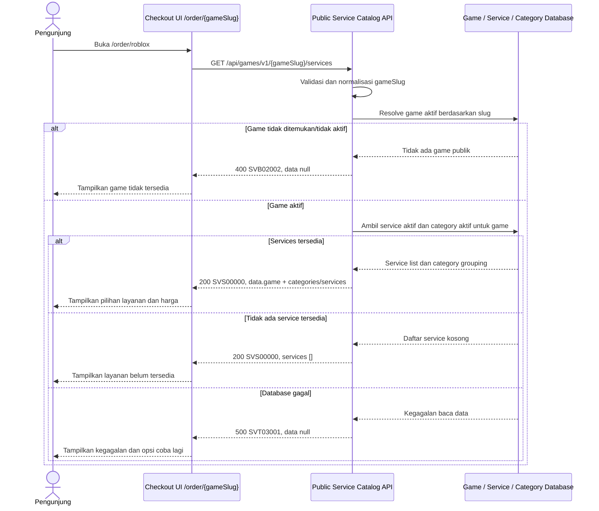

# Service Catalog Service - Get List Services by Game Interface Agreement

> **Document Type:** API Contract  
> **Status:** Draft  
> **Service / Domain:** Service Catalog — Public Game Services  
> **Consumer / Partner:** JokiHub storefront checkout (`/order/:gameSlug`)

## Design

API ini menyediakan layanan publik yang tersedia untuk game dari route `/order/{gameSlug}`. Contohnya, `/order/roblox` memuat game berdasarkan slug `roblox` lalu menampilkan service aktif yang dapat dipesan. Service dikelompokkan berdasarkan kategori untuk dipilih di checkout. Harga fixed dan quote/custom price dibedakan dengan jelas; endpoint tidak mengarang harga untuk service custom. Game, kategori, atau service nonaktif/tidak dipublikasikan tidak tersedia untuk pemesanan baru.

## Sequence Diagram



## Performance / SLA Targets

| Success Rate                                | VUser                                 | CPU / Memory                            | Response Time                                                                             |
| ------------------------------------------- | ------------------------------------- | --------------------------------------- | ----------------------------------------------------------------------------------------- |
| TBD; confirm service criticality and target | TBD; confirm peak concurrent visitors | TBD; define after capacity estimate/NFT | TBD; proposed less-critical web baseline: ideal 200 ms, acceptable 1 s, max tolerable 2 s |

## General Information

| Component          | Value                                                                                                |
| ------------------ | ---------------------------------------------------------------------------------------------------- |
| Description        | Mengambil game dan daftar layanan publik yang dapat dipesan berdasarkan game slug.                   |
| Resource URL       | `https://{host}/api/games/v1/{gameSlug}/services`                                                    |
| Transport Protocol | HTTPS, REST                                                                                          |
| Request Verb       | GET                                                                                                  |
| Content Type       | `application/json`                                                                                   |
| Interaction Type   | Synchronous                                                                                          |
| Security Policy    | Public read API; rate limiting, cache policy, dan input validation. Tidak mengembalikan data privat. |

### Path / Endpoint

| Section        | Value                               |
| -------------- | ----------------------------------- |
| Host / Domain  | `{host}` (environment-specific)     |
| Service Name   | Game / Service Catalog              |
| Version        | `v1`                                |
| Resource       | `/games/v1/{gameSlug}/services`     |
| Final Endpoint | `/api/games/v1/{gameSlug}/services` |

### API Versioning

- **Decision:** New Endpoint
- **Previous Endpoint:** Tidak ada public API service-by-game yang teridentifikasi; `/order/:gameSlug` saat ini memakai daftar game dan service statis.
- **Final Endpoint:** `GET /api/games/v1/{gameSlug}/services`
- **Backward Compatibility:** Belum ada consumer API teridentifikasi. Endpoint popular games dan category list tetap terpisah. Field response opsional dapat ditambahkan secara kompatibel.
- **Reason:** Checkout membutuhkan katalog service yang terikat pada game route dan tervalidasi server-side.

## Business Rules

1. `gameSlug` adalah slug publik dari `GAME_CATALOG.slug`; lookup case-insensitive dapat dinormalisasi lowercase. Slug harus unik.
2. Hanya game aktif/publik dan tidak terhapus yang dapat digunakan untuk order baru.
3. Hanya service dengan `is_active=true`, `deleted_at IS NULL`, dan game yang cocok dengan slug tersebut yang dikembalikan.
4. Service hanya ditampilkan bila category-nya aktif dan tidak terhapus. Aturan kategori nonaktif tidak mengubah historical order snapshots.
5. Service diurutkan deterministik menurut category display order/name, kemudian service display order/name dan ID. ERD belum memiliki `sort_order` service/category; aturan final perlu disepakati atau field urutan ditambahkan.
6. Satu service berada pada satu game dan satu kategori sesuai model UI saat ini. Jika model bisnis mengizinkan multi-game/category, relasi perlu diubah dan kontrak diperbarui.
7. Harga fixed mengembalikan `priceAmount` dan `currency`. Currency mengikuti konfigurasi platform yang telah dikonfirmasi; saat ini IDR hanya asumsi UI.
8. Service dengan `isCustomPrice=true` mengembalikan `priceAmount: null` dan `pricingType: QUOTE_REQUIRED`. UI harus mengarahkan pengguna ke quote/contact flow, bukan menghitung total atau melanjutkan payment flow dengan harga buatan.
9. `estimateText` merupakan teks estimasi tampilan, bukan SLA/garansi penyelesaian.
10. Response menyediakan category ID/name/slug serta service ID/name agar UI tidak bergantung pada daftar statis. Kategori tanpa service yang eligible tidak disertakan.
11. Nilai `gameSlug` yang valid tetapi game tidak ada, tidak aktif, atau tidak dipublikasikan diperlakukan sebagai resource tidak tersedia. Apakah dikembalikan 404 atau baseline 400 perlu keputusan API owner.
12. Tanpa pagination pada kontrak awal karena jumlah layanan per game diasumsikan terbatas. Jika katalog membesar, pagination dapat ditambahkan secara kompatibel.
13. Data yang dikembalikan adalah snapshot catalog saat request; pembuatan order wajib memvalidasi ulang game/service aktif dan mengambil harga authoritative dari server.
14. Game artwork/category icon hanya dikembalikan sebagai approved asset key, bukan arbitrary URL.
15. Cache dapat digunakan untuk katalog publik; perubahan service/category/game harus meng-invalidate cache sesuai TTL/freshness target TBD.

## Request Headers

| Header            | E/N/T | Type   | M/O/C | Max Length | Description                                              | Example            |
| ----------------- | ----- | ------ | ----- | ---------: | -------------------------------------------------------- | ------------------ |
| `Accept`          | N     | String | O     |        100 | Response media type. Defaults to JSON.                   | `application/json` |
| `Accept-Language` | N     | String | O     |         35 | Preferred localized display copy; fallback behavior TBD. | `id-ID`            |

## Request Parameters

| Parameter  | E/N/T | Type   | M/O/C | Max Length | Description                                                   | Example  |
| ---------- | ----- | ------ | ----- | ---------: | ------------------------------------------------------------- | -------- |
| `gameSlug` | N     | String | M     |        100 | Slug game dari route order; URL-decode, trim, lalu lowercase. | `roblox` |

## Request Query Parameters

None. Endpoint mengembalikan semua service yang dapat dipilih untuk game tersebut.

## Request Body

None. GET request has no body.

### Request Validation

1. `gameSlug` wajib, tidak kosong, maksimal 100 karakter, dan mengikuti format slug `^[a-z0-9]+(?:-[a-z0-9]+)*$` setelah normalisasi. Nilai malformed mengembalikan `SVB02001`.
2. Slug harus resolve ke game aktif/publik. Game tidak ditemukan atau tidak tersedia mengembalikan `SVB02002`.
3. Query parameter yang tidak didukung ditolak dengan `SVB02001`; konfirmasi jika konvensi public API memilih untuk mengabaikan parameter tak dikenal.
4. Query harus membatasi service dan category ke record aktif/non-deleted/publik sebelum grouping.
5. Untuk fixed-price service, `priceAmount` harus tersedia dan non-negative. Untuk quote service, `priceAmount` harus null. Data catalog yang melanggar invariant tidak boleh dipresentasikan sebagai harga valid; catat data integrity error dan keluarkan/return safe service error sesuai kebijakan.
6. Hasil kosong untuk game aktif adalah sukses dengan `categories: []` dan `totalServices: 0`.
7. Query grouping tidak boleh menggandakan service karena join kategori atau asset.
8. Kegagalan database mengembalikan HTTP 500 `SVT03001` tanpa detail internal.

## Response Body

Success responses use `status` and `data`. Response memuat game yang ditemukan serta kategori dan service aktif; daftar dapat kosong.

| Attribute                                    | E/N/T | Type               | M/O/C |                Max Length | Description                                                | Example                        |
| -------------------------------------------- | ----- | ------------------ | ----- | ------------------------: | ---------------------------------------------------------- | ------------------------------ |
| `status`                                     | N     | Object             | M     |                         — | Response status.                                           | `{}`                           |
| `status.code`                                | N     | String             | M     |                        20 | Service status code.                                       | `SVS00000`                     |
| `status.message`                             | N     | String             | O     |                       200 | Human-readable result.                                     | `Game services retrieved`      |
| `data`                                       | N     | Object/null        | M     |                         — | Result payload; null on errors.                            | `{}`                           |
| `data.game`                                  | N     | Object             | M     |                         — | Resolved public game identity and display fields.          | `{}`                           |
| `data.game.id`                               | N     | String             | M     |                        64 | Stable game catalog ID.                                    | `game_01JXYZ`                  |
| `data.game.name`                             | N     | String             | M     |                       100 | Game display name.                                         | `Roblox`                       |
| `data.game.slug`                             | N     | String             | M     |                       100 | Canonical slug.                                            | `roblox`                       |
| `data.game.artworkKey`                       | N     | String/null        | O     |                       160 | Approved game artwork key.                                 | `roblox`                       |
| `data.categories`                            | N     | Array              | M     | 100 categories (proposed) | Categories with eligible services for game.                | `[]`                           |
| `data.categories[].id`                       | N     | String             | M     |                        64 | Category ID.                                               | `cat_01JXYZ`                   |
| `data.categories[].name`                     | N     | String             | M     |                       100 | Category display name.                                     | `Top Up Game`                  |
| `data.categories[].slug`                     | N     | String             | M     |                       100 | Category URL/filter slug.                                  | `top-up-game`                  |
| `data.categories[].services`                 | N     | Array              | M     |   500 services (proposed) | Active services in category for selected game.             | `[]`                           |
| `data.categories[].services[].id`            | N     | String             | M     |                        64 | Service ID.                                                | `svc_01JXYZ`                   |
| `data.categories[].services[].name`          | N     | String             | M     |                       150 | Public service name.                                       | `Robux 400`                    |
| `data.categories[].services[].description`   | N     | String/null        | O     |                       500 | Public detail/short description, if modeled.               | `Top up Robux ke akun Roblox.` |
| `data.categories[].services[].pricingType`   | N     | String             | M     |                        20 | `FIXED` or `QUOTE_REQUIRED`.                               | `FIXED`                        |
| `data.categories[].services[].priceAmount`   | N     | Decimal/null       | C     |                      18,2 | Fixed amount; null for quote-required service.             | `25000.00`                     |
| `data.categories[].services[].currency`      | N     | String/null        | C     |                         3 | ISO 4217 currency for fixed-price service; null for quote. | `IDR`                          |
| `data.categories[].services[].estimateText`  | N     | String             | M     |                       100 | Customer-facing estimate text.                             | `Instan`                       |
| `data.categories[].services[].isCustomPrice` | N     | Boolean            | M     |                         — | Indicates quote/custom price.                              | `false`                        |
| `data.totalServices`                         | N     | Integer            | M     |                 10 digits | Total eligible service count across categories.            | `5`                            |
| `data.dataAsOf`                              | N     | String (date-time) | O     |                        35 | Catalog snapshot time in ISO 8601 UTC, if available.       | `2026-10-12T09:45:00Z`         |

### Success Example

```json
{
  "status": {
    "code": "SVS00000",
    "message": "Game services retrieved"
  },
  "data": {
    "game": {
      "id": "game_01JXYZ",
      "name": "Roblox",
      "slug": "roblox",
      "artworkKey": "roblox"
    },
    "categories": [
      {
        "id": "cat_01JXYZ",
        "name": "Top Up Game",
        "slug": "top-up-game",
        "services": [
          {
            "id": "svc_01JXYZ",
            "name": "Robux 400",
            "description": "Top up Robux ke akun Roblox.",
            "pricingType": "FIXED",
            "priceAmount": 25000.0,
            "currency": "IDR",
            "estimateText": "Instan",
            "isCustomPrice": false
          }
        ]
      },
      {
        "id": "cat_01JABC",
        "name": "Joki Game",
        "slug": "joki-game",
        "services": [
          {
            "id": "svc_01JABC",
            "name": "Joki Star (Custom)",
            "description": null,
            "pricingType": "QUOTE_REQUIRED",
            "priceAmount": null,
            "currency": null,
            "estimateText": "Hubungi admin untuk estimasi",
            "isCustomPrice": true
          }
        ]
      }
    ],
    "totalServices": 2,
    "dataAsOf": "2026-10-12T09:45:00Z"
  }
}
```

### Business Error Example

```json
{
  "status": {
    "code": "SVB02002",
    "message": "Game is not available"
  },
  "data": null
}
```

### Technical Error Example

```json
{
  "status": {
    "code": "SVT03001",
    "message": "Service catalog is temporarily unavailable"
  },
  "data": null
}
```

## HTTP Status Codes

| HTTP Status | Usage                                                                                       |
| ----------- | ------------------------------------------------------------------------------------------- |
| `200`       | Game aktif ditemukan; daftar layanan dapat kosong.                                          |
| `400`       | Slug malformed atau query tidak didukung sesuai baseline API.                               |
| `404`       | Game slug tidak ditemukan/tidak aktif bila API standard mengadopsi resource HTTP semantics. |
| `500`       | Unexpected service or catalog database failure.                                             |

## Service Status Codes

Format: `[Service Prefix][Status Type][Category][Specific Error Code]`

| Code       | Type      | Category        | Meaning                                                       |
| ---------- | --------- | --------------- | ------------------------------------------------------------- |
| `SVS00000` | Success   | General         | Daftar layanan untuk game berhasil dikembalikan.              |
| `SVB02001` | Business  | User validation | Game slug malformed atau parameter tidak valid.               |
| `SVB02002` | Business  | User validation | Game tidak ditemukan, tidak aktif, atau tidak dipublikasikan. |
| `SVT03001` | Technical | Database        | Game/service/category gagal dibaca atau database unavailable. |

## API Exposure Classification

| Classification | Rationale                                                                           |
| -------------- | ----------------------------------------------------------------------------------- |
| Public         | Checkout storefront reads publicly available game/service catalog and pricing data. |

## Testing & Documentation Scope

| Scope      | Required | Rationale / Handoff                                                                                                                                                                                   |
| ---------- | -------- | ----------------------------------------------------------------------------------------------------------------------------------------------------------------------------------------------------- |
| NFT        | Yes      | Uji popular game slug, nested category/service query, cache hit/miss, banyak service per game, dan peak checkout load. TPS, resource, dan response-time targets TBD.                                  |
| VA/Pentest | Yes      | Public pricing/catalog API. Uji slug validation, inactive game/service/category leakage, price integrity, quote-price handling, injection, enumeration, cache poisoning, dan excessive data exposure. |

## Assumptions

- Endpoint `/api/games/v1/{gameSlug}/services`, response envelope, prefix `SV`, and error codes are proposals; API owner review required.
- Route `/order/:gameSlug` currently uses static demo data. This contract replaces that data source; `/order/roblox` resolves slug from public `GAME_CATALOG`.
- [Service ERD](../../erd/service-erd.md), [Game ERD](../../erd/game-erd.md), and [Service Category ERD](../../erd/service-category-erd.md) define proposed catalog source fields and active-state rules.
- Service `description`, service/category ordering, currency storage, game artwork, public/published status, and category slug usage need confirmation; some response fields are derived/proposed for checkout UI.
- Current Checkout UI treats custom service as quote/contact and does not define backend quote workflow. Quote-required service must not enter priced checkout until that flow is designed.
- Pricing authority at order submission, inventory/availability race handling, tax/fees, authentication, cache invalidation, SLA, and HTTP error mapping are TBD or owned by order/payment contracts.
- Endpoint only reads service catalog for one game; it does not create orders, reserve stock, accept credentials, or process payment.

## References

- `src/app/order/[gameSlug]/page.tsx` — route passes dynamic `gameSlug` to checkout page.
- `src/features/Checkout/views/pages/Checkout.page.tsx` — current mock game/service data and selection behavior.
- `src/features/Checkout/views/interfaces/checkout.interface.ts` — checkout game/service UI types.
- `../../erd/game-erd.md` — public game slug and active state.
- `../../erd/service-erd.md` — service-game, price, estimate, and active fields.
- `../../erd/service-category-erd.md` — service category association and active behavior.
- `docs/sprint_1/solutioning/public/games/get-list-games.md` — public catalog API conventions.
- `docs/sprint_1/solutioning/TEMPLATE.md` — API contract template.
